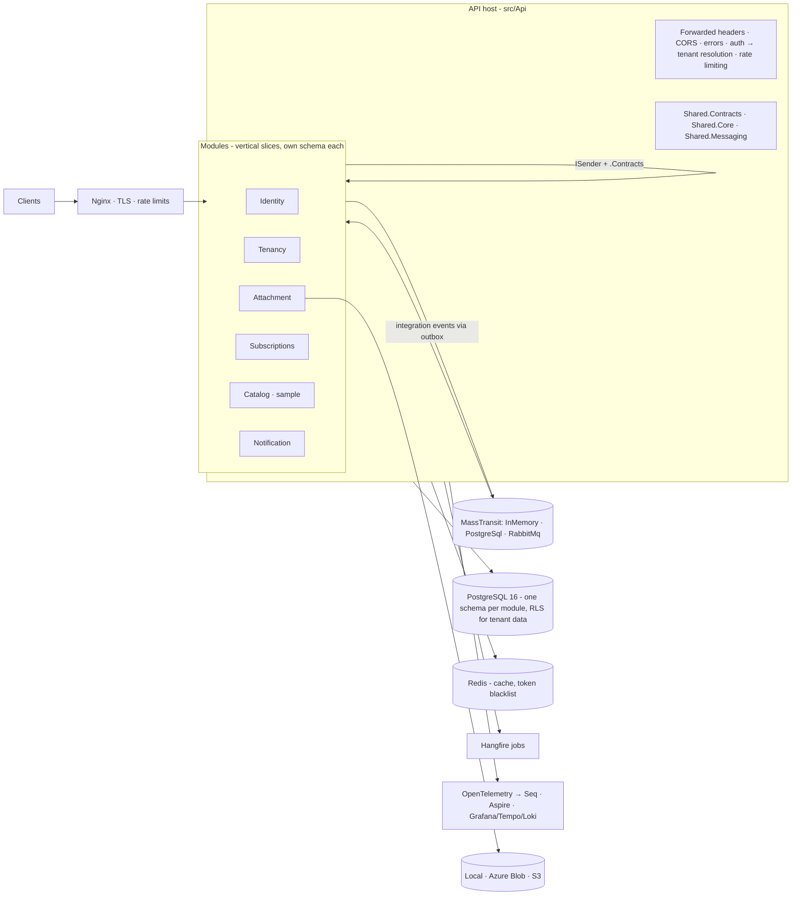

# StarterKit

[](https://github.com/mhasabalah/StarterKit/actions/workflows/hybrid-ci-cd.yml)


[](LICENSE)

A production-ready **ASP.NET Core 10 modular monolith starter**. Clone it, rename it, and build features on top of:
- identity (JWT + rotating refresh tokens, permissions, 2FA)
- optional **multi-tenancy** (tenants, branches, row-level security, shared or dedicated databases)
- files, subscriptions and billing, email + WhatsApp notifications
- a **transactional outbox**, background jobs and full observability
- a complete Docker / Nginx / GitHub Actions deployment pipeline

It also ships a guardrailed **Claude Code plugin**: skills that scaffold modules, features, migrations, events and
tests the way this codebase expects them.

## Architecture



**Key ideas:**
- Modules talk only through `.Contracts` (`ISender`) or integration events delivered at-least-once through the
  outbox.
- Every module owns its DbContext and schema.
- Tenant data is isolated by named EF filters **and** Postgres RLS.
- These rules are enforced by architecture tests.

The reasons behind them are in [`wiki/Decisions`](wiki/Decisions/README.md).

## Modules

| Module | What it does | Docs |
|---|---|---|
| **Identity** | Register/login, JWT + rotating refresh tokens, token blacklist, roles → fine-grained permissions, 2FA (TOTP), OTP, email confirmation, admin and user management, audited impersonation, external login hooks, session/device management, API keys (scoped PATs), KMS-protected Data Protection keys | [wiki/Identity](wiki/Identity/README.md) |
| **Tenancy** | Tenants, branch trees, memberships, tenant roles, invitations, custom domains, export/deletion/move, audit (multi-tenancy control plane) | [wiki/Modules/Tenancy](wiki/Modules/Tenancy.md) |
| **Attachment** | Validated uploads (magic bytes), thumbnails, anonymous pending uploads, entity access policies, reconciliation; Local / Azure Blob / S3 | [wiki/Attachment](wiki/Attachment/README.md) |
| **Subscriptions** | Plans and features, subscription lifecycle, proof-based payments, invoices, refunds, price changes, append-only ledger, Stripe + Paymob adapters, trials, coupons, dunning, usage metering and quotas | [wiki/Modules/Subscriptions](wiki/Modules/Subscriptions.md) |
| **Webhooks** | Customer webhook endpoints per tenant, Standard Webhooks signatures, retries with backoff, delivery log, SSRF guard, auto-disable | [wiki/Modules/Webhooks](wiki/Modules/Webhooks.md) |
| **Notification** | Every email (Liquid templates, en/ar) and WhatsApp delivery, user channel preferences, delivery log | [wiki/Modules/Notification](wiki/Modules/Notification.md) |
| **Catalog** (sample) | Products (moderation workflow, gallery, attributes, soft delete), categories, tags, wishlist: the **reference vertical slice** | [wiki/Modules/Catalog](wiki/Modules/Catalog.md) |

**Tech stack:** .NET 10, ASP.NET Core minimal APIs (Carter), an owned mediator (`Shared.Contracts.Mediation`), FluentValidation, Mapster, EF Core 10 + Npgsql
(snake_case), PostgreSQL 16, Redis 7, MassTransit, Hangfire, OpenTelemetry, Seq, .NET Aspire, Docker, Nginx, and
GitHub Actions. Details: [TechnologyStack](wiki/Architecture/TechnologyStack.md).

## Quick start

### Prerequisites

| Tool | Version | Needed for |
|---|---|---|
| .NET SDK | 10.0.x (pinned in `global.json`) | build, run, test |
| Docker | 24+ with Compose v2 | Aspire resources, compose, integration/E2E tests |
| `dotnet-ef` | 10.x | migrations (`dotnet tool install -g dotnet-ef`) |
| Node.js | 20+ | optional, Playwright smoke tests only |

### Option 1: .NET Aspire (recommended for development)

```bash
cd src/Aspire/AppHost
dotnet run                                          # API + PostgreSQL (db "starterkit") + Redis + Seq
dotnet run -- Observability:FullStack=true          # + Grafana, Prometheus, Tempo, Loki, Jaeger
```

The Aspire dashboard shows logs, traces and metrics. Each module migrates its schema and seeds on startup. Details:
[wiki/Infrastructure/Aspire](wiki/Infrastructure/Aspire.md).

### Option 2: Docker Compose

```bash
cp .env.example .env          # replace CHANGE_ME values
docker compose up -d          # docker-compose.override.yml (dev tools) is merged automatically
```

| Service | URL with `.env.example` ports |
|---|---|
| API · Swagger · Scalar · health | http://localhost:5000 · `/swagger` · `/scalar` · `/health`, `/alive` |
| Seq (logs) | http://localhost:5342 |
| pgAdmin | http://localhost:5050 |
| Redis Commander | http://localhost:8081 |
| Mailhog | http://localhost:8025 |

Postgres, Redis and Seq use offset dev ports in `.env.example` (5433, 6380, 5342) to avoid clashing with locally
installed services; without `.env` the compose defaults are the standard ports. The full matrix and the overlays
(observability, RabbitMQ, Data Protection) are in [Docker-Compose](wiki/deployment/Docker-Compose.md).

### Build and test

```bash
dotnet build StarterKit.slnx
dotnet test StarterKit.slnx            # needs Docker (Testcontainers)
```

## Configuration

| Setting | Default | Purpose |
|---|---|---|
| `ConnectionStrings:starterkit` | local Postgres | One database shared by all module schemas |
| `MultiTenancy:Enabled` | `false` | Off = single tenant (the Default tenant). On = tenants, branches, memberships ([guide](wiki/MultiTenancy/Overview.md)) |
| `Messaging:Transport` | `InMemory` | `PostgreSql` or `RabbitMq` in production. `InMemory` is not durable |
| Attachment storage provider | Local | Local / AzureBlob / S3 ([guide](wiki/Attachment/Storage-Providers.md)) |
| `Observability:*` | OTLP + Prometheus | Exporters and toggles ([guide](wiki/Architecture/Observability.md)) |
| `RateLimiting:Policies` | `create`, `search`, `upload`, `auth`, `otp` | Per-user or per-IP limits |
| Secrets | `./secrets/*.txt` (Docker secrets) | JWT key, DB/Redis/RabbitMQ passwords, Data Protection cert ([guide](wiki/deployment/Secrets.md)) |

## Testing

| Level | Where | Run |
|---|---|---|
| Unit | `src/Modules/<M>/<M>.Tests` | `dotnet test src/Modules/Catalog/Catalog.Tests` |
| Integration (real Postgres) | `src/Modules/<M>/<M>.IntegrationTests` (Catalog, Identity, Subscriptions, Tenancy, Webhooks) | `dotnet test src/Modules/Tenancy/Tenancy.IntegrationTests` |
| Architecture guardrails | `src/Api.Tests/Architecture` | `dotnet test src/Api.Tests` |
| HTTP end-to-end (+ multi-tenant) | `src/Api.E2ETests` | `dotnet test src/Api.E2ETests` |
| Shared kernel / Aspire | `src/Shared/Shared.Core.Tests`, `src/Aspire/AppHost.Tests` | `dotnet test <project>` |
| Browser smoke | `tests/e2e` (Playwright) | `cd tests/e2e && npm ci && npx playwright test` |

To run a single test, add `--filter "FullyQualifiedName~<Name>"`. The strategy and the per-feature checklist are
in [wiki/Testing](wiki/Testing/Testing-Strategy.md).

## Project structure

```
src/
├── Api/                      # host: Program.cs, appsettings, Dockerfile
├── Api.Tests/                # architecture tests (guardrails)
├── Api.E2ETests/             # HTTP end-to-end tests
├── Aspire/                   # AppHost (+ tests), ServiceDefaults
├── Modules/
│   ├── Identity/             # Identity, Identity.Contracts, UserDirectory.Contracts, .Tests, .IntegrationTests
│   ├── Tenancy/              # multi-tenancy control plane (+ .Tests, .IntegrationTests)
│   ├── Attachment/           # + .Tests
│   ├── Subscriptions/        # + .Tests, .IntegrationTests
│   ├── Notification/         # + .Tests
│   └── Catalog/              # sample: + .Tests, .IntegrationTests
└── Shared/                   # Shared.Contracts, Shared.Core (+ .Tests), Shared.Messaging
tests/e2e/                    # Playwright smoke tests
infra/                        # Nginx, observability, pgAdmin configs
deployment/                   # deploy/rollback/backup scripts, production Nginx, .env.production.example
tools/claude/starterkit-plugin/   # Claude Code plugin: skills, reviewer agent, hooks
wiki/                         # developer documentation
```

`make help` lists Docker, database, cache and Nginx shortcuts.

## Building with Claude Code

[`CLAUDE.md`](CLAUDE.md) holds the rules. The repo-local **StarterKit plugin**
([`tools/claude/starterkit-plugin`](tools/claude/starterkit-plugin/README.md)) is enabled by
`.claude/settings.json`; trust the folder when prompted. It provides:

| Skill | For |
|---|---|
| `/starterkit:new-module` | a new bounded context, wired into the host and architecture tests |
| `/starterkit:add-aggregate` · `/starterkit:add-feature` | entities, then command/query slices with endpoints |
| `/starterkit:add-migration` | EF migrations with tenant RLS |
| `/starterkit:add-integration-event` · `/starterkit:add-background-job` | outbox events and consumers; tenant-aware Hangfire jobs |
| `/starterkit:add-permission` · `/starterkit:add-email-template` | authorization; notifications |
| `/starterkit:write-tests` · `/starterkit:review` | tests at every level; interactive senior review |
| `/starterkit:new-project` · `/starterkit:update-docs` | bootstrapping from the template; docs hygiene |

The plugin also contains an `architecture-reviewer` agent and hooks that block agent commits and flag forbidden
patterns. Other agents should read [`AGENTS.md`](AGENTS.md).

## Starting a new project

Follow [wiki/Getting-Started/New-Project.md](wiki/Getting-Started/New-Project.md), or run `/starterkit:new-project`.
In short:
1. Copy and rename.
2. Configure `.env` and `secrets/`.
3. Choose multi-tenancy, transport and storage.
4. Optionally remove Catalog.
5. Regenerate migrations.
6. Set up the GitHub environment, variables and runner.

## Deployment

Pushing to `master` runs build and test, builds the image to GHCR, waits for manual approval, then deploys to a VPS
through a self-hosted runner with health checks and rollback. Backups use pgBackRest to S3. Start at
[wiki/deployment](wiki/deployment/README.md).

Production does not migrate on boot: `Database:MigrateOnStartup=false`, and the compose `migrator` service runs
`dotnet Api.dll --migrate-only` once per deploy (under a Postgres advisory lock) before `api` starts
([Database migrations](wiki/deployment/Database-Migrations.md)). The API refuses to start in production with the
non-durable `InMemory` message transport.

## Documentation

- [wiki/README.md](wiki/README.md): where to start
- [wiki/INDEX.md](wiki/INDEX.md): every page
- [wiki/Decisions](wiki/Decisions/README.md): architecture decision records
- `bash scripts/check-docs.sh` (or `make docs-check`) validates links and placeholders

## Security

No real credentials are committed. `appsettings*.json`, `.env.example` and `deployment/.env.production.example`
contain placeholders only. Production secrets come from Docker secrets (`./secrets/*.txt`, git-ignored) or
environment variables. Report vulnerabilities privately; see [`.github/SECURITY.md`](.github/SECURITY.md).
Contributions: [`.github/CONTRIBUTING.md`](.github/CONTRIBUTING.md).

## License

[MIT](LICENSE). Projects created from the template may relicense their own code.
Most dependencies are MIT/Apache-2.0. QuestPDF and the Seq container are free only below a revenue threshold or for a
single user. Check [Third-party licenses](wiki/Reference/Third-Party-Licenses.md) before shipping a product.
