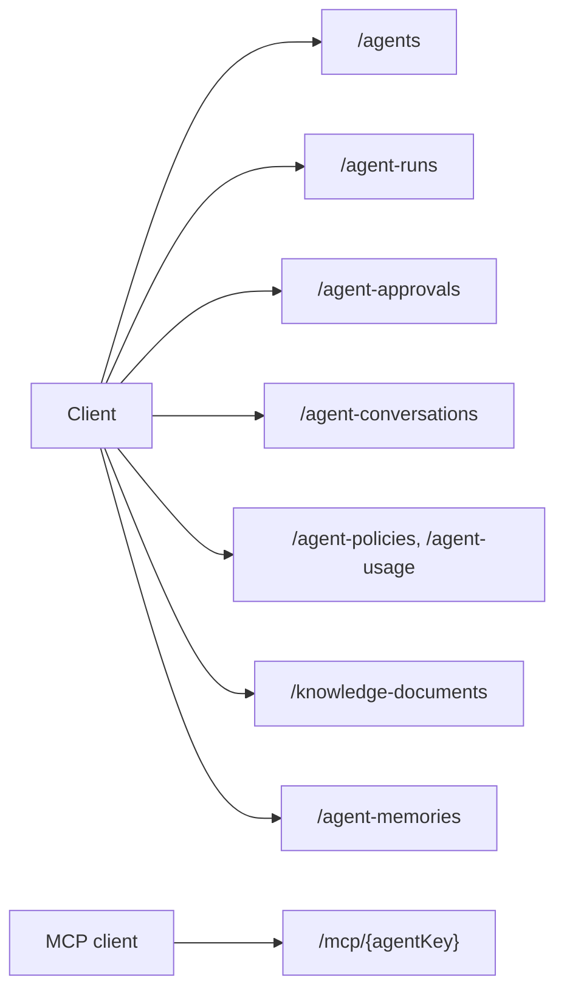
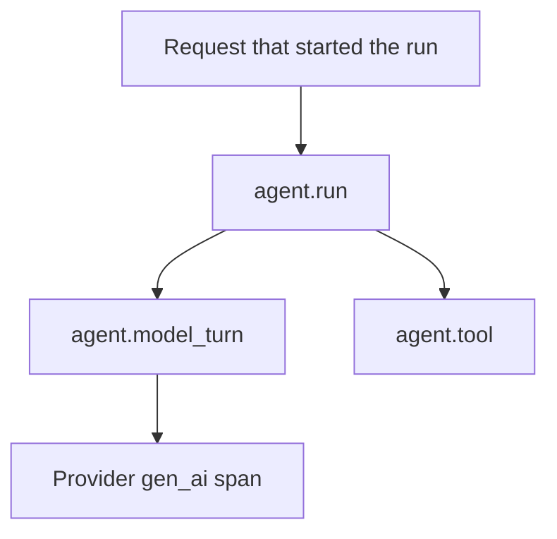

# API, permissions and observability

Every route of the module, who may call it, and what the module tells operators. Every route answers 404 while
`Agentic:Enabled` is false and needs the plan feature `agents` where noted.

Part of the [Agentic module](../Modules/Agentic.md). The full route list of the product:
[Endpoint authorization](../Reference/Endpoint-Authorization.md).

## Permissions and plan entitlements

| Tenant permission | Grants |
|---|---|
| `agentic.runs.start` | Start runs and conversations, use the MCP server, manage one's own memories |
| `agentic.runs.read` | Read every run and conversation of the tenant, and the usage report |
| `agentic.approvals.decide` | Decide approvals (together with the tool's own permission) |
| `agentic.manage` | Tenant policies, knowledge documents, tenant memories, cancelling someone else's run |

Owners and Administrators hold all four. Entitlement keys: `agents` (plan feature), `agent_runs` and `agent_tokens`
(quotas), `max_concurrent_agent_runs` (limit).

## Endpoints

*Figure: All routes are under `/api/v1`; the MCP route exists only while `Agentic:Mcp:Enabled` is on.*

| Route | Authorization |
|---|---|
| `GET /agents`, `GET /agents/{key}` | Tenant member, plan feature `agents`; only agents the caller may start |
| `POST /agent-runs` (202) | `agentic.runs.start` + the agent's `RequiredPermission`, plan feature `agents`, no impersonation, rate limit `create`, optional `Idempotency-Key` |
| `GET /agent-runs`, `/{id}`, `/{id}/steps` | Tenant member: own runs, or all with `agentic.runs.read`; someone else's run is 404. An API key without the read scope sees only the runs that key started. Filters: `agentKey`, `status`, `conversationId` |
| `POST /agent-runs/{id}/cancel` | Tenant member, no impersonation: the initiator, or anyone with `agentic.manage` |
| `GET /agent-approvals`, `/{id}` | Tenant member: all with `agentic.approvals.decide`, otherwise those of the caller's own runs (none for an API key) |
| `POST /agent-approvals/{id}/approve`, `/reject` | `agentic.approvals.decide` + the tool's permission; no API key, no impersonation |
| `POST /agent-conversations` (202), `POST /{id}/messages` (202) | As `POST /agent-runs`; messages only by the owner |
| `GET /agent-conversations`, `/{id}` | Tenant member: the list is the caller's own; one conversation is readable by its owner or with `agentic.runs.read` |
| `PATCH`, `DELETE /agent-conversations/{id}` | The owner only, no impersonation |
| `GET`, `PUT /agent-policies/{agentKey}` | `agentic.manage` (PUT: no impersonation) |
| `GET /agent-usage` | `agentic.runs.read` |
| `GET /knowledge-documents` | `agentic.manage`; status, revision and passage count, never content |
| `GET`, `POST /agent-memories`, `DELETE /{id}` | `agentic.runs.start` (POST and DELETE: no impersonation); a tenant memory needs `agentic.manage`; someone else's memory is 404 |
| `POST`, `GET`, `DELETE /mcp/{agentKey}` | `agentic.runs.start` + the agent's `RequiredPermission`, plan feature `agents`, no impersonation |

## Errors a client branches on

| `errorCode` | Status | Meaning |
|---|---|---|
| (none) | 404 | The module is off (`Agentic:Enabled=false`); a queued run then fails with `agents_disabled` |
| `feature_not_in_plan` | 403 | The plan has no `agents` feature |
| `quota_exceeded` | 429 | `agent_runs` used up |
| `too_many_concurrent_runs`, `automatic_run_limit` | 429 | Capacity or the hourly trigger limit |
| `conversation_busy`, `conversation_full` | 409 | One turn at a time; message limit reached |
| `agent_not_conversational` | 400 | Messages to a task agent |
| `approval_payload_mismatch`, `run_not_waiting` | 409 | The approved payload changed; the run stopped waiting |

A run's own `failureCode` (`budget_exceeded`, `model_unavailable`, `tool_outcome_unknown`, ...) is listed in
[Failure modes](Failure-Modes.md).

## Metrics and traces

Activity source and meter `StarterKit.Agentic` (`AgenticTelemetry`, `AgenticMetrics`).

*Figure: A run's spans join the trace of the request that started it; a conversation turn's `agent.run` carries `gen_ai.conversation.id`.*

| Instrument | Type | Use |
|---|---|---|
| `agent.runs.started`, `agent.runs.finished` (`status`, `failure`, `agent`) | Counters | Throughput and failure rate |
| `agent.runs.requeued` | Counter | Stalled runs queued again (worker deaths, lost jobs) |
| `agent.model.turns`, `agent.model.tokens` | Counters | Model load and spend |
| `agent.tool.calls` | Counter | Tool usage and refusals |
| `agent.run.active.duration` | Histogram | Active time per run |
| `agent.approvals.pending`, `agent.approvals.oldest_pending.age` | Gauges | Approval backlog |
| `agent.runs.queued.oldest.age` | Gauge | Worker backlog (refreshed by the stall sweep) |

The Prometheus alerts on these and what to do when one fires: [Agentic operations](../deployment/Agentic-Operations.md).

## Related

[Endpoint authorization](../Reference/Endpoint-Authorization.md), [Observability](../deployment/Observability.md),
[Failure modes](Failure-Modes.md).
