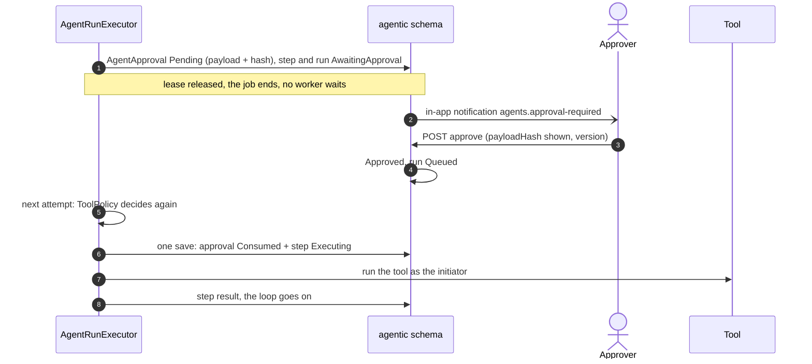

# Human approval

When the [tool gateway](Tools-And-The-Gateway.md) decides that a call needs a person, the run stops, a person decides,
and the run goes on. An approval is **consent to one exact action**, used once, and it never replaces a check.

Part of the [Agentic module](../Modules/Agentic.md). Design: [ADR-0027](../Decisions/0027-agent-approvals-triggers-and-policies.md).

## When a person is asked

- The tool is `SensitiveMutation` or `ExternalOrIrreversible`.
- The tool declares `RequiresApproval` (for example `memory.remember`).
- The call is a change and the run is tainted (it read untrusted content), or the tenant's policy says
  `RequireApprovalForChanges`.

## The flow

*Figure: The decision handler never executes anything; only the executor does, after deciding the call again under the person's current permissions.*

## The approval's lifecycle

```mermaid
stateDiagram-v2
  accTitle: Agent approval lifecycle
  accDescr: A pending approval is approved then consumed once, or rejected, expired or cancelled; a changed tool proposes it again.
  [*] --> Pending: request
  Pending --> Approved: approve
  Pending --> Rejected: reject
  Pending --> Expired: too late
  Pending --> Cancelled: run ended
  Approved --> Consumed: used once
  Approved --> Cancelled: run ended
  Approved --> Pending: tool changed
  Consumed --> [*]
  Rejected --> [*]
  Expired --> [*]
  Cancelled --> [*]
```

*Figure: `Consume` happens in the save that marks the step `Executing`; `Repropose` voids a decision when a new tool version is deployed; a replayed job or a second decision finds nothing left to use.*

## What an approval binds

| Bound by | Effect |
|---|---|
| `PayloadHash` = hash of tool name, tool version and arguments | The approver sends the hash they were shown. A different payload on record is 409 `approval_payload_mismatch` |
| Tool version | A tool deployed with a new `Version` after the decision voids it: the action is proposed again (`Repropose`) |
| One use | The approval is `Consumed` in the same save that marks the step `Executing` |

## Who may decide

| Rule | How |
|---|---|
| Permission | `agentic.approvals.decide` **and** the tool's own permission |
| How | An interactive user: no API key, no impersonation |
| Four eyes | `Agentic:Approvals:RequireDifferentApprover = true`: the person the run acts for may not approve its actions |
| Seeing requests | `GET /api/v1/agent-approvals`: all requests with `agentic.approvals.decide`, otherwise those of the caller's own runs |

## Outcomes

| Decision | What happens next |
|---|---|
| Approve | The run is queued. The next attempt decides the call again (allowlist, the initiator's **current** permission, autonomy) and runs it once |
| Reject (with a reason) | The step is closed as `Rejected` with the reason; the run goes on and the model is told |
| Nobody decides within `Approvals:ExpireAfterHours` (72) | `ExpireAgentApprovalsJob` expires it and the run fails with `approval_expired` |
| The run finishes first (cancelled, failed) | `CloseApprovalsOnRunFinishedEventHandler` cancels its open requests; a later decision is 409 `run_not_waiting` |
| A cancel arrives just before the suspension | The cancel wins: the run is cancelled and nobody is asked |

## Audit

Every request and decision is in the tenant audit trail (`AgentApproval` is `IAuditable`) with the payload's
digest, not the arguments themselves. `PurgeAgentAuditEntriesJob` applies `AuditTrail:RetentionDays`. The arguments
live on the approval row and are erased with the run's content ([Events and data lifecycle](Events-And-Data-Lifecycle.md)).

<!--#if (sample)-->

The Shipping sample shows the whole flow: the preparation agent drafts a declaration on its own, then waits for a
person before `shipping.submit_declaration` ([Shipping](../Modules/Shipping.md)).

<!--#endif-->

## Related

[Tools and the gateway](Tools-And-The-Gateway.md), [Runs](Runs.md), [API and observability](API-And-Observability.md),
[ADR-0027](../Decisions/0027-agent-approvals-triggers-and-policies.md).
