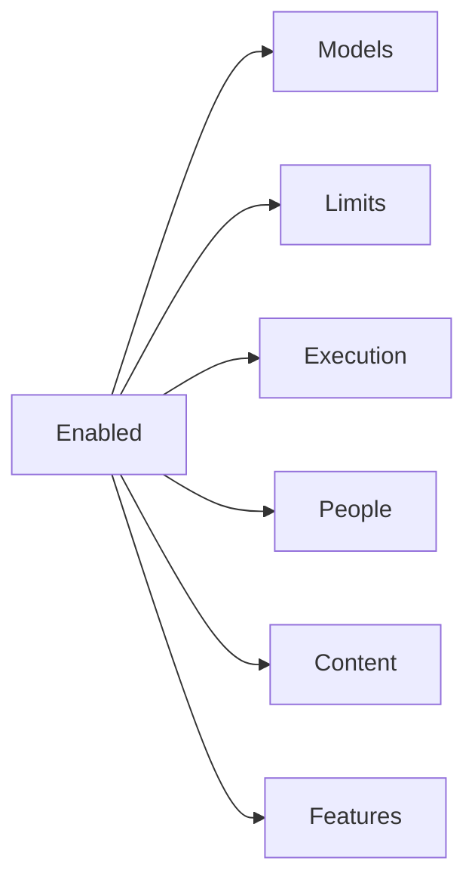

# Agentic configuration

Section `Agentic` (`AgenticOptions`, [source](../../src/Modules/Agentic/Agentic/Options/AgenticOptions.cs)), validated
at startup when enabled. The flat list of every key is in the [configuration reference](../Reference/Configuration.md);
this page groups them by what they control.

Part of the [Agentic module](../Modules/Agentic.md).

## Where each setting acts


*Figure: The sections below follow these groups. While `Enabled` is false the agent routes answer 404, nothing executes, and queued runs fail with `agents_disabled`.*

## Switch and models

| Key | Default | Meaning |
|---|---|---|
| `Enabled` | `false` | Master switch |
| `DefaultModel` | `default` | Model key of agents that name none |
| `Models:<key>:Provider` / `ModelId` | `scripted` | Which provider serves the model, and the provider's model id |
| `Models:<key>:MaxOutputTokens` | 4096 | Output token limit per request |
| `Models:<key>:InputPricePerMillionTokens` / `OutputPricePerMillionTokens` | 0 | Cost estimate; 0 = not tracked |
| `Models:<key>:Streaming` | `true` | `false` opts one model out of streaming |
| `Providers:<name>:Kind` | `Scripted` | `Scripted` (refused in Production), `OpenAiCompatible`, `Anthropic` |
| `Providers:<name>:Endpoint` / `ApiKey` | unset | Base URL (needed for self-hosted servers); key, preferably the Docker secret `agentic_<name>_api_key` |
| `Providers:<name>:TimeoutSeconds` / `MaxRetries` | 120 / 2 | One model request; retries inside the client |

## Run limits

| Key | Default | Meaning |
|---|---|---|
| `Limits:MaxModelTurns` / `MaxToolCalls` / `MaxToolCallsPerTurn` | 12 / 30 / 8 | Model requests and executed calls per run; calls taken from one turn |
| `Limits:MaxTokens` / `MaxDurationSeconds` | 200000 / 600 | Tokens per run (delegates included); active seconds |
| `Limits:MaxPromptLength` / `MaxInputBytes` | 8000 / 32768 | Size of a new run's prompt and structured input |
| `Limits:MaxToolArgumentsBytes` / `MaxToolResultBytes` / `MaxModelTextBytes` | 32768 / 65536 / 65536 | One call's arguments, one result, one answer's text |
| `Limits:MaxConcurrentRunsPerTenant` | 20 | Queued, running or waiting runs per tenant (a plan may lower it); 0 = no limit |

## Execution

| Key | Default | Meaning |
|---|---|---|
| `LeaseSeconds` / `MaxAttempts` | 300 / 3 | Lease of a running run; consecutive failed attempts before it fails |
| `StalledAfterMinutes` / `SweepCron` | 10 / `*/5 * * * *` | When the sweep queues a run again; keep the sweep under 20 minutes or the backlog gauges go silent |
| `ProgressIntervalMilliseconds` | 1000 | Throttle of `agentic.run-progress` |
| `Streaming:Enabled` / `IntervalMilliseconds` | `true` / 100 | Stream answers to the initiator; batching interval |
| `Telemetry:CaptureContent` | `false` | Adds prompts and tool content to spans; leave off unless the trace store may hold business data |
| `Hangfire:Servers:Agentic:Enabled` / `WorkerCount` | `true` / 4 | The worker server of the queue `agentic` in this replica |

## People and triggers

| Key | Default | Meaning |
|---|---|---|
| `Approvals:ExpireAfterHours` / `ExpiryCron` | 72 / `*/10 * * * *` | Undecided requests expire and their run fails |
| `Approvals:RequireDifferentApprover` | `false` | Four-eyes rule |
| `Triggers:MaxAutomaticRunsPerHour` | 60 | Event and schedule runs per agent, tenant and hour; 0 = no limit |

## Content, memory and conversations

| Key | Default | Meaning |
|---|---|---|
| `Content:RetentionDays` | 90 | Run content is erased after this many days; 0 = keep |
| `Memory:RetentionDays` / `MaxPerUser` / `MaxPerTenant` / `MaxRecalled` | 365 / 100 / 500 / 50 | Memory lifetime and limits |
| `Conversations:MaxHistoryTurns` / `MaxHistoryCharacters` | 20 / 24000 | History given to a turn; 0 = none |
| `Conversations:MaxMessages` | 200 | Messages per conversation, then 409 `conversation_full` |
| `Conversations:SummarizeAfterTurns` / `KeepRecentTurns` | 16 / 8 | When a summary is written, and the newest turns it leaves out; 0 = no summaries |
| `Conversations:SummaryModel` / `MaxSummaryCharacters` | `DefaultModel` / 4000 | Summary model and length |

## Knowledge, delegation and MCP

| Key | Default | Meaning |
|---|---|---|
| `Knowledge:Enabled` | `false` | Indexing and `knowledge.search` |
| `Knowledge:EmbeddingProvider` / `EmbeddingModelId` / `Dimensions` | scripted / `hashing` / model default | Embedding model; changing the model needs a re-index |
| `Knowledge:ChunkSize` / `ChunkOverlap` | 1200 / 150 | Passage length and overlap, in characters |
| `Knowledge:MaxDocumentBytes` / `MaxPdfPages` / `MaxTextLength` | 10 MB / 500 / 1,000,000 | Bounds of one document |
| `Knowledge:MaxAttempts` / `StalledAfterMinutes` | 4 / 15 | Indexing retries; stall sweep |
| `Knowledge:SearchCandidates` / `MaxResults` / `EmbeddingBatchSize` | 40 / 8 / 64 | Search breadth and size; embedding batch |
| `Knowledge:VectorIndex` | `None` | `Hnsw`: an HNSW index for `Dimensions` (at most 4000), built by the migrator |
| `Knowledge:HnswM` / `HnswEfConstruction` / `HnswEfSearch` | 16 / 64 / 100 | Links per node, build breadth, search breadth (at least `SearchCandidates`) |
| `Delegation:MaxDepth` | 2 | How deep delegations nest (1 = a delegate may not delegate again; at most 3) |
| `Mcp:Enabled` | `false` | Maps the MCP server of agents with `McpServer = true` |

## A minimal production setup

```json
{
  "Agentic": {
    "Enabled": true,
    "DefaultModel": "default",
    "Models": {
      "default": { "Provider": "openai", "ModelId": "CHANGE_ME", "InputPricePerMillionTokens": 0, "OutputPricePerMillionTokens": 0 }
    },
    "Providers": {
      "openai": { "Kind": "OpenAiCompatible" }
    }
  }
}
```

The API key comes from the Docker secret `secrets/agentic_openai_api_key.txt`, never from this file. Running it, sizing
the workers and the alerts: [Agentic operations](../deployment/Agentic-Operations.md).

## Related

[Configuration reference](../Reference/Configuration.md), [Models and evaluation](Models-And-Evaluation.md),
[Secrets](../deployment/Secrets.md).
