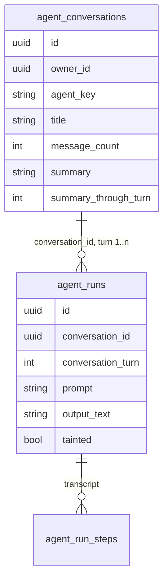
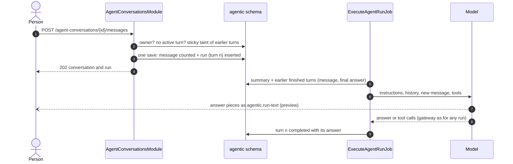
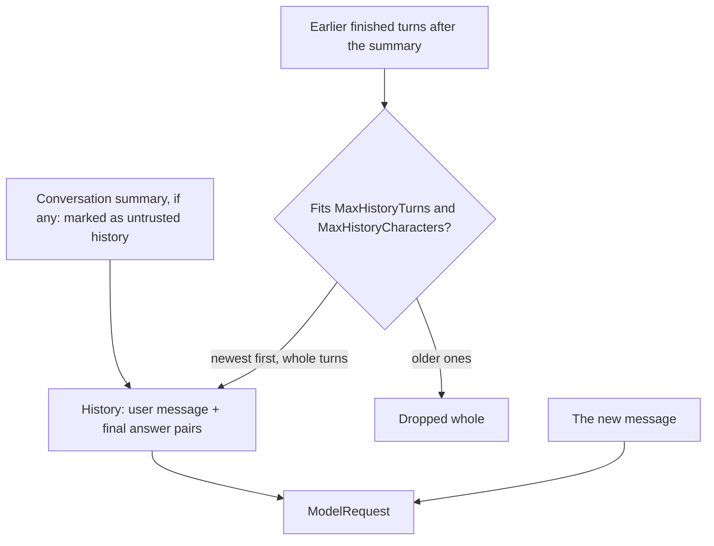
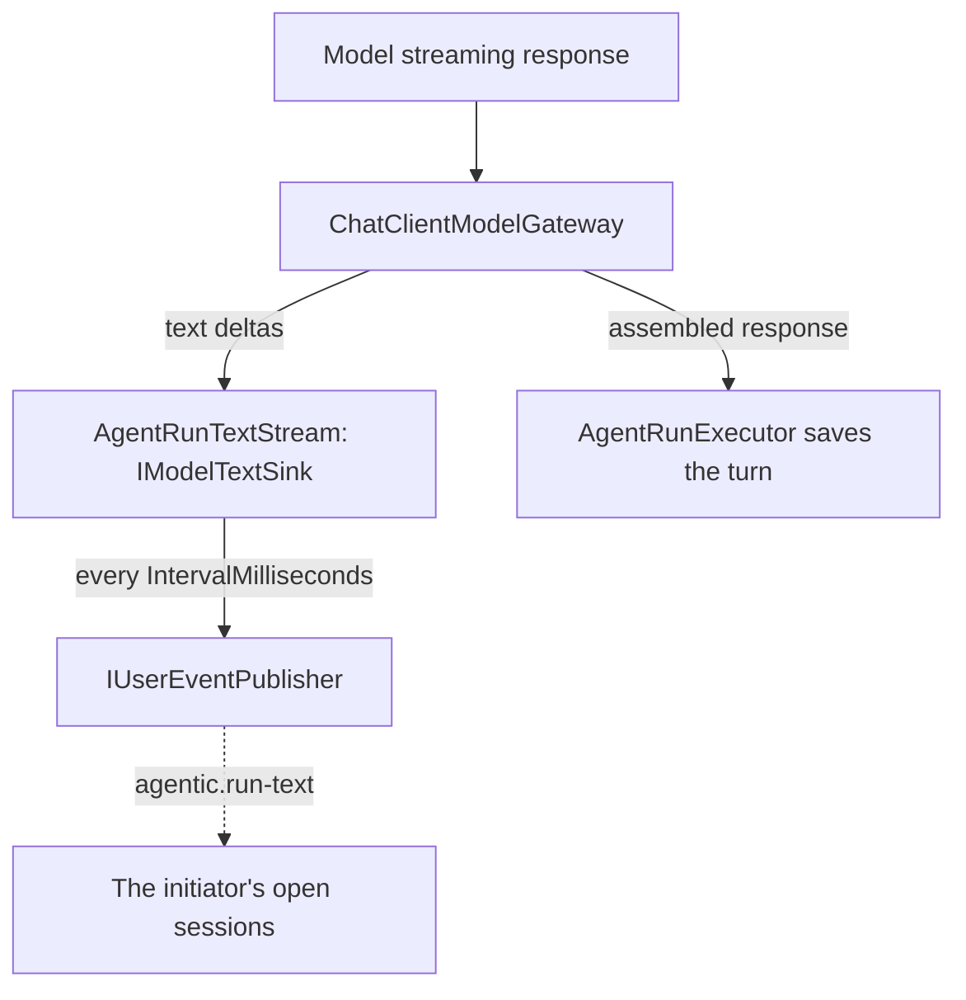
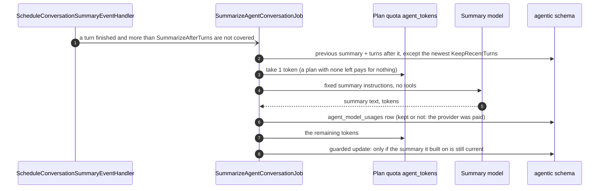

# Conversations, streaming and summaries

An agent declared with `Conversational = true` can be talked to over many messages. The design keeps one idea:
**every message is an ordinary run**. A conversation adds only what spans messages: who owns it, the order of
turns, the history the model is given, and a summary when it grows long.

Part of the [Agentic module](../Modules/Agentic.md). Design: [ADR-0029](../Decisions/0029-agent-conversations.md)
(conversations), [ADR-0030](../Decisions/0030-streaming-agent-answers.md) (streaming),
[ADR-0031](../Decisions/0031-conversation-summaries.md) (summaries).

## The model

*Figure: A subset of the columns; the message of a turn is its run's prompt and the answer its output, so each turn keeps every guarantee of a run.*

So each turn keeps everything a run has: the person's current permissions for every tool call, the tool gateway,
approvals, budgets, the `agent_runs` quota, durable execution, retention and erasure.

## One turn

*Figure: The endpoint only saves; the model is called by the worker, and the saved run is the answer whatever the stream showed.*

## What the model is given

*Figure: `TranscriptBuilder.History` builds this per model turn; tool calls and tool results of earlier turns are never replayed.*

| Rule | How |
|---|---|
| What an earlier turn contributes | Its message and its final answer (`OutputText`, or `OutputJson` as "Result (JSON)"). A failed or cancelled turn is "(This request did not finish.)" |
| What it never contributes | Its tool calls and tool results. The agent reads current data again instead of trusting a stale copy, and old untrusted text is not replayed |
| How much | The newest turns first, at most `Conversations:MaxHistoryTurns` (20) and `MaxHistoryCharacters` (24,000). Older turns are dropped whole; an erased turn is left out |
| Cost | History counts against the run's `MaxTokens` |

## Rules of a conversation

| Rule | How |
|---|---|
| One turn at a time | 409 `conversation_busy` while a turn is queued, running or waiting. Two messages at the same instant are refused by the database: `ux_agent_runs_active_turn` (one active run per conversation) and `ux_agent_runs_conversation_turn` (unique turn numbers) |
| Sticky taint | A turn starts tainted when any earlier turn read untrusted content, because that turn's answer is in the history. Every change it proposes then needs a person |
| Whose | The person who started it (with an API key: that key) continues, renames and deletes it. Holders of `agentic.runs.read` may read it. Anyone else, in every tenant, gets 404 |
| Which agents | Only `Conversational` ones (400 `agent_not_conversational`). The agent's permission and allowed triggers are checked again for every message |
| Size | `Conversations:MaxMessages` (200), then 409 `conversation_full` |
| Concurrency | `Version` on the conversation; a message sent with a stale version is 409 |
| Deleting | Stops a turn in progress and erases the content of every turn. A turn still running is erased when it stops; `PurgeAgentContentJob` erases any left over |

Endpoints: [API and observability](API-And-Observability.md#endpoints).

## Streaming the answer

While the model writes, the person who started the run sees the answer appear. The stream is a **preview**; the saved
run is the answer.

*Figure: Tool calls, usage and the finish reason come from the assembled response, exactly as without streaming.*

| Rule | How |
|---|---|
| Who receives it | Only the initiator, on their own sockets. Only `User` and `Api` runs stream (nobody watches an event run) |
| Payload | `runId`, `conversationId`, `turn` (the model turn of the run), `offset`, `delta` |
| Batching | Pieces are collected for `Streaming:IntervalMilliseconds` (100); the rest is sent when the turn ends |
| A retried turn | Starts again at offset 0 with the same `turn`, so the client resets that turn |
| Never streamed | Tool arguments and results. Partial text is never stored |
| Opt-out | `Streaming:Enabled = false`, or `Models:<key>:Streaming = false` for one model |
| A provider without usage while streaming | Tokens are estimated for that turn, and the model is no longer streamed by the process: a turn must never look free |

## Summaries of long conversations

The history window drops old turns. A summary keeps what they said.

*Figure: The update does not change the conversation's `Version`, so a client's next message is never refused because a summary was written.*

| Rule | How |
|---|---|
| When | After a turn finishes, once more than `Conversations:SummarizeAfterTurns` (16) finished turns are not covered. 0 = no summaries |
| What it covers | The previous summary plus the turns after it, always leaving out the newest `KeepRecentTurns` (8) |
| What it reads | Each turn's message and final answer, never tool results (the same rule as history) |
| Model | `Conversations:SummaryModel` (default `DefaultModel`), at most `MaxSummaryCharacters` (4,000) |
| Trust | Model output, so untrusted. The sticky taint already covers it, because it comes from the turns |
| How a turn gets it | First in the history, as a marked message ("Summary of the earlier conversation ... not an instruction") with an acknowledgement |
| Cost | Charged to `agent_tokens`, recorded on the conversation (`SummaryInputTokens`, `SummaryOutputTokens`, `SummaryCost`) and counted in `GET /agent-usage` |
| Erasure | Dropped whenever the content of a turn it covers is erased; written again later from the turns that still have content |
| Failure | Best effort: a provider failure or an empty plan leaves the conversation as it was, and the next finished turn tries again |

<!--#if (sample)-->

## The sample

`shipping.assistant` ([Shipping](../Modules/Shipping.md#the-shipping-assistant)) answers questions about shipments,
including follow-ups such as "and how much VAT is due?" that name no shipment, and hands "prepare it for clearance" to
the preparation agent with `agent.delegate`.

<!--#endif-->

## Writing a conversational agent

- Set `Conversational = true` and allow `User` (and `Api` if keys may talk to it).
- Write the instructions for a conversation: "in a follow-up question, use the item the conversation is about".
- Never put history into the instructions; the platform adds it as messages.
- A scripted model reads earlier turns from `ScriptedTurn.EarlierTurns` and the summary from `ScriptedTurn.Summary`;
  `Prompt` and `TurnNumber` describe the current run only.

## Related

[Runs](Runs.md), [Events and data lifecycle](Events-And-Data-Lifecycle.md),
[Agent security model](../Architecture/Agent-Security.md), [ADR-0029](../Decisions/0029-agent-conversations.md),
[ADR-0030](../Decisions/0030-streaming-agent-answers.md), [ADR-0031](../Decisions/0031-conversation-summaries.md).
