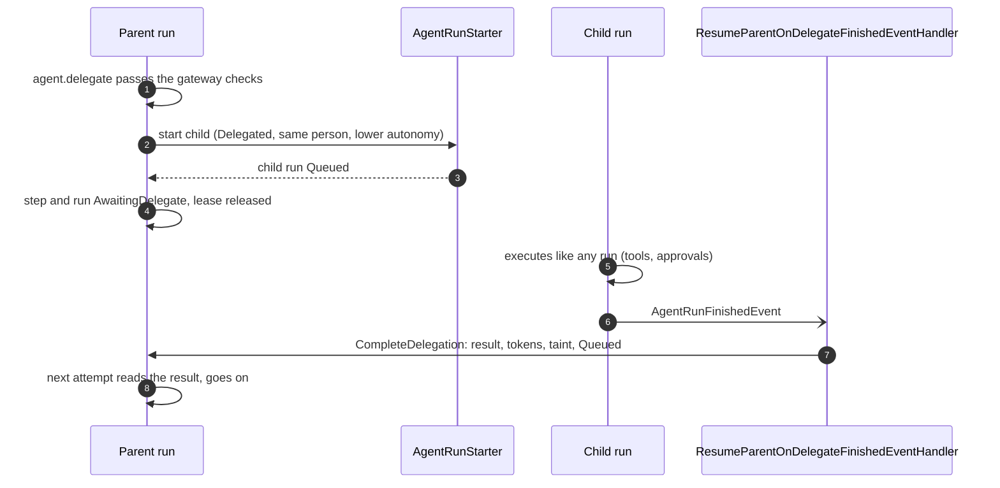
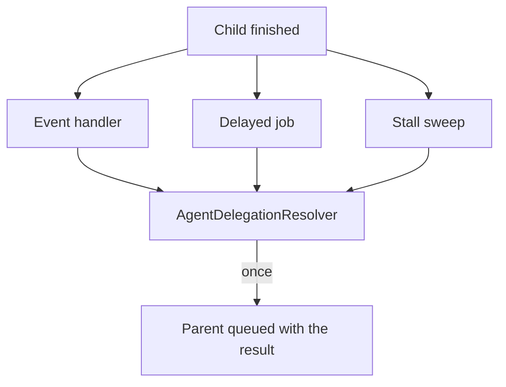

# Delegation between agents

An agent can hand part of its work to another agent. The other agent does not run inside a tool call: it runs as a
**child run**, created through `AgentRunStarter` like any run, for the same person, and never with more authority than
the run that delegated.

Part of the [Agentic module](../Modules/Agentic.md). Design: [ADR-0033](../Decisions/0033-agent-delegation.md).

## Declaring it

```csharp
services.AddAgent(new AgentDefinition
{
    Key = "orders.assistant",
    // ...
    Delegates = ["orders.fulfilment"]   // each must allow AgentTriggerKind.Delegated
});
```

The agent then gets the built-in tool `agent.delegate { agentKey, task }`, whose schema lists only those keys and
whose description names what each delegate does. The host refuses to start on an unknown delegate, a self-delegation,
a delegate that does not allow `Delegated`, or a cycle.

## How it runs


*Figure: The parent holds no worker while it waits; an approval inside the child suspends the child, and the parent simply keeps waiting.*

## The rules

| Rule | How |
|---|---|
| To whom | Only the keys in `Delegates`; any other is refused with `tool_not_allowed` |
| As whom | The same person (`InitiatedBy`), permission ceiling and API key. They must hold the delegate's `RequiredPermission` now (`forbidden`) |
| With what authority | The lower of the two runs' autonomies. Taint is inherited: a tainted parent's child needs a person for every change |
| How much | At most the parent's remaining tokens. The child's tokens are added to the parent's `DelegatedTokens`, so one budget bounds the whole tree |
| How deep | `Delegation:MaxDepth` (2; at most 3): beyond it `delegation_too_deep` |
| Starting | Through `AgentRunStarter`: tenant policy, capacity and the `agent_runs` quota apply. A refusal is told to the model like a refused tool |
| Exactly once | `ux_agent_runs_parent_step`: one child per parent step, so a retried attempt finds the child it already started |
| What the parent gets | The child's status and answer, or typed result, or failure code (`delegate_failed`) as the tool's result |

## Waiting, resuming and recovering


*Figure: `ResumeParentOnDelegateFinishedEventHandler`, `ResolveAgentDelegationJob` and `RequeueStalledAgentRunsJob` all go through `AgentDelegationResolver`; whichever arrives first resumes the parent, and the others find the step closed.*

| Situation | Outcome |
|---|---|
| The parent was still saving its suspension when the child finished | `ResolveAgentDelegationJob` checks again shortly; the parent's next attempt also takes a finished child's result itself |
| A worker stopped after starting the child, before suspending | The next attempt finds that child and waits for it; no second child starts |
| The event that resumes the parent was lost | The stall sweep resumes it |
| The child fails or is cancelled | The `agent.delegate` call fails with `delegate_failed` and the child's failure code; the parent goes on |

## Cascades

- Cancelling a run cancels its children (`CancelDelegatesOnRunFinishedEventHandler`, retried against a running
  child's checkpoints). A child also stops at its next checkpoint once its parent has finished.
- Erasing a run's content erases its children's.
- A child is listed like any run, with `parentRunId` and trigger `Delegated`; its approvals are decided as usual.

<!--#if (sample)-->

## The sample

`shipping.assistant` delegates "prepare it for clearance" to `shipping.shipment-preparation`. The preparation agent
drafts the declaration and proposes the submission; the person approves it on the child run, and the assistant then
answers with what was done ([Shipping](../Modules/Shipping.md)).

<!--#endif-->

## Related

[Runs](Runs.md), [Approvals](Approvals.md), [Triggers, policies and quotas](Triggers-Policies-And-Quotas.md),
[ADR-0033](../Decisions/0033-agent-delegation.md).
