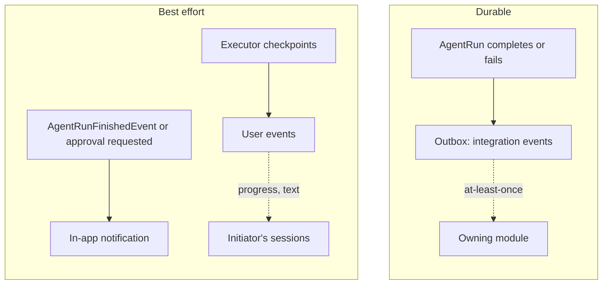
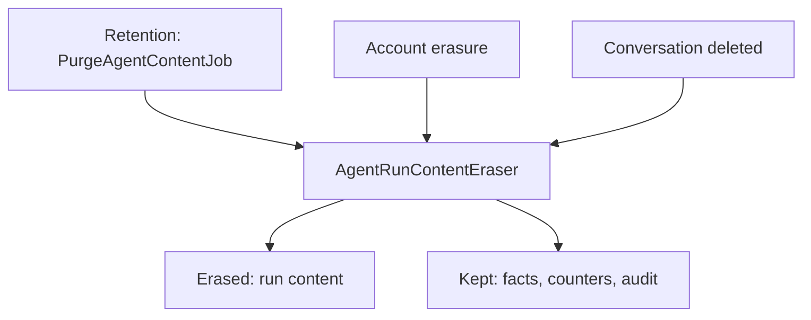

# Events, notifications and data lifecycle

What a run tells the rest of the system while it works and when it ends, and how long what it saw and said is kept.

Part of the [Agentic module](../Modules/Agentic.md).

## What a run emits

*Figure: Only integration events are durable; notifications and user events are best effort, and the run row stays the source of truth.*

| Signal | Kind | To whom | Carries |
|---|---|---|---|
| `AgentRunCompletedIntegrationEvent` (`agentic.agent-run-completed.v1`) | Outbox | The module that owns the agent | Ids, agent key, trigger key, whether a typed result exists |
| `AgentRunFailedIntegrationEvent` (`agentic.agent-run-failed.v1`) | Outbox | The same | Ids, agent key, trigger key, failure code |
| `agents.approval-required` | In-app notification | The person the run acts for | Which agent waits for what |
| `agents.run-finished` | In-app notification | The same | The outcome |
| `agentic.run-progress` | User event | The initiator | Status, counters, the step that changed, `conversationId` |
| `agentic.run-text` | User event | The initiator | The answer as it is written ([Streaming](Conversations.md#streaming-the-answer)) |

- A cancelled run raises no integration event. Runs started over [MCP](MCP-Server.md) raise none.
- Runs started by delegation or MCP send no `agents.run-finished` (the delegating run, or the client, reports the
  outcome). An approval a delegated run needs is notified as usual.
- The owning module consumes the integration events and reads the result with `GetAgentRunByIdQuery`; the events
  carry ids only, never content.
- Progress is throttled by `Agentic:ProgressIntervalMilliseconds` (1,000); a change of status is always sent.
- Apart from the streamed answer, which goes only to the initiator, none of these carries prompts, tool arguments or
  results.

## What is stored, and for how long

*Figure: Content is the prompt, input, output, transcript text, tool arguments and results, and approval payloads; erasure removes it, while the record that a run happened, and what it cost, remains.*

| Event | What is erased | What stays |
|---|---|---|
| `PurgeAgentContentJob` (daily) | Content of runs finished more than `Content:RetentionDays` (90; 0 = keep) ago; expired memories; titles of conversations idle as long; any finished turn of a deleted conversation not yet erased | Facts and counters |
| Account erasure (`UserDeletedIntegrationEvent`) | The user's personal memories (deleted), open runs (cancelled), the content of their finished runs in every tenant; their conversations closed and titles dropped | Facts, counters, audit entries |
| Conversation deleted | Every turn's content (a running turn when it stops) and the summary | The runs as facts |
| Content of a summarized turn erased | The conversation's summary | The other turns |
| A run's content erased | Its delegated runs' content too | |
| Attachment deleted (`AttachmentDeletedIntegrationEvent`) | The knowledge documents indexed from it | |
| Audit retention | `PurgeAgentAuditEntriesJob` applies `AuditTrail:RetentionDays` | |

## Telemetry and privacy

Prompts, tool arguments and results are never logged or traced unless `Agentic:Telemetry:CaptureContent` is on.
Spans, counters and gauges: [API and observability](API-And-Observability.md#metrics-and-traces).

## Related

[Runs](Runs.md), [Conversations](Conversations.md), [Messaging](../Architecture/Messaging.md),
[Notification realtime and push](../Modules/Notification-Realtime-and-Push.md).
