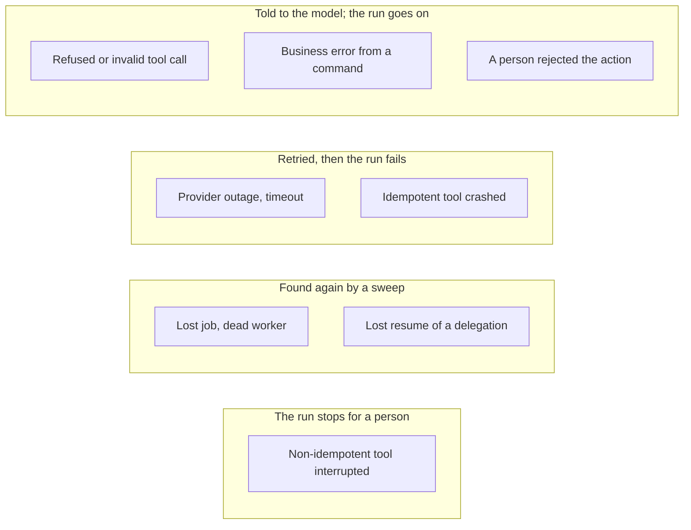

# Failure modes and guarantees

What happens when something goes wrong, grouped by where it goes wrong, and the tests that hold each guarantee.
Failure messages on a run are localized texts chosen by code; provider and exception details go to the log only.

Part of the [Agentic module](../Modules/Agentic.md).

## Where failures are absorbed

*Figure: A wrong model costs a model turn, never data; an infrastructure failure costs time, never a duplicate effect.*

## Execution

| Situation | Outcome |
|---|---|
| Duplicate job delivery, a second worker | Only the lease holder proceeds; the other does nothing |
| Provider outage | The attempt fails and the run is retried with backoff; after `MaxAttempts` it fails with `model_unavailable` |
| Idempotent tool fails unexpectedly | The attempt fails; the retry runs the same step with the same idempotency key |
| Non-idempotent tool fails unexpectedly or is found interrupted | The run fails with `tool_outcome_unknown`; the action is not repeated |
| Server shutdown | The run returns to `Queued` without counting a failure |
| Lost Hangfire job, dead worker | `RequeueStalledAgentRunsJob` queues the run again once its lease expired and the quiet period passed |
| Budget reached | The run fails with `budget_exceeded` and the name of the limit |
| `agent_tokens` used up | The run fails with `quota_exceeded` before its next step |

## The model

| Situation | Outcome |
|---|---|
| Asks for a tool outside its allowlist | Refused `tool_not_allowed`; the model is told |
| Sends arguments over `MaxToolArgumentsBytes` (a typed result included) | Refused `arguments_too_large` as the answer is saved; the arguments are never stored |
| Sends invalid or extra arguments | Refused `invalid_arguments` |
| Answers with more than `MaxModelTextBytes` of text | Nothing of the answer is stored or run; the run fails with `output_too_large` |
| A tool result is too large | A change stays a success with the payload withheld; a read-only tool gets `result_too_large` |
| A business error from a tool (4xx, conflict) | Returned to the model with its code; the run goes on |

## People and permissions

| Situation | Outcome |
|---|---|
| Initiator removed or deactivated | The run fails with `initiator_no_longer_authorized` |
| A permission revoked mid-run | The next call that needs it is refused with `forbidden` |
| A payload or tool changed after it was approved | Not executed; the action is proposed again |
| A decision replayed, or a job delivered again after the approval was used | Nothing happens: an approval is used once |
| Nobody decides in time | The request expires and the run fails with `approval_expired` |
| The same trigger delivered twice | One run |

## Conversations and streaming

| Situation | Outcome |
|---|---|
| A message while the previous turn is still going, or two at once | 409 `conversation_busy`; one turn runs |
| An earlier turn read untrusted content | Every later turn starts tainted: its changes wait for a person |
| A conversation is deleted while a turn runs | The turn is asked to stop and its content is erased when it does; the other turns at once |
| Someone else's conversation, or another tenant's | 404 for every route (read with `agentic.runs.read` only) |
| The summary model fails, or the plan has no tokens left | No summary is saved; the history drops old turns as before, and the next turn tries again |
| The content of a summarized turn is erased | The summary is dropped and written again from the turns that still have content |
| A model turn is retried after the answer was partly streamed | The turn streams again from offset 0 (same `turn`); the saved answer counts |
| A provider reports no token usage while streaming | Tokens are estimated for that turn and the model is no longer streamed |
| The hub is down or the user has no open session | The stream is lost; the run is unaffected |

## Knowledge

| Situation | Outcome |
|---|---|
| A document's content changes while it is indexed | The older job's result is dropped; the newer revision is indexed |
| Embedding provider down while indexing | Retried with backoff; after `Knowledge:MaxAttempts` the document is `Failed` and not searchable |
| Embedding provider down while searching | Keyword search only |
| The HNSW build was interrupted (deploy stopped) | The index is invalid; the next migrator run drops and builds it again. Search stays correct meanwhile (PostgreSQL ignores an invalid index) |
| A user without the source's permission searches | No passage of that source, whatever the model asks for |

## Delegation and MCP

| Situation | Outcome |
|---|---|
| The delegating run is still saving when its delegate finishes | `ResolveAgentDelegationJob` checks again shortly; the next attempt also takes a finished delegate's result itself |
| A worker stops after starting a delegate, before suspending | The next attempt finds that delegate and waits for it; no second one starts |
| The delegate fails or is cancelled | `agent.delegate` fails with `delegate_failed` and the delegate's code; the delegating run goes on |
| An MCP client asks for a change | Refused with `approval_required`; nothing runs or is recorded |
| The process stops during an MCP call | The call's run is failed with `mcp_call_interrupted` by the next worker that finds it |

## The tests that hold these

| Guarantee | Tests |
|---|---|
| Boundaries and libraries | `ModuleBoundaryTests`, `ThirdPartyIsolationTests` (the AI, MCP and PDF packages stay in Agentic), `AgentToolArchitectureTests` (tools reach data only through the mediator) |
| Tenant isolation | `TenantIsolationArchitectureTests`, `TenantRowLevelSecurityCoverageTests`, `PendingModelChangesTests` |
| Background work | `BackgroundJobEventDispatchTests` |
| Behaviour on real PostgreSQL (pgvector) | `Agentic.IntegrationTests`: execution, security, recovery, cancellation, approvals, governance, events, tracing, knowledge and the vector index, memory, conversations, summaries, delegation, MCP |
| Over HTTP | `Api.E2ETests`: agents on with the scripted model (runs, approvals, conversations, delegation, an official MCP client) |
| A real model | `ModelEvaluationTests`, `KnowledgeEvaluationTests` (opt-in, [Models and evaluation](Models-And-Evaluation.md)) |

Threats and the control that answers each: [Agent security model](../Architecture/Agent-Security.md).

<!--#if (sample)-->

Under load: the opt-in k6 scenario `agents` runs the Shipping demo ([Load testing](../Testing/Load-Testing.md)).

<!--#endif-->

## Related

[Runs](Runs.md), [Agentic operations](../deployment/Agentic-Operations.md), [API and observability](API-And-Observability.md).
