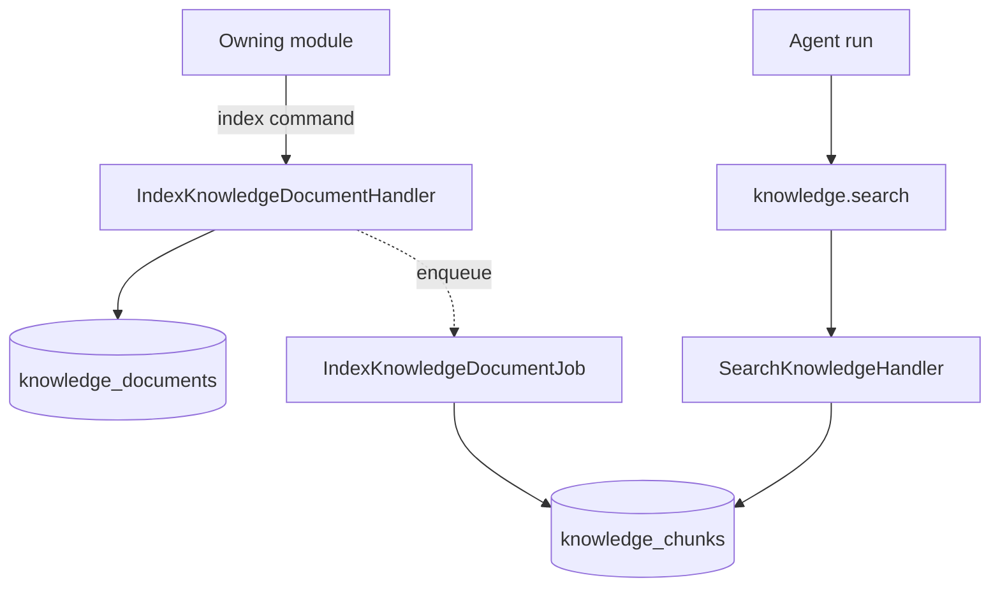
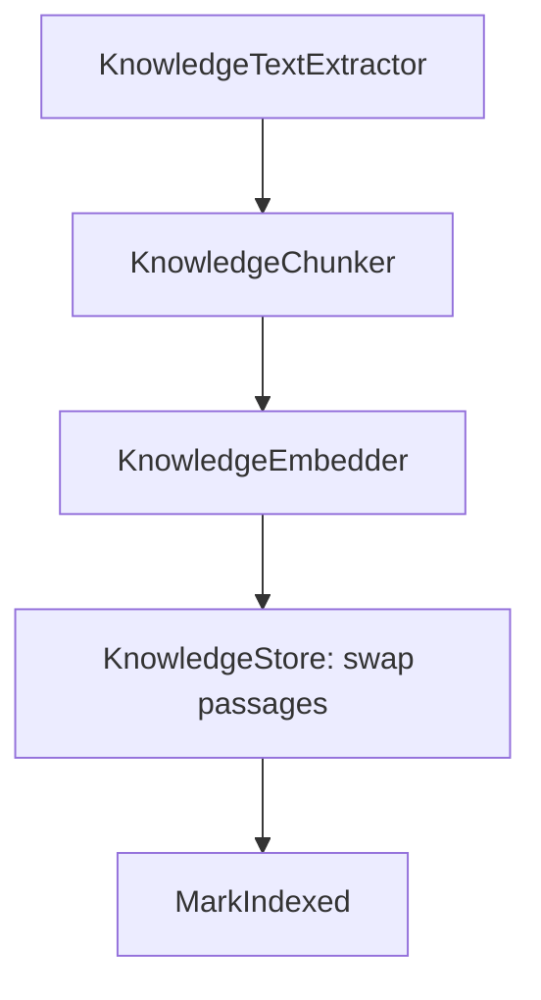
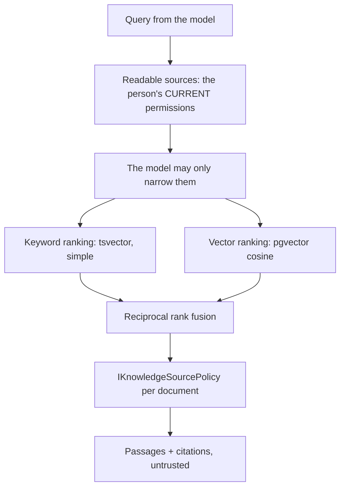
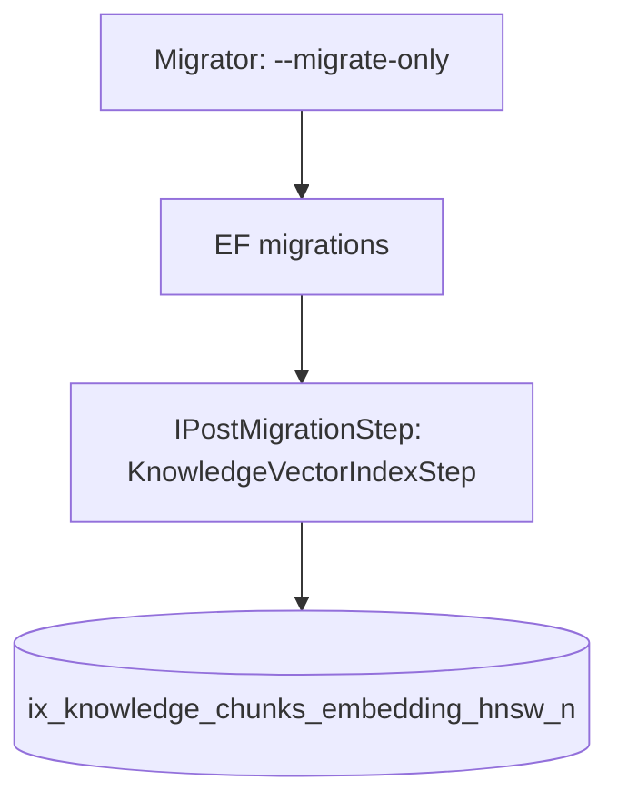
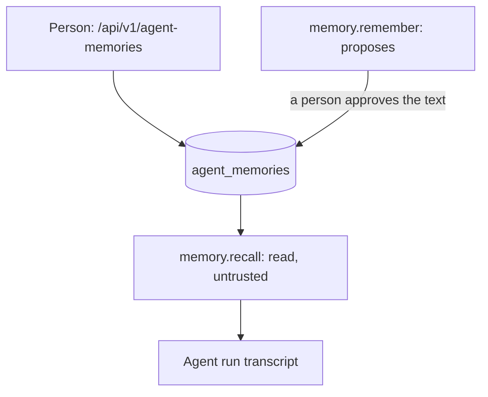

# Knowledge and memory

Agents can search what modules chose to make searchable (**knowledge**) and recall facts people wrote or approved
(**memory**). Both live in PostgreSQL with pgvector, behind the same tenant isolation and permissions as everything
else. Neither is ever injected into an agent's instructions: an agent reaches them only through read tools, and
what it reads is treated as untrusted.

Part of the [Agentic module](../Modules/Agentic.md). Design: [ADR-0028](../Decisions/0028-agent-knowledge-and-memory-on-pgvector.md)
(knowledge and memory), [ADR-0032](../Decisions/0032-knowledge-hnsw-index.md) (HNSW index).

## Knowledge: the big picture


*Figure: A passage row holds its text, a full-text `tsvector` and a pgvector embedding. Only what a module indexes is searchable; there is no upload endpoint.*

## 1. Register a source

In the owning module:

```csharp
services.AddKnowledgeSource(new KnowledgeSourceDefinition
{
    Key = "orders.documents",
    Name = new LocalizedText("Order documents", "مستندات الطلبات"),
    RequiredPermission = TenantPermissions.OrdersRead   // or AllowAnyMember = true, explicitly
});
services.AddKnowledgeSourcePolicy<OrderDocumentPolicy>();  // optional, per-document access
```

- A source is readable by a run only if the person it acts for holds `RequiredPermission` **now** (narrowed further by
  an API key's ceiling).
- An `IKnowledgeSourcePolicy` decides, as that person, which of the found documents they may read: for content whose
  access depends on the record, not only on a permission.

## 2. Index a document

The module sends `IndexKnowledgeDocumentCommand(source, externalRef, title, Text: ...)` or
`(..., AttachmentId: ...)` from its own handler or consumer, and `RemoveKnowledgeDocumentCommand` to take it out. Both
are trusted commands (never bound to an endpoint) and do nothing while `Agentic:Knowledge:Enabled` is false.

```mermaid
stateDiagram-v2
  accTitle: Knowledge document lifecycle
  accDescr: A document is pending until its revision is indexed or fails; new content makes it pending again.
  [*] --> Pending: Create
  Pending --> Ready: MarkIndexed (current revision)
  Pending --> Failed: MarkFailed
  Ready --> Pending: Replace (new content)
  Failed --> Pending: Replace (new content)
```


*Figure: Until a new revision is indexed, searches keep using the passages of the last indexed revision.*

`IndexKnowledgeDocumentJob` (queue `agentic`) does the work:


*Figure: The swap happens only while the job's revision is still the current one, so a slow job never overwrites newer content.*

| Stage | Detail |
|---|---|
| Extract | Plain text, Markdown, CSV, JSON, HTML without markup, the PDF text layer (PdfPig). Bounds: `MaxDocumentBytes`, `MaxPdfPages`, `MaxTextLength` |
| Chunk | Overlapping passages of `ChunkSize` (1,200) characters with `ChunkOverlap` (150) |
| Embed | `EmbeddingBatchSize` (64) passages per request to the embedding model |
| Swap | Old and new passages exchanged in one transaction |
| Same content again | A no-op (unless the embedding model changed); new content is a new revision |

| Failure | Result |
|---|---|
| Unreadable content | Fails at once: `unsupported_content_type`, `document_too_large`, `no_text`, `pdf_encrypted`, `pdf_unreadable`, `attachment_not_found` |
| Embedding provider down | Retried with backoff; after `Knowledge:MaxAttempts` (4) the document is `Failed` (`indexing_failed`) and not searchable |
| Lost job | `RequeueStalledKnowledgeDocumentsJob` queues it again after `StalledAfterMinutes` (15) |
| The attachment was deleted | `AttachmentDeletedKnowledgeConsumer` removes the documents indexed from it |

## 3. Search

An agent that lists `knowledge.search` gets passages with citations (`<source>/<externalRef>#<passage>`).


*Figure: Every raw SQL statement names the tenant as well as running under row-level security; the result taints the run.*

- Without a query embedding (the embedding provider is down), the search degrades to keywords only instead of failing.
- `SearchCandidates` (40) per ranking are merged; at most `MaxResults` (8) passages are returned.
- Vectors of different embedding models are never compared: a document records the model of its passages. After
  changing `Knowledge:EmbeddingModelId`, have the owning modules send their documents again; unchanged content is
  then indexed again with the new model.

### Exact search or an HNSW index

Vector search is exact by default, which is correct and fast enough for small and medium corpora. For large ones:


*Figure: The index is built at deploy time, never at boot in production; an interrupted build is dropped and built again by the next migrator run.*

| Setting | Effect |
|---|---|
| `Knowledge:VectorIndex = Hnsw` + `Knowledge:Dimensions` | A partial expression index for that vector length (`halfvec` above 2,000 dimensions, at most 4,000), built `CONCURRENTLY` |
| `HnswM` / `HnswEfConstruction` | Links per node / build breadth (16 / 64) |
| `HnswEfSearch` | Search breadth (100, at least `SearchCandidates`); the scan is iterative, so tenant and source filters still leave enough candidates |
| A query vector of another length | Falls back to exact search |

Before choosing an embedding model, run `KnowledgeEvaluationTests` against it (`AGENTIC_EVAL_EMBEDDING_MODEL`):
paraphrased English and Arabic questions must rank the passage that answers them first.

## Memory


*Figure: Memory is data in the transcript, never part of the instructions.*

| | Personal memory | Tenant memory |
|---|---|---|
| Visible to | One user | Everyone in the tenant |
| Written by | The user, or an approved `memory.remember` | A person with `agentic.manage` |
| Limit | `Memory:MaxPerUser` (100) | `Memory:MaxPerTenant` (500) |
| Expires | After `Memory:RetentionDays` (365) | Same |
| Erased with the user | Yes | No |

- `memory.recall` (read, `ReturnsUntrustedContent`): the user's and the tenant's memories that have not expired, at
  most `MaxRecalled` (50).
- `memory.remember` (`RequiresApproval`, permission `agentic.runs.start`): proposes a personal memory for the person
  the run acts for. Every call waits for a person to approve the exact text, at any autonomy from `Prepare`.

## Related

[Tools and the gateway](Tools-And-The-Gateway.md) (taint), [Events and data lifecycle](Events-And-Data-Lifecycle.md),
[Configuration](Configuration.md), [Database conventions](../Architecture/DatabaseConventions.md) (`IPostMigrationStep`),
[ADR-0028](../Decisions/0028-agent-knowledge-and-memory-on-pgvector.md), [ADR-0032](../Decisions/0032-knowledge-hnsw-index.md).
