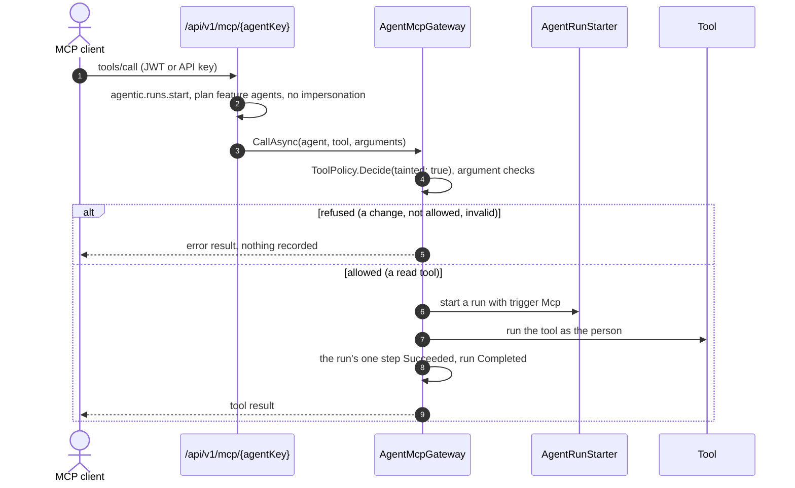

# MCP server

External AI clients (an IDE, a desktop assistant) can use an agent's tools over the
[Model Context Protocol](https://modelcontextprotocol.io). The calling model is outside our control, so every call is
decided by the same tool gateway as a run, **as if the run had read untrusted content**: reads work, changes do not.

Part of the [Agentic module](../Modules/Agentic.md). Design: [ADR-0034](../Decisions/0034-agent-mcp-server.md).

## Turning it on

Two switches, both off by default:

1. The agent opts in: `McpServer = true` on its `AgentDefinition`.
2. The deployment opts in: `Agentic:Mcp:Enabled = true`. Only then is the route `/api/v1/mcp/{agentKey}` mapped.

## How a call flows


*Figure: The call runs inside the request (it is one tool call, not a model loop) and leaves a run on record for audit, retention and erasure.*

## What a client sees and gets

| | Behaviour |
|---|---|
| Protocol | Streamable HTTP, stateless (any replica answers) |
| Authentication | A JWT, or an API key in a header. Use a key limited to what the client should read |
| `tools/list` | The agent's tools that this person may run **now** without an approval: in practice its read tools |
| `tools/call` of a change | Refused with `approval_required`; nothing runs and nothing is recorded |
| Arguments | Checked exactly as for a run: size, strict JSON, validator |
| A non-MCP agent | Answered with an error |
| Anonymous / no `agentic.runs.start` | 401 / 403 |

## What a call becomes

A run with trigger `Mcp` and one tool step: visible in `GET /api/v1/agent-runs`, audited, retained and erased like any
run, and counted against the `agent_runs` quota and capacity. It raises **no** integration event and no notification
(no module waits for it). If the process stops during a call, the next worker that finds the run fails it with
`mcp_call_interrupted`; an MCP run is never executed by a model.

## A client configuration

```json
{
  "url": "https://api.example.com/api/v1/mcp/<agent-key>",
  "headers": { "X-Api-Key": "CHANGE_ME" }
}
```

## Related

[Tools and the gateway](Tools-And-The-Gateway.md) (taint), [API and observability](API-And-Observability.md),
[Agent security model](../Architecture/Agent-Security.md), [ADR-0034](../Decisions/0034-agent-mcp-server.md).
