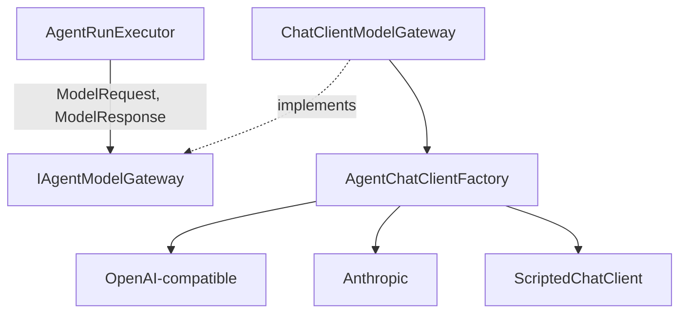
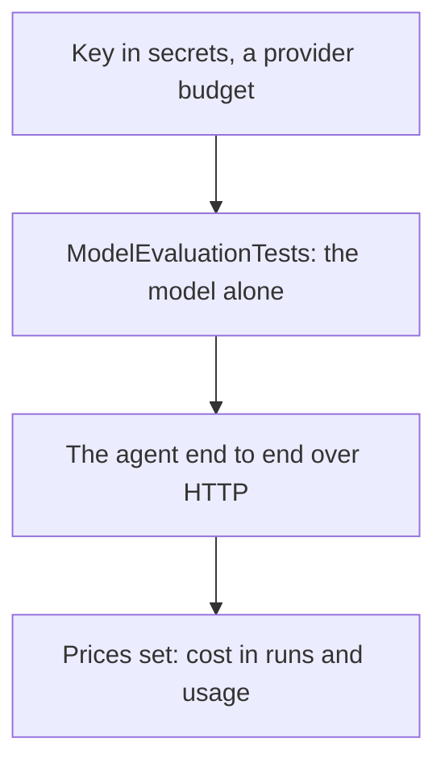

# Models, providers and evaluation

The model is a replaceable part behind one port. It proposes; it never executes. This page covers how the platform
talks to a model, which providers it supports, and how to prove a real model is good enough for your agents.

Part of the [Agentic module](../Modules/Agentic.md). Design: [ADR-0025](../Decisions/0025-agentic-module-and-model-seam.md).

## The model seam

*Figure: The factory builds one `IChatClient` per model key; the scripted client answers from `IAgentScript`. A `ModelResponse` carries text, tool calls as data and usage, and nothing is invoked automatically.*

Only the Agentic module references `Microsoft.Extensions.AI`, a provider SDK or the MCP SDK
(`ThirdPartyIsolationTests`). Business modules see none of it.

## Providers

| `Agentic:Providers:<name>:Kind` | Use |
|---|---|
| `Scripted` | A deterministic `IAgentScript` per agent: tests, CI, demos without a key. **Refused in Production** by `AgenticStartupCheck` |
| `OpenAiCompatible` | OpenAI, Azure OpenAI's v1 endpoint, self-hosted servers that speak the OpenAI chat API (Ollama, vLLM, ...) |
| `Anthropic` | The official Anthropic SDK |

A **model key** (`Agentic:Models:<key>`) names a provider, a `ModelId`, `MaxOutputTokens`, prices for the cost
estimate and whether it streams. An agent names a model key (or uses `DefaultModel`). Embeddings use their own
provider and model (`Knowledge:EmbeddingProvider`, `EmbeddingModelId`; Anthropic has no embeddings API).

The key comes from configuration or the Docker secret `agentic_<provider>_api_key`; `docker-compose.agents.yml` turns
agents on with an OpenAI-compatible provider and mounts that secret.

## The scripted provider

An `IAgentScript` registered with `AddAgentScript<T>()` answers for one agent key. It receives a `ScriptedTurn`
(prompt, earlier turns, summary, the results of the tools it already called) and returns a `ScriptedReply`: say
something, or call a tool. It makes integration tests and demos deterministic, and proves the **platform**; it cannot
prove that a real model will use the tools well.

## Proving a real model

*Figure: Each step spends a little more: a few hundred tokens per evaluation, then real runs of your agents.*

1. **Key.** Put the provider key in `secrets/agentic_openai_api_key.txt` (one line, git-ignored) or set
   `Agentic:Providers:<name>:ApiKey` from the environment. Never in `appsettings` or a committed file. Give the
   provider account a monthly budget.
2. **The model alone.** `dotnet test src/Modules/Agentic/Agentic.Tests --filter Category=ModelEvaluation` with
   `AGENTIC_EVAL_PROVIDER` (`OpenAiCompatible` or `Anthropic`), `AGENTIC_EVAL_MODEL` and `AGENTIC_EVAL_API_KEY`
   (`AGENTIC_EVAL_EMBEDDING_MODEL` adds the embedding tests). Skipped without them.
3. **The agent end to end.** Run the API with `Agentic:Enabled=true` and `Agentic:Models:default` pointing at the
   provider, drive the agent over HTTP and read its transcript at `/api/v1/agent-runs/{id}/steps`.
4. **Cost.** Set `InputPricePerMillionTokens` / `OutputPricePerMillionTokens` so runs and `GET /agent-usage` report
   money, not only tokens.

| `ModelEvaluationTests` checks that the model | Why it matters |
|---|---|
| Answers a question with the read tool and arguments matching its schema | Tools get valid calls |
| Uses a tool result without calling again | Runs stay within budget |
| Does not choose an irreversible tool when the user only asks | Fewer pointless approvals |
| Streams in pieces and still reports token usage | Streamed turns are never counted as free |
| Keeps references and numbers in a conversation summary, and answers a follow-up from it | Long conversations stay coherent |
| Hands a task to `agent.delegate` with the details the delegate needs | Delegation works without the conversation |

They measure the model, not the code: every safety rule is enforced by the gateway whatever the model does.

**What a real model changes compared with a script:** it chooses the order of its tool calls and may call several at
once. The platform's decisions follow from that order (a change after an untrusted read waits for a person; the same
change before it does not). Tests that drive a real model assert outcomes (what was done, refused, or waited for a
person), never an exact sequence of steps.

## Related

[Configuration](Configuration.md), [Agentic operations](../deployment/Agentic-Operations.md),
[Testing strategy](../Testing/Testing-Strategy.md), [ADR-0025](../Decisions/0025-agentic-module-and-model-seam.md).
