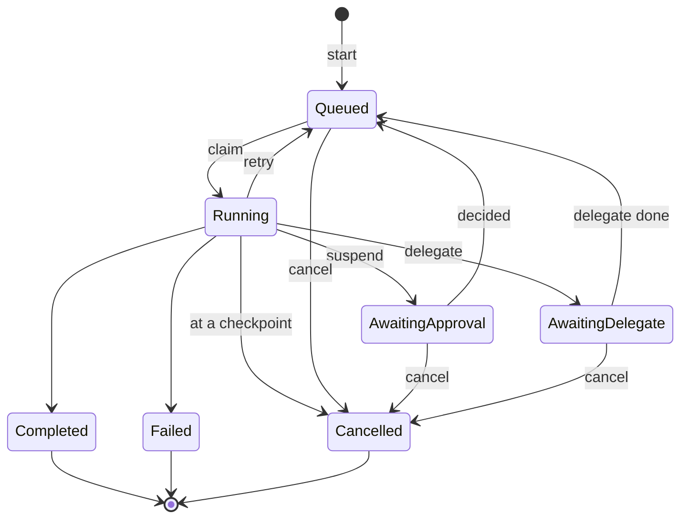
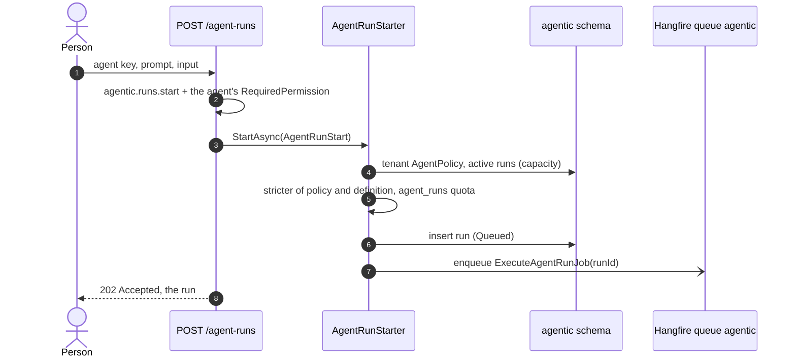
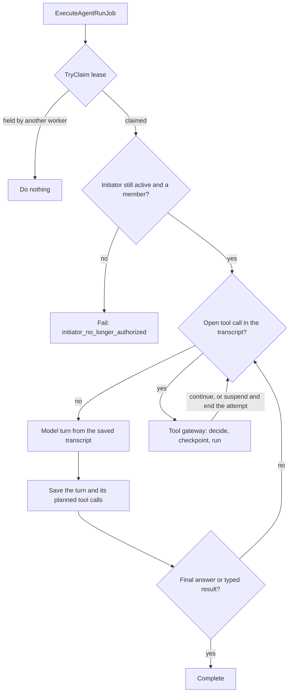
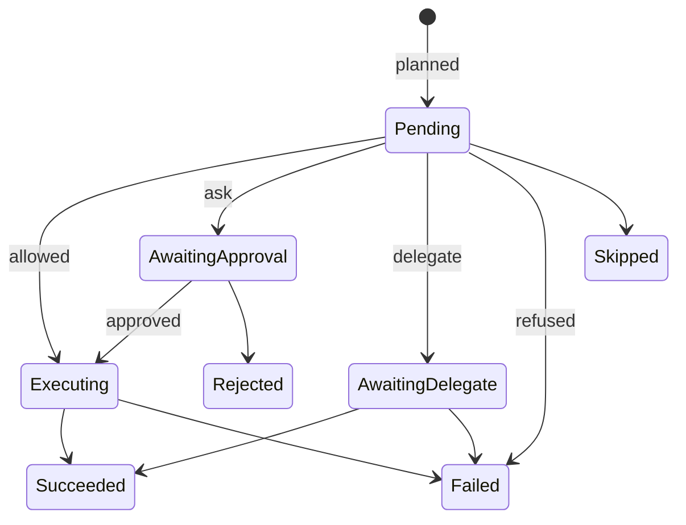
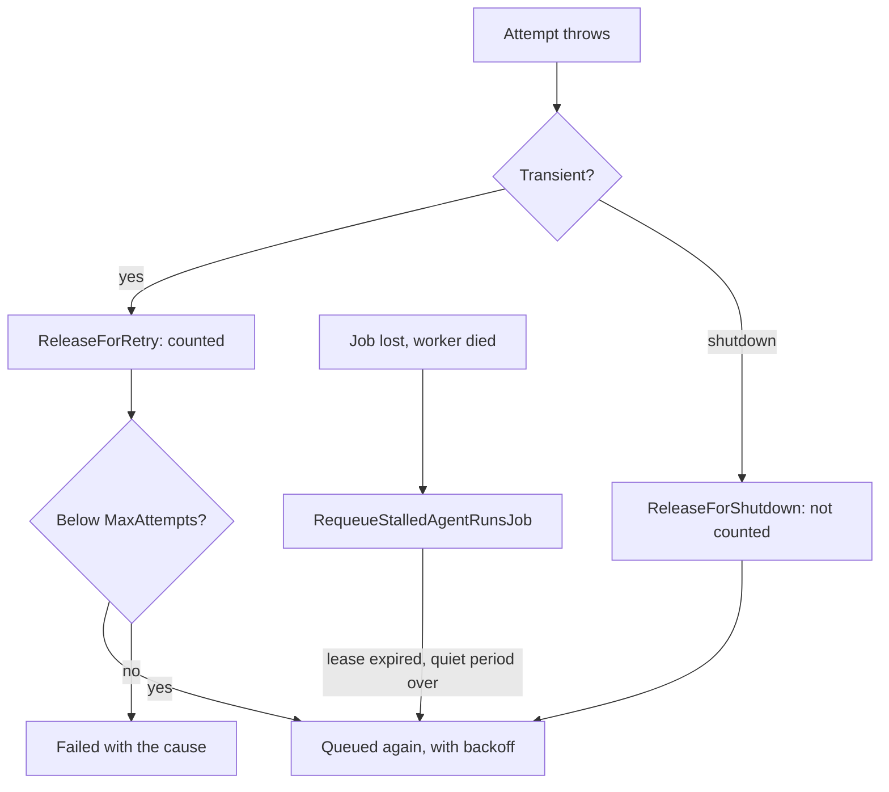
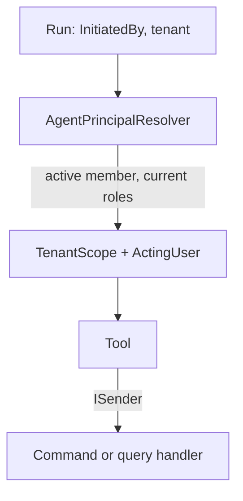

# Runs and durable execution

A **run** is one job an agent does for one person: "prepare shipment SHP-1", "answer this message". It is a row in
`agentic.agent_runs` (`AgentRun`) with an append-only transcript of steps (`AgentRunStep`). The run, not a process in
memory, is the source of truth: any worker can pick it up, and a crash loses no more than the step in progress.

Part of the [Agentic module](../Modules/Agentic.md). Design: [ADR-0026](../Decisions/0026-durable-agent-runs-on-hangfire.md).

## The lifecycle

*Figure: Transitions are methods of `AgentRun` (`TryClaim`, `ReleaseForRetry`, `Suspend`, `Resume`, `AwaitDelegate`, `CompleteDelegation`, `Complete`, `Fail`, `RequestCancel`); a waiting run holds no worker, and `Failed` is also reached from a waiting run whose approval expires.*

| Status | Meaning | Holds a worker? |
|---|---|---|
| `Queued` | Saved and enqueued on the Hangfire queue `agentic`; waiting for a worker | No |
| `Running` | A worker holds the **lease** (`LeaseOwner`, `LeaseUntil`) and is executing | Yes |
| `AwaitingApproval` | A tool call waits for a person ([Approvals](Approvals.md)) | No |
| `AwaitingDelegate` | An `agent.delegate` call waits for another run ([Delegation](Delegation.md)) | No |
| `Completed` | The model gave its final answer (`OutputText`) or a valid typed result (`OutputJson`) | No |
| `Failed` | Stopped with a `FailureCode` and a localized `FailureMessage` | No |
| `Cancelled` | Stopped on request; raises no integration event | No |

`Completed`, `Failed` and `Cancelled` are terminal (`AgentRun.IsTerminal`): a terminal run never changes status again,
and every method that would change it throws `InvalidAgentRunStateException("already_finished")`.

## What happens when a run starts

Nothing runs inside the HTTP request. The request only creates the row and queues a job.

*Figure: Every trigger (person, API key, event, schedule, delegation, MCP) goes through `AgentRunStarter`, the one place a run is created.*

What the start fixes on the run, and never changes afterwards:

| Fixed at start | Why |
|---|---|
| Agent version, model key | A deploy in the middle of a run does not change what it is |
| Autonomy | The stricter of the agent's definition, the tenant policy and (for a delegate) the delegating run |
| Budgets (`MaxModelTurns`, `MaxToolCalls`, `MaxTokens`, `MaxDurationSeconds`) | `Agentic:Limits`, lowered by `AgentDefinition.Limits` and the policy |
| An API key's scopes, as a permission ceiling | A key never acts with more than it was given |

What is deliberately **not** stored: the person's permissions. They are read again before every tool call
(see [Acting as the person](#acting-as-the-person)).

## How a worker executes a run

`ExecuteAgentRunJob` calls `AgentRunExecutor.ExecuteAsync`. One **attempt** is one job execution; a run may need
several attempts (it waited for a person, a worker died, the provider was down).

*Figure: The loop never keeps state in memory between steps: each iteration reads the saved transcript, so the next attempt resumes exactly where this one stopped.*

The loop, in words:

1. **Claim.** `AgentRun.TryClaim(owner, now, lease)` succeeds only for a `Queued` run, or a `Running` run whose lease
   expired. A duplicate job delivery finds the lease held and does nothing.
2. **Who.** `AgentPrincipalResolver` re-reads the initiator: active in the user directory, still a member of the
   tenant, permissions from their current roles.
3. **Next step.** With no open tool call, `TranscriptBuilder` turns the saved steps into a `ModelRequest`, the model
   answers, and `RecordModelTurn` + `PlanToolCall` save the answer and the calls it asked for **before** anything runs.
4. **Tool calls.** Each open call goes through the [tool gateway](Tools-And-The-Gateway.md). The step is marked
   `Executing` before the tool runs and gets its result after, so a crash in between is visible.
5. **End.** A free-text agent completes when the model answers without a tool call. An agent with an `OutputType`
   completes only when the model hands in a value that passes validation through the reserved tool
   `agent.submit_result`.

### Steps: the transcript and the checkpoint

*Figure: Tool-call steps only; `Executing` is saved before the tool runs, and `Skipped` closes the other open calls once a typed result is accepted. Model-turn steps are recorded once, already finished.*

| Step kind | Holds |
|---|---|
| `ModelTurn` | The model's text, model id, finish reason, input/output tokens |
| `ToolCall` | Tool name and version, arguments, result or error code, duration, whether it read untrusted content |

`GET /api/v1/agent-runs/{id}/steps` returns the transcript in order. It is what you read to understand why an agent
did something.

## Leases, attempts and recovery

*Figure: A checkpoint resets the failure count, so only consecutive failed attempts count against `Agentic:MaxAttempts`.*

| Mechanism | Setting | What it guarantees |
|---|---|---|
| Lease | `Agentic:LeaseSeconds` (300), renewed at every checkpoint, extended to cover a long model request or tool timeout | Only one worker executes a run at a time |
| Attempts | `Agentic:MaxAttempts` (3) consecutive failures | A broken provider fails the run instead of retrying forever |
| Stall sweep | `RequeueStalledAgentRunsJob` every `Agentic:SweepCron` (5 min), after `StalledAfterMinutes` (10) | A lost Hangfire job or a dead worker never strands a run |
| Shutdown | `ReleaseForShutdown` | A deploy puts running runs back in the queue without counting a failure |

The sweep also resumes a run whose delegate finished while the resume event was lost, and refreshes the backlog
gauges that the alerts read ([Agentic operations](../deployment/Agentic-Operations.md)).

### At-least-once, made safe

A crash between "the tool ran" and "the result was saved" means the step is still `Executing` when the next attempt
looks. What happens then depends on the tool:

| Tool declares | Next attempt | Why it is safe |
|---|---|---|
| `Idempotent = true` (the default) | Runs the same call again with the same `AgentToolContext.IdempotencyKey` | The command recognises the key and returns the first result |
| `Idempotent = false` | Fails the run with `tool_outcome_unknown` | Repeating could do it twice; a person checks the record |

## Budgets

| Budget | Default (`Agentic:Limits`) | When reached |
|---|---|---|
| `MaxModelTurns` | 12 | `budget_exceeded` (the limit is named in the message) |
| `MaxToolCalls` | 30 | `budget_exceeded` |
| `MaxToolCallsPerTurn` | 8 | Further calls of that turn are not taken |
| `MaxTokens` | 200,000 input + output (plus `DelegatedTokens`) | `budget_exceeded` |
| `MaxDurationSeconds` | 600 of **active** time | `budget_exceeded`; waiting for a person or a delegate does not count |

Size limits (prompt, input, tool arguments, tool result, model text) are in [Configuration](Configuration.md). Plan
quotas and per-tenant capacity are in [Triggers, policies and quotas](Triggers-Policies-And-Quotas.md).

## Acting as the person

A tool runs exactly as a request of the person the run acts for would. There is no agent identity and no system user.

*Figure: Handlers see the initiator through `IHttpContextService` and the tenant through `ITenantContext`, as in a request.*

- The scope is `TenantScope.Begin(tenant, membership:)` (the person's current branch scope) and
  `ActingUser.Begin(userId, "agent-run:<id>")`.
- Audit entries of changes a tool makes carry the person as actor and `agent-run:<id>` as correlation id.
- A permission revoked in the middle of a run takes effect at the next tool call that needs it (`forbidden`). A
  removed or deactivated user fails the run (`initiator_no_longer_authorized`). A temporary sign-in lockout is not
  visible outside Identity and does not stop a run.

## Cancelling

`POST /api/v1/agent-runs/{id}/cancel` (the initiator, or anyone with `agentic.manage`): a queued or waiting run is
cancelled at once; a running one sets `CancelRequested` and stops at its next checkpoint. A cancel that arrives just
before a suspension wins: the run is cancelled and nobody is asked to approve anything. Cancelling a run also cancels
the runs it [delegated](Delegation.md) to.

## Related

[Tools and the gateway](Tools-And-The-Gateway.md), [Approvals](Approvals.md),
[Failure modes](Failure-Modes.md), [ADR-0026](../Decisions/0026-durable-agent-runs-on-hangfire.md),
[DataTransfer](../Modules/DataTransfer.md) (the same leased-job pattern).
