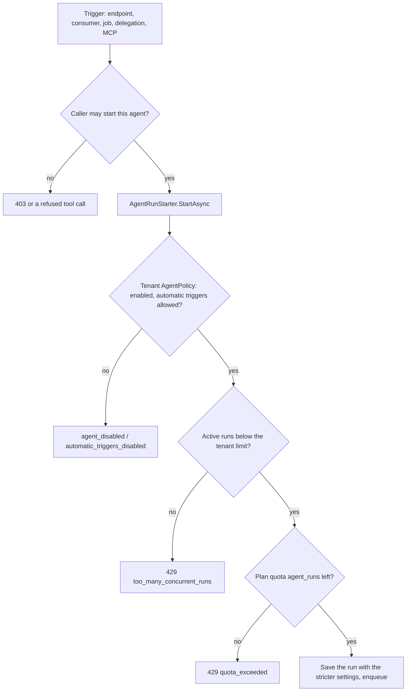
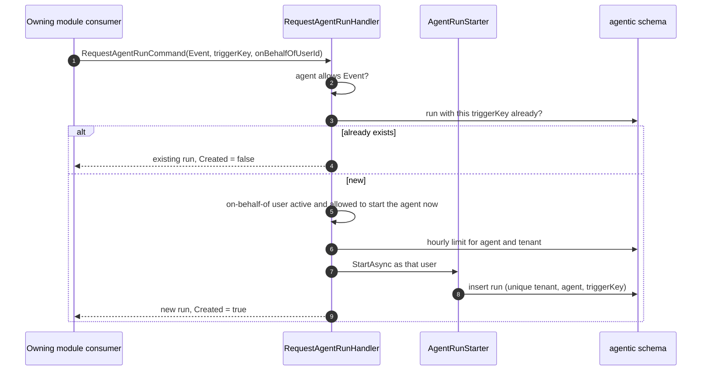
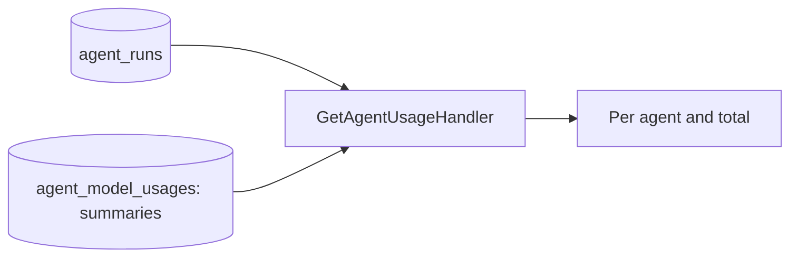

# Triggers, policies, quotas and usage

Who can start a run, how often, with how much authority, and what it costs. Everything here is decided **before** a
run exists, in one place: `AgentRunStarter`.

Part of the [Agentic module](../Modules/Agentic.md). Design: [ADR-0027](../Decisions/0027-agent-approvals-triggers-and-policies.md).

## Six ways a run starts

| Trigger (`AgentTriggerKind`) | Who starts it | Entry point |
|---|---|---|
| `User` | A signed-in person | `POST /api/v1/agent-runs`, or a message in a [conversation](Conversations.md) |
| `Api` | An API key, for its owner | The same endpoints, with the key's scopes as a ceiling |
| `Event` | The owning module, reacting to an integration event | `RequestAgentRunCommand` from its consumer |
| `Schedule` | The owning module's recurring job | `RequestAgentRunCommand` from its job |
| `Delegated` | Another run | `agent.delegate` ([Delegation](Delegation.md)) |
| `Mcp` | An external MCP client, for the signed-in person | `/api/v1/mcp/{agentKey}` ([MCP server](MCP-Server.md)) |

An agent lists the kinds it accepts in `AllowedTriggers`; any other kind is refused (`trigger_not_allowed`).

## The path every start takes


*Figure: Who may start is the caller's job (endpoint policy, the agent's permission, the on-behalf-of user); what the run may be is the starter's.*

## Automatic triggers

A module that wants an agent to react to its own facts sends, from a consumer or a recurring job:

```csharp
await sender.Send(new RequestAgentRunCommand(
    agentKey,                                 // the agent to run
    AgentTriggerKind.Event,                   // or Schedule
    $"shipment-ready:{message.ShipmentId}",   // TriggerKey: stable per fact
    message.RequestedBy,                      // OnBehalfOfUserId: the real user who caused it
    prompt,
    inputJson), ct);
```


*Figure: A redelivered message gets the same run; two deliveries racing on the same key lose to the unique index and return the winner.*

| Rule | Why |
|---|---|
| A **real** user: `onBehalfOfUserId` must be an active member allowed to start the agent right now | There is no system identity for agents; a run never has more rights than a person |
| `triggerKey` unique per tenant and agent | At-least-once delivery yields one run |
| At most `Triggers:MaxAutomaticRunsPerHour` (60) per agent and tenant, 429 `automatic_run_limit` | An event loop cannot spawn runs without bound |
| The tenant policy may refuse automatic triggers | A tenant can keep an agent manual-only |

The consumer catches `NotFoundException` / `ForbiddenException` (agents off, the user may not start it), logs and
returns; anything else throws so the bus retries.

## Tenant policies

`AgentPolicy` is one row per tenant and agent, managed with `GET` / `PUT /api/v1/agent-policies/{agentKey}`
(`agentic.manage`). It can only **tighten**: the starter takes the stricter of the policy and the definition.

| Setting | Effect on new runs |
|---|---|
| `Enabled` | Off: no new runs (`agent_disabled`) |
| `AutonomyCeiling` | Lowers the run's autonomy |
| `AllowAutomaticTriggers` | Off: `Event` and `Schedule` starts are refused |
| `RequireApprovalForChanges` | Every change in the run needs a person, like a tainted run |
| `MaxModelTurns`, `MaxToolCalls`, `MaxTokens` | Lower the run's budgets (tool calls may be 0: the agent only talks) |

A run keeps what it started with: changing a policy affects the next runs, not the ones in progress.

## Bounds and quotas

| Bound | Where it is set | When it is hit |
|---|---|---|
| Per-run budgets | `Agentic:Limits`, lowered by `AgentDefinition.Limits` and the policy | The run fails `budget_exceeded` |
| Runs in progress per tenant | `Limits:MaxConcurrentRunsPerTenant` (20) and plan limit `max_concurrent_agent_runs` | Start refused, 429 `too_many_concurrent_runs` |
| Plan quota `agent_runs` | One unit per run, consumed just before the run is saved | Start refused, 429 `quota_exceeded` |
| Plan quota `agent_tokens` | Per saved model turn (summaries included) | The run fails `quota_exceeded` before its next step |
| Plan feature `agents` | `RequireFeature` on every agent endpoint | 403 `feature_not_in_plan` |

Capacity counts runs that are queued, running or waiting. It is a check, not a lock: two starts at the same instant
may overshoot by one, which is acceptable for a guard whose hard bounds are the budgets and the quota.

## Usage and cost

`GET /api/v1/agent-usage?from=&to=` (`agentic.runs.read`; default: the current month, at most 366 days) reports per
agent and in total: runs by outcome, model turns, tool calls, input and output tokens, and estimated cost.


*Figure: Tokens and cost include conversation summaries, so the totals add up to what `agent_tokens` paid for; `Summaries`, `SummaryTokens` and `SummaryCost` are their share.*

- A delegate's tokens are reported once, on the delegated run, although they also count against the delegating run's
  budget (`DelegatedTokens`).
- Cost is an estimate from `Models:<key>:InputPricePerMillionTokens` / `OutputPricePerMillionTokens`; 0 means not
  tracked.

## Related

[Runs](Runs.md), [Tools and the gateway](Tools-And-The-Gateway.md), [Configuration](Configuration.md),
[ADR-0027](../Decisions/0027-agent-approvals-triggers-and-policies.md), [Messaging](../Architecture/Messaging.md).
