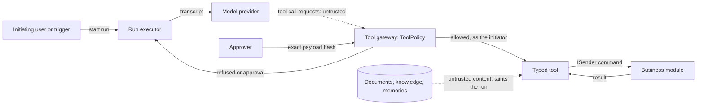

# Agent security model

How the [Agentic module](../Modules/Agentic.md) stays safe when the model is wrong, manipulated or hostile: the trust
boundaries, and each threat with the control that answers it and the test that proves the control.

## Goal

No outcome of an agent run depends on the model obeying its instructions. The model can only ask; deterministic code
decides, with the same validation, tenant isolation and permissions as an HTTP request, and a person decides
whatever is external or sensitive.

## Trust boundaries

*Figure: dashed arrows carry untrusted data. Nothing on them reaches a business command without passing the gateway.*

- **Trusted:** the run's context (tenant, initiating user, agent and tool versions, idempotency key), built on the
  server. Tool inputs never contain a tenant, a user or a permission.
- **Untrusted:** everything the model produces (text, tool names, arguments, typed results, their size) and every tool
  result that carries outside content (`ReturnsUntrustedContent`: documents, knowledge passages, recalled memories).

## Threats, controls and evidence

| Threat | Control | Tests |
|---|---|---|
| Prompt injection through a document, a search result or a memory | After untrusted content is read, every change needs a person (taint); reads still run | `AgentRunSecurityTests.InstructionsHiddenInADocument_CannotMoveData_OnceUntrustedContentWasRead_EveryChangeNeedsAPerson`, `ToolPolicyTests.OnceTheRunReadUntrustedContent_EveryMutationNeedsApproval_ButReadsStillRun`, `KnowledgeTests.IndexedText_BecomesSearchable_WithVectorsAndCitations_AndTaintsTheRun`, `AgentMemoryTests.Recall_ReturnsTheUsersAndTheTenantsMemories_AndTaintsTheRun` |
| The model names another tenant or user in tool arguments | Strict JSON binding (unknown members rejected) and the input validator; tenant and user come from the context | `AgentRunSecurityTests.Arguments_ThatDoNotMatchTheToolsInput_AreRefused_AndTheToolNeverRuns` |
| The model calls a tool that does not exist or is not the agent's | Allowlist first; both refused the same way | `AgentRunSecurityTests.AToolName_ThatDoesNotExist_IsRefused`, `ARegisteredTool_OutsideTheAgentsAllowlist_IsRefused_EvenForAUserWhoMayUseIt`, `ToolPolicyTests.AnUnknownTool_IsRefused` |
| The agent exceeds its initiator | The initiator's CURRENT permissions on every call, intersected with API-key scopes; a removed or deactivated initiator stops the run | `AgentRunSecurityTests.ATool_TheInitiatorHasNoPermissionFor_IsRefused_AndNothingIsWritten`, `APermissionRevoked_InTheMiddleOfARun_RefusesTheNextCallThatNeedsIt`, `ARunStartedWithAnApiKey_NeverExceedsTheKeysScopes_EvenWhenItsOwnerMayDoMore`, `AnInitiator_WhoWasDeactivated_StopsTheRun` |
| An external or irreversible action without consent | Always held for a person, at any autonomy | `AgentRunSecurityTests.AnExternalAction_IsNeverExecutedWithoutAPerson_EvenWhenTheInitiatorMayDoIt`, `ToolPolicyTests.SensitiveAndExternalActions_AlwaysNeedApproval_EvenAtFullAutonomy` |
| Approval bypass: forged, replayed or reused consent | Approval bound to a SHA-256 of tool, version and arguments; used once; the approver needs the tool's permission; the call is decided again after the decision | `AgentApprovalTests.Approve_WithAHashOtherThanThePayloadOnRecord_IsAConflict_AndNothingChanges`, `APayload_ChangedAfterItWasApproved_IsNotExecuted_AndIsProposedAgain`, `AnApproval_CanBeUsedOnce_ASecondDecisionAndAReplayedJobChangeNothing`, `AnApprover_WithoutTheToolsOwnPermission_CannotApprove`, `Approval_DoesNotReplaceTheInitiatorsPermission_RevokedWhileWaiting_TheActionIsRefused`, `WithTheFourEyesRule_TheInitiatorCannotApproveTheirOwnRun_ButSomeoneElseCan` |
| Cross-tenant reads or writes | Tenant filter, forced RLS, the tenant named in every raw statement; foreign ids are 404 | `AgentRunSecurityTests.ARun_IsInvisibleFromAnotherTenant_ThroughTheApiAndInTheDatabase`, `AJob_DeliveredForAnotherTenantsRun_DoesNothing`, `AgentApprovalTests.ARequest_CannotBeSeenOrDecided_FromAnotherTenant`, `KnowledgeTests.AnotherTenantsPassages_AreInvisible_EvenToRawSql`, `AgentMemoryTests.AMemoryOfAnotherTenant_DoesNotExist`, `TenantRowLevelSecurityCoverageTests` |
| Reading knowledge the user may not read | Sources filtered by permission (the model can only narrow); per-document policy of the owning module | `KnowledgeTests.ASourceTheUserMayNotRead_ReturnsNothingFromIt_WhateverTheModelAsks`, `TheOwningModulesDocumentPolicy_HidesADocument`, `AnApiKeyCeiling_NarrowsTheSources_EvenForAUserWhoHoldsThePermission` |
| Memory poisoning | Memory is written by a person, or by `memory.remember` after approval; recalled only as tool data | `AgentMemoryTests.Remember_AlwaysWaitsForAPerson_ThenWritesAPersonalMemory_Once`, `Remember_IsRefused_WhenTheUserMayNotStartRuns_EvenAfterApproval` |
| Oversized output: storage and context exhaustion | Model text over `MaxModelTextBytes` stops the run and is not stored; arguments over `MaxToolArgumentsBytes` (a typed result included) are refused when saved and not stored; tool results over `MaxToolResultBytes` are withheld | `AgentRunSecurityTests.AModelAnswer_LargerThanTheLimit_IsNotStored_AndStopsTheRun`, `ATypedResult_LargerThanTheLimit_IsRefused_AndNeverBecomesTheRunsResult`, `Arguments_LargerThanTheLimit_AreRefused`, `AToolResult_LargerThanTheLimit_IsReplacedByAnError` |
| Runaway cost and loops | Per-run budgets, per-turn call cap, plan quotas, concurrency per tenant, hourly cap of automatic runs | `AgentRunExecutionTests.AModelThatNeverStops_IsStoppedByTheTurnBudget`, `ToolCalls_BeyondTheBudget_StopTheRun_BeforeTheNextToolRuns`, `TheTokenBudget_StopsTheRun`, `OnlyTheFirstCallsOfATurn_UpToTheLimit_AreTaken`, `AgentGovernanceTests.ModelTokens_AreCountedAgainstThePlan_AndARunStopsWhenThePlanRunsOut`, `RunsInProgress_AreLimitedPerTenant_AndAFinishedRunFreesItsPlace`, `AutomaticRuns_OfOneAgent_AreLimitedPerHour_SoAnEventLoopCannotRunAway` |
| An action done twice after a crash | Lease, checkpoint before the call, idempotency key; a non-idempotent tool is never repeated | `AgentRunRecoveryTests.ASecondWorker_ThatPicksUpTheSameRun_WhileTheFirstHoldsTheLease_DoesNothing`, `ANonIdempotentTool_FoundInterruptedAfterACrash_IsNotRunAgain`, `AnInfrastructureFailure_InAnIdempotentTool_FailsTheAttempt_AndTheRetryRepeatsTheSameCall_WithTheSameKey`, `AgentApprovalTests.AnApprovedIdempotentAction_InterruptedByAFailure_RunsAgainUnderTheSameApproval_WithOneEffect` |
| A trigger that starts runs on its own | Stable trigger key, a real user, the agent's allowed triggers, the tenant's policy | `AgentRunRecoveryTests.TheSameTrigger_DeliveredAgain_ReturnsTheSameRun_AndStartsNothingNew`, `AnAutomaticRun_NeedsARealUser_WhoMayStartTheAgentRightNow`, `AgentGovernanceTests.APolicy_CanRefuseAutomaticTriggers` |
| A badly written tool | Startup refuses a tool without an authorization decision or a mutation open to any member; tools may only call `ISender` | `AgentRegistryTests.ATool_WithoutAnAuthorizationDecision_StopsTheHost`, `AMutation_OpenToAnyMember_StopsTheHost`, `AgentToolArchitectureTests` |
| Business data in logs and traces | Prompts and tool content are traced only with `Agentic:Telemetry:CaptureContent`; provider errors go to the log, never to the run | `AgentHardeningTests.PromptsAndAnswers_StayOutOfTraces_ByDefault`, `AgentRunRecoveryTests.AProviderOutage_IsRetriedWithBackoff_ThenFailsTheRun_WithoutLeakingTheProvidersError` |
| Canned answers in production | The scripted provider is refused in Production | `AgentHardeningTests.TheScriptedProvider_IsRefusedInProduction` |
| Personal data kept after erasure | Account erasure deletes memories, cancels runs and erases run content; content retention | `AgentMemoryTests.AccountErasure_DeletesPersonalMemories_CancelsOpenRuns_AndErasesRunContent_InEveryTenant`, `Retention_ErasesTheContentOfOldFinishedRuns_Only` |

<!--#if (sample)-->

The sample's own rules are tested the same way in the [Shipping sample](../Modules/Shipping.md) (route authorization,
cross-tenant ids, a stale submission that never reaches the customs gateway).

<!--#endif-->

## What is not covered

- **Model quality.** Whether a model picks the right tool is measured by `ModelEvaluationTests` (category
  `ModelEvaluation`), skipped unless a provider is configured. No control above depends on it.
- **Data sent to the provider.** Prompts and tool results go to the configured provider. Choose a provider and
  contract that fit the data; the platform does not redact.
- **A tenant-supplied model endpoint.** Endpoints are operator configuration. A product that lets tenants supply one
  must route it through `GuardedConnector`.

## Related

[Agentic module](../Modules/Agentic.md), [Agentic operations](../deployment/Agentic-Operations.md),
[ADR-0027](../Decisions/0027-agent-approvals-triggers-and-policies.md),
[ADR-0028](../Decisions/0028-agent-knowledge-and-memory-on-pgvector.md),
[Architecture guardrails](../Reference/Architecture-Guardrails.md).
