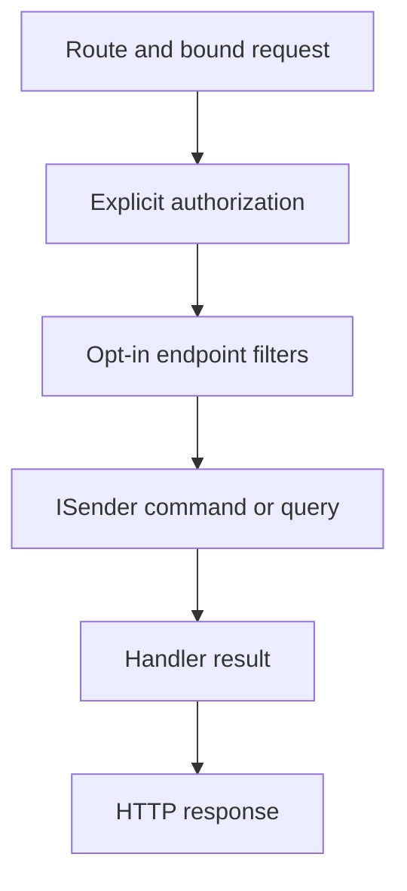

# API guidelines

Carter endpoints translate HTTP requests into commands and queries while declaring routing, authorization and response metadata explicitly.

## At a glance

| Responsibility | Source |
|---|---|
| Endpoint routing | Module `ICarterModule` implementations |
| Version selection | `src/Shared/Shared.Core/Web/ApiVersioningExtensions.cs` |
| Paging contract | `src/Shared/Shared.Contracts/CQRS/BaseQuery.cs` |
| Error and response contract | [Errors and responses](Errors-and-Responses.md) |

There are no controllers.
To add an endpoint, use the copy-ready templates in `/starterkit:add-feature`
(`tools/claude/starterkit-plugin/skills/add-feature/references/templates.md`).

## How it works


*Figure: The endpoint owns the HTTP contract while the mediator pipeline and handler own application execution.*

### Routes and versioning

- Business endpoints: `EndpointConfig.BaseApiPath + "/<resources>"`, which resolves to `api/v{version}/<resources>`.
  For example, `GET api/v1/tenants/current/` and `PUT api/v1/tenants/current/`.
- Use plural nouns and kebab-case segments. Actions that are not CRUD use named sub-resources.
- Route constraints are always typed (`{id:guid}`). The route id is the source of truth; the body never carries the
  id.
- Each endpoint or its route group declares `.WithApiVersionSet(app.NewApiVersionSet("<Module>").Build())` and `.HasApiVersion(1.0)`.
  The version is read from the URL segment or the `api-version` header (`Shared.Core/Web/ApiVersioningExtensions.cs`).
  A breaking change ships as a new version, and the old one is kept until clients migrate.
- Some older Identity and admin routes (`api/auth/*`, `api/identity/*`, `/admin/...`) are unversioned. Keep new work
  on the versioned base path.

| Verb | Use | Success |
|---|---|---|
| GET | Read, list (paginated) | 200 |
| POST | Create (`Results.Created(location, ...)`) or action | 201 / 200 |
| PUT | Full update (with optional `version`) | 200 |
| PATCH | Narrow state change (`/status`) | 200 |
| DELETE | Delete (soft or hard) | 200 |

### Request and response shape

- **Requests:** a `<Feature>Request` record in the endpoint file, mapped explicitly to the command. Queries bind
  with `[AsParameters]` to a `BaseQuery`-derived record (`PageNumber` default 1, `PageSize` default 10, sort fields).
- **Responses and failures:** use the [Errors and responses](Errors-and-Responses.md) contract. It defines envelope fields, validation, exception/status mapping, machine codes, trace identifiers and the existing HTTP-201/envelope-200 caveat.
- **Lists:** use `PaginatedResult<T>`; small fixed lookups may return a plain list. Never expose an unbounded collection.

- **Enums:** check the declared contract. Types such as `SortBy` opt into string JSON through `JsonStringEnumConverter`; there is no host-wide enum converter. Localized labels come from the enum lookup endpoint.
- **Bilingual input and output** uses `LocalizedText` `{ "en": "...", "ar": "..." }`.
- **Optimistic concurrency:** read DTOs expose `version`; update requests may send it back. A stale one returns 409.

### Documentation metadata

New endpoints declare `.WithName`, `.WithTags`, `.WithSummary`, `.WithDescription`, and one `.Produces<...>` per
status it can return. The host maps Swagger UI at `/swagger` and Scalar at `/scalar` in Development; Nginx also defines protected locations for them. Opening a proxy allow-list does not enable production OpenAPI.

### Security

- **Auth is explicit.** Carter endpoints are deny-by-default (authenticated user) as a safety net, and
  `Every_endpoint_declares_authorization_explicitly` fails the build unless each endpoint states its intent. Pick from the table in
  `CLAUDE.md` → *Hard-won patterns* (`RequireAuthorization`, `"PageGate"`, `RequirePermission`,
  `RequireTenantPermission`, `HostOnly`, `DisallowImpersonation`, `AllowAnonymous`). See also
  `/starterkit:add-permission`.
- **Rate limiting:** `.RequireRateLimiting("create" | "search" | "upload" | "auth" | "otp")`. Policies are
  configured in `RateLimiting:Policies`, partitioned per user and otherwise per client IP. Login, OTP and upload
  endpoints must have one.
- **CORS** is configured per environment (`Cors` section, `UseConfigurableCors`).
- Never return internal ids of other tenants, stack traces, or whether an account exists (forgot-password
  must not disclose account existence; rate limits and human-verification checks can still reject the request).

## Configuration

Defaults from `src/Api/appsettings.json`; version selection is fixed in `ApiVersioningExtensions`.

| Key | Default | Meaning |
|---|---|---|
| `Paging:DefaultPageSize` | `10` | Default page size. |
| `Paging:MaxPageSize` | `100` | Authenticated paging cap. |
| `Paging:AnonymousMaxPageSize` | `20` | Anonymous paging cap. |
| `RequestTimeouts:DefaultSeconds` | `30` | Default request timeout. |
| `RequestTimeouts:LongRunningSeconds` | `300` | Long-running policy for file operations. |

`BaseQuery` defaults `PageNumber` to 1 and `PageSize` to 10. The version reader accepts URL segments and the `api-version` header, assumes 1.0 when unspecified, and reports supported/deprecated versions. Rate-limit policy entries live under `RateLimiting:Policies`; CORS is environment-specific.

## Usage

This excerpt is from `src/Modules/Tenancy/Tenancy/Domains/Tenants/Features/TenantsModule.cs`; its surrounding route group carries the version set and tenant requirement:

```csharp
current.MapGet("/", async (ISender sender, CancellationToken ct) =>
        Results.Ok(ApiResponseExtensions.Success(await sender.Send(new GetCurrentTenantQuery(), ct))))
    .WithName("GetCurrentTenant").Produces<ApiResponse<TenantDto>>()
    .WithSummary("Current tenant").WithDescription("Profile of the current tenant. Members only.")
    .RequireTenantMember();
```

### Checklist for a new endpoint

- [ ] Versioned route, typed constraints, plural resource
- [ ] Request record mapped to a command or query; no domain types in the HTTP contract
- [ ] Validator with localized messages (en + ar)
- [ ] Explicit authorization and rate limiting
- [ ] Full `Produces` list, plus name, tags and summary
- [ ] `PaginatedResult<T>` for lists; `version` round-trip for critical updates
- [ ] Tests: validator, handler, and E2E for 401/403 plus the happy path (`/starterkit:write-tests`)

## Failure modes and guarantees

Explicit authorization is mandatory even though Carter applies an authenticated-user fallback. Security-sensitive self-service endpoints also use `DisallowApiKey`; destructive or owner actions use `DisallowImpersonation`. Feature flags, plan gates and idempotency do not replace authorization. See [Request lifecycle](Request-Lifecycle.md) for filter order and [Errors and responses](Errors-and-Responses.md) for failures.

## Guardrails

`AdminEndpointAuthorizationTests` checks every endpoint's authorization metadata and permission registration. `NamingConventionTests` checks endpoint names. `ExceptionHandlingTests` and `ResponseWrapperTests` cover response handling. Use `/starterkit:add-feature`, `/starterkit:add-permission` and `/starterkit:write-tests`; [ADR-0002](../Decisions/0002-carter-minimal-apis.md) explains Carter.

## Related

[DesignPatterns.md](DesignPatterns.md) · [DatabaseConventions.md](DatabaseConventions.md) ·
[../Testing/Testing-Strategy.md](../Testing/Testing-Strategy.md)
