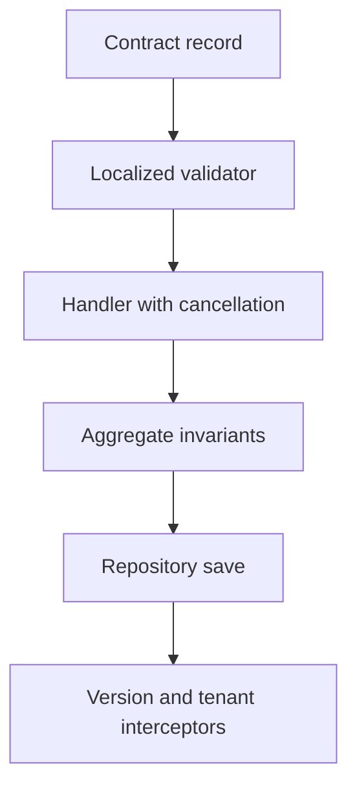

# Coding standards

C# conventions make feature slices predictable and keep invariants, cancellation, localization and diagnostics consistent across modules.

## At a glance

| Concern | Authority |
|---|---|
| Architecture rules | `CLAUDE.md` |
| Compiler and analyzer settings | `Directory.Build.props`, `.editorconfig` |
| Package versions | `Directory.Packages.props` |
| Copy-ready procedures | `tools/claude/starterkit-plugin/skills/*/references/templates.md` |

Use `dotnet new starterkit-module` for a reference aggregate that is available without the optional sample.

## How it works


*Figure: Contracts carry intent, validators check input, and aggregate methods preserve invariants before infrastructure stamps the save.*

### Language and project settings

- .NET 10 / the SDK-default C# version, with `Nullable` and `ImplicitUsings` enabled (`Directory.Build.props`). Treat nullable
  warnings as bugs.
- File-scoped namespaces that match the folder (for example, `Tenancy.Domains.Tenants.Features`).
- Package versions live only in `Directory.Packages.props`.
- Each module has a `GlobalUsings.cs` for its common namespaces. Don't repeat those `using`s in files.

### Types

| Use | For |
|---|---|
| `record` (positional) | Commands, queries, results, requests, responses, DTOs, domain events |
| `sealed class` | Services, consumers, jobs, options, integration events (with `init` properties) |
| Primary constructors | Handlers, services, repositories, endpoints' dependencies |
| `private set` + factory method | Entities and aggregates (`static Create(...)`, private parameterless ctor for EF) |
| `const` | Max lengths, index names, job ids, permission values |

### Error handling

Use typed exceptions, not a Result abstraction, and let the shared handler map them to HTTP. The canonical [Errors and responses](Errors-and-Responses.md) page defines the envelope, exceptions, status codes and machine codes. Validation belongs in discovered FluentValidation validators; domain invariants belong in entities.

Do not swallow exceptions. A best-effort side effect catches, logs a warning with context and continues with an explicit explanation. Use `catch (Exception ex) when (ex is not OperationCanceledException)` so cancellation propagates.

### Async and cancellation

- Every I/O method is `async` and takes a `CancellationToken cancellationToken`; pass it all the way down.
- No `.Result`, `.Wait()` or `async void`.
- Match the job's Hangfire cancellation contract and forward cancellation to I/O; jobs in the repository use both `IJobCancellationToken` and `CancellationToken`.

### Time, ids and money

- Inject `TimeProvider` in new handlers, services and jobs. Pass time into domain behavior when it needs to be controlled.
- All timestamps are UTC `DateTime`.
- Ids are `Guid` assigned in factories with `Guid.NewGuid()` or `Guid.CreateVersion7()`. Seed data uses fixed ids (`TenantSeedIds.For` per tenant).
- Money is `decimal` with an explicit currency (see [money precision](../Decisions/0017-money-precision-and-per-currency-rounding.md)).

### Logging

- Use structured logging with message templates and pass exceptions separately: `logger.LogWarning(ex, "Could not release idempotency key (it expires on its own)")`.
  This excerpt is from `src/Shared/Shared.Core/Web/Idempotency/IdempotencyFilter.cs`. No string interpolation in log calls.
- Never log secrets, tokens, passwords, OTP codes or full PII.
- Use `Warning` for handled, expected-but-notable cases, and `Error` for failures needing attention.

### Localization

- Every user-facing message comes from the module resx through `IStringLocalizer<<Module>Resource>`, with keys in
  **both** `.resx` and `.ar.resx`. Keep both resource key sets identical.
- Bilingual data is `LocalizedText` (en/ar). Enums exposed to clients carry `[LocalizedDescription("en", "ar")]`.
- Exceptions and aggregate invariants without dependency injection use `IdentityText.Get(key, args)` in Identity (`src/Modules/Identity/Identity/Resources/IdentityText.cs`), backed by the same bilingual resources. Localized enum labels are served by the enum lookup endpoint described in [API guidelines](ApiGuidelines.md).

### Naming

The full table is in `CLAUDE.md` → *Naming*, enforced by `NamingConventionTests`. Highlights:
- `<Feature>EndPoint` (capital P), `<Feature>CommandValidator` placed before `<Feature>Handler` in the same file.
- Test methods are named `Scenario_Expectation`.
- Private fields are `_camelCase`. Async methods end in `Async`. Constants are `PascalCase`.

### Comments

- Write XML doc comments (`///`) on public types whose *why* isn't obvious: invariants, concurrency, tenancy and
  idempotency decisions.
- Comment the reason, not the mechanics. No commented-out code; git has history.

### Analyzers

The build runs the .NET analyzers at `AnalysisLevel=latest-recommended` plus the IDE style rules
(`EnforceCodeStyleInBuild`), and `TreatWarningsAsErrors=true` (all in `Directory.Build.props`). A warning therefore
breaks the build, locally and in CI.

- **Fix first.** Nullable, culture (CA1305: use `CultureInfo.InvariantCulture` for machine formats), cancellation
  forwarding (CA2016), obsolete APIs, SQL built from strings (EF1002) and weak crypto (CA53xx) are real defects.
- **Relax a rule only in `.editorconfig`**, under *Code Quality Rules* (or the *Test projects* section for
  `*.Tests`/`*.IntegrationTests`/`*.E2ETests`), with the severity and a one-line comment saying **why**:

  ```ini
  # CA1848 / CA1873: Use LoggerMessage delegates / avoid expensive logging argument evaluation
  # Relaxed to suggestion: a performance micro-optimisation, and hundreds of call sites would turn every log line into boilerplate.
  dotnet_diagnostic.CA1848.severity = suggestion
  ```
- **A single false positive** gets a local `[SuppressMessage("Category", "CAxxxx:Title", Justification = "...")]` (or a
  narrowly scoped `#pragma warning disable` with a reason on the same line). Never a bare `#pragma`, never a
  project-wide `NoWarn` (the only entries are CS1591, and AV0029/AV0030 whose diagnostics come from a source generator
  that `.editorconfig` cannot reach).
- EF migrations (`**/Data/Migrations`, `**/Persistence/Migrations`) are generated code (`generated_code = true`):
  analyzers skip them. Generate schema changes through EF tooling, then add required tenant RLS operations as described in [Migrations](../Reference/Migrations.md).
- `IDE0005` (unused usings) is a suggestion because the compiler only evaluates it in the build when
  `GenerateDocumentationFile=true`, which would also enable the OpenAPI XML-comment source generator. Clean usings in
  the IDE (`dotnet format style --diagnostics IDE0005` with that property set also works).

### Formatting

Follow `.editorconfig`. Run `dotnet format StarterKit.slnx --verify-no-changes` before review if you touched many
files.

## Configuration

Build policy comes from `Directory.Build.props`, not runtime appsettings.

| Key | Value | Meaning |
|---|---|---|
| `TargetFramework` | `net10.0` | Shared target framework. |
| `Nullable` | `enable` | Nullable reference analysis. |
| `ImplicitUsings` | `enable` | SDK-provided common imports. |
| `AnalysisLevel` | `latest-recommended` | Recommended .NET analyzer set. |
| `EnforceCodeStyleInBuild` | `true` | Evaluate style rules during build. |
| `TreatWarningsAsErrors` | `true` | Warnings fail the build. |

## Usage

The request records in `src/Modules/Tenancy/Tenancy/Domains/Tenants/Features/TenantsModule.cs` use positional records:

```csharp
public record TransferOwnershipRequest(Guid NewOwnerUserId);

public record TenantReasonRequest(string? Reason);
```

## Failure modes and guarantees

Never set `Version` or `TenantId` by hand. Critical updates accept `long? Version` and call `ExpectVersion`; child-only aggregate changes use `BumpVersionOnSave`. Deletes do not take a version. New tenant tables require RLS and tenant-leading unique indexes; `ApplyTenantFilters` comes last. Use named filter helpers rather than parameterless `IgnoreQueryFilters()`.

Build warnings fail locally and in CI. Do not hide a failure behind broad suppression, a blocking async call, or a catch that discards cancellation. See [Errors and responses](Errors-and-Responses.md) for safe client messages.

## Guardrails

`NamingConventionTests`, `ModuleBoundaryTests`, `TenantIsolationArchitectureTests`, `ClientGeneratedKeyTests` and `AuditTrailArchitectureTests` enforce structural conventions. Concurrency tests live in `src/Shared/Shared.Core.Tests/Concurrency/`; `PendingModelChangesTests` checks migration/model alignment. Run `dotnet build StarterKit.slnx`, relevant tests and `dotnet test src/Api.Tests` after code changes.

## Related

[API guidelines](ApiGuidelines.md), [Database conventions](DatabaseConventions.md), [ADR-0021](../Decisions/0021-aggregate-version-covers-child-collections.md), `/starterkit:add-feature`, `/starterkit:add-aggregate`, and `/starterkit:write-tests`.
