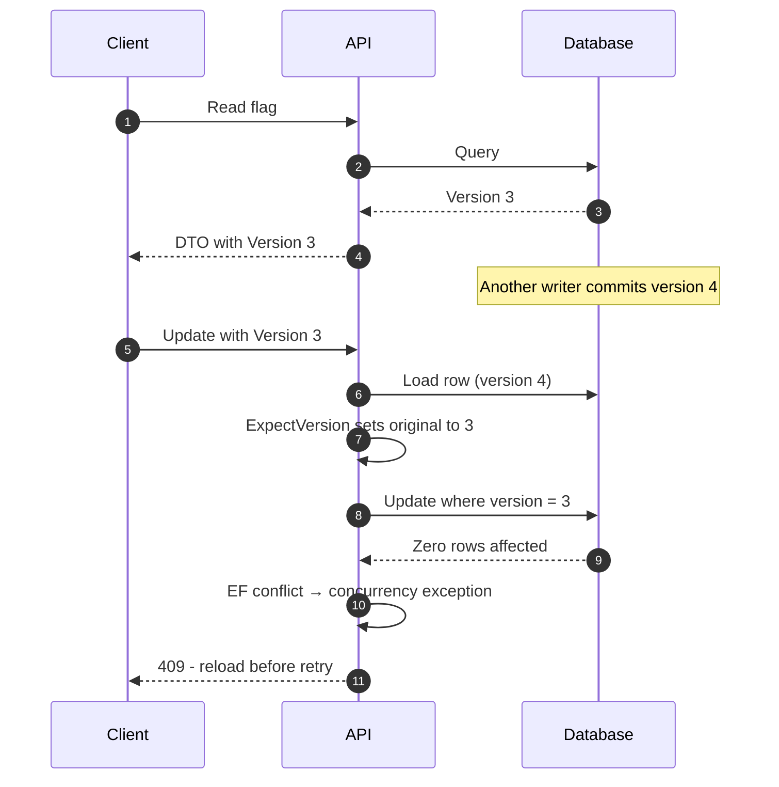

# Concurrency and versions

Optimistic concurrency checks a persisted version at save time so a stale writer cannot silently overwrite a newer change to an entity or its child collections.

## At a glance

| Boundary | Contract / source |
|---|---|
| Entity | `IEntity.Version`, implemented by `Entity<T>` in `src/Shared/Shared.Core/DDD/` |
| Model | `ConfigureVersionConcurrencyTokens()` in each module DbContext |
| Client expectation | `DbContextVersioningExtensions.ExpectVersion` in `src/Shared/Shared.Core/Data/` |
| Save | `AuditableEntityInterceptor` in `src/Shared/Shared.Core/Data/Interceptors/` |
| HTTP translation | `ConcurrencyHandlingBehavior` → `ConcurrencyConflictException` → 409 |
| Child-only mutation | `Aggregate.BumpVersionOnSave()`; [ADR-0021](../Decisions/0021-aggregate-version-covers-child-collections.md) |

## How it works

New entities start with `Version = 0`. EF maps the version as a concurrency token. For a modified entity, the audit interceptor sets the current version to the original version plus one and marks that property modified. It does not replace the original value: EF uses that value in the update predicate. An owned-entity change also updates the owner version. After a successful save, EF accepts the new values, so a second save in the same scope checks the new version.

Critical update commands and HTTP requests accept `long? Version = null`; read DTOs expose `long Version`. After loading a tracked entity, the handler calls `dbContext.ExpectVersion(entity, command.Version)` before mutation and saving. A supplied value replaces EF's original version, including when the server loaded a newer row than the client saw. An omitted value keeps the loaded version: it protects the load-to-save interval, but cannot detect edits made since an earlier client read.


*Figure: A client-supplied version detects a stale edit even when the handler loaded the newest row.*

`ExpectVersion` with a non-null expectation requires a tracked, persisted entity; detached or added entities cause `InvalidOperationException`. It sets an expectation, not an immediate database check. The conflict is detected when EF executes a version-checked write; calling the helper alone is not a preflight check for an external side effect.

### Child-only changes

An ordinary child row is not an EF owned value. Changing that row does not inherently mark the aggregate root modified. A behavior method that changes only children calls `BumpVersionOnSave()` so the interceptor updates and checks the root as part of the same save. Methods that also change a root column need no explicit bump. The request is consumed on save, including for added entities, and repeated requests before a save cause one bump.

This protects invariants spanning children, such as a tenant's custom-domain limit, and makes a root DTO's version cover its collection. See `Tenant` in `src/Modules/Tenancy/Tenancy/Domains/Tenants/Models/Tenant.cs` and the flag override example below.

### Deletes and background work

Delete commands do not accept a client version. A tracked EF delete can still conflict with a concurrent update or deletion after load; absence of a request version does not disable EF's token.

DbContexts propagate `DbUpdateConcurrencyException` unchanged. The mediator behavior wraps it in `ConcurrencyConflictException`; background code may see either form. Jobs use `IsConcurrencyConflict()` to log and skip the contested item. A retry must load fresh state and re-evaluate the operation, rather than replaying a stale tracked entity.

`SubscriptionsDbContext.SaveChangesAsync(CancellationToken)` separately maps PostgreSQL unique violations (`23505`) to `ConflictException`, with safe constraint-specific messages. These enforce uniqueness under races, not version equality. `IsConcurrencyConflict()` recognizes only the raw EF concurrency exception and its domain wrapper; jobs that also handle uniqueness conflicts explicitly include `ConflictException` in their catch filter.

## Usage

From `src/Modules/Tenancy/Tenancy.Contracts/FeatureFlags/FeatureFlagContracts.cs`:

```csharp
public sealed record UpdateFeatureFlagCommand(
    string Key,
    string? Description,
    bool Enabled,
    int RolloutPercent,
    bool KillSwitch,
    long? Version = null) : ICommand<UpdateFeatureFlagResult>;

public sealed record UpdateFeatureFlagResult(Guid Id, long Version);
```

`FeatureFlagDto` in the same file exposes `long Version`; `UpdateFeatureFlagRequest` in `src/Modules/Tenancy/Tenancy/Domains/FeatureFlags/Features/FeatureFlagsModule.cs` passes its nullable version into the command. The handler in the adjacent `FeatureFlagHandlers.cs` performs the check:

```csharp
var key = FeatureFlag.NormalizeKey(command.Key);
var flag = await dbContext.FeatureFlags.FirstOrDefaultAsync(f => f.Key == key, cancellationToken)
           ?? throw new FeatureFlagNotFoundException(key);
dbContext.ExpectVersion(flag, command.Version);

flag.Update(command.Description, command.Enabled, command.RolloutPercent, command.KillSwitch);
await dbContext.SaveChangesAsync(cancellationToken);
return new UpdateFeatureFlagResult(flag.Id, flag.Version);
```

Child-only removal in `src/Modules/Tenancy/Tenancy/Domains/FeatureFlags/Models/FeatureFlag.cs`:

```csharp
public void RemoveOverride(Guid overrideId)
{
    var existing = _overrides.FirstOrDefault(o => o.Id == overrideId)
                   ?? throw new FeatureFlagOverrideNotFoundException(Key, overrideId);
    _overrides.Remove(existing);
    BumpVersionOnSave();
    Touch();
}
```

The job catch filter in `src/Modules/Subscriptions/Subscriptions/Domains/Subscriptions/Jobs/ProcessPlanPriceChangesJob.cs` uses `catch (Exception ex) when (ex.IsConcurrencyConflict())`.

## Failure modes and guarantees

- A version mismatch causes the version-checked save to fail. Writes in that save's transaction do not partially commit. This does not undo earlier committed saves or external calls.
- Both raw and translated concurrency exceptions map to HTTP 409 with the safe message “The resource was modified by another request. Reload and try again.” They do not assign an `errorCode` string. See [Errors and responses](Errors-and-Responses.md) for the envelope.
- No automatic command retry occurs. Reload, show the current state to the caller, and submit a deliberate new change with its version.
- Never assign `Version` or EF's `OriginalValue` in application code; use the helper and interceptor. Bulk SQL operations bypass tracked-entity interception and need their own concurrency design.
- Domain-event eligibility follows commit, not attempted mutation; see [Request lifecycle](Request-Lifecycle.md).

## Guardrails

`OptimisticConcurrencyTests`, `ChildCollectionVersionTests` and `ConcurrencyHandlingBehaviorTests` in `src/Shared/Shared.Core.Tests/Concurrency/` pin stale/future/null expectations, sequential saves, child-only changes and exception translation. `JobDomainEventTests` and `ConcurrencyTests` in `src/Modules/Subscriptions/Subscriptions.IntegrationTests/` cover job conflicts and uniqueness races. These tests require the appropriate database fixtures; they are not all architecture-only tests.

## Related

[Database conventions](DatabaseConventions.md), [Request lifecycle](Request-Lifecycle.md), [Errors and responses](Errors-and-Responses.md), [Feature flags](Feature-Flags.md), [ADR-0021](../Decisions/0021-aggregate-version-covers-child-collections.md), and `/starterkit:add-feature` / `/starterkit:add-aggregate`.
