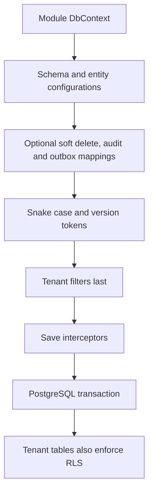

# Database conventions

Module-owned PostgreSQL schemas and shared EF Core conventions keep persistence boundaries explicit while enforcing tenant isolation and concurrency at the database boundary.

## At a glance

| Concern | Main types / source |
|---|---|
| Context setup | `AddCustomDbContext`, `src/Shared/Shared.Core/Data/Extentions.cs` |
| Model conventions | `AppDbContextBase`, `ToSnakeCaseTables`, `ConfigureVersionConcurrencyTokens` |
| Save interception | `src/Shared/Shared.Core/Data/Interceptors/`; [Request lifecycle](Request-Lifecycle.md#save-commit-and-dispatch) |
| Tenant isolation | `ITenantDataContext`, `TenantEntityInterceptor`, `TenantSessionConnectionInterceptor` |
| Deploy migrations | `DatabaseMigrationOptions`, `MigrationLock`, `src/Api/Program.cs` |

## How it works

### One database, one schema per module

The shared database is selected by `ConnectionStrings:starterkit`. Each module owns its DbContext, schema and migrations history (`UseModuleMigrationsHistory<TContext>()`). Platform schemas include `identity`, `tenancy`, `attachment`, `subscriptions`, `notification`, `webhooks` and `datatransfer`; the optional sample owns its own schema. Tenant-data contexts can instead use a tenant's dedicated database. Control-plane contexts remain in the host database.

No cross-module joins or foreign keys cross schema boundaries. Store another module's identity as a scalar id and read through `ISender` plus its contracts. See [Overview](Overview.md) and [ADR-0001](../Decisions/0001-modular-monolith-schema-per-module.md).


*Figure: Model conventions and save interception complement database constraints and tenant row-level security.*

### Naming

Use snake_case for tables, columns and indexes through `EFCore.NamingConventions` and `ToSnakeCaseTables()`. Owned `LocalizedText` uses `name_en` / `name_ar`. Name unique indexes explicitly and keep the name in a configuration constant so `IsUniqueViolation` can translate a particular constraint into a domain conflict.

### Keys, types and columns

| Concern | Rule |
|---|---|
| Primary key | Generate `Guid` ids in factories; both `Guid.NewGuid()` and `Guid.CreateVersion7()` exist. Client-generated child keys require `ValueGeneratedNever()`. |
| Enums | `.HasConversion<string>().HasMaxLength(...)`: readable and reorder-safe. `EnumStorageTests` fails on any enum column stored as an integer, except nine legacy Identity/Subscriptions columns it lists (converting them is a data migration on existing tables). |
| Strings | Bound persisted strings with `HasMaxLength`, using entity constants. |
| Money | Explicit decimal precision and currency; shared money precision is `numeric(19,4)`. |
| Booleans | Use `IsRequired()`; avoid `HasDefaultValue` sentinel surprises. |
| Concurrency | `long Version`, mapped by `ConfigureVersionConcurrencyTokens()`; never assign it manually. |
| Audit columns | `CreatedAt`, `CreatedBy`, `LastModified`, `LastModifiedBy`, stamped by `AuditableEntityInterceptor`. |
| Tenant ownership | `tenant_id` on every tenant-data entity; `TenantEntityInterceptor` stamps it. Never set `TenantId` yourself. |

`Entity<T>.CreatedAt` is nullable (`DateTime?`) in `src/Shared/Shared.Core/DDD/Entity.cs`. If an entity needs a non-nullable creation time, shadow it with `public new DateTime CreatedAt { get; private set; }`, as in `src/Modules/Identity/Identity/Domains/Onboarding/Models/OnboardingProcess.cs`; do not assume the base property is non-nullable.

#### Timestamps (UTC only)

Npgsql uses non-legacy timestamp behavior. For `timestamptz`, supply UTC `DateTime` values, normally `TimeProvider.GetUtcNow().UtcDateTime`; local or unspecified values are rejected. Normalize client `DateTimeOffset` input with `ToUniversalTime()`. Do not enable `Npgsql.EnableLegacyTimestampBehavior`.

### Relationships

Map aggregate children with an explicit delete behavior and field access for private backing collections. Between aggregates in a module, reference by id and add a foreign key where integrity requires it, with a deliberate cascade or restrict policy. Never add a cross-module foreign key. Repositories load aggregates and children with `Include`, using `AsSplitQuery()` for multiple collections; do not rely on lazy loading.

### Indexes

Index filter and sort columns, foreign keys, statuses and purge predicates such as `(is_deleted, deleted_at)`. Unique indexes in tenant-data contexts start with `tenant_id`. For unique indexes spanning an owned property and the owner's tenant column, create the composite index in migration SQL, keeping its name aligned with the configuration constant. Filtered unique indexes allow soft-deleted values to be reused where the domain permits that.

### Query filters

Use named filters (`QueryFilterNames`): `SoftDelete` from `FilterSoftDeletedProperties()`, `Tenant` and `Branch` from `ApplyTenantFilters`, and module-specific filters such as `Lifecycle`. Add soft-delete mapping only for entities that actually soft-delete.

Admin, restore and purge queries use `IgnoreNonIsolationFilters()` to remove soft-delete/lifecycle restrictions while keeping tenant and branch isolation. `IgnoreBranchScope()` removes branch scoping for explicitly authorized tenant-wide access. Parameterless `IgnoreQueryFilters()` is forbidden in production code. Neither helper is a substitute for endpoint authorization.

### Reading data

Queries use `AsNoTracking()` and SQL projection, then `.PagedResult(pageNumber, pageSize, ct)` from `src/Shared/Shared.Core/Extensions/QueryExtensions.cs`. Small bounded lookups can return a list. Avoid per-row database calls: batch ids into a single query. Escape user-supplied wildcard characters before an `EF.Functions.ILike` search; parameterization alone does not make `%` or `_` literal.
<!--#if (search)-->

`ILIKE` is a filter, not a search: it cannot rank, match word forms or forgive a typo, and it scans. Text search that
users type goes through the [Search module](../Modules/Search.md): the owning module registers an index, asks it for
ids and loads them through its own DbContext, keeping `ILIKE` only as the fallback while the index cannot answer.
<!--#endif-->

### Writing data and transactions

Prefer one `SaveChangesAsync` per command. A save is transactional; use an explicit transaction if several saves must commit together. Event staging, commit and post-commit dispatch are distinct stages; [Request lifecycle](Request-Lifecycle.md#save-commit-and-dispatch) defines them. Integration facts use the [transactional outbox](Messaging.md#outbox).

Critical updates use `ExpectVersion`; [Concurrency and versions](Concurrency-and-Versions.md) covers the full request/DTO contract and child-only mutations. Translate known PostgreSQL unique violations (`23505`) using `IsUniqueViolation`, rather than relying on a pre-insert existence query alone. Subscriptions also translates unique violations centrally in its async DbContext save override.

### Seeding

Implement `IDataSeeder` (`SeedAllAsync`, `DbContextType`) and register it in the owning module. Seeding must be idempotent. Use `TenantSeedIds.For(tenantId, seedId)` for stable per-tenant ids. `UseMigration<T>()` runs seeders after migrations when migration is enabled; tenant-data seeders run in the Default tenant scope. Tenancy provisioning uses `MigrateAndSeedAsync` for dedicated tenant databases.

Schema work that depends on configuration (an index sized by a setting) cannot be a migration: implement
`Shared.Core.Data.IPostMigrationStep` (`DbContextType`, `RunAsync`) and register it in the owning module. It runs
after that context's migrations wherever they run (`--migrate-only`, boot-time migration in development, dedicated
tenant databases), on the migration connection and under the migration lock, so never at boot in production. It must
be idempotent.
<!--#if (agentic)-->
Reference: `KnowledgeVectorIndexStep` ([ADR-0032](../Decisions/0032-knowledge-hnsw-index.md)).
<!--#endif-->

### Audit trail

Entities implementing `IAuditable` get an `audit_entries` row for each tracked insert, update and delete through `AuditTrailInterceptor`, in the same save transaction. Map `AddAuditTrail()` or `AddTenantAuditTrail()` before tenant filters; tenant-data audit tables also need RLS in the migration. Retention jobs call `PurgeAuditEntriesAsync`.

`[AuditIgnore]` excludes noisy or secret properties; names containing Password, Secret, Token or Hash are automatically excluded. `ExecuteUpdate` and `ExecuteDelete` bypass this interceptor. See [ADR-0011](../Decisions/0011-audit-trail.md).

### Row-level security

Every new table in an `ITenantDataContext`, including children, audit rows and outbox rows, requires `EnableTenantRowLevelSecurity` in its migration. EF filters and tenant write checks are complemented by forced PostgreSQL RLS. The connection interceptor sets session tenant state. Role-based host bypass requires a privileged role; setting a session flag does not bypass role-based policies. Tenant-data connections must not use transaction pooling. See [Isolation and dedicated databases](../MultiTenancy/Isolation-and-Dedicated-Databases.md).

### Migrations at deploy

Production disables boot-time migration with `Database:MigrateOnStartup=false`. The deploy runs `dotnet run --project src/Api -- --migrate-only` (or the published API with the same flag) to migrate and seed shared and dedicated tenant databases, then exit. It also provisions the PostgreSQL message transport when configured.

`MigrationLock` serializes migrators per database through a session advisory lock on a dedicated, unpooled connection. The lock is released on disposal or connection loss; lock acquisition times out rather than running migrations concurrently. The shared migration connection may use `Database:MigrationConnectionString` for elevated privileges, while normal request connections retain runtime privileges. That override is for shared-database migration; it does not replace dedicated-tenant connection strings. See [Migrations](../Reference/Migrations.md) for creation and deployment procedures.

## Configuration

Defaults come from `DatabaseMigrationOptions`, `src/Api/appsettings.json`, `appsettings.Docker.json` and audit retention configuration.

| Key | Default | Meaning |
|---|---|---|
| `Database:MigrateOnStartup` | `true`; Docker `false` | Enables migration and seed during normal module initialization. |
| `Database:MigrateOnly` | `false` | Set by `--migrate-only`; migrate regardless of the boot setting, then exit. |
| `Database:MigrationConnectionString` | `null` | Optional privileged shared-database migration connection; otherwise the normal connection. |
| `Database:LockTimeoutSeconds` | `300` | Maximum advisory-lock wait. |
| `AuditTrail:RetentionDays` | `365` | Retention cutoff used by audit purge jobs. |

## Usage

The ordering in `src/Modules/Tenancy/Tenancy/Data/TenancyDbContext.cs` is:

```csharp
base.OnModelCreating(builder);
builder.HasDefaultSchema(Schema);
builder.ApplyConfigurationsFromAssembly(Assembly.GetExecutingAssembly());
builder.ToSnakeCaseTables();
builder.ConfigureVersionConcurrencyTokens();
```

`ApplyTenantFilters(builder)` is the final model-building call. Tenant-data contexts follow the same ordering and require every entity to implement `IMustHaveTenant`. `AddCustomDbContext<TContext>` supplies Npgsql, naming conventions and save/connection interceptors; model mappings and migrations remain the module's responsibility.

From `src/Modules/Tenancy/Tenancy/Data/Configurations/FeatureFlagConfigurations.cs`, a real aggregate-child mapping:

```csharp
builder.HasMany(f => f.Overrides).WithOne().HasForeignKey(o => o.FeatureFlagId).OnDelete(DeleteBehavior.Cascade);
builder.Navigation(f => f.Overrides).UsePropertyAccessMode(PropertyAccessMode.Field);
```

## Failure modes and guarantees

Version mismatches and translated uniqueness conflicts return 409; unmapped database failures follow the 500 path in [Errors and responses](Errors-and-Responses.md). Isolation checks are not optional query conveniences: omitting a tenant filter or RLS migration creates a security defect. An advisory-lock timeout fails the migration run; it does not authorize a second migrator to proceed. Deploy migrations before starting runtime instances that require the new schema.

## Guardrails

`TenantIsolationArchitectureTests`, `ClientGeneratedKeyTests`, `AuditTrailArchitectureTests` and `ModuleBoundaryTests` in `src/Api.Tests/Architecture/` enforce model and dependency rules. `PendingModelChangesTests` and `TenantRowLevelSecurityCoverageTests` in `src/Api.E2ETests/` check migrations and actual RLS coverage. `MigrationsHistoryTests` and `MigrationLockTests` in `src/Shared/Shared.Core.Tests/Infrastructure/` cover history isolation and lock behavior. Concurrency has its own [test coverage](Concurrency-and-Versions.md#guardrails).

## Related

[Migrations](../Reference/Migrations.md), [Adding a tenant-aware module](../MultiTenancy/Adding-a-Tenant-Aware-Module.md), [API guidelines](ApiGuidelines.md), [Testing strategy](../Testing/Testing-Strategy.md), [ADR-0001](../Decisions/0001-modular-monolith-schema-per-module.md), and `/starterkit:add-migration` / `/starterkit:add-aggregate`.
