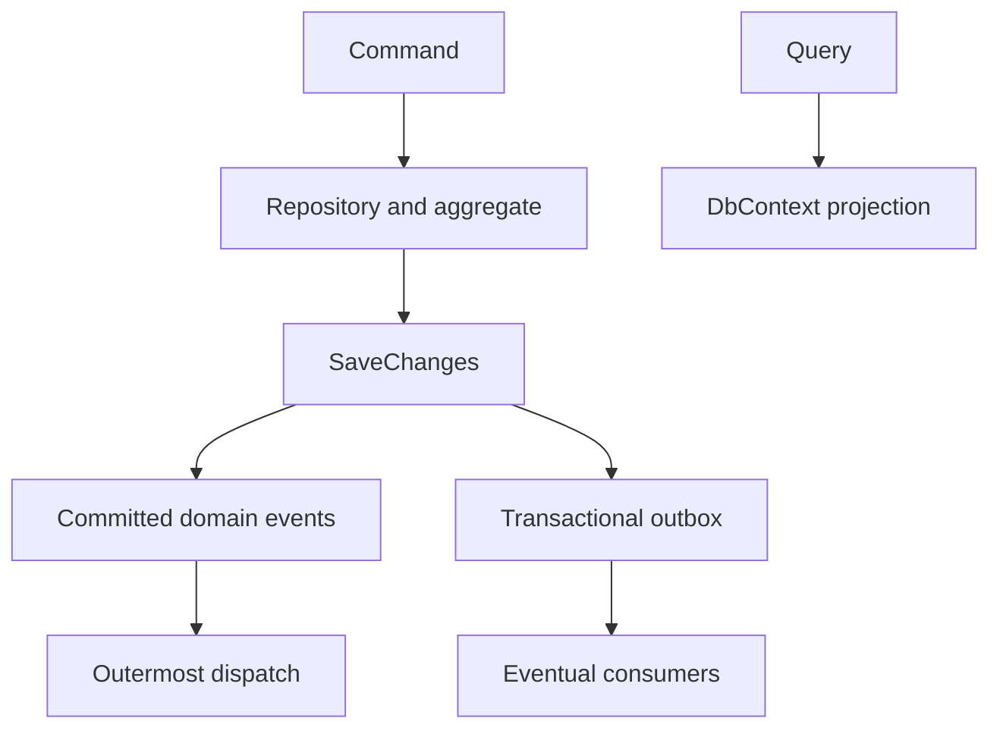

# Design patterns

StarterKit uses a small set of patterns to keep business invariants, module boundaries and persistence guarantees explicit.

## At a glance

Decisions behind these choices are in [ADRs](../Decisions/README.md).

| Pattern | Where | Use it for |
|---|---|---|
| **Modular monolith** | `src/Modules/*`, one schema per module | Independent bounded contexts in one deployable ([ADR-0001](../Decisions/0001-modular-monolith-schema-per-module.md)) |
| **Vertical slice** | `Domains/<Aggregate>/Features/<Feature>/` | One use case = validator + handler + endpoint in one folder |
| **CQRS (owned mediator)** | `ICommand`/`IQuery` + `ICommandHandler`/`IQueryHandler` (`Shared.Contracts.CQRS`) | Commands change state through aggregates; queries project from the DbContext |
| **Aggregate + factory** | `Aggregate<Guid>` and static factories | Invariants in one place; private setters |
| **Domain events** | `AddDomainEvent` → `DispatchDomainEventsInterceptor` → `IPublisher` after commit | Same-module reactions (cache invalidation, logging, emails) |
| **Integration events + transactional outbox** | `AddIntegrationEvent` → `outbox_messages` → MassTransit | Cross-module facts, at-least-once ([Messaging.md](Messaging.md)) |
| **Repository** | `Data/Repository/<X>Repository.cs`, one per aggregate root | Loading and saving aggregates with their children |
| **Unit of work runner** | `IUnitOfWorkRunner` (`Shared.Core/Data`) | DB work outside the mediator (jobs, consumers) with event dispatch |
| **Pipeline behaviors** | `Shared.Core/Behaviors` | Cross-cutting concerns around every request (see below) |
| **Options** | `<M>Options` + `services.Configure<T>(section)` | Typed configuration per module |
| **Strategy / provider** | Storage providers (Local/Azure/S3), email providers, messaging transports | Swappable infrastructure behind one interface |
| **Policy (authorization)** | `IAttachmentEntityAccessPolicy` | Row-level rules owned by the module that owns the data |
| **Port / adapter** | `UserDirectory.Contracts` implemented by Identity | Replaceable identity provider ([ADR-0006](../Decisions/0006-identity-behind-userdirectory-port.md)) |
| **Optimistic concurrency** | `Version` + `ExpectVersion` + `AuditableEntityInterceptor` | Lost-update protection, 409 on stale writes |
| **Ambient context** | `ITenantContext` / `TenantScope` (AsyncLocal) | The current tenant flows through requests, jobs and messages |

## How it works

### mediator pipeline

Outermost first. `RequestTelemetryBehavior` is registered by `AddCustomObservability` (host); the others by
`Shared.Core/Extensions/MediatorExtensions.cs` (every module, including test fixtures):

```
Request → RequestTelemetryBehavior → ValidationBehavior → ConcurrencyHandlingBehavior → LoggingBehavior → DispatchDomainEventsBehavior → Handler
```

| Behavior | Responsibility |
|---|---|
| `RequestTelemetryBehavior` | Span named with the instrumentation prefix, request kind and request name + `mediatr.request.duration` histogram; registered by `AddCustomObservability` (host only), so it is outermost |
| `ValidationBehavior` | Runs every `IValidator<TRequest>`; failures become 400 with localized messages |
| `ConcurrencyHandlingBehavior` | Translates EF `DbUpdateConcurrencyException` into `ConcurrencyConflictException` (409), in one place |
| `LoggingBehavior` | Request name and timing, with structured logs and trace correlation |
| `DispatchDomainEventsBehavior` | After the outermost handler completes, publishes the domain events of committed saves |

The shared pipeline has **no transaction behavior**. A command commits through its repository's `SaveChangesAsync`,
and domain events of failed or rolled-back saves are discarded. Identity adds one module-specific behavior,
`AuditedCommandTransactionBehavior`, which wraps audited admin commands so the UserManager saves and the audit row
commit together.

### Choosing between patterns

- **Repository or DbContext?** Commands use a repository; queries and lookup CRUD use the DbContext directly.
- **Domain event, integration event, or `ISender`?** See the decision table in [Messaging.md](Messaging.md#1-which-kind-of-event).
- **Service or entity method?** If it needs only the aggregate's own state, make it an entity method. If it needs
  other aggregates, I/O or the current user, make it a domain service in `Domains/<X>/Services/`.
- **New abstraction?** Only when a second real implementation exists or is planned. Explicit beats clever.


### HTTP middleware order

[Request lifecycle](Request-Lifecycle.md#http-pipeline) owns the exact middleware order, including API-key restrictions, tenant resolution, timeouts and endpoint filters. Module initialization and outbox scheduling are startup work, not request stages.

### Request and unit-of-work lifecycle


*Figure: Commands persist aggregate changes while queries project directly; domain and integration events have different dispatch boundaries.*

## Usage

`src/Shared/Shared.Core/Extensions/MediatorExtensions.cs` registers the shared behaviors once, even when every module calls `AddMediator`:

```csharp
services.TryAddEnumerable(ServiceDescriptor.Transient(typeof(IPipelineBehavior<,>), typeof(ValidationBehavior<,>)));
services.TryAddEnumerable(ServiceDescriptor.Transient(typeof(IPipelineBehavior<,>), typeof(ConcurrencyHandlingBehavior<,>)));
```

## Failure modes and guarantees

The outermost handler boundary delays domain-event dispatch; it is not a transaction spanning nested saves. Failed saves and rolled-back transactions do not publish domain events. A post-commit handler failure can still fail the request after data has committed. Use integration events when a downstream reaction must retry independently.

Optimistic concurrency rejects stale updates with 409; it does not retry business commands automatically. Cache failures must not fail requests. Jobs and consumers need `IUnitOfWorkRunner` or explicit `IDomainEventDispatcher.DispatchPendingAsync` after saving. See [Errors and responses](Errors-and-Responses.md) and [Messaging](Messaging.md).

## Guardrails

`ModuleBoundaryTests`, `MessagingArchitectureTests`, `SagaArchitectureTests` and `BackgroundJobEventDispatchTests` enforce boundary and dispatch rules. `DomainEventDispatchTests` and `DomainEventCollectorTests` exercise commit/rollback and nesting behavior.

## Related

[Request lifecycle](Request-Lifecycle.md), [Database conventions](DatabaseConventions.md), [ADR-0007](../Decisions/0007-owned-mediator-port.md), [ADR-0023](../Decisions/0023-durable-sagas-on-module-dbcontexts.md), `/starterkit:add-feature` and `/starterkit:add-background-job`.
