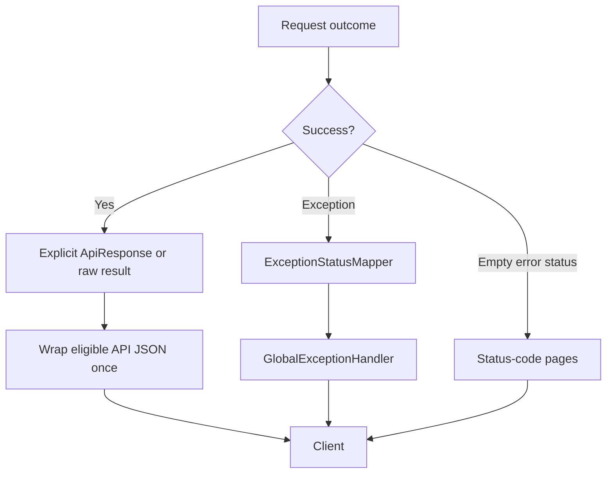

# Errors and responses

The API uses an ApiResponse envelope and typed exceptions to give clients stable status codes and machine-readable failures without exposing server internals.

## At a glance

| Concern | Source |
|---|---|
| Envelope and helpers | `src/Shared/Shared.Core/Response/ApiResponse.cs`, `ApiResponseExtensions.cs` |
| Exception types and mapping | `src/Shared/Shared.Core/Exceptions/`, `Handler/ExceptionStatusMapper.cs` |
| Logging and error serialization | `src/Shared/Shared.Core/Exceptions/Handler/GlobalExceptionHandler.cs` |
| Empty error responses | `src/Shared/Shared.Core/ProblemDetails/Extensions.cs` |
| Successful-response wrapping | `src/Shared/Shared.Core/Web/ResponseWrapperMiddleware.cs` |
| Correlation header | `src/Shared/Shared.Core/Web/CorrelationExtensions.cs` |

## How it works


*Figure: Success wrapping, exception mapping and empty-status handling converge on the envelope where applicable.*

### Envelope fields

ASP.NET Core's web JSON naming produces these field names. `code`, `errorCode` and `traceId` have explicit null-omission attributes; the helpers do not set a trace ID on success.

| Field | Type | Meaning |
|---|---|---|
| `isSuccess` | boolean | Whether the envelope represents success. |
| `statusCode` | integer | Status recorded in the envelope; see the 201 caveat below. |
| `data` | object, array, scalar or null | The endpoint result. Errors use null. |
| `successMessage` | string or null | Optional success message. Errors use null. |
| `errors` | string array | Client-safe messages; empty on success. |
| `code` | optional integer | `CustomException.Code`; omitted when null. |
| `errorCode` | optional string | `CustomException.ErrorCode`; stable client branching key, omitted when null. |
| `traceId` | optional string | `Activity.Current?.Id`, falling back to `HttpContext.TraceIdentifier`. |

The following success shape is produced by `ApiResponseExtensions.Success` with null data (not a business endpoint payload):

```json
{
  "isSuccess": true,
  "statusCode": 200,
  "data": null,
  "successMessage": null,
  "errors": []
}
```

A generic server error has this shape; `CHANGE_ME` represents the runtime trace identifier:

```json
{
  "isSuccess": false,
  "statusCode": 500,
  "data": null,
  "successMessage": null,
  "errors": ["An unexpected error occurred. Please try again later."],
  "traceId": "CHANGE_ME"
}
```

For a coded failure, the same error envelope additionally includes `errorCode`, for example `idempotency_in_progress` with 409. Optional codes are not emitted as null fields. `errors` is a flat list of messages, not a dictionary keyed by field name.

### Wrapping boundaries

`ResponseWrapperMiddleware` wraps eligible successful JSON or empty responses under `/api`, preserving their HTTP status. Carter's `ApiResponseMarkerFilter` recognizes explicit envelopes; a structural JSON check is the fallback. It does not wrap HEAD, bodyless 204/205/304 responses, non-JSON files/text/streams, `application/problem+json`, non-2xx responses, or paths outside `/api`.

`ApiResponseExtensions.Success` always sets envelope `statusCode` to 200. Existing endpoints such as tenant creation return `Results.Created(..., ApiResponseExtensions.Success(result))`: HTTP 201 with envelope 200. The wrapper intentionally preserves that existing envelope. Clients should use the actual HTTP status as authoritative. `SuccessResult(..., statusCode: 201)` and `Created(...)` set both to 201; `SuccessResult` with 204 writes no body.

### Typed exceptions and status codes

All types below are in `Shared.Core/Exceptions` unless another namespace is stated. `ExceptionStatusMapper.Map` is the central exception-to-status table; endpoints should throw typed failures rather than duplicate mapping logic.

| Type / source | Status | Mapping |
|---|---|---|
| `BadRequestException` | 400 | Exception message. |
| `DomainException` | 400 by default | Can supply another HTTP status. |
| `AppException` | 400 by default | Can supply another HTTP status and numeric code. |
| `UnauthorizedException` | 401 | Exception message. |
| `ForbiddenException` | 403 | Exception message. |
| `NotFoundException` | 404 | Exception message. |
| `AggregateNotFoundException` | 404 | Aggregate type/id message; derives directly from `Exception`. |
| `ConflictException` | 409 | Exception message. |
| `ConcurrencyConflictException` | 409 | Reload-and-retry message; derives directly from `Exception`. |
| `GoneException` | 410 | Exception message. |
| `InternalServerException` | 500 | Generic server-error message, never its internal message. |
| `CustomException` | 500 by default | Its status when 400–599; otherwise normalized to 500. Preserves optional numeric/string codes. |
| FluentValidation `ValidationException` | 400 | Distinct, nonblank validation messages; fallback to exception message if none. |
| EF `DbUpdateConcurrencyException` | 409 | Same safe message as `ConcurrencyConflictException`. |
| ASP.NET Core `BadHttpRequestException` | Its status | Covers malformed input, missing parameters and body limits; 5xx messages are sanitized. |
| Any other exception, including ordinary database errors | 500 | Generic server-error message. |

`ProblemDetailsWithCode` is a legacy response type, not an exception; the global handler does not serialize it. `AddProblemDetails` is registered, but the standard application error contract is `ApiResponse`, not an RFC problem-details object with `type`, `title`, `detail` and `instance`.

### Machine-readable error codes

These are the values assigned to `CustomException.ErrorCode` in production code, including constants and constructor arguments. Numeric `code`, provider diagnostics, SCIM error fields, authorization headers and stored job failure codes are separate contracts. Source paths below are relative to `src/`.

| `errorCode` | HTTP status | Meaning | Source |
|---|---|---|---|
| `api_key_restricted` | 403 | Endpoint requires an interactive session. | `Shared/Shared.Core/Authorization/ApiKeyAuthentication.cs` |
| `feature_not_in_plan` | 403 | Paying subscriber's plan lacks the feature. | `Shared/Shared.Core/Entitlements/Entitlements.cs` |
| `quota_exceeded` | 429 | Metered plan quota is exhausted. | `Shared/Shared.Core/Entitlements/Metering.cs` |
| `idempotency_in_progress` | 409 | The key has an active reservation. | `Shared/Shared.Core/Web/Idempotency/IdempotencyFilter.cs` |
| `idempotency_key_reused` | 422 | The same key was used with a different body. | `Shared/Shared.Core/Web/Idempotency/IdempotencyFilter.cs` |
| `captcha_required` | 400 | Human-verification token missing. | `Shared/Shared.Core/BotProtection/BotProtectionExtensions.cs` |
| `captcha_invalid` | 400 | Token rejected. | Same bot-protection source. |
| `captcha_unavailable` | 503 | Verifier unavailable with fail-closed policy. | Same bot-protection source. |
| `malware_detected` | 400 | Scanner reports infected content. | `Modules/Attachment/Attachment/Domains/Attachments/Exceptions/AttachmentExceptions.cs` |
| `malware_scanner_unavailable` | 503 | Scanner cannot produce a verdict. | Same attachment source. |
| `passkey_invalid` | 400 | Invalid, expired or replayed passkey ceremony. | `Modules/Identity/Identity/Domains/Passkeys/Exceptions/PasskeyExceptions.cs` |
| `reauthentication_required` | 403 | Adding a passkey needs recent authentication. | Same passkey source. |
| `passkeys_disabled` | 404 | Passkey capability disabled. | Same passkey source. |
| `passkey_limit_reached` | 409 | Account has reached its passkey limit. | Same passkey source. |
| `last_sign_in_method` | 409 | Removal would leave no sign-in method. | Same passkey source. |
| `sso_connection_invalid` | 400 | Invalid SSO connection change. | `Modules/Identity/Identity/Domains/Sso/Exceptions/SsoExceptions.cs` |
| `sso_domain_taken` | 409 | Another active connection owns the verified domain. | Same SSO source. |
| `sso_domain_unverified` | 409 | Domain verification is required. | Same SSO source. |
| `sso_required` | 403 | The user's domain requires SSO. | Same SSO source. |
| `tenant_role_not_found` | 400 | Assigned directory role is not valid for the tenant. | `Modules/Identity/Identity/Services/Sso/TenantRoleGuard.cs` |
| `amount_not_supported` | 409 | Checkout amount is not supported by the gateway. | `Modules/Subscriptions/Subscriptions/Domains/OnlinePayments/Features/CreateOnlineCheckout/CreateOnlineCheckoutHandler.cs` |
| `payment_gateway_error` | 502 | Gateway refused or could not complete the call. | `Modules/Subscriptions/Subscriptions/Domains/OnlinePayments/Exceptions/PaymentGatewayNotFoundException.cs` |
| `trial_already_used` | 409 | Subscriber already used a free trial. | `Modules/Subscriptions/Subscriptions/Domains/Subscriptions/Features/StartTrial/StartTrialHandler.cs` |
| `plan_has_no_trial` | 409 | Plan does not offer a trial. | Same trial-handler source. |
| `coupon_inactive` | 400 | Coupon disabled. | `Modules/Subscriptions/Subscriptions/Domains/Coupons/Exceptions/CouponExceptions.cs` |
| `coupon_expired` | 400 | Coupon validity period ended. | Same coupon source. |
| `coupon_exhausted` | 400 | Coupon redemption limit reached. | Same coupon source. |
| `coupon_plan_not_allowed` | 400 | Coupon does not apply to the plan. | Same coupon source. |
| `coupon_currency_mismatch` | 400 | Coupon and purchase currencies differ. | Same coupon source. |
| `invalid_job_state` | 400 | Transfer operation is invalid in the current job state. | `Modules/DataTransfer/DataTransfer/Domains/TransferJobs/Exceptions/TransferJobExceptions.cs` |
| `import_already_running` | 409 | Same transfer definition already has a pending/running import in this tenant. | Same transfer-exception source. |

`InvalidTransferFileException` takes its string code as a constructor argument. The currently supplied values are below. They map to 400 when thrown during HTTP handling; background execution records the failure on the transfer job instead of returning an HTTP error.

| `errorCode` | Meaning | Source under `Modules/DataTransfer/DataTransfer/` |
|---|---|---|
| `unsupported_format` | Requested file format is unsupported. | `Domains/TransferJobs/Features/TransferJobCommandHandlers.cs` |
| `duplicate_column` | Duplicate recognized header. | `Engine/HeaderMap.cs` |
| `missing_columns` | Required headers are absent. | `Engine/HeaderMap.cs` |
| `no_known_columns` | No usable definition columns found. | `Engine/HeaderMap.cs` |
| `empty_file` | File contains no header row. | `Engine/TabularReader.cs` |
| `too_many_columns` | Column limit exceeded. | `Engine/TabularReader.cs` |
| `too_many_rows` | Import/export row limit exceeded. | `Engine/TabularReader.cs`, `Domains/TransferJobs/Jobs/ProcessExportJob.cs` |
| `invalid_csv` | CSV parsing failed. | `Engine/TabularReader.cs` |
| `invalid_xlsx` | Workbook is invalid or unreadable. | `Engine/TabularReader.cs` |
| `file_too_large` | Upload, decompressed workbook or export size limit exceeded. | `Engine/TransferFileStore.cs`, `Engine/TabularReader.cs`, `Domains/TransferJobs/Jobs/ProcessExportJob.cs` |
| `missing_source` | Import source file is absent. | `Domains/TransferJobs/Jobs/ProcessImportJob.cs` |

### Validation, server failures and identifiers

`ValidationBehavior` runs discovered FluentValidation validators before the handler. Validators localize user-facing messages through module resources; `Accept-Language` selects request culture. The mapper deduplicates messages and does not expose FluentValidation property names or its internal error-code fields.

For every mapped 5xx, `GlobalExceptionHandler` logs the full exception with method, path, status and trace ID, while the client sees only `An unexpected error occurred. Please try again later.` Optional application codes survive sanitization. Expected non-5xx exceptions are logged at Warning. A response that has already started cannot be replaced.

Bodiless 4xx/5xx responses, such as routing 404 or authorization 401/403, are filled by status-code pages with a reason phrase and trace ID. Other middleware can write its own envelope; a machine code is not guaranteed on every error. For example, `MfaAwareAuthorizationResultHandler` sends `mfa_required` in `X-Auth-Error` and the first `errors` entry, not in `errorCode`. Rate limits are 429; configured request timeouts are 504. Caller cancellation is a special 499 path with no JSON body.

`X-Correlation-Id` is accepted only after sanitization (at most 128 characters), otherwise generated, then echoed and added to the logging scope. It is distinct from the envelope's `traceId`; neither is a separate problem identifier. Quote the response trace ID when correlating a handled exception to logs.

## Usage

From `src/Shared/Shared.Core/BotProtection/BotProtectionExtensions.cs`, a typed failure carries a stable machine code separately from its localized message:

```csharp
throw new BadRequestException(Text("BotProtection.Required", "Please complete the human verification and try again."))
{
    ErrorCode = CaptchaRequiredCode
};
```

Successful endpoints normally return `ApiResponseExtensions.Success(data)`. Lists place `PaginatedResult<T>` in `data`: `pageInfoResult` contains `currentPage`, `pageSize`, `totalItems`; `result` contains rows, with `orderBy` and `orderByDesc` alongside it. Enum JSON depends on the contract converter (for example, `Shared.Contracts/Enums/SortBy.cs` explicitly uses strings); there is no host-wide enum converter. Bilingual values use `LocalizedText` with `en` and `ar`.

## Failure modes and guarantees

- Branch on HTTP status and optional `errorCode`, not localized message text. Unknown codes must remain displayable.
- A 409 concurrency failure requires reloading state before resubmitting. The mapper does not retry.
- An HTTP failure does not guarantee rollback of earlier commits or post-commit side effects. See [Request lifecycle](Request-Lifecycle.md).
- Idempotency reservations and quota counters can fail open; malware scanning fails closed. Do not treat all 503s as the same business outcome.
- Files, protocol-specific responses and already-written errors are not universally normalized by the wrapper. This contract describes the application pipeline, not errors generated by Nginx before the request reaches it.

## Guardrails

`ExceptionHandlingTests` verifies mappings, server-error sanitization and cancellation. `ResponseWrapperTests` covers double-wrapping, non-JSON and bodyless responses. `IdempotencyFilterTests` covers replay/conflict behavior. `AdminEndpointAuthorizationTests` enforces explicit endpoint authorization; domain and handler tests cover module-specific failures.

## Related

[API guidelines](ApiGuidelines.md), [Coding standards](CodingStandards.md), [Request lifecycle](Request-Lifecycle.md), [Observability](Observability.md), [ADR-0003](../Decisions/0003-exceptions-not-result-type.md), and `/starterkit:add-feature`.
