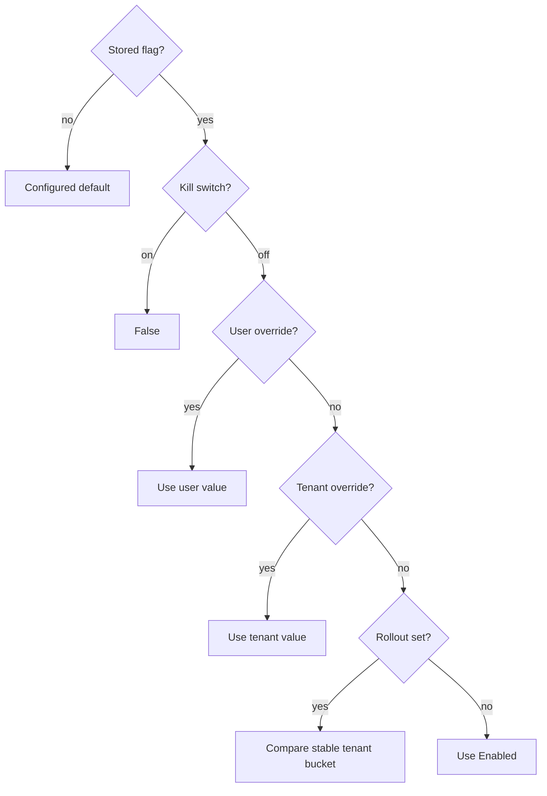

# Feature flags

Runtime feature flags control dark launches, tenant rollout and kill switches independently of authorization and subscription entitlements.

## At a glance

| Responsibility | Main types / source |
|---|---|
| Port | `IFeatureFlags`, `src/Shared/Shared.Contracts/FeatureFlags/` |
| Evaluation and endpoint gate | `FeatureFlagEvaluator`, `RequireFlag`, `src/Shared/Shared.Core/FeatureFlags/FeatureFlags.cs` |
| Stored implementation | `TenancyFeatureFlags`, `FeatureFlagStore`, `src/Modules/Tenancy/Tenancy/Domains/FeatureFlags/` |
| Persistence | Host database: `tenancy.feature_flags`, `tenancy.feature_flag_overrides` |
| Administration | `FeatureFlagsModule`, host-only `feature-flags.manage` permission (SuperAdmin) |

## How it works

### Evaluation order


*Figure: Stored flags override configuration, and a kill switch overrides every stored rollout or override.*

For rollout 1–99, the evaluator hashes `key|tenantId` with SHA-256, reads the first four bytes as an unsigned big-endian integer, and takes modulo 100. The tenant GUID uses the `N` format; no tenant uses `Guid.Empty`. A bucket below the rollout percentage is enabled. Rollout 100 enables everyone not already decided by an override; zero uses `Enabled`. The stable hash makes replicas agree and raising a percentage only adds tenants.

Keys are trimmed and lowercased. They are 1–100 characters, start with a letter or digit, and then allow lowercase letters, digits, `.`, `_` or `-`. Descriptions are limited to 500 characters. Each override targets exactly one tenant or user; these are host-owned flag rows, not tenant-data entities.

### Storage and caching

`ConfigFeatureFlags` supplies configuration-only evaluation when no module stores flags; Tenancy registers `TenancyFeatureFlags` as the stored implementation.

`FeatureFlagStore` caches one snapshot in memory and `IDistributedCache`. After commit, `FeatureFlagChangedEventHandler` evicts both levels and broadcasts L1 eviction through `ILocalCacheInvalidationBus`. A generation check prevents a read that overlaps invalidation from repopulating the cache with the earlier snapshot; that read may still serve its snapshot once.

Cache failures fall back to the database. If the database read fails, the store returns an empty, uncached snapshot and evaluation uses configured defaults. Without a working invalidation broadcast, replicas can serve their cached value until expiry. A kill switch is subject to cache propagation and the same outage fallback as any flag.

## Configuration

Defaults come from `FeatureFlagDefaults`, `MultiTenancyOptions` and `src/Api/appsettings.json`.

| Key | Default | Meaning |
|---|---|---|
| `FeatureFlags:Defaults:<key>` | `false` when absent | Value for an unstored flag, or when the store cannot be read. |
| `MultiTenancy:Cache:LocalSeconds` | `30` | L1 snapshot lifetime; non-positive disables storage at this level. |
| `MultiTenancy:Cache:DistributedSeconds` | `600` | Distributed snapshot lifetime; non-positive disables writes at this level. |

## Usage

### Use

The endpoint gate is implemented in `src/Shared/Shared.Core/FeatureFlags/FeatureFlags.cs`:

```csharp
var flags = context.HttpContext.RequestServices.GetRequiredService<IFeatureFlags>();
if (!await flags.IsEnabledAsync(key, context.HttpContext.RequestAborted))
    throw new NotFoundException("The requested resource was not found.");

return await next(context);
```

Attach `RequireFlag(key)` to an endpoint or inject `IFeatureFlags` for code-level evaluation. Authentication and permission checks still apply before the gate. `RequireFeature` checks a subscription entitlement; it is a separate mechanism described in [Request lifecycle](Request-Lifecycle.md#endpoint-filters).

### API

Routes are declared in `src/Modules/Tenancy/Tenancy/Domains/FeatureFlags/Features/FeatureFlagsModule.cs`. All admin mutations disallow impersonation.

| Method / route | Contract |
|---|---|
| `GET /api/v1/admin/feature-flags` | All stored flags and their overrides. |
| `POST /api/v1/admin/feature-flags` | Create; returns 201. |
| `GET /api/v1/admin/feature-flags/{key}` | One stored flag with its `Version`. |
| `PUT /api/v1/admin/feature-flags/{key}` | Update description, enabled state, rollout or kill switch; optional `version`. |
| `DELETE /api/v1/admin/feature-flags/{key}` | Delete flag and overrides; evaluation then uses configuration. |
| `PUT /api/v1/admin/feature-flags/{key}/overrides` | Exactly one of `tenantId` / `userId`, plus `enabled`. |
| `DELETE /api/v1/admin/feature-flags/{key}/overrides/{overrideId}` | Remove an override. |
| `GET /api/v1/me/feature-flags` | Authenticated caller's enabled flags only, in the normal response envelope; absence means off. |

`UpdateFeatureFlagHandler` calls `ExpectVersion`; override commands do not accept a client version, but their child mutations bump the root version. See [Concurrency and versions](Concurrency-and-Versions.md).

## Failure modes and guarantees

Invalid keys, rollout values or override targets produce 400; missing flags/overrides and a disabled endpoint gate produce 404. Duplicate keys and stale versioned updates produce 409. These failures do not define a feature-flag-specific `errorCode`; see [Errors and responses](Errors-and-Responses.md).

A flag is neither an authorization boundary nor a durable entitlement. Defaults must be suitable for storage outages. Deleting a stored kill switch may enable a configured default. The caller API intentionally omits disabled keys so dark-launched names do not leak through that endpoint.

## Guardrails

`FeatureFlagEvaluatorTests`, `FeatureFlagPortTests` and `RequireFlagTests` in `src/Shared/Shared.Core.Tests/FeatureFlags/` test evaluation, registration and the gate. `FeatureFlagTests` in `src/Modules/Tenancy/Tenancy.IntegrationTests/` exercises persistence, caching and the caller view. `AdminEndpointAuthorizationTests` enforces explicit authorization. Database check constraints enforce rollout bounds and exactly one override target; unique indexes prevent duplicate overrides.

## Related

[ADR-0008](../Decisions/0008-feature-flags.md), [Concurrency and versions](Concurrency-and-Versions.md), [Request lifecycle](Request-Lifecycle.md), and `/starterkit:add-feature` / `/starterkit:add-permission`.
