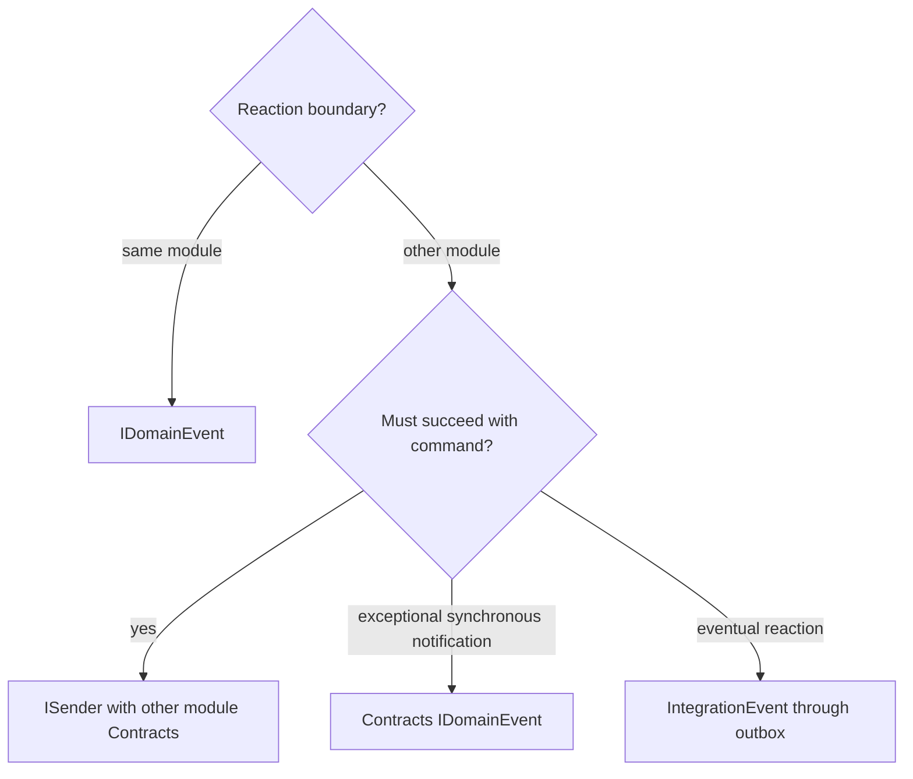
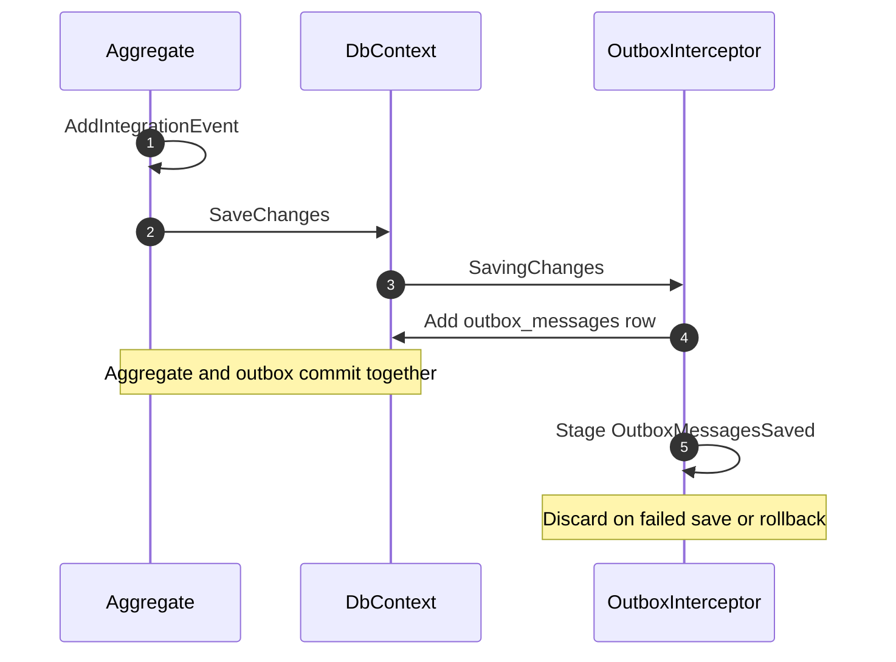
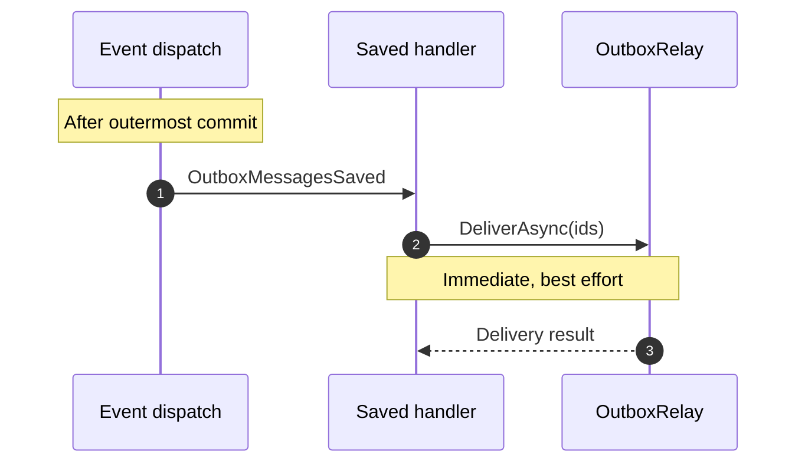
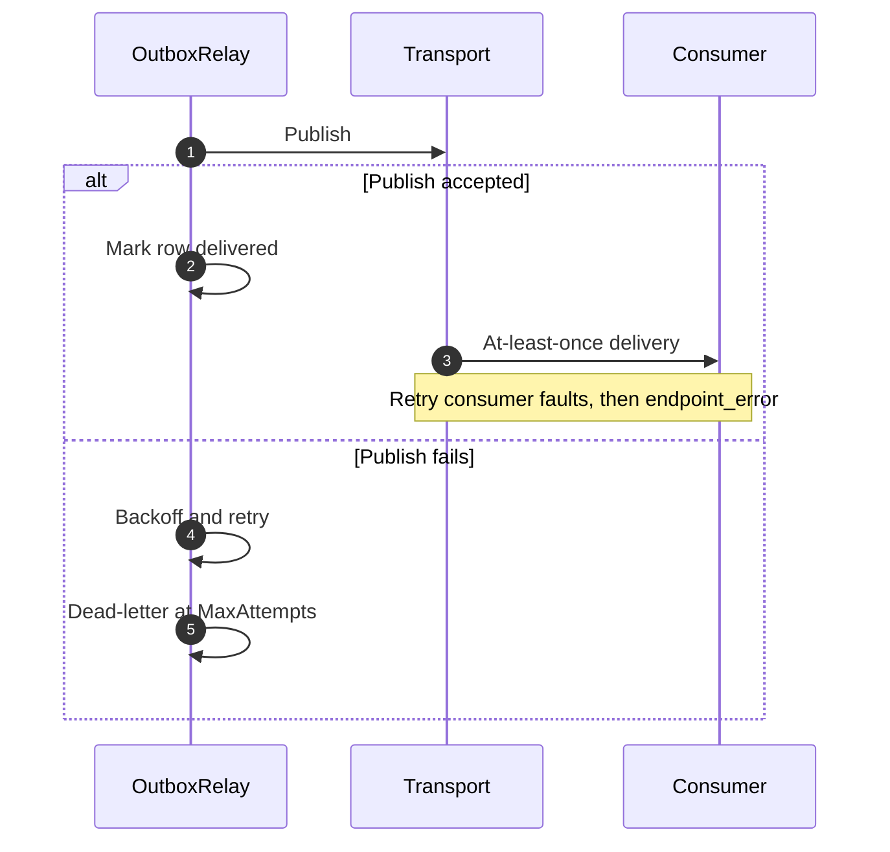
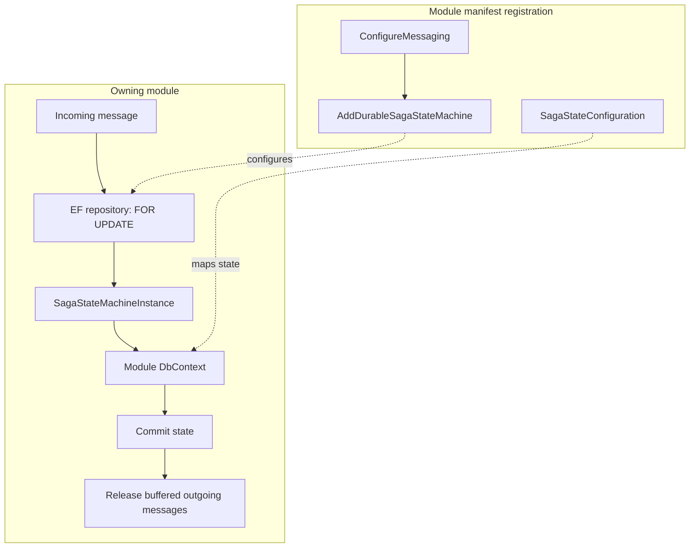

# Messaging: domain events, integration events, outbox and transports

Messaging separates in-process reactions from durable cross-module facts, committing integration events with business changes and delivering them asynchronously through an outbox.

## At a glance

| Boundary | Main types / source |
|---|---|
| In-process events | `IDomainEvent`, `IPublisher`, `IDomainEventDispatcher` |
| Integration contracts | `IntegrationEvent`, `IIntegrationEvent`, `src/Shared/Shared.Contracts/Messaging/` |
| Persistence and relay | `OutboxInterceptor`, `OutboxRelay`, `OutboxSweepJob`, `src/Shared/Shared.Core/Messaging/Outbox/` |
| Transport | `src/Shared/Shared.Messaging/Extensions/MassTransitExtensions.cs` |
| Operations | `src/Api/Endpoints/OutboxAdminEndPoint.cs` |
| Saga persistence | `src/Shared/Shared.Core/Messaging/Sagas/` |

Synchronous calls use `ISender` and the other module's contracts. There is no gRPC or HTTP hop between modules. Extracting a service would require a new transport boundary; contracts provide the seam, not an existing remote implementation. See [Overview](Overview.md) and [Request lifecycle](Request-Lifecycle.md).

## How it works

### 1. Which kind of event?

| | Domain event | Integration event |
|---|---|---|
| Contract | `IDomainEvent`, an owned-mediator `INotification` | `IIntegrationEvent` / `IntegrationEvent` |
| Raised with | `AddDomainEvent(...)` | `AddIntegrationEvent(...)` |
| Delivery | `IPublisher`, normally after the outermost successful unit of work | Transactional outbox to MassTransit |
| Guarantee | Committed events are eligible for in-process dispatch; no durable replay | At-least-once publish attempts, bounded retries and dead letters |
| Reaction | `INotificationHandler<T>` | `IConsumer<T>` in the reacting module |
| Location | Module `Domains/<Aggregate>/Events/`, or contract events for explicit synchronous notifications | Publishing `.Contracts` project, under `IntegrationEvents/` |

Use integration events for eventual reactions that must not fail the publishing command. If a reaction must succeed before issuing a result, call a contract synchronously, or use an explicit synchronous contract notification. Ordinary post-commit domain-event dispatch cannot make an already committed save roll back. The impersonation audit below explicitly publishes before token issuance; it is not evidence that all domain events run before commit.


*Figure: Choose synchronous contracts for required results and integration events for independent eventual reactions.*

### Current flows

| Event / flow | Kind | Current reaction |
|---|---|---|
| `SubscriptionActivatedIntegrationEvent`, `SubscriptionExpiredIntegrationEvent` | Integration | Tenancy `TenantBillingStatusConsumer` re-reads current billing status to suspend/reactivate; Webhooks `SubscriptionActivatedWebhookConsumer` / `SubscriptionExpiredWebhookConsumer` forward public events. |
| `AgentRunCompletedIntegrationEvent`, `AgentRunFailedIntegrationEvent` (Agentic) | Integration | For the module that owns the agent: it consumes them and re-reads the run with `GetAgentRunByIdQuery`. No consumer ships in the template. |
| `UserAvatarChangedIntegrationEvent` (Attachment) | Integration | Identity `UserAvatarChangedConsumer` re-reads the current avatar and updates `ProfilePictureUrl`. |
| `AttachmentDeletedIntegrationEvent` (Attachment) | Integration | Agentic `AttachmentDeletedKnowledgeConsumer` removes the knowledge documents indexed from the file. |
| `UserSessionsRevokedIntegrationEvent` (`UserDirectory.Contracts`) | Integration | Identity persists a `SessionRevocation` tombstone and outbox fact for session revocation; Notification `UserSessionsRevokedConsumer` closes revoked hub sessions across replicas. Sign-out does not wait for Notification. |
| `UserDeletedIntegrationEvent` (`UserDirectory.Contracts`) | Integration | `UserDeletedAttachmentConsumer`, `UserDeletedTenancyConsumer`, `UserDeletedNotificationConsumer`, `UserDeletedAgenticConsumer` clean up module-owned data. |
| Optional sample: `ProductPublishedIntegrationEvent` | Integration | `ProductPublishedConsumer` re-reads visibility and sends the owner an in-app notification using the event id for correlation; `ProductPublishedWebhookConsumer` forwards it. This flow exists only when the sample is included. |
| `UserDirectory.Contracts.Events.ImpersonationStartedEvent` | Explicit synchronous notification | Tenancy `ImpersonationAuditHandler` must write the audit before an impersonation token is issued. |
| `TenantDataPurgeRequestedEvent` | In-process orchestration | Attachment `TenantDataPurgeRequestedEventHandler` and Notification `NotificationTenantPurgeHandler` participate in `PurgeDeletedTenantsJob`; failure stops that attempt and the job retries. |
| Tenancy cache invalidation, Subscriptions emails; optional sample logging | Same-module domain events | In-process side effects, with the commit/dispatch limitations above. |

| Optional sample: `ShipmentReadyForClearanceIntegrationEvent` (Shipping) | Integration | Shipping `ShipmentReadyForClearanceConsumer` starts the shipment preparation agent through `RequestAgentRunCommand` (trigger key per shipment, on behalf of the user who handed it over). |
### Outbox

The outbox lives in the publishing module's database, not in a separate shared business-state store. `OutboxInterceptor` inserts the event row in the same `SaveChanges` transaction as the aggregate and stages `OutboxMessagesSaved` for post-commit dispatch.


*Figure: The aggregate and its outbox row commit atomically.*


*Figure: Post-commit dispatch attempts immediate delivery.*

`DomainEventDispatcher` publishes to `OutboxMessagesSavedHandler` for immediate best-effort delivery. Independently, `OutboxSweepJob` recovers due rows and purges delivered rows beyond retention. See [Request lifecycle](Request-Lifecycle.md#save-commit-and-dispatch) for save failure, rollback and outermost-dispatch handling.


*Figure: Publishing retries and consumer retries have separate failure paths.*

The relay conditionally leases target rows using `lock_token` and `locked_until`. Competing relays cannot claim an unexpired lease; expired leases are reclaimable after a crash or an overlong delivery. Delivery must fit within the configured lease. A crash after publish but before marking the row processed can publish again with the same `MessageId = EventId`.

Each publish restores the row's tenant/host scope; the transport propagates `X-Tenant-Id`. `StarterKit.Outbox` produces an `outbox publish` span parented to the originating trace. Tenant-data contexts use `TenantOutboxMessage`, named filters and RLS; rows move, export and purge with the tenant. The sweep visits serviceable tenants through `ITenantJobRunner`, including dedicated databases; migrating tenants wait. Ordering by `occurred_on` is best effort, not an ordering guarantee across retries.

### Transports (`Messaging:Transport`)

| Transport | Durability | Intended use |
|---|---|---|
| `InMemory` | None; each process has its own bus | Development/tests only. In-flight and retry messages disappear on restart. |
| `PostgreSql` | Durable queues in the existing database's `transport` schema | Default production Compose selection. |
| `RabbitMq` | Durable broker queues | Deployments requiring a separate broker and its routing/fan-out facilities. |

`ProductionConfigurationGuard` rejects production InMemory and RabbitMq without a usable broker address/password. Outbox persistence protects the publish intent; it cannot make an in-memory consumer queue durable.

All transports use kebab-case endpoint names, tenant publish/send/consume filters and `MassTransitHostOptions.WaitUntilStarted`. Waiting for startup is essential: publishing before receive endpoints bind can be accepted without reaching a subscription, then marked delivered by the relay.

`TenantMigratingException` uses delayed redelivery at 5s, 30s, 1m, 2m, 5m, 10m, 15m and 30m. PostgreSql and InMemory support it natively. RabbitMQ needs `rabbitmq_delayed_message_exchange` and `UseDelayedExchange=true`; otherwise migration failures use in-memory retry, holding consumer slots and risking starvation of other tenants. An inner exponential retry handles other transient failures with five retries; exhausted messages fault to `<endpoint>_error`.

PostgreSql resolves `ConnectionStrings:starterkit`, falling back to `PostgresOptions:ConnectionString`. Infrastructure creation needs DDL and `CREATEROLE`. Normal startup provisions it only with `Database:MigrateOnStartup=true`; production's `--migrate-only` provisions it explicitly, using `Database:MigrationConnectionString` credentials when supplied. Module migrations use the [migration advisory lock](DatabaseConventions.md#migrations-at-deploy); the transport uses MassTransit's migration service. Disable `CreateInfrastructure` only when provisioning it externally.

RabbitMq prefers `ConnectionStrings:rabbitmq` (including the URI injected by Aspire), otherwise `Messaging:RabbitMq:*`. Supply its password through Docker secret `rabbitmq_password` or `Messaging__RabbitMq__Password`.

| Environment | Selection |
|---|---|
| Aspire | AppHost `Messaging__Transport=RabbitMq` adds and wires the broker and management UI; PostgreSql uses the existing database. |
| Compose | `MESSAGING_TRANSPORT=PostgreSql`, or add `docker-compose.rabbitmq.yml`; development also uses `docker-compose.override.yml`. With workers, also include `docker-compose.rabbitmq-worker.yml` so both roles use the same transport. |

### Sagas

No production business saga is registered. `AddDurableSagaStateMachine<TMachine,TState,TDbContext>` is the supported registration seam in a module manifest's `ConfigureMessaging`; the bus scans consumers, not sagas. See [ADR-0023](../Decisions/0023-durable-sagas-on-module-dbcontexts.md).

State is a plain `SagaStateMachineInstance`, not `Entity<T>`. Map it with `SagaStateConfiguration<TState>` before `ToSnakeCaseTables()`, and migrate the owning module. Tenant-data saga state also implements `IMustHaveTenant` and requires RLS. The helper supplies an EF repository on that context, PostgreSQL pessimistic `FOR UPDATE` locking, and an in-memory outgoing-message buffer released after state persistence. This buffer is not a second transactional outbox table or an exactly-once guarantee.

Tenant filters scope lookup and `TenantEntityInterceptor` stamps new state. Configure `OnMissingInstance` to discard when absence is legitimate, such as a message scoped to a different tenant. Scheduled timeouts use the state machine's `Schedule` API and a nullable GUID token property. `IMessageScheduler` is available only when the chosen transport configuration registers it.

| Transport | Scheduler | Durable |
|---|---|---|
| PostgreSql | `AddSqlMessageScheduler` / `UseSqlMessageScheduler` | Yes |
| InMemory | Delayed message scheduler | No |
| RabbitMq | Delayed message scheduler with `UseDelayedExchange=true` | Yes, with plugin |

Without the RabbitMQ plugin/configuration there is no scheduler, so scheduling a timeout faults the saga step. Scheduled sends carry tenant headers like other sends.

#### Durable saga persistence


*Figure: Durable saga registration keeps state and locking in the owning module database.*

## Configuration

Outbox defaults come from `OutboxOptions` and `src/Api/appsettings.json`; transport defaults come from `MessagingOptions` and the same settings file.

| Key | Default | Meaning |
|---|---|---|
| `Messaging:Outbox:BatchSize` | `100` | Rows claimed per relay round (1–1000). |
| `Messaging:Outbox:MaxAttempts` | `10` | Publish attempts before dead-lettering (1–100). |
| `Messaging:Outbox:LeaseSeconds` | `60` | Claim lease (5–3600 seconds). |
| `Messaging:Outbox:SweepCron` | `* * * * *` | Hangfire recovery sweep. |
| `Messaging:Outbox:RetentionDays` | `7` | Delivered-row retention (1–365); dead letters are retained. |
| `Messaging:Transport` | `InMemory` | Base settings; production Compose selects PostgreSql. |
| `Messaging:PostgreSql:Schema` / `Role` | `transport` / `transport` | Queue schema and owning role. |
| `Messaging:PostgreSql:CreateInfrastructure` | `true` | Create/upgrade transport objects during the migration path. |
| `Messaging:PostgreSql:AdminUsername` / `AdminPassword` | `null` / `null` | Optional infrastructure credentials; otherwise derived from the selected connection. |
| `Messaging:RabbitMq:Port` / `VirtualHost` | `5672` / `/` | Broker endpoint settings. |
| `Messaging:RabbitMq:Username` | `starterkit` in appsettings; options fallback `guest` | Broker user. |
| `Messaging:RabbitMq:Password` | `CHANGE_ME` in base appsettings; options fallback empty | Replace through secret configuration. |
| `Messaging:RabbitMq:UseDelayedExchange` | `false` | Enables delayed redelivery and scheduling when the broker plugin is installed. |

`Messaging:RabbitMq:Host` is a local development address in base settings and the Compose broker service in Docker settings; configure the deployed broker or supply `ConnectionStrings:rabbitmq`. Deployment addresses are not portable defaults.

## Usage

### Adding an integration event

From `src/Modules/Subscriptions/Subscriptions.Contracts/Subscriptions/IntegrationEvents/SubscriptionLifecycleIntegrationEvents.cs`:

```csharp
[MessageUrn("subscriptions.subscription-activated.v1")]
[PublicWebhookEvent(Description = "A subscription became active.")]
public sealed class SubscriptionActivatedIntegrationEvent : IntegrationEvent
{
    public Guid SubscriptionId { get; init; }
    public Guid SubscriberId { get; init; }
}
```

The aggregate in `src/Modules/Subscriptions/Subscriptions/Domains/Subscriptions/Models/Subscription.cs` raises:

```csharp
AddIntegrationEvent(new SubscriptionActivatedIntegrationEvent { SubscriptionId = Id, SubscriberId = SubscriberId });
```

Keep payloads to ids and minimal projections, never entities. Tenant scope travels in headers, not an event `TenantId` property. Host contexts map `builder.AddOutbox()`; tenant-data contexts map `builder.AddTenantOutbox()` before tenant filters and enable RLS for `outbox_messages` in their migration. Register `services.AddOutbox<TContext>()` after context registration. Consumers are discovered through manifests' `ConsumerAssemblies`. Follow `/starterkit:add-integration-event` and `/starterkit:add-migration` for the procedure.

Never call `IPublishEndpoint.Publish` from feature code for cross-module facts: it bypasses the transactionally persisted intent. `[PublicWebhookEvent]` exposes a contract in the webhook catalog; it also requires a forwarding consumer in Webhooks. `WebhookCatalogAndPayloadTests` checks that every public event has one. It does not mean every internal integration event is customer-visible.

### Consumer idempotency and versioning

Consumers must tolerate duplicate and out-of-order delivery. Treat lifecycle events as triggers and query the owning module's current state through contracts, as `TenantBillingStatusConsumer` and `UserAvatarChangedConsumer` do. For side effects, use the event id as a durable deduplication/correlation key. `MessageId = EventId` identifies retries; it does not itself suppress them.

Consumers run outside the mediator. After saving aggregates, dispatch pending domain events explicitly or use `IUnitOfWorkRunner`. Throw for transient failures; return normally for known no-op cases such as an already-applied effect or absent entity. Tenant jobs use `ITenantJobRunner`.

Wire identity is the unique `[MessageUrn]`, not a CLR rename. Add optional properties for compatible changes. Breaking changes require a new type and `.vN` URN; publish both while consumers migrate, and retain the old type until its outbox rows and queues drain.

## Failure modes and guarantees

Atomicity applies to the aggregate and its outbox row. A publish failure increments `attempts`, records `last_error` and backs off 5s, 10s, 20s, up to one hour. At `MaxAttempts` the row is dead-lettered. Unknown URNs, unreadable payloads and missing tenants dead-letter immediately. Recovery is bounded and operationally visible, not an unconditional promise that every committed event reaches a consumer. Immediate delivery catches non-cancellation failures; cancellation can still propagate after commit while the sweep retains the recovery path.

Consumer failures occur after the relay has accepted publication as delivered. They belong to transport retries and `<endpoint>_error`, not the outbox dead-letter list. Fix the consumer and use the transport's queue inspection/replay tools; the outbox requeue API does not replay consumer error queues. `MessageConsumerFaults` alerts on MassTransit `receive.errors`.

### Operations

`outbox.messages.pending` and `outbox.messages.dead_lettered` are gauges tagged by DbContext `context` (for example `SubscriptionsDbContext`). Prometheus names are `outbox_messages_pending` and `outbox_messages_dead_lettered`. The sweep caches counts; callbacks do not query the database. Tenant counts sum serviceable shared/dedicated tenants. Samples older than ten minutes disappear, since another Hangfire server may own later runs. Alerts in `infra/observability/configs/alerts.yaml` include `OutboxDeadLetters` (>0 for 5m) and `OutboxBacklogGrowing` (>10 and rising for 15m).

Admin routes require `outbox.manage` (SuperAdmin); requeue disallows impersonation. Context names are case-insensitive. For tenant-data contexts, `?tenantId=` selects the tenant, including its dedicated database; without it operations use host scope over the shared database.

| Method | Route | Result |
|---|---|---|
| GET | `/api/v1/admin/outbox/{context}/dead-letters?page=&pageSize=` | Paged `OutboxDeadLetterDto`: id, type, tenant, attempts and last error; no payload. |
| POST | `/api/v1/admin/outbox/{context}/dead-letters/{id}/requeue` | Requeue one; 404 unknown context/row, 409 if not dead-lettered. |
| POST | `/api/v1/admin/outbox/{context}/dead-letters/requeue` | Requeue all in context/scope; returns count. |

Requeue clears the dead-letter mark and attempts and makes the row due for the next sweep. Fix the underlying cause first; a missing event type will dead-letter again. These routes use the standard [error envelope](Errors-and-Responses.md), without dedicated outbox `errorCode` strings.

SQL inspection remains possible against the owning schema's `outbox_messages`: pending rows have `processed_at IS NULL AND dead_lettered_at IS NULL`, dead letters have `dead_lettered_at IS NOT NULL`, and `min(occurred_on)` identifies the oldest outstanding fact. Manual requeue resets `dead_lettered_at`, `attempts` and `next_attempt_at`. Prefer the admin service, which also resets lease state. Tenant tables require an authorized RLS scope or bypass role; `app.bypass_rls` alone does not bypass role-based RLS. Never assume host SQL sees a dedicated tenant's database.

Relay logs use `DEAD-LETTERED` at Error and publish failures/retry times at Warning. Correlate those with [Observability](Observability.md).

## Guardrails

`MessagingArchitectureTests` validates contract placement, unique URNs, separation from mediator notifications, consumer location and outbox mapping/registration. Add new events to its expected inventory. `BackgroundJobEventDispatchTests` guards explicit dispatch outside the mediator; `SagaArchitectureTests` requires durable saga registration and mapped state.

`OutboxInterceptorTests`, `OutboxRelayTests`, `OutboxMessagesSavedHandlerTests`, `OutboxOptionsTests` and `OutboxVisibilityTests` cover persistence, delivery and operations. `TenantMessagingBusTests` runs the real InMemory and PostgreSql bus configurations for tenant propagation, host scope, purged-tenant drop, migration redelivery and noisy-neighbor isolation. `DurableSagaTests` covers persistence, locking and tenant-scoped scheduled timeouts. `OutboxAdminTests` exercises the admin API.

For a new event, assert `IntegrationEvents` in aggregate unit tests, persisted URN/payload/tenant in PostgreSQL integration tests, and duplicate/out-of-order handling in consumer tests. Run the bus acceptance tests when changing transport behavior.

## Related

[Request lifecycle](Request-Lifecycle.md), [Database conventions](DatabaseConventions.md), [Overview](Overview.md), [ADR-0004](../Decisions/0004-outbox-and-messaging-transports.md), [ADR-0022](../Decisions/0022-production-message-transport.md), [ADR-0023](../Decisions/0023-durable-sagas-on-module-dbcontexts.md), and `/starterkit:add-integration-event` / `/starterkit:add-background-job`.
