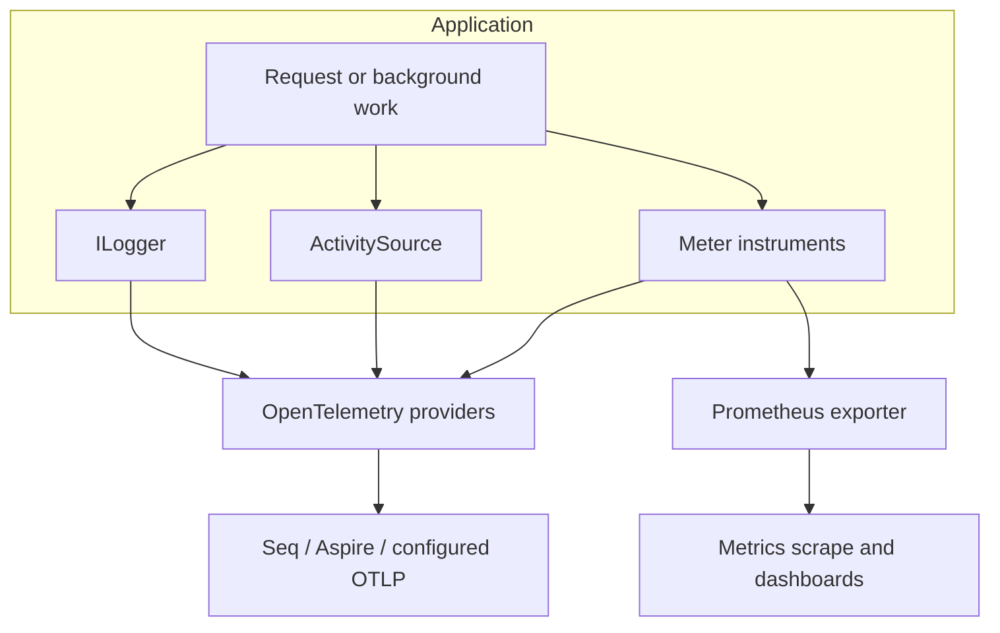

# Observability for developers

Structured logs, distributed traces, metrics and health probes expose request and background-work behavior without coupling business code to a telemetry backend.

## At a glance

| Signal | Registration / source | Developer entry point |
|---|---|---|
| Logs | `ILogger<T>`, `AddSeqEndpoint`, `src/Api/Program.cs` | Seq or Aspire; correlate with the response `traceId`. |
| Traces and metrics | `AddCustomObservability`, `src/Shared/Shared.Core/OpenTelemetryCollector/Extensions.cs` | Aspire, configured OTLP destination, or Prometheus `/metrics`. |
| Application diagnostics | `IDiagnosticsProvider`, `RequestTelemetryBehavior` | Shared activity source and meter. |
| Health | `src/Shared/Shared.Core/HealthCheck/Extensions.cs` | `/health` readiness, `/alive` liveness. |

This is the application developer view. Collector deployment, dashboards, ports, access restrictions and alert operations belong in [deployment observability](../deployment/Observability.md).

## How it works


*Figure: Application code emits backend-neutral signals; provider configuration selects the destinations for each signal.*

### Where to look

| Environment | Logs | Traces | Metrics |
|---|---|---|---|
| Aspire | Dashboard and Seq | Dashboard | Dashboard |
| Aspire with `Observability:FullStack=true` | Also Loki/Grafana | Also Tempo/Jaeger | Also Prometheus/Grafana |
| Compose base | Seq | Seq when configured through its endpoint | `/metrics` when enabled |
| Compose full observability overlay | Seq and collector/Loki | Collector to Tempo/Jaeger | Prometheus/Grafana |
| Compose lite overlay | Seq | Seq | Prometheus scrapes the API directly; Grafana displays it. |
| Production | Configured sinks, normally Seq behind restricted ingress | Configured OTLP backends | Configured scraper/backend |

The lite overlay clears the collector endpoint; it does not require the full collector stack. See the [lite profile](../deployment/Observability.md#lite-profile-prometheus--grafana-only).

### Logs and correlation

The application uses `Microsoft.Extensions.Logging` with structured templates. There is no Serilog registration or package; Seq integration is supplied by `Aspire.Seq` and OpenTelemetry. `Logging:LogLevel` controls verbosity. Telemetry includes formatted messages, structured state and logging scopes. Request logs can carry activity trace/span ids; background logs without an active activity do not automatically have a request trace.

The error envelope's `traceId` is the starting point for support investigations. `X-Correlation-Id` is separately sanitized, echoed and included in a logging scope; it is not interchangeable with a trace id. See [Errors and responses](Errors-and-Responses.md#validation-server-failures-and-identifiers).

Use structured properties for relevant entity ids and log exceptions with failures. Do not log credentials, OTPs or sensitive payloads. A background job or consumer should summarize processed, skipped and failed work. Instrumentation can capture SQL text; review telemetry access and avoid putting secrets into query text or tags.

### What is instrumented out of the box

Tracing subscribes to ASP.NET Core, HttpClient, gRPC clients, EF Core/Npgsql, MassTransit and the shared activity source. `RequestTelemetryBehavior`, registered only by the host's observability setup, wraps mediator requests in `{InstrumentationName}.{kind} {RequestName}` spans and records durations. See [Request lifecycle](Request-Lifecycle.md#mediator-and-handler) for pipeline ordering.

The outbox's `StarterKit.Outbox` source continues the originating trace through its `outbox publish` producer span. New independent activity sources must be included in `AddSource(...)` or their activities are not exported. Development uses an always-on sampler. Health probes are excluded from ASP.NET request traces; `/metrics`, `/health` and `/alive` are disabled in HTTP request metrics to reduce probe noise.

Built-in meters cover ASP.NET Core, HttpClient, process/runtime, Kestrel, MassTransit and SignalR's `Microsoft.AspNetCore.Http.Connections`. SignalR exposes `signalr.server.active_connections` and `signalr.server.connection.duration`. Application instruments are listed below; `mediatr` in the instrument name is retained even though the mediator is owned code.

### Custom metrics

Source paths below are relative to `src/`. The host instrumentation meter is `ObservabilityOptions:InstrumentationName` (`starterkit_service` in base settings, `StarterKit.API` in Docker settings).

| Meter | Instrument(s) | Kind / tags | Source |
|---|---|---|---|
| Host instrumentation | `mediatr.request.duration` | Histogram, seconds; `mediatr.request.name`, `.kind`, `.outcome` (`success`, `failure`, `canceled`) | `Shared/Shared.Core/OpenTelemetryCollector/Behaviors/RequestTelemetryBehavior.cs` |
| Host instrumentation | `outbox.messages.pending`, `outbox.messages.dead_lettered` | Observable gauges; `context` | `Shared/Shared.Core/Messaging/Outbox/OutboxMetrics.cs` |
| Host instrumentation | `metering.store.failures`, `metering.quota.denied` | Counters; `operation` / `feature` | `Modules/Subscriptions/Subscriptions/Domains/Metering/UsageMetrics.cs` |
| `StarterKit.BotProtection` | `bot_protection.verifications` | Counter; `outcome`, `action` | `Shared/Shared.Core/BotProtection/BotProtectionMetrics.cs` |
| `StarterKit.Attachment` | `attachment.malware.scans` | Counter; `result` | `Modules/Attachment/Attachment/Infrastructure/Validation/MalwareScanMetrics.cs` |
| `StarterKit.Notification` | `notification.inapp.delivered`, `notification.push.sent`, `notification.realtime.sent` | Counters; no tags / `result` / `method`, `result` | `Modules/Notification/Notification/Dispatch/NotificationMetrics.cs` |
| `StarterKit.DataTransfer` | `datatransfer.rows`, `datatransfer.jobs.finished`, `datatransfer.job.duration` | Row counter: `definition`, `outcome`; job counter and seconds histogram: `kind`, `definition`, `status` | `Modules/DataTransfer/DataTransfer/Engine/ImportRecords.cs` |

DataTransfer defines and records its instruments, but the current host `AddMeter` list does **not** subscribe to `StarterKit.DataTransfer`. Do not expect those instruments in the default export. Outbox and metering use fallback meters (`StarterKit.Outbox`, `StarterKit.Metering`) when no `IDiagnosticsProvider` is available; the normal host uses the shared meter.

Outbox gauges are cached counts refreshed by the sweep, not live database queries during scraping; stale samples expire after ten minutes. See [Messaging operations](Messaging.md#operations). Keep metric tags low-cardinality: request type, outcome or bounded feature key, never user or tenant ids.

### Health checks

`/health` evaluates all registered checks: self, configured PostgreSQL and Redis dependencies, plus checks registered by modules or infrastructure. `/alive` selects checks tagged live, so a database outage does not imply that the process should restart. Seq health checks are explicitly disabled: telemetry sink failure must not make the API unready. Attachment's configured `clamav` check reports Degraded when unavailable. `/health-ui` is mapped only outside Production when enabled.

Readiness describes registered checks; it is not proof that every external provider or dedicated tenant database is healthy. Operational routing and probe policy are documented in the deployment guide.

## Configuration

The application section is **`ObservabilityOptions`**, not `Observability` (the latter also names AppHost's full-stack switch). Defaults come from `ObservabilityOptions`, `HealthOptions` and `src/Api/appsettings.json`.

| Key | Default | Meaning |
|---|---|---|
| `ObservabilityOptions:InstrumentationName` | `starterkit_service` | Required shared meter/source name; Docker uses `StarterKit.API`. |
| `ObservabilityOptions:ServiceName` | `StarterKit Service` | Resource identity; Docker uses `StarterKit.API`. Without a value the application name is used. |
| `ObservabilityOptions:MetricsEnabled` | `true` | Register metrics provider. |
| `ObservabilityOptions:TracingEnabled` | `true` | Register tracing provider. |
| `ObservabilityOptions:LoggingEnabled` | `true` | Register shared OpenTelemetry logging exports. |
| `ObservabilityOptions:UsePrometheusExporter` | `true` | Metrics exporter and scrape endpoint. |
| `ObservabilityOptions:UseOTLPExporter` | `false` | Additional destination from `OTLPOptions`, alongside standard OTLP settings. |
| `ObservabilityOptions:UseGrafanaExporter` | `false` | Opt-in Grafana distribution. |
| `ObservabilityOptions:UseConsoleExporter` | `false` | Console exporter. |
| `ObservabilityOptions:UseJaegerExporter` | `false` | Jaeger destination over OTLP gRPC. |
| `ObservabilityOptions:UseZipkinExporter` | `false` | Legacy optional Zipkin trace exporter. |
| `HealthOptions:Enabled` | `true` | Shared health registration and non-production health UI. |
| `HealthOptions:DatabaseConnectionStringName` | `starterkit` | Named database connection for readiness. |
| `Logging:LogLevel:Default` | `Information` | Default log threshold. |

`OtlpExporterPlan` selects standard `OTEL_EXPORTER_OTLP_*` settings and explicitly requested extra endpoints, avoiding duplicate destinations. `OTEL_SERVICE_NAME` / `OTEL_RESOURCE_ATTRIBUTES` override configured resource identity, enabling Aspire to associate signals with the correct replica. Endpoint settings are under `ObservabilityOptions:OTLPOptions`, `JaegerOptions` and `ZipkinOptions`; use deployment-specific addresses rather than copying development endpoints. `ConnectionStrings:seq` supplies the independent Seq endpoint.

## Usage

### Instrumenting new code

Use the existing diagnostics port rather than constructing a new unregistered source. The real span pattern from `src/Shared/Shared.Core/OpenTelemetryCollector/Behaviors/RequestTelemetryBehavior.cs` is:

```csharp
using var activity = diagnostics.ActivitySource.StartActivity(
    $"{diagnostics.InstrumentationName}.{kind} {name}", ActivityKind.Internal);
activity?.SetTag(RequestTelemetryMetrics.NameTag, name);
activity?.SetTag(RequestTelemetryMetrics.KindTag, kind);
```

A source may return no activity when there is no listener; null-safe tagging is intentional. Add meaningful operation spans around provider calls or long-running work. Use counters for events and histograms for durations, with bounded tag values. New meters also need an `AddMeter(...)` subscription.

### Troubleshooting checklist

1. Search Seq by the response trace id, request path or relevant structured entity property.
2. Inspect the trace for slow/failed database, HTTP, mediator or outbox spans.
3. For async flows, inspect `attempts` and `dead_lettered_at` in the owning outbox, plus consumer logs/error queues; publication success is not consumer success.
4. For jobs, inspect the protected `/hangfire` dashboard for failed attempts and retries.
5. If signals are missing, check the source/meter subscription, enabled provider, resource identity and exporter plan before changing application logic.

## Failure modes and guarantees

Telemetry is diagnostic, not a transactional audit record. Exporter outages or sampling can leave gaps. An error response can include a trace id even when its trace was not retained. Seq failure does not fail readiness. Enabling Grafana export alongside a standard OTLP destination can duplicate signals because the distribution manages its own exporter; choose the intended path deliberately.

An instrument's existence does not ensure export, as the DataTransfer subscription gap illustrates. Use the [database audit trail](DatabaseConventions.md#audit-trail) for same-transaction change records, and the [error contract](Errors-and-Responses.md) for client behavior rather than deriving either from logs.

## Guardrails

`RequestTelemetryBehaviorTests`, `OtlpExporterPlanTests` and `ObservabilityRegistrationTests` in `src/Shared/Shared.Core.Tests/Observability/` cover request signals, destination selection and registration. `OutboxVisibilityTests` tests backlog visibility; `HealthCheckRegistrationTests` checks health registration. These tests do not validate a deployed collector, scrape target or retention policy; use the operational guide for those checks.

## Related

[Deployment observability](../deployment/Observability.md), [Request lifecycle](Request-Lifecycle.md), [Errors and responses](Errors-and-Responses.md), [Messaging](Messaging.md), [Real-time and push](../Modules/Notification-Realtime-and-Push.md#operations), and `/starterkit:add-feature` / `/starterkit:add-background-job`.
