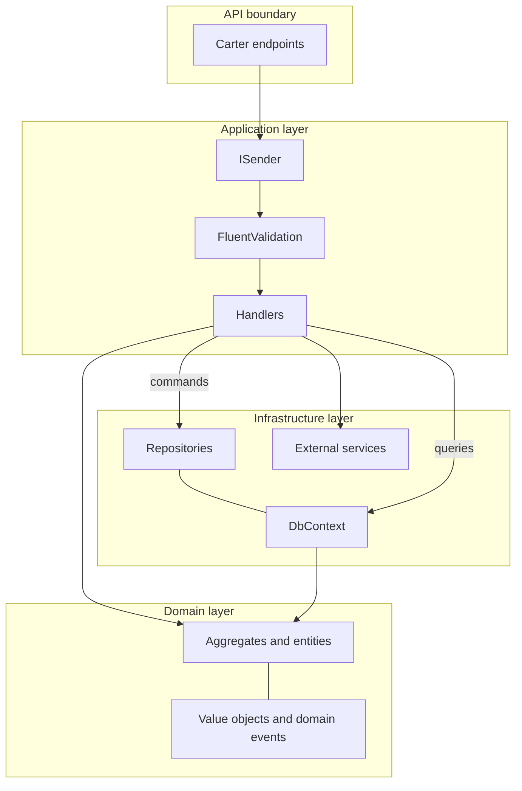
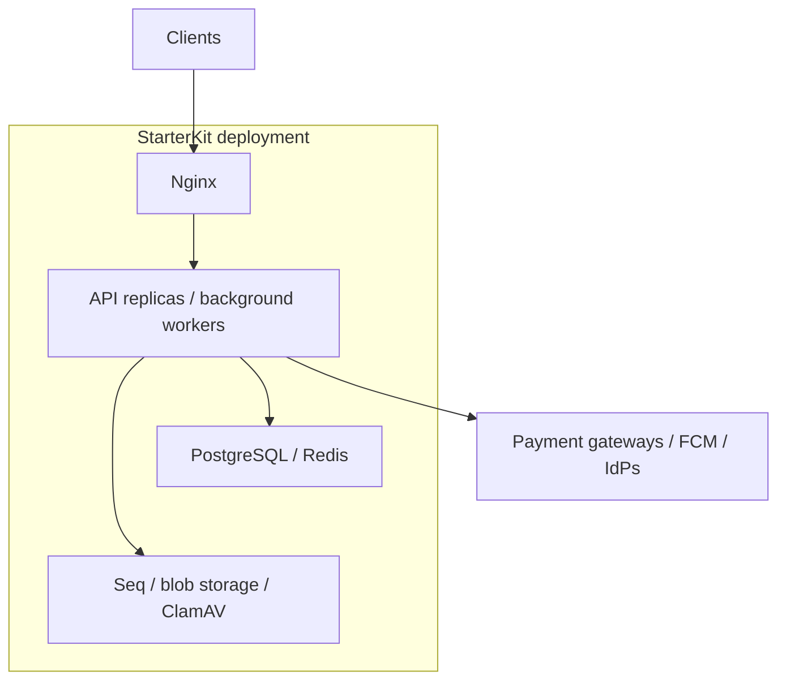
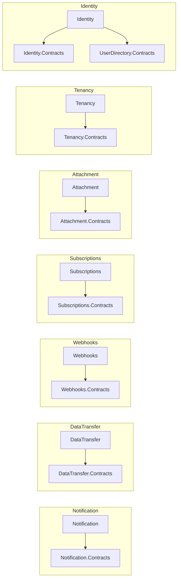
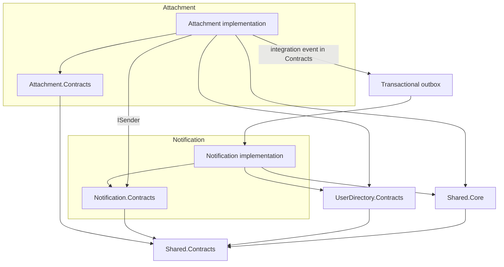
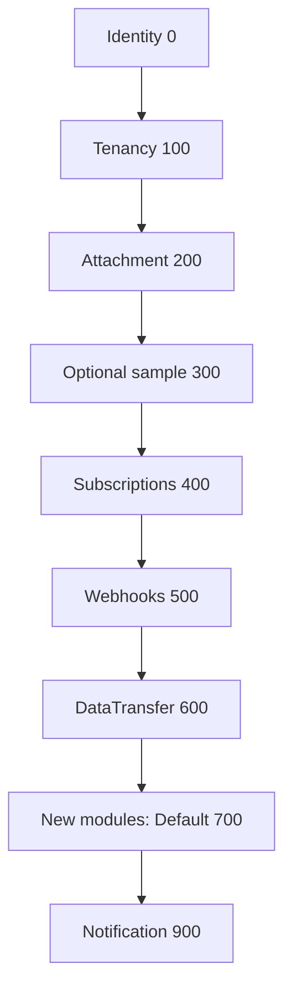

# Architecture Overview

StarterKit composes independently owned business modules into one ASP.NET Core host, using contracts to control coupling and per-module schemas to control persistence.

## At a glance

| Boundary | Responsibility | Source |
|---|---|---|
| Host | Configuration, middleware, discovery, endpoint mapping | `src/Api/Program.cs` |
| Modules | Business state, handlers, persistence, jobs | `src/Modules/` |
| Contracts | Commands, queries, DTOs and integration events | Each module's `.Contracts` project |
| Shared | Mediator ports, infrastructure and transport adapters; no business state | `src/Shared/` |

## How it works

### System architecture

Vertical slices apply Clean Architecture and domain-driven design within module assemblies; layers are responsibilities, not separate deployables.

### Core principles

#### 1. Modular Monolith

- Self-contained modules with clear boundaries
- Each module has its own DbContext and database schema
- Modules communicate through contracts and ISender, or integration events through the transactional outbox
- One deployment; extraction into a service would require new transport and operational boundaries

#### 2. Clean Architecture Layers


*Figure: Endpoints invoke handlers; commands use aggregates and repositories while queries project directly from the owning DbContext.*

#### 3. Domain-Driven Design

- **Aggregates**: Core business entities (for example, Subscription)
- **Entities**: Domain objects with identity
- **Value Objects**: Immutable descriptive objects
- **Domain Events**: Business events that trigger side effects
- **Repositories**: Data access abstraction

#### 4. CQRS Pattern

- **Commands**: Write operations (Create, Update, Delete)
- **Queries**: Read operations (Get, List, Search)
- Separation of read and write models
- Owned mediator port (`Shared.Contracts.Mediation`) for command/query handling

### Architectural patterns

#### Vertical Slice Architecture

A feature groups validation, its handler and its Carter endpoint under `Domains/<Aggregate>/Features/`. Small lookup or control-plane operations can share handler and route files, as in Tenancy's `TenantHandlers.cs` and `TenantsModule.cs`.

#### Repository Pattern

- One repository per aggregate root, interface and implementation in `Data/Repository/<X>Repository.cs`
- Used by command handlers only; query handlers read the DbContext directly

#### Factory Pattern

Domain entities use static factories and private setters to preserve invariants; callers change state through aggregate methods.

#### Event-Driven Architecture

- Domain events for same-module reactions; integration events for eventual cross-module reactions
- MassTransit for message bus
- Event handlers for side effects

#### Notifications and real time

- Every message to a person goes through `INotificationSender` (Notification module): an email/WhatsApp fallback
  chain plus two additive channels, the in-app inbox and FCM push.
- Each channel group runs as its own Hangfire job; the in-app job pushes events to the user's open sessions over the
  SignalR hub `/hubs/notifications`, scaled out across replicas by the Redis backplane.
- The hub is push-only (commands stay REST); see [Notification-Realtime-and-Push](../Modules/Notification-Realtime-and-Push.md)
  and [ADR 0012](../Decisions/0012-realtime-inbox-and-push.md).

### Technology decisions

| Aspect | Technology | Reason |
|--------|-----------|--------|
| Framework | .NET 10 | SDK pinned in `global.json` |
| Database | PostgreSQL | ACID compliance, JSON support |
| ORM | EF Core 10 | Code-first, migrations |
| API | Carter (Minimal APIs) | Feature-local route definitions |
| Messaging | MassTransit | Consumer dispatch and selectable transport |
| Caching | Redis | Distributed caching |
| Logging | Microsoft.Extensions.Logging + OpenTelemetry → Seq / Aspire / Loki | Structured logging |
| Orchestration | .NET Aspire | Local dependency orchestration |

### Module independence

Each module:

- Owns its PostgreSQL schema and business state.
- Owns a boundary that can inform a later service extraction; extraction is not supplied by the template.
- Can publish domain events and subscribe to relevant events.
- Does not reference another module's implementation; public contracts are allowed.

### System context

Workers are background processing roles; deployments can host jobs in API processes or use the worker overlay. Blob, malware scanning, payment, push and identity-provider integrations depend on configuration.


*Figure: API and worker roles share infrastructure and call configured providers.*

API requests use the identity providers; push jobs call FCM. Both roles can access PostgreSQL, Redis, Seq, blob storage, malware scanning and payment services as configured.


### Allowed module dependencies

Each implementation owns its contract assembly. Identity additionally exposes the provider-neutral user port.


*Figure: Each platform module owns its contracts while Identity supplies the replaceable user-directory port.*

The arrows illustrate allowed dependency directions, not a list of all calls. The same rule applies to Tenancy, Subscriptions, Webhooks and DataTransfer. `Identity.Contracts` is private to Identity and the host. Contracts depend only on `Shared.Contracts`, except the explicitly allowed `Tenancy.Contracts` dependency on `Shared.Core`.


*Figure: Modules reach other modules through public contracts or integration events and obtain users through UserDirectory.Contracts.*


### Module initialization order

Both service registration and initialization follow ascending `ModuleOrder`.

The sample occupies slot 300 only when included; generated products can omit that slot.


*Figure: ModuleOrder initializes the platform before new modules and Notification last.*

## Usage

The host discovers manifests through `builder.AddModules()` in `src/Api/Program.cs`. A module delegates registration and initialization, as in `src/Modules/Tenancy/Tenancy/TenancyModuleManifest.cs`:

```csharp
public override int Order => ModuleOrder.Tenancy;

public override void AddServices(IHostApplicationBuilder builder) =>
    builder.Services.AddTenancyModule(builder.Configuration);

public override void Initialize(WebApplication app) => app.UseTenancyModule();
```

## Failure modes and guarantees

A module boundary is enforced in code, not by a network hop. A synchronous dependency can fail its caller; eventual consumers retry independently through the outbox. The host does not provide a transaction spanning all module calls. Tenant-data contexts add EF filters, write checks and PostgreSQL RLS; control-plane tables require explicit scope checks.

See [Request lifecycle](Request-Lifecycle.md) for execution order, [Errors and responses](Errors-and-Responses.md) for HTTP failures and [Messaging](Messaging.md) for delivery guarantees.

## Guardrails

`ModuleBoundaryTests`, `ModuleDiscoveryTests`, `ThirdPartyIsolationTests`, `MessagingArchitectureTests` and `TenantIsolationArchitectureTests` in `src/Api.Tests/Architecture/` enforce the boundaries. [ADR-0001](../Decisions/0001-modular-monolith-schema-per-module.md) records the deployment choice; [ADR-0019](../Decisions/0019-module-manifests-and-discovery.md) records discovery. Use `/starterkit:new-module` when adding a boundary.

## Related

- [Project Structure](ProjectStructure.md)
- [Technology Stack](TechnologyStack.md)
- [Design Patterns](DesignPatterns.md)
