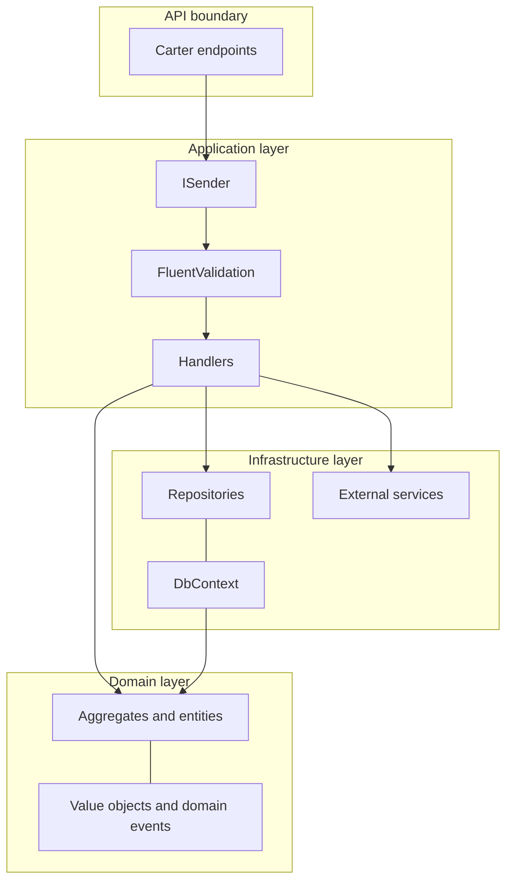
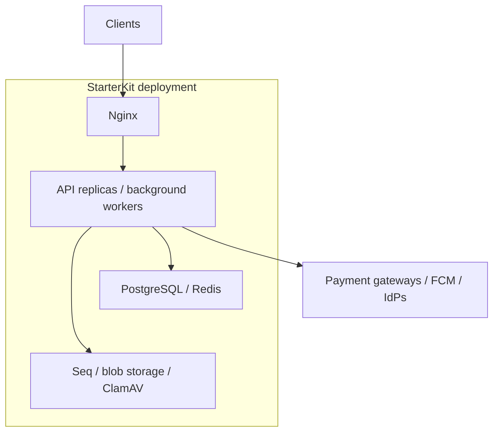
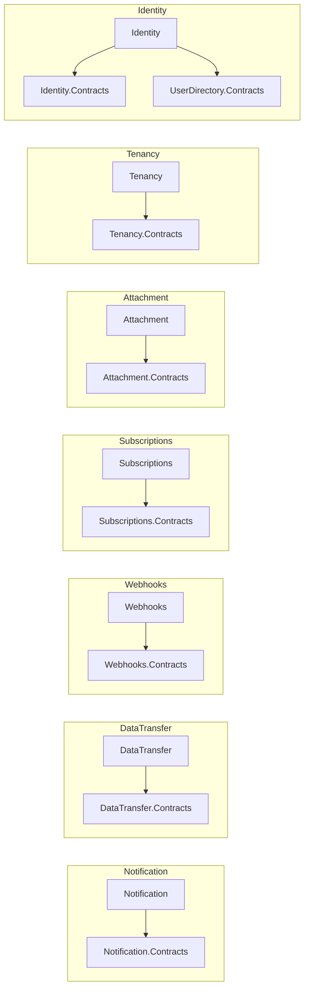
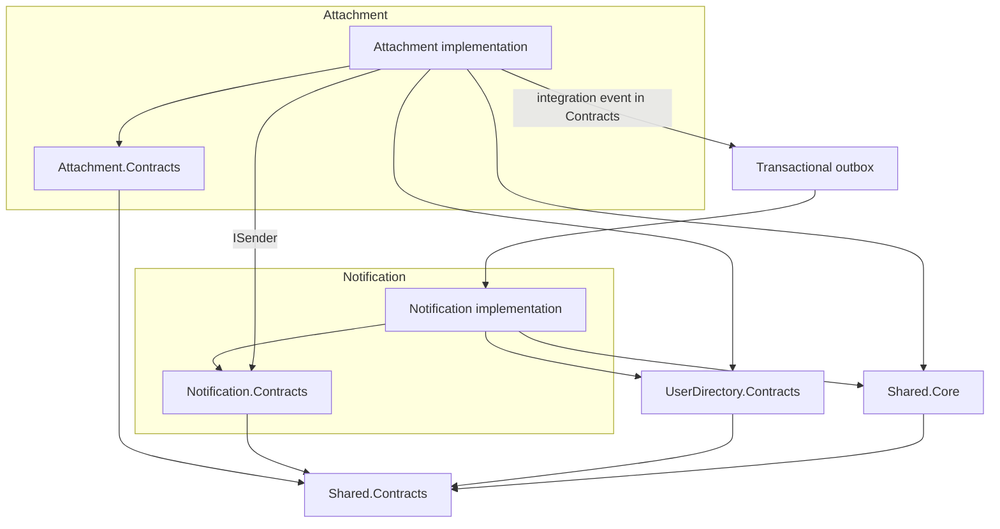
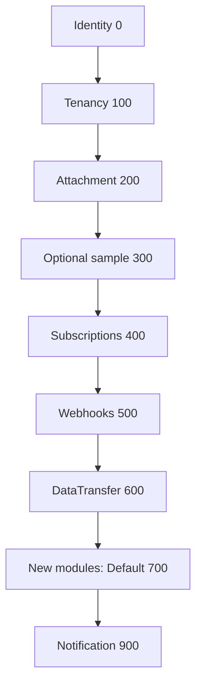

# Architecture Overview

## System Architecture

StarterKit is built as a **Modular Monolith** using **Clean Architecture** and **Domain-Driven Design (DDD)** principles.

## Core Principles

### 1. Modular Monolith
- Self-contained modules with clear boundaries
- Each module has its own DbContext and database schema
- Modules communicate through contracts and ISender, or integration events through the transactional outbox
- Independent deployment capability (future microservices migration)

### 2. Clean Architecture Layers


*Figure: Endpoints invoke application handlers that coordinate domain behavior and persistence.*

### 3. Domain-Driven Design
- **Aggregates**: Core business entities (Product, Subscription, User)
- **Entities**: Domain objects with identity
- **Value Objects**: Immutable descriptive objects
- **Domain Events**: Business events that trigger side effects
- **Repositories**: Data access abstraction

### 4. CQRS Pattern
- **Commands**: Write operations (Create, Update, Delete)
- **Queries**: Read operations (Get, List, Search)
- Separation of read and write models
- Owned mediator port (`Shared.Contracts.Mediation`) for command/query handling

## Architectural Patterns

### Vertical Slice Architecture
Each feature is self-contained:
```text
Features/
├── CreateProduct/
│   ├── CreateProductHandler.cs    # Business logic
│   ├── CreateProductEndPoint.cs   # Carter endpoint
│   └── Validator (inline)       # Validation rules
```

### Repository Pattern
- One repository per aggregate root, interface and implementation in `Data/Repository/<X>Repository.cs`
- Used by command handlers only; query handlers read the DbContext directly

### Factory Pattern
Domain entities use static factory methods:
```csharp
public static Product Create(Guid id, string name, Guid profileId)
```

### Event-Driven Architecture
- Domain events for same-module reactions; integration events for eventual cross-module reactions
- MassTransit for message bus
- Event handlers for side effects

### Notifications and real time
- Every message to a person goes through `INotificationSender` (Notification module): an email/WhatsApp fallback
  chain plus two additive channels, the in-app inbox and FCM push.
- Each channel group runs as its own Hangfire job; the in-app job pushes events to the user's open sessions over the
  SignalR hub `/hubs/notifications`, scaled out across replicas by the Redis backplane.
- The hub is push-only (commands stay REST); see [Notification-Realtime-and-Push](../Modules/Notification-Realtime-and-Push.md)
  and [ADR 0012](../Decisions/0012-realtime-inbox-and-push.md).

## Technology Decisions

| Aspect | Technology | Reason |
|--------|-----------|--------|
| Framework | .NET 10.0 | Latest features, performance |
| Database | PostgreSQL | ACID compliance, JSON support |
| ORM | EF Core 10 | Code-first, migrations |
| API | Carter (Minimal APIs) | Lightweight, fast |
| Messaging | MassTransit | Reliable, patterns support |
| Caching | Redis | Distributed caching |
| Logging | Microsoft.Extensions.Logging + OpenTelemetry → Seq / Aspire / Loki | Structured logging |
| Orchestration | .NET Aspire | Dev/prod consistency |

## Module Independence

Each module:
- Has its own database schema (PostgreSQL schema)
- Can be extracted to microservice
- Publishes domain events
- Subscribes to relevant events
- Does not directly reference other modules

## Next Steps
- [Project Structure](ProjectStructure.md)
- [Technology Stack](TechnologyStack.md)
- [Design Patterns](DesignPatterns.md)


## System context

Workers are background processing roles; deployments can host jobs in API processes or use the worker overlay. Blob, malware scanning, payment, push and identity-provider integrations depend on configuration.


*Figure: API and worker roles share infrastructure and call configured providers.*

API requests use the identity providers; push jobs call FCM. Both roles can access PostgreSQL, Redis, Seq, blob storage, malware scanning and payment services as configured.


## Allowed module dependencies

Each implementation owns its contract assembly. Identity additionally exposes the provider-neutral user port.


*Figure: Each platform module owns its contracts while Identity supplies the replaceable user-directory port.*

The arrows illustrate allowed dependency directions, not a list of all calls. The same rule applies to Tenancy, Subscriptions, Webhooks and DataTransfer. `Identity.Contracts` is private to Identity and the host. Contracts depend only on `Shared.Contracts`, except the explicitly allowed `Tenancy.Contracts` dependency on `Shared.Core`.


*Figure: Modules reach other modules through public contracts or integration events and obtain users through UserDirectory.Contracts.*


## Module initialization order

Both service registration and initialization follow ascending `ModuleOrder`.

The sample occupies slot 300 only when included; generated products can omit that slot.


*Figure: ModuleOrder initializes the platform before new modules and Notification last.*
