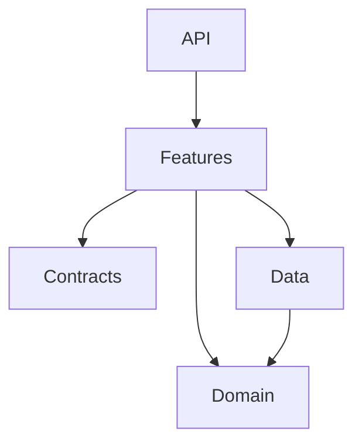

# Project Structure

The solution separates the host, module implementations, public contracts and test projects so each change has a clear owner.

## At a glance

| Change | Location |
|---|---|
| Host pipeline or configuration | `src/Api` |
| Business use case | Owning module's `Domains/<Aggregate>/Features/` |
| Cross-module public surface | Owning `.Contracts` project; users through `UserDirectory.Contracts` |
| Shared technical policy | `src/Shared` |
| Architecture rule | `src/Api.Tests/Architecture` |

## How it works

### Solution Organization

```text
StarterKit/
├── src/
│   ├── Api/                                 # ASP.NET Core host (Program.cs, appsettings, Dockerfile)
│   ├── Api.Tests/                           # Architecture tests (guardrails)
│   ├── Api.E2ETests/                        # HTTP end-to-end tests (+ multi-tenant, pending-model-changes)
│   ├── Aspire/
│   │   ├── AppHost/                         # .NET Aspire orchestration (Postgres, Redis, Seq, observability)
│   │   ├── ServiceDefaults/                 # Shared OpenTelemetry / health defaults
│   │   └── AppHost.Tests/                   # Aspire orchestration tests
│   ├── Modules/
│   │   ├── Identity/                        # Auth, users, roles, JWT (+ UserDirectory.Contracts port)
│   │   ├── Tenancy/                         # Tenants, branches, memberships (multi-tenancy control plane)
│   │   ├── Notification/                    # Email, WhatsApp, inbox, SignalR, push
│   │   ├── Attachment/                      # File uploads and storage providers
│   │   ├── Subscriptions/                   # Subscribers, plans, subscriptions, payments
│   │   ├── Webhooks/                        # Signed outbound deliveries
│   │   ├── DataTransfer/                    # CSV/XLSX import and export jobs
│   │   └── Agentic/                         # AI agents: durable runs, typed tools, model providers
│   └── Shared/
│       ├── Shared.Contracts/                # CQRS interfaces, pagination, enums
│       ├── Shared.Core/                     # Base classes, behaviors, EF/Redis/web helpers
│       └── Shared.Messaging/                # MassTransit configuration
├── tests/e2e/                               # Playwright browser smoke tests (TypeScript)
├── tools/claude/starterkit-plugin/          # Claude Code plugin: skills, reviewer agent, hooks
├── infra/                                   # Nginx, observability, pgAdmin configs
└── deployment/                              # VPS deploy, rollback and backup scripts
```

### Module Structure Template

Use `dotnet new starterkit-module` and `/starterkit:new-module` to create the four-project layout below. The optional sample occupies its own module folder when included. This is a layout convention: small operations can share handler files, and Notification uses `Persistence/` for its context and migrations. Attachment integration tests live under `Attachment.Tests/Integration`.

```text
src/Modules/<Module>/
├── <Module>.Contracts/                      # Public surface: Shared.Contracts only
│   ├── <Area>s/Commands/  Queries/  Dtos/  Enums/  IntegrationEvents/
│   └── <Module>ContractsRoot.cs             # assembly marker (enum lookup)
├── <Module>/                                # Implementation
│   ├── Domains/<Aggregate>/
│   │   ├── Models/                          # aggregate + children, factories, invariants
│   │   ├── Features/<Feature>/              # <Feature>Handler.cs (validator + handler) + <Feature>EndPoint.cs
│   │   ├── Events/  EventHandlers/  Exceptions/
│   │   ├── Consumers/  Jobs/  Services/  Mappings/
│   ├── Data/
│   │   ├── <Module>DbContext.cs  <Module>DbContextFactory.cs (design time)
│   │   ├── Configurations/                  # IEntityTypeConfiguration<T>
│   │   ├── Repository/                      # I<X>Repository + <X>Repository (one file)
│   │   ├── Migrations/  Seed/
│   ├── Options/  Resources/ (<Module>Resource.resx + .ar.resx)  Common/
│   ├── <Module>ModuleManifest.cs            # assembly attribute, order and initialization
│   ├── <Module>Module.cs                    # Add<Module>Module / Use<Module>Module
│   └── GlobalUsings.cs                      # + <Module>Root assembly marker
├── <Module>.Tests/                          # unit: Domain/, Features/, Services/, TestSupport.cs
└── <Module>.IntegrationTests/               # Testcontainers Postgres + real Add<Module>Module
```

#### Contracts rules

- Contracts hold no implementation logic: records, enums, integration events.
- They depend only on `Shared.Contracts` (architecture test). The one whitelisted exception is
  `Tenancy.Contracts → Shared.Core`.
- Other modules may reference them. Identity is reached only through `UserDirectory.Contracts`.

Contracts include command/query/result records, DTOs, enums, integration events and public ports. They are versioned when needed and shared across modules; they are not restricted to DTOs.

### Naming Conventions

#### Files

- `{Feature}Handler.cs` - validator + mediator handler
- `{Feature}EndPoint.cs` - Carter endpoint (or grouped `{X}sModule.cs`)
- `{Entity}Configuration.cs` - EF Core configuration
- `{Entity}Repository.cs` - Repository implementation
- Repository interfaces commonly share `{Entity}Repository.cs` with their implementation; one repository per aggregate root.

#### Namespaces

```text
{Module}.Domains.{Aggregate}.Models
{Module}.Domains.{Aggregate}.Features.{Action}
{Module}.Data.Repository.{Aggregate}
{Module}.Contracts.{Aggregate}.Commands
```

### Dependency Flow


*Figure: Feature slices use domain behavior and data access while exposing contracts.*

**Rules**:
- Domain behavior owns invariants; it never reaches another module's implementation
- Data depends on Domain
- Features depend on Domain and Data
- Contracts reference `Shared.Contracts`; `Tenancy.Contracts` has the explicit `Shared.Core` exception
- API orchestrates everything

## Usage

The assembly marker in `src/Modules/Tenancy/Tenancy/TenancyModuleManifest.cs` makes the implementation discoverable:

```csharp
[assembly: ModuleManifest(typeof(Tenancy.TenancyModuleManifest))]
```

`src/Api/Api.csproj` references module implementation projects by glob. `builder.AddModules()` discovers manifests, configures messaging and enum assemblies, and registers modules in ascending order. Do not add individual module calls to `Program.cs`.

## Failure modes and guarantees

A folder alone is not a module: it needs its implementation project and exactly one manifest. Generated projects must also be in the solution for solution-level builds and tests. Shared projects cannot own business schemas, endpoints or jobs. Keep user dependencies behind `UserDirectory.Contracts` so replacing Identity does not require changing business modules.

## Guardrails

`ModuleDiscoveryTests`, `ModuleBoundaryTests` and `NamingConventionTests` verify discovery, references and naming. `ThirdPartyIsolationTests` keeps infrastructure packages in their owning adapter modules. See [ADR-0019](../Decisions/0019-module-manifests-and-discovery.md) and `/starterkit:new-module`.

## Related

- [Technology Stack](TechnologyStack.md)
- [Design Patterns](DesignPatterns.md)
- [Coding Standards](CodingStandards.md)
