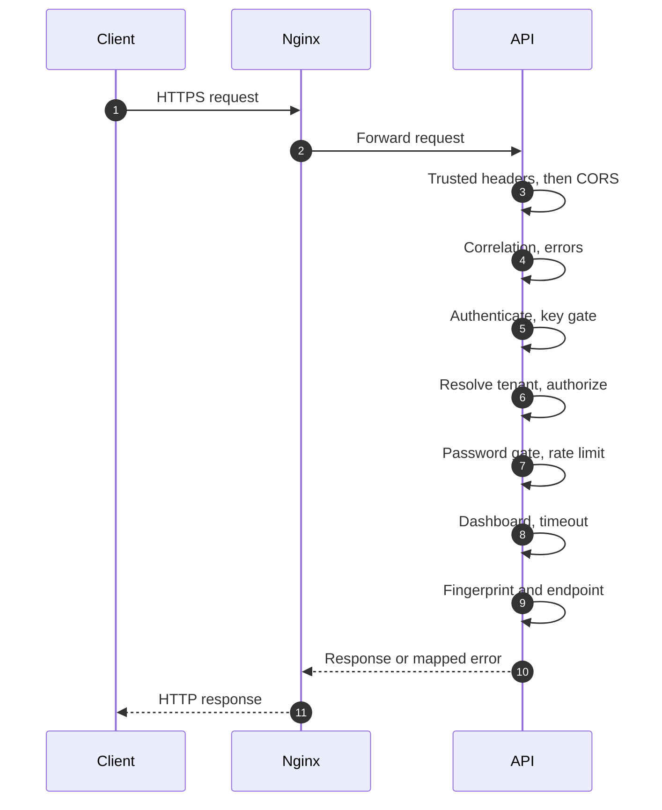
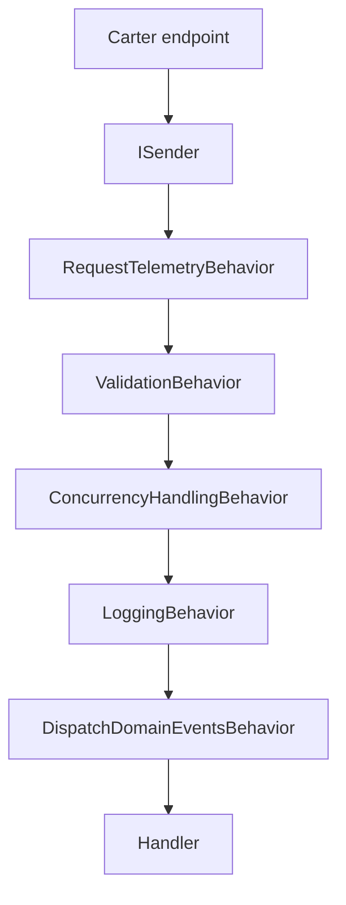
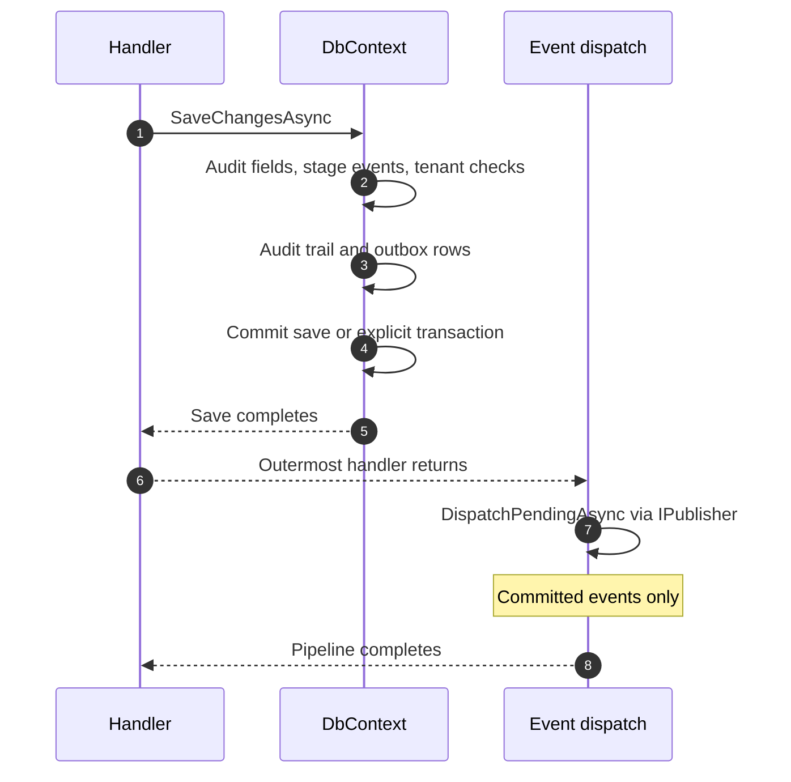

# Request lifecycle

An HTTP request crosses host middleware, endpoint filters, the owned mediator and EF interceptors before returning a response, with commit and event dispatch as separate boundaries.

## At a glance

| Boundary | Main types / source |
|---|---|
| Reverse proxy | `deployment/nginx/conf.d/app-production.conf` |
| Host middleware | `src/Api/Program.cs`, `src/Api/Extensions/SharedInfrastructureExtensions.cs` |
| Authentication and authorization | `src/Modules/Identity/Identity/IdentityModule.cs` |
| Endpoint and mediator | Carter `ICarterModule`, `ISender`, `src/Shared/Shared.Core/Extensions/MediatorExtensions.cs` |
| Save and dispatch | `src/Shared/Shared.Core/Data/Extentions.cs`, `DispatchDomainEventsInterceptor`, `IDomainEventDispatcher` |
| Response | `ApiResponse<T>`, `GlobalExceptionHandler`, `ResponseWrapperMiddleware` |

## How it works

### HTTP pipeline

The following order is explicit in `Program.cs` and the extensions it calls. Nginx supplies forwarded headers and `X-Request-ID`; the API only trusts configured proxies. The API's `X-Correlation-Id` is a separate header. CORS runs before the error wrapper, so a preflight can finish without entering the rest of this pipeline.


*Figure: A business request enters the endpoint only after identity, tenant and host policies allow it.*

| Order | Registration | Effect |
|---|---|---|
| 1 | `UseTrustedForwardedHeaders` | Restores trusted client address and scheme before downstream policies use them. |
| 2 | `UseConfigurableCors` | Applies the configured origin policy. |
| 3 | `UseErrorHandling` | Registers correlation, response wrapping, status-code pages and exception handling, in that order. |
| 4 | `UseIdentityPipeline` | Authentication, `ApiKeyRestrictionMiddleware`, the supplied `UseMultiTenancy` callback, authorization, then `MustChangePasswordMiddleware`. |
| 5 | `UseRateLimiter` | Partitions authenticated traffic by user; anonymous traffic by client address. |
| 6 | `UseHangfireDashboard` | Serves the protected dashboard; matching requests short-circuit before request timeouts. |
| 7 | `UseRequestTimeouts` | Applies endpoint/default timeout policy. |
| 8 | `UseSharedInfrastructure` | Registers idempotency fingerprinting, maps Carter and health endpoints, registers localization and maps the root endpoint; development also maps OpenAPI. |

`UseModules()` between timeout registration and shared infrastructure initializes modules in `ModuleOrder`; it is not a per-request middleware stage. `UseOutboxSweep()` schedules recovery work. In `--migrate-only` mode the host exits after migrations, before outbox scheduling and shared endpoint setup. Mapping Carter routes does not execute them: localization registered in this extension runs before the selected endpoint delegate.

Authentication uses the `BearerOrApiKey` policy scheme and `ApiKeyRequest.SelectScheme` to select JWT Bearer or API-key authentication. An explicit `Authorization: Bearer` takes precedence; otherwise `Authorization: ApiKey` or `X-Api-Key` selects the key scheme. API-key permissions are limited to the owner's permissions intersected with the key scopes. Tenant resolution follows authentication because it needs the caller; authorization follows tenant resolution because membership policies need the resolved tenant. See [Identity](../Identity/README.md) and [tenant resolution](../MultiTenancy/Overview.md).

### Endpoint filters

Carter endpoints have an `ApiResponseMarkerFilter` and deny-by-default authorization convention. Each endpoint must still declare authorization explicitly. The filters below are opt-in; they run in the order registered on that endpoint, not in one universal order. The idempotency body fingerprint is computed by middleware before body binding.

| Filter | Port / behavior | Rejection or limitation |
|---|---|---|
| `WithIdempotency()` | Optional `Idempotency-Key`; reserve and replay through `IIdempotencyStore` | 409 `idempotency_in_progress`; 422 `idempotency_key_reused`; store failures fail open. |
| `RequireFeature(key)` | `IEntitlementService` checks the paying subscriber's plan | 403 `feature_not_in_plan`; enforcement defaults off. |
| `RequireQuota(key, qty)` | `IQuotaService` consumes a metered quota | 429 `quota_exceeded`; counter-store failures fail open. |
| `RequireFlag(key)` | `IFeatureFlags` checks a runtime flag | 404 when disabled; separate from plan entitlements. |
| `RequireHumanVerification(action)` | `IHumanVerifier`, token in `X-Captcha-Token` | 400 `captcha_required` / `captcha_invalid`; 503 `captcha_unavailable` when the provider fails closed. |

### Mediator and handler

`ISender` is the owned port in `Shared.Contracts.Mediation`, implemented by `Shared.Core.Mediation.Mediator`. It is not MediatR. Behaviors run outermost first:


*Figure: The shared mediator pipeline validates and observes a request before its handler and dispatches committed events on return.*

The host registers `RequestTelemetryBehavior` through `AddCustomObservability`; module fixtures need not include it. `AddMediator` registers validation, concurrency translation, logging and domain-event dispatch. Identity additionally registers `AuditedCommandTransactionBehavior` inside `DispatchDomainEventsBehavior`, immediately around the handler. It transacts audited admin commands and passes other requests through, making UserManager saves and the audit row atomic. There is no general transaction behavior.

Command handlers load aggregates through repositories and invoke aggregate methods. Queries use the owning DbContext directly with `AsNoTracking`, SQL projection and bounded pagination. Nested `ISender.Send` calls share the dispatch depth counter; only the successful outermost call drains pending domain events.

### Save, commit and dispatch

`AddCustomDbContext` registers save interceptors in this exact order (`src/Shared/Shared.Core/Data/Extentions.cs`):

| Order | Interceptor | Responsibility |
|---|---|---|
| 1 | `AuditableEntityInterceptor` | Stamps audit fields and manages optimistic-concurrency versions. Never set `Version` manually. |
| 2 | `DispatchDomainEventsInterceptor` | Takes aggregate domain events and stages them; it does not publish them here. |
| 3 | `TenantEntityInterceptor` | Stamps tenant ownership and rejects cross-tenant writes. Never set `TenantId` manually. |
| 4 | `AuditTrailInterceptor` | Adds audit rows after tenant stamping, in the same save. |
| 5 | `OutboxInterceptor` | Adds integration-event rows to the same DbContext transaction, copying validated tenant ownership. |

Tenant-data contexts also register `TenantSessionConnectionInterceptor` for connection-level RLS state. The selected connection can be the shared database or the tenant's dedicated database. Audit and outbox behavior requires the corresponding model mappings; registering interceptors does not create tables.


*Figure: A committed save makes events eligible for dispatch, but the outermost successful handler controls when dispatch runs.*

Without an explicit transaction, `SavedChanges` promotes staged events. With one, they wait for `TransactionCommitted`. Failed/canceled saves, concurrency failures and rolled-back transactions discard their events. Outbox staging also adds `OutboxMessagesSaved`; its handler attempts delivery after commit and the sweep recovers undelivered rows. Integration delivery is at-least-once, so consumers must be idempotent.

After the pipeline returns, the endpoint constructs its result. `ApiResponseExtensions.Success` provides the explicit envelope; the marker prevents wrapping it again. The wrapper handles eligible raw successful JSON responses under `/api`. Files, streams and bodyless responses pass through. [Errors and responses](Errors-and-Responses.md) defines the exact shapes and exceptions.

## Configuration

Defaults below come from `src/Api/appsettings.json`, `IdempotencyOptions` and `SubscriptionOptions`.

| Key | Default | Meaning |
|---|---|---|
| `ForwardedHeaders:TrustPrivateNetworks` | `false` (`true` in Docker settings) | Trust private-network proxies only for deployments that control that network. |
| `RequestTimeouts:DefaultSeconds` | `30` | Default endpoint timeout; zero disables the default. |
| `RequestTimeouts:LongRunningSeconds` | `300` | Long-running endpoint timeout; non-positive means infinite. |
| `Hangfire:DashboardPath` | `/hangfire` | Dashboard route, outside request timeout middleware. |
| `Idempotency:Ttl` | 24 hours | Completed-response replay lifetime (24 hours). |
| `Idempotency:InFlightTtl` | 5 minutes | Reservation lifetime after a worker dies. |
| `Idempotency:MaxStoredBodyBytes` | `262144` | Larger responses are returned but not stored. |
| `Idempotency:MaxKeyLength` | `255` | Maximum key-header length. |
| `Subscriptions:Entitlements:Enforce` | `false` | Enables plan entitlement enforcement. |
| `BotProtection:Enabled` | `false` | Enables human verification. |
| `BotProtection:FailOpen` | `true` | Allows requests during verifier outages; does not make an invalid token valid. |

## Usage

The ordering-sensitive host call is copied from `src/Api/Program.cs`:

```csharp
app.UseIdentityPipeline(afterAuthentication: a => a.UseMultiTenancy());

// Rate limiting runs AFTER authentication so policies can partition per user id (anonymous → per client IP).
app.UseRateLimiter();
```

For background work, use `IUnitOfWorkRunner.RunAsync` per item, or dispatch explicitly after saving in an existing scope. Tenant jobs use `ITenantJobRunner.ForEachTenantScopeAsync`; request middleware does not run for jobs or message consumers.

## Failure modes and guarantees

- Validation stops the handler with 400. Concurrency translation produces 409; it does not rerun commands.
- A root handler failure clears pending domain events, but cannot undo already committed saves. A domain-event handler can fail after commit; do not infer rollback from an HTTP error.
- Request timeout is 504; a caller-aborted request is handled as 499 without a JSON body. Cancellation does not prove that a prior commit was undone.
- Idempotency is opt-in, expires, and fails open on store outage. Thrown downstream errors release the reservation; eligible returned 2xx/4xx responses may be cached. It is not an exactly-once financial guarantee.
- A migrating tenant rejects writes with 503. Tenant and permission checks remain necessary even when filters or feature gates are present.

## Guardrails

`AdminEndpointAuthorizationTests`, `ModuleDiscoveryTests`, `TenantIsolationArchitectureTests`, `AuditTrailArchitectureTests`, `MessagingArchitectureTests` and `BackgroundJobEventDispatchTests` protect host/module rules. `DomainEventDispatchTests`, `DomainEventCollectorTests`, `IdempotencyFilterTests`, `TenantResolutionMiddlewareTests`, `ExceptionHandlingTests` and `ResponseWrapperTests` exercise runtime boundaries.

## Related

[Overview](Overview.md), [Errors and responses](Errors-and-Responses.md), [Design patterns](DesignPatterns.md), [Messaging](Messaging.md), [ADR-0007](../Decisions/0007-owned-mediator-port.md), `/starterkit:add-feature`, and `/starterkit:add-background-job`.
