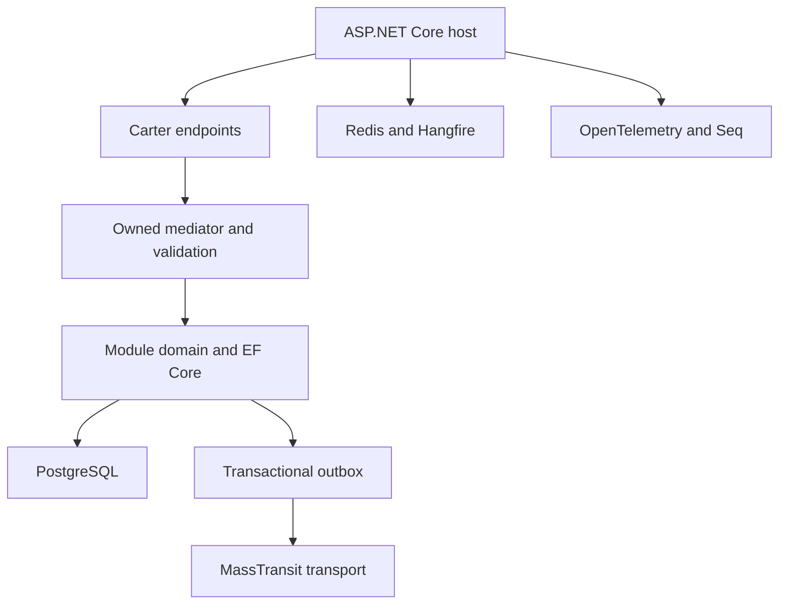

# Technology stack

StarterKit pins its application dependencies centrally and composes them behind module boundaries, with infrastructure images selected by Docker Compose overlays.

## At a glance

| Concern | Source of truth |
|---|---|
| SDK | `global.json`: `10.0.403`, `rollForward: latestFeature`, prereleases disabled |
| Target and compiler defaults | `Directory.Build.props`: `net10.0`, nullable and implicit usings enabled; no explicit `LangVersion` pin |
| NuGet | `Directory.Packages.props`: central versions and transitive pinning |
| Runtime infrastructure | `docker-compose.yml` and its overlays |
| License constraints | [Third-party licenses](../Reference/Third-Party-Licenses.md) |

## How it works


*Figure: Shared infrastructure supports the modules while contracts and adapters contain library-specific dependencies.*

The [architecture overview](Overview.md) explains module boundaries; [Request lifecycle](Request-Lifecycle.md) explains execution order. The tables below record repository pins, not claims about the newest upstream releases. A central package declaration makes a version available; the consuming project still selects its references.

### Framework, API and application

| Component | Repository version | Responsibility |
|---|---|---|
| .NET SDK | `10.0.403` | Builds the `net10.0` solution. SDK roll-forward is allowed within the configured policy. |
| Carter | `10.0.0` | Minimal API endpoint organization; OpenAPI generation is supplied separately. |
| Microsoft.AspNetCore.OpenApi | `10.0.14` | API description generation. |
| Swashbuckle.AspNetCore | `10.3.1` | Swagger tooling. |
| Scalar.AspNetCore | `2.19.0` | Interactive API reference. |
| Asp.Versioning.Http | `10.2.3` | HTTP API versioning; Abstractions/Mvc/Mvc.ApiExplorer are `10.2.1`. |
| Owned mediator | Repository source | `Shared.Contracts.Mediation` ports, implemented by `Shared.Core.Mediation.Mediator`; no MediatR package. |
| FluentValidation | `12.2.0` | Validators run through the mediator pipeline; DI extensions use the same version. |
| Mapster | `10.0.14` | Object mapping. |
| Scrutor | `7.0.0` | Service registration utilities. |
| Polly | `8.9.1` | Resilience policies. |

The code uses file-scoped namespaces, records, primary constructors, init-only properties and pattern matching. Language support follows the selected SDK and target framework; the repository does not pin “C# 12+” as a separate version.

### Persistence, caching and jobs

| Component | Repository version | Responsibility |
|---|---|---|
| Microsoft.EntityFrameworkCore | `10.0.14` | Code-first models, migrations, interceptors and named query filters. |
| Npgsql.EntityFrameworkCore.PostgreSQL | `10.0.3` | PostgreSQL EF provider. |
| EFCore.NamingConventions | `10.0.1` | snake_case naming. |
| Microsoft.Extensions.Caching.StackExchangeRedis | `10.0.14` | Distributed cache adapter; Redis also carries cache invalidation pub/sub. |
| Hangfire.Core / Hangfire.AspNetCore | `1.8.25` | Durable background jobs in API/worker roles. |
| Hangfire.PostgreSql | `1.21.1` | Job storage. |

PostgreSQL supplies per-module schemas, transactions, JSON/JSONB storage, indexes and row-level security. Query and index choices belong to the owning module; the database engine's full-text capabilities do not imply a shared full-text search feature. See [Database conventions](DatabaseConventions.md) and [Redis](../Infrastructure/Redis.md).

### Messaging, notification and files

| Component | Repository version | Responsibility / boundary |
|---|---|---|
| MassTransit, Abstractions, EntityFrameworkCore, RabbitMQ, SqlTransport.PostgreSql | `8.5.12` | Integration-event delivery and durable saga repository support; InMemory, PostgreSql or RabbitMq transport. |
| Microsoft.AspNetCore.SignalR.StackExchangeRedis | `10.0.14` | Notification hub scale-out on a separate Redis connection. |
| FirebaseAdmin | `3.7.0` | FCM behind Notification's `IPushProvider`; NoOp is the default without provider configuration. |
| MailKit / Fluid.Core | `4.18.2` / `2.41.1` | Email transport and templates. |
| Azure.Storage.Blobs | `12.30.1` | Attachment blob storage option. |
| AWSSDK.S3 | `4.0.104.11` | Attachment S3 storage option. |
| SkiaSharp | `4.155.0` | Attachment image processing. |
| QuestPDF | `2026.9.1` | Subscriptions invoice PDFs. |
| Stripe.net | `53.1.0` | Payment provider adapter. |
| Sylvan.Data.Csv / Sylvan.Data.Excel | `1.4.4` / `0.5.8` | DataTransfer streaming CSV/XLSX readers. |

Domain events use the owned mediator, not MassTransit. Cross-module synchronous calls also use the mediator; [Messaging](Messaging.md) describes asynchronous delivery. SignalR serves `/hubs/notifications`; production uses WebSockets, while SSE/long polling require sticky sessions. FCM supports Android, iOS through APNs, and web push; provider SDKs stay behind module ports. See [Real-time and push](../Modules/Notification-Realtime-and-Push.md).

### Identity and security

| Component | Repository version | Responsibility |
|---|---|---|
| Microsoft.AspNetCore.Identity.EntityFrameworkCore | `10.0.14` | Extended user/role persistence, password hashing and Identity services. |
| Microsoft.AspNetCore.Authentication.JwtBearer | `10.0.14` | Bearer authentication. |
| Microsoft.AspNetCore.Authentication.Google / Facebook | `10.0.14` | Social authentication adapters. |
| System.IdentityModel.Tokens.Jwt / Microsoft.IdentityModel.Protocols.OpenIdConnect | `8.23.0` | Tokens and OIDC metadata. |
| ITfoxtec.Identity.Saml2 | `4.21.0` | Identity's SAML integration. |
| Azure.Extensions.AspNetCore.DataProtection.Keys / Azure.Identity | `1.6.5` / `1.21.0` | Optional key encryption through Azure. |
| AWSSDK.KeyManagementService | `4.0.101.4` | Optional AWS KMS key encryption. |

Authentication details, including header/cookie handling and provider-specific behavior, belong in [Identity](../Identity/README.md); a library choice does not define the token storage contract.

### Observability and local orchestration

| Component | Repository version | Responsibility |
|---|---|---|
| OpenTelemetry.Extensions.Hosting / OTLP, Console and Zipkin exporters | `1.20.1` | Telemetry registration and optional exporters. |
| OpenTelemetry ASP.NET Core / Http instrumentation | `1.20.2` | Server and client telemetry. |
| OpenTelemetry Runtime instrumentation | `1.20.1` | Runtime metrics. |
| OpenTelemetry Process instrumentation | `1.20.1-rc.1` | Process metrics (prerelease). |
| OpenTelemetry GrpcNetClient / Prometheus.AspNetCore | `1.20.1-beta.1` | gRPC client instrumentation and metrics scraping (prerelease). |
| Npgsql.OpenTelemetry | `10.0.3` | Database tracing. |
| Grafana.OpenTelemetry | `1.14.1` | Optional Grafana distribution. |
| Aspire hosting packages / Aspire.Seq | `13.6.4` | AppHost orchestration, dependency wiring, discovery and Seq export. |
| AspNetCore.HealthChecks packages | `9.0.0` | Dependency checks and development health UI. |

Application logging uses `Microsoft.Extensions.Logging` and OpenTelemetry; there is no Serilog package. Seq is a destination, alongside Aspire and configured OTLP collectors. Jaeger receives OTLP; Zipkin is an opt-in exporter retained for existing deployments. See [Observability](Observability.md).

### Infrastructure images

| Compose source | Images / tags |
|---|---|
| `docker-compose.yml` | `postgres:16-alpine` plus pgBackRest 2.57 (built from `infra/postgres` for `postgres` and `pgbackrest`), `redis:7-alpine`, `datalust/seq:2024.3`; API image uses `DOCKER_IMAGE` / `DOCKER_IMAGE_TAG`. |
| `docker-compose.rabbitmq.yml` | `rabbitmq:3.13-management-alpine` |
| `docker-compose.clamav.yml` | `clamav/clamav:1.4` |
| `docker-compose.observability-lite.yml` | `prom/prometheus:v3.5.1`, `grafana/grafana:12.3.1` |
| `docker-compose.observability.yml` | Collector, Prometheus, Grafana, Tempo, Loki, Jaeger and infrastructure exporters use `latest`. |
| `docker-compose.override.yml` | pgAdmin, Redis Commander and MailHog use `latest`; development API uses `starterkit-api:dev`. |
| `docker-compose.loadtest.yml` | `grafana/k6:1.0.0`, PostgreSQL/Redis tags as above, `starterkit-api:loadtest`. |

Floating tags are not immutable version pins. This table does not infer the resolved patch version of `7-alpine` or `latest`. See [Docker Compose](../deployment/Docker-Compose.md) for overlay selection and [operational observability](../deployment/Observability.md) for full versus lite telemetry stacks.

### Testing and build tooling

| Component | Repository version | Responsibility |
|---|---|---|
| xunit.v3.mtp-off / xunit.runner.visualstudio | `4.0.2` / `4.0.1` | xUnit v3 API with VSTest-compatible `dotnet test`. |
| FluentAssertions | `7.2.2` | Assertions. |
| Moq | `4.21.0` | Mocks. |
| Testcontainers.PostgreSql / Redis | `4.16.0` | Real database/cache integration fixtures. |
| Bogus | `35.6.5` | Test data. |
| Microsoft.NET.Test.Sdk / coverlet.collector | `18.11.0` / `10.1.0` | Test execution and coverage. |
| Microsoft.AspNetCore.Mvc.Testing / TestHost / SignalR.Client | `10.0.14` | HTTP and real-time tests. |
| SonarAnalyzer.CSharp | `10.35.0.4138` | Build-time analysis. |
| Microsoft.CodeAnalysis packages | `5.0.0` | Pin required by EF Core Design's workspace dependency. |

MSBuild centralizes package versions and build settings. Docker builds the deployable image; GitHub Actions supplies the repository CI/deployment workflows. Use a .NET 10-capable IDE and container runtime. pgAdmin is included as a development tool; an external SQL client is optional. NuGet feed configuration is a deployment choice, not an included Azure Artifacts integration.

## Usage

The actual central pin in `Directory.Packages.props` is:

```xml
<PackageVersion Include="MassTransit" Version="8.5.12" />
```

Projects reference centrally managed packages without a local `Version` attribute. Inspect `global.json` before choosing an SDK and the relevant Compose overlay before documenting an infrastructure version.

## Failure modes and guarantees

MassTransit stays on the 8.x major and FluentAssertions on 7.x for the repository's licensing policy; do not treat newer major releases as routine upgrades. MediatR was replaced by the owned mediator. QuestPDF has product-specific licensing requirements and stays inside Subscriptions; other service/container obligations are recorded in [Third-party licenses](../Reference/Third-Party-Licenses.md).

An SDK pin with roll-forward and a floating container tag do not guarantee byte-for-byte reproduction. Versions in this page come from repository declarations, not network resolution. No Azure Service Bus transport is configured, and no production business saga is currently registered.

## Guardrails

`ThirdPartyIsolationTests` enforces package boundaries and prohibits MediatR/ImageSharp references. `ModuleBoundaryTests`, `MessagingArchitectureTests` and `SagaArchitectureTests` enforce the architectural use of dependencies. Central package management prevents project-local version drift; its declarations do not by themselves validate every upstream upgrade.

## Related

[Overview](Overview.md), [Design patterns](DesignPatterns.md), [Coding standards](CodingStandards.md), [Database conventions](DatabaseConventions.md), [Third-party licenses](../Reference/Third-Party-Licenses.md), [ADR-0007](../Decisions/0007-owned-mediator-port.md), and `/starterkit:new-module` / `/starterkit:update-docs`.
