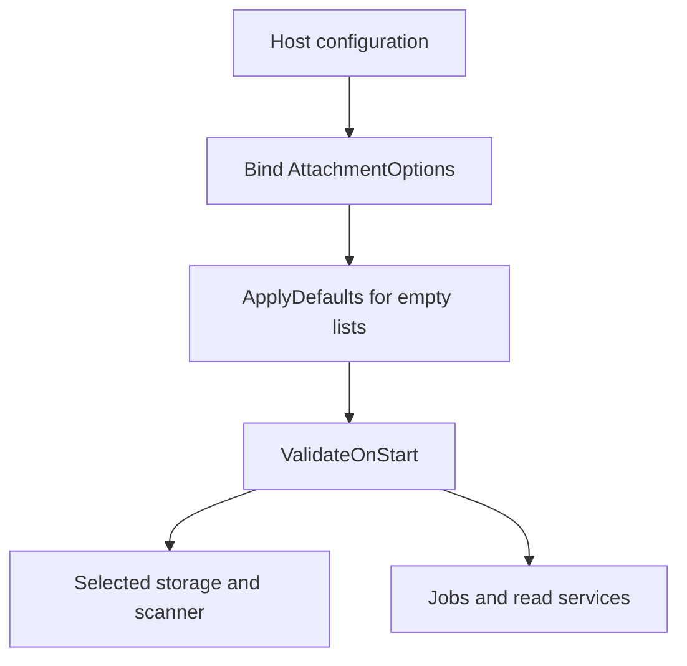

# Attachment configuration

Attachment binds one validated options tree for storage, upload inspection, signed reads, image processing and background recovery.

## At a glance

| Source | Role |
|---|---|
| `src/Api/appsettings.json` | Shipped settings |
| `src/Api/appsettings.Docker.json` | Template-conditional provider selection for generated deployments |
| `src/Modules/Attachment/Attachment/Infrastructure/Configuration/AttachmentOptions.cs` | All option properties and fallback lists |
| `AttachmentOptionsValidator.cs` in the same directory | Startup constraints |
| `src/Modules/Attachment/Attachment/AttachmentModule.cs` | Bind once, apply defaults, validate on start |

## How it works


*Figure: Configuration is bound once; empty lists receive fallback values before startup validation runs.*

Non-empty lists replace option-level fallback lists rather than appending to them. `ApplyDefaults` also fills explicitly empty arrays, so an empty allowlist does not disable all file types. Normal configuration-provider precedence still applies, including indexed array overrides between files. Other appsettings environment files do not add active Attachment overrides in this checkout; Docker provider lines are template-controlled.

## Configuration

This is the complete set of settable leaf properties under `Attachment`. Defaults are the shipped base settings, with differing class fallbacks identified. Values absent from base JSON come from the options class. Null/empty secrets are unset, not deployable credentials. The scanner host's literal loopback default is shown because it is configuration data, not a production hostname.

| Key | Default | Meaning |
|---|---|---|
| `Attachment:Pending:MaxUploadsPerSession` | 20 | Live files per owner-bound session |
| `Attachment:Pending:MaxUploadsPerMinute` | 5 | Unused compatibility key; use the named `upload` rate policy |
| `Attachment:Pending:ExpirationHours` | 48 | Pending upload lifetime |
| `Attachment:Pending:CleanupIntervalHours` | 6 | Cleanup every N hours; 24 or more means daily |
| `Attachment:Pending:CleanupBatchSize` | 100 | Rows per cleanup batch |
| `Attachment:Storage:Provider` | `Local` | `Local`, `AzureBlob`, `S3` |
| `Attachment:Storage:Local:UploadPath` | `uploads` | Root relative to content root, or absolute |
| `Attachment:Storage:Local:BaseUrl` | `/uploads` shipped; null option | Ignored; no static file serving |
| `Attachment:Storage:AzureBlob:ConnectionString` | null | Required when Azure is selected; signing-capable credentials |
| `Attachment:Storage:AzureBlob:ContainerName` | `attachments` | Private container |
| `Attachment:Storage:AzureBlob:UsePublicAccess` | false | Ignored; container creation is private |
| `Attachment:Storage:S3:AccessKeyId` | Empty shipped; null option | Set both credentials or neither for default credential chain |
| `Attachment:Storage:S3:SecretAccessKey` | Empty shipped; null option | Paired S3 credential |
| `Attachment:Storage:S3:Region` | `us-east-1` | AWS region |
| `Attachment:Storage:S3:BucketName` | Empty shipped; `attachments` option | Required when S3 selected |
| `Attachment:Storage:S3:UsePublicAccess` | true shipped; false option | Ignored; no public object ACL |
| `Attachment:Storage:S3:CloudFrontDomain` | null | Ignored; no unsigned CDN URL |
| `Attachment:Storage:S3:UseServerSideEncryption` | true | Request AES256 encryption on writes/copies |
| `Attachment:Storage:S3:StorageClass` | `STANDARD` | Storage class; adapter recognizes listed classes in [Storage providers](Storage-Providers.md) |
| `Attachment:Storage:S3:PresignedUrlExpirationMinutes` | 60 | Ignored; use `Download:ReadUrlTtlMinutes` |
| `Attachment:Validation:MaxFileSizeBytes` | 10485760 | Other-file limit |
| `Attachment:Validation:MaxImageSizeBytes` | 10485760 | Image limit |
| `Attachment:Validation:MaxDocumentSizeBytes` | 52428800 | Document limit |
| `Attachment:Validation:MaxVideoSizeBytes` | 104857600 | Video limit |
| `Attachment:Validation:MaxAudioSizeBytes` | 20971520 | Audio limit |
| `Attachment:Validation:MaxImageMegapixels` | 40 | Reject oversized image headers before decode |
| `Attachment:Validation:AllowedExtensions` | `.jpg`, `.jpeg`, `.png`, `.gif`, `.bmp`, `.webp`, `.pdf`, `.doc`, `.docx`, `.xls`, `.xlsx`, `.ppt`, `.pptx`, `.txt`, `.csv`, `.json`, `.xml`, `.mp4`, `.mpeg`, `.quicktime`, `.avi`, `.mp3`, `.wav`, `.ogg` shipped | Option fallback is the same list through `.xml`, without media extensions; a signature rule is also required |
| `Attachment:Validation:AllowedImageTypes` | `image/jpeg`, `image/png`, `image/gif`, `image/bmp`, `image/webp` | Allowed raster MIME types |
| `Attachment:Validation:AllowedDocumentTypes` | `application/pdf`, `application/msword`, `application/vnd.openxmlformats-officedocument.wordprocessingml.document`, `application/vnd.ms-excel`, `application/vnd.openxmlformats-officedocument.spreadsheetml.sheet`, `application/vnd.ms-powerpoint`, `application/vnd.openxmlformats-officedocument.presentationml.presentation`, `text/plain`, `text/csv`, `application/json`, `application/xml` | Allowed document/text MIME types |
| `Attachment:Validation:AllowedVideoTypes` | `video/mp4`, `video/mpeg`, `video/quicktime`, `video/x-msvideo` | MIME list does not bypass extension/signature rules |
| `Attachment:Validation:AllowedAudioTypes` | `audio/mpeg`, `audio/mp3`, `audio/wav`, `audio/ogg` | Allowed audio MIME types |
| `Attachment:Validation:EnableVirusScanning` | false | Scan content through `IMalwareScanner` |
| `Attachment:Validation:RequireVirusScanning` | false | Refuse startup when scanning is disabled |
| `Attachment:Validation:Scanner:Provider` | `None` | `None` uses custom/no-op registration; `ClamAv` selects adapter |
| `Attachment:Validation:Scanner:Host` | `localhost` | clamd host; compose overlay uses its service name |
| `Attachment:Validation:Scanner:Port` | 3310 | TCP port |
| `Attachment:Validation:Scanner:TimeoutSeconds` | 30 | Connect + scan timeout |
| `Attachment:Validation:Scanner:ChunkSizeBytes` | 65536 | INSTREAM chunk size |
| `Attachment:Validation:Scanner:FailOpen` | false | True accepts unscanned files on outage |
| `Attachment:Validation:EnableContentVerification` | true | Ignored; signature verification is always on |
| `Attachment:Validation:BlockedExtensions` | `.exe`, `.dll`, `.bat`, `.cmd`, `.sh`, `.ps1`, `.vbs`, `.js` | Additional blocklist; built-in dangerous formats always blocked |
| `Attachment:Image:EnableThumbnailGeneration` | true | Queue image thumbnails |
| `Attachment:Image:ThumbnailWidth` | 200 | Bounding-box width |
| `Attachment:Image:ThumbnailHeight` | 200 | Bounding-box height |
| `Attachment:Image:ThumbnailQuality` | 80 | JPEG quality |
| `Attachment:Image:EnableOptimization` | true | EXIF orientation for thumbnail, not original-file optimization |
| `Attachment:Download:ReadUrlTtlMinutes` | 5 | Signed URL lifetime |
| `Attachment:Download:PublicBaseUrl` | null | Optional absolute API origin for stable DTO URLs |
| `Attachment:Download:InlineContentTypes` | `image/jpeg`, `image/png`, `image/gif`, `image/webp`, `image/bmp` | Inline disposition allowlist; all other types download |
| `Attachment:Download:SigningKey` | null | At least 32 characters when set; JWT-derived then process-random fallback |
| `Attachment:Reconciliation:Enabled` | true | Schedule recovery sweeper |
| `Attachment:Reconciliation:Cron` | `*/15 * * * *` | UTC schedule |
| `Attachment:Reconciliation:BatchSize` | 100 | Rows or storage objects per batch |
| `Attachment:Reconciliation:MaxBatchesPerRun` | 100 | Bound per phase/run |
| `Attachment:Reconciliation:UploadingTimeoutMinutes` | 60 | Abandoned upload age |
| `Attachment:Reconciliation:DeletionRetryBaseDelayMinutes` | 5 | Initial exponential deletion backoff |
| `Attachment:Reconciliation:DeletionRetryMaxDelayMinutes` | 1440 | Backoff cap |
| `Attachment:Reconciliation:DeletionAttemptsAlertThreshold` | 10 | Failure count at which error-level logging starts |
| `Attachment:Reconciliation:PurgeRetentionDays` | 30 | Associated/deleted pending-row retention |
| `Attachment:Reconciliation:StorageScan:Enabled` | false | Optional orphan listing |
| `Attachment:Reconciliation:StorageScan:DryRun` | true | Log orphan candidates without deleting |
| `Attachment:Reconciliation:StorageScan:SafetyWindowHours` | 24 | Protect recent objects |
| `Attachment:Reconciliation:StorageScan:MaxObjectsPerRun` | 10000 | Objects inspected per run |

`ValidationOptions.MaxUploadBytes` is computed, not configurable: the largest per-type limit. Endpoints add 65536 bytes for multipart framing. The `upload` policy comes from `RateLimiting:Policies`, with shipped `PermitLimit=20`, `WindowSeconds=60`, `QueueLimit=0`.

The [example JSON](appsettings.Attachment.example.json) is an example override, not a complete defaults snapshot. Every key still exists, including obsolete `BaseUrl`, `UsePublicAccess` and `EnableContentVerification`; those values bind but do not enable the old behaviors. The example is intentionally unchanged. Its extension list does not bypass `FileSignatureCatalog`; configure supported signatures rather than assuming every listed extension can upload.

## Usage

Binding from `src/Modules/Attachment/Attachment/AttachmentModule.cs`:

```csharp
services.AddOptions<AttachmentOptions>()
    .Bind(configuration.GetSection(AttachmentOptions.SectionName))
    .PostConfigure(o => o.ApplyDefaults())
    .ValidateOnStart();
```

Consumers inject `IOptions<AttachmentOptions>`. The module manifest already invokes registration. Use environment-specific configuration and secret providers for deployment values; do not add explicit module calls to the host.

## Failure modes and guarantees

`AttachmentOptionsValidator` rejects missing selected-provider settings, half-specified S3 credentials, non-positive file limits/megapixels, and empty required extension/image/document lists after defaults. It does not impose the former documented 5 GB upper bound.

When thumbnails are enabled, dimensions must be positive and quality 1-100. Read TTL must be 1-10080 minutes; explicit signing keys need at least 32 characters. Pending session count, cleanup batch/interval must be positive. Reconciliation requires positive batches and retention, a cron when enabled, upload timeout at least five minutes, positive base delay no greater than its cap, scan safety window at least one hour and positive object cap. ClamAV validates host, port 1-65535, timeout 1-600 seconds and chunks 1024-4194304 bytes.

Startup scanning posture is checked separately by `MalwareScannerStartupCheck`; provider validation does not prove remote connectivity. There is no silent storage fallback. For failed directory writes inspect filesystem permissions/volume mounts; for Azure authentication failures inspect the selected connection string and signing credentials. [Security](Security.md) describes production scanning and signing requirements.

## Guardrails

`FileValidationServiceTests` and `AttachmentLifecycleUnitTests` cover options and scanning posture; `StorageProviderTests` covers provider behavior; `ImageProcessingContractTests` covers configured thumbnail behavior. These tests do not replace deployment checks against the configured storage and scanner.

## Related

[Storage providers](Storage-Providers.md), [Security](Security.md), [Image processing](Image-Processing.md), [Reliability](Reliability.md), and `/starterkit:update-docs`.
