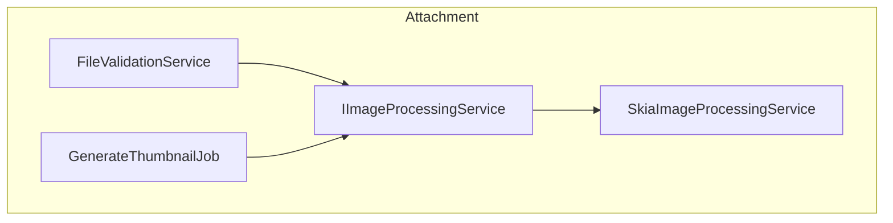

# Attachment image processing

Attachment identifies image headers and generates JPEG thumbnails through an internal port that isolates SkiaSharp from the rest of the application.

## At a glance

| Type / source | Responsibility |
|---|---|
| `IImageProcessingService` | Header identification and thumbnail contract |
| `SkiaImageProcessingService` | Default SkiaSharp adapter |
| `FileValidationService` | Checks detected image type and megapixels before decode |
| `GenerateThumbnailJob` | Writes and records thumbnails after upload |

Source: `src/Modules/Attachment/Attachment/Infrastructure/ImageProcessing/`; jobs: `Infrastructure/BackgroundJobs/`. The port is an implementation detail of Attachment, not a cross-module image API.

## How it works


*Figure: Validation and thumbnail generation share one image port; only its adapter depends on SkiaSharp.*

| Method | Contract |
|---|---|
| `IdentifyAsync` | Header only, no pixel decode; MIME and dimensions or null for unrecognized images; never disposes the caller's stream |
| `GenerateThumbnailAsync` | JPEG within configured bounds, aspect ratio retained, first frame only, EXIF orientation when enabled, no EXIF/GPS metadata, transparency flattened onto white; supports non-seekable input |

The accepted raster formats are JPEG, PNG, GIF, BMP and WebP. `MaxImageMegapixels` is checked before decoding to reject decompression bombs. The Skia adapter uses scaled JPEG decoding when possible; it is not a guarantee that every format can avoid full-size decoding. Keep the parser patched and retain the size cap.

SkiaSharp is MIT-licensed and needs no build license secret. `SkiaSharp.NativeAssets.Linux.NoDependencies` supplies the native Linux library. `src/Api/Dockerfile` publishes for the target architecture; validate native loading on each deployment target. QuestPDF's native Skia library is separate and stays in Subscriptions; see [third-party licenses](../Reference/Third-Party-Licenses.md).

### Thumbnail job

Direct uploads enqueue `ExecuteForAttachmentAsync` after the Ready commit. The response initially has no thumbnail and can report `thumbnailPending=true`. Pending uploads enqueue `ExecuteAsync`. Each execution uses `IUnitOfWorkRunner`, so thumbnail domain events dispatch only after a successful save.

The job skips missing/non-Ready direct rows, and missing/deleted/expired/associated pending rows. It also skips non-images, existing thumbnails and absent source blobs. It writes the JPEG, updates metadata, then saves. A failed save deletes the newly written thumbnail; concurrency conflicts end quietly, while other exceptions are rethrown for Hangfire's two retries. Direct-file metadata retains the original image dimensions; pending thumbnail metadata uses the produced thumbnail dimensions.

## Configuration

Defaults from `Infrastructure/Configuration/AttachmentOptions.cs` and `src/Api/appsettings.json`:

| Key | Default | Meaning |
|---|---|---|
| `Attachment:Image:EnableThumbnailGeneration` | true | Enable upload-triggered thumbnail work |
| `Attachment:Image:ThumbnailWidth` | 200 | Bounding-box width |
| `Attachment:Image:ThumbnailHeight` | 200 | Bounding-box height |
| `Attachment:Image:ThumbnailQuality` | 80 | JPEG quality, 1-100 |
| `Attachment:Image:EnableOptimization` | true | Apply EXIF orientation; does not optimize or replace the original upload |
| `Attachment:Validation:MaxImageMegapixels` | 40 | Header-based pre-decode cap |

## Usage

The actual registration in `src/Modules/Attachment/Attachment/AttachmentModule.cs`:

```csharp
services.AddScoped<IImageProcessingService, SkiaImageProcessingService>(); // the image adapter: swap it here
```

To replace the adapter, keep its package in Attachment only, implement this port, change this registration and run `ImageProcessingContractTests` unchanged against the replacement. Package versions belong in `Directory.Packages.props`. Update `ThirdPartyIsolationTests` and the license reference deliberately before introducing a different library; ImageSharp is currently forbidden by the architecture guardrail. Remove unused SkiaSharp packages only after no production caller depends on them. Do not copy hypothetical adapter implementations into feature handlers.

## Failure modes and guarantees

Header identification failure or mismatched type fails validation; excessive megapixels are rejected before thumbnail decoding. Upload success does not guarantee thumbnail completion. A job failure can leave a file without a thumbnail; inspect Hangfire and retry after fixing the cause. Compensation cannot make blob writes atomic with EF; orphan scanning is the recovery mechanism for crash leftovers.

## Guardrails

`ImageProcessingContractTests` checks headers, stream ownership, non-seekable input, bounds, white transparency and EXIF rotations (including 1, 3, 6, 8). `AttachmentLifecycleTests` covers thumbnail persistence/events and lifecycle skips. `FileValidationServiceTests` covers image validation, and `ThirdPartyIsolationTests` prevents SkiaSharp escaping Attachment.

## Related

[Security](Security.md), [Reliability](Reliability.md), [Configuration](Configuration.md), [Third-party licenses](../Reference/Third-Party-Licenses.md), and [`/starterkit:add-background-job`](../../tools/claude/starterkit-plugin/skills/add-background-job/SKILL.md).
