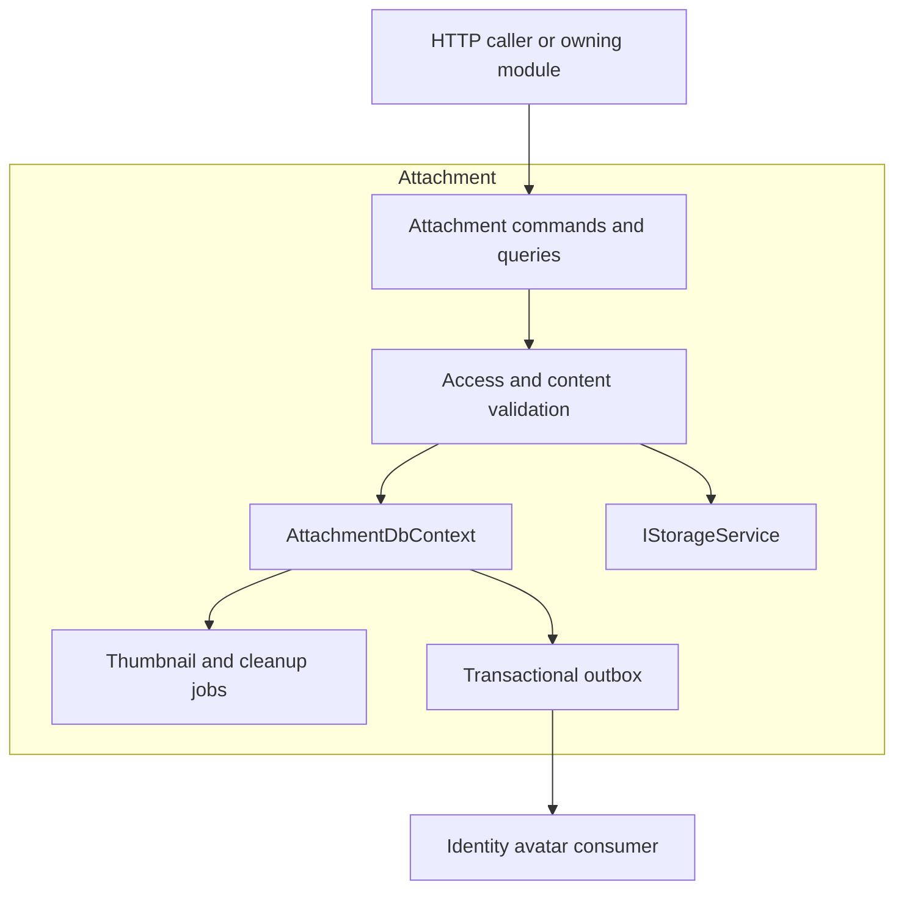

# Attachment module

Attachment owns tenant-scoped file metadata, private blob storage and controlled reads so other modules can attach files without depending on storage implementations.

## At a glance

| Responsibility | Types / source |
|---|---|
| Aggregates | `AttachmentFile`, `PendingAttachment` in `src/Modules/Attachment/Attachment/Domains/Attachments/Models/` |
| Persistence | `AttachmentDbContext`, schema `attachment`, `ITenantDataContext`; tenant filters and forced RLS |
| Public boundary | `src/Modules/Attachment/Attachment.Contracts/`; commands, queries, DTOs and entity access policies |
| Infrastructure | `Infrastructure/Storage/`, `Validation/`, `ImageProcessing/`, `BackgroundJobs/`, `Maintenance/` inside Attachment |
| Discovery | `AttachmentModuleManifest`, `ModuleOrder.Attachment` (200): after Tenancy (100), before Subscriptions (400) |

The manifest delegates registration to `AddAttachmentModule` and initialization to `UseAttachmentModule`, and exposes the Contracts enum assembly. The host discovers it; do not add module calls to `Program.cs`. Initialization runs migrations through the shared migration mechanism and does not expose an upload directory as static files.

## How it works


*Figure: Attachment owns storage and metadata; Identity receives committed avatar changes through the outbox.*

Direct uploads become visible only after the blob is stored and the row is `Ready`. Pending uploads let a client upload before its owning entity exists, then associate the session after creation. Metadata returns stable API download URLs; pending previews and provider redirects are short-lived signed URLs. See [Uploads](Uploads.md), [Security](Security.md) and the shared [request lifecycle](../Architecture/Request-Lifecycle.md).

### Contracts

Send requests through `ISender`; other modules must not reference Attachment's implementation or DbContext.

| Area | Contracts |
|---|---|
| Direct files | `UploadAttachmentCommand`, `DeleteAttachmentCommand`, `DeleteAttachmentsByEntityCommand` |
| Pending files | `UploadPendingAttachmentCommand`, `AssociatePendingAttachmentsCommand`, `DeletePendingAttachmentCommand`, `ReorderPendingAttachmentsCommand`, `CleanupExpiredPendingAttachmentsCommand` |
| Reads | `GetAttachmentByIdQuery`, `GetAttachmentsByEntityQuery`, `GetUserAvatarQuery`, `GetPendingAttachmentsBySessionQuery`, `GetPendingAttachmentByIdQuery` |
| Trusted content reads | `GetAttachmentReadUrlQuery`, `OpenAttachmentContentQuery` (caller authorizes first; dispose returned streams) |
| Entity authorization | `IAttachmentEntityAccessPolicy`, registered with `AddAttachmentEntityPolicy`; built-in User policy allows self-access |

The HTTP upload, association and deletion endpoints enable entity-policy enforcement. Trusted module commands have different authorization defaults; [Security](Security.md) defines that boundary. DataTransfer uses `EntityType.DataTransferJob` for its files; Subscriptions uses trusted read URLs after checking invoice/proof access.

### Endpoints and authorization

Source: `src/Modules/Attachment/Attachment/Domains/Attachments/Features/`. All routes below start with `/api/v1/attachments`. Authorization declarations do not replace handler ownership checks.

| Method | Route suffix | Declaration and checks |
|---|---|---|
| POST | `/upload` | `RequireAuthorization()`; entity attach policy |
| GET | `/{id:guid}` | `RequireAuthorization()`; public, uploader, admin or entity read policy |
| GET | `/{id:guid}/download` | `AllowAnonymous()`; public or authorized reader; optional `thumbnail=true` |
| GET | `/files` | `AllowAnonymous()`; Local signed URL validation |
| DELETE | `/{id:guid}` | `RequireAuthorization()`; admin, linked entity attach policy or unlinked uploader |
| GET | `/entity/{entityType}/{entityId:guid}` | `RequireAuthorization()`; policy readers see all, otherwise public + own |
| POST | `/pending/sessions` | `AllowAnonymous()`; `upload` rate policy; issues owner-bound session |
| POST | `/pending/upload` | `AllowAnonymous()`; session ownership and `upload` rate policy |
| GET | `/pending/session/{sessionId:guid}` | `AllowAnonymous()`; session ownership |
| DELETE | `/pending/{id:guid}?sessionId=...` | `AllowAnonymous()`; session ownership |
| POST | `/pending/associate` | `RequireAuthorization()`; session ownership + entity attach policy |

Entity listing accepts `pageNumber` and `pageSize`, sorts newest first with id as tie-breaker, and returns a list with `X-Total-Count`, `X-Page-Number` and `X-Page-Size`. Without paging parameters it uses `Paging:MaxPageSize` (100). Reordering has a contract handler, not an HTTP endpoint.

### Jobs and events

| Job | Trigger / retry |
|---|---|
| `GenerateThumbnailJob` | Enqueued after image upload; two automatic retries |
| `DeleteAttachmentFilesJob` | Enqueued after deletion or avatar replacement; three automatic retries, then reconciliation continues |
| `CleanupExpiredPendingAttachmentsJob` | `cleanup-expired-attachments`, every six hours by default; three automatic retries |
| `AttachmentReconciliationJob` | `attachment-reconciliation`, every 15 minutes by default; next scheduled run is the retry |

`JobSchedulerBootstrap` schedules recurring work. Tenant maintenance preserves tenant scope; [Reliability](Reliability.md) explains compensation, batching and concurrency.

`Domains/Attachments/Events/AttachmentEvents.cs` defines uploaded, updated, deleted, linked, thumbnail-generated and public/private domain events, plus pending uploaded/deleted/associated/thumbnail-generated events. `AttachmentUploadedEvent` handles replacement of older avatars. `AttachmentFile.MarkReady` also stages `UserAvatarChangedIntegrationEvent` for a user avatar in the same transaction. Identity's `UserAvatarChangedConsumer` re-reads `GetUserAvatarQuery`, so delayed messages do not overwrite the current avatar with stale data. Attachment consumes `UserDeletedIntegrationEvent` from `UserDirectory.Contracts`; `TenantDataPurgeRequestedEventHandler` handles tenant blob purge. See [Messaging](../Architecture/Messaging.md) for delivery semantics.

## Configuration

| Key | Default | Meaning |
|---|---|---|
| `Attachment:Storage:Provider` | `Local` | Select Local, AzureBlob or S3 |
| `Attachment:Pending:ExpirationHours` | 48 | Pending upload lifetime |
| `Attachment:Download:ReadUrlTtlMinutes` | 5 | Signed URL lifetime |
| `Attachment:Image:EnableThumbnailGeneration` | true | Background thumbnails |

The [complete configuration reference](Configuration.md) distinguishes shipped settings, option fallbacks and ignored compatibility keys.

## Usage

Registration copied from `src/Modules/Attachment/Attachment/AttachmentModule.cs`:

```csharp
services.AddAttachmentEntityPolicy<UserAttachmentEntityAccessPolicy>(EntityType.User);
```

An owning module registers its own policy through Attachment.Contracts, then uses contracts to upload, associate or delete files. Follow the [upload flow](Uploads.md) for HTTP payloads.

## Failure modes and guarantees

Invalid files return 400; missing resources 404; ownership failures 403; concurrency or duplicate order 409. Scanning returns 400 `malware_detected` or 503 `malware_scanner_unavailable`. A successful upload does not imply its thumbnail is ready. Deletion hides metadata before asynchronous storage removal. Database and storage are not one transaction; compensation and reconciliation cover the gaps.

## Guardrails

`ModuleDiscoveryTests`, `ModuleBoundaryTests`, `TenantIsolationArchitectureTests`, `MessagingArchitectureTests`, `ThirdPartyIsolationTests` and `AdminEndpointAuthorizationTests` enforce module boundaries. `AttachmentTenantIsolationTests`, `AttachmentLifecycleTests`, `PendingAttachmentFlowTests` and `UserDeletedConsumerTests` exercise the module against PostgreSQL.

## Related

- [Uploads](Uploads.md): direct uploads, pending sessions, association and limits.
- [Storage providers](Storage-Providers.md): private Local/Azure/S3 storage and tenant prefixes.
- [Security](Security.md): policies, validation, malware scanning and signed reads.
- [Image processing](Image-Processing.md): SkiaSharp port and thumbnail jobs.
- [Reliability](Reliability.md): lifecycle, deletion, retries and orphan reconciliation.
- [Configuration](Configuration.md): complete option reference and [example JSON](appsettings.Attachment.example.json).
- [ADR-0015](../Decisions/0015-malware-scanning-clamd-fail-closed.md), [ADR-0019](../Decisions/0019-module-manifests-and-discovery.md), and [`/starterkit:add-feature`](../../tools/claude/starterkit-plugin/skills/add-feature/SKILL.md).
