# Attachment reliability

Attachment coordinates database rows and blob operations through explicit lifecycle states, compensating actions and recurring reconciliation rather than a distributed transaction.

## At a glance

| Component | Source under `src/Modules/Attachment/Attachment/` |
|---|---|
| Lifecycle | `Domains/Attachments/Models/AttachmentStatus.cs`, `AttachmentFile.cs` |
| Read visibility | `Data/AttachmentDbContext.cs` |
| Deletion | `Infrastructure/Maintenance/AttachmentFileReaper.cs` |
| Recovery | `Infrastructure/Maintenance/AttachmentReconciler.cs` |
| Scheduling | `Infrastructure/BackgroundJobs/JobSchedulerBootstrap.cs` |

## How it works

```mermaid
stateDiagram-v2
  accTitle: How it works
  accDescr: AttachmentStatus has exactly Uploading, Ready and PendingDeletion; association can create Ready rows directly after moving existing blobs.
  [*] --> Uploading: StartUpload
  Uploading --> Ready: MarkReady
  Uploading --> PendingDeletion: abandoned or entity deleted
  Ready --> PendingDeletion: RequestDeletion
  PendingDeletion --> [*]: blobs removed, row deleted
```


*Figure: AttachmentStatus has exactly Uploading, Ready and PendingDeletion; association can create Ready rows directly after moving existing blobs.*

| State | Visibility |
|---|---|
| `Uploading` | Hidden while a direct upload is in progress or abandoned |
| `Ready` | Visible only if not soft-deleted and within tenant scope |
| `PendingDeletion` | Hidden immediately; physical removal is asynchronous |

`AttachmentDbContext` combines named `Lifecycle`, `SoftDelete` and tenant filters. Maintenance uses `IgnoreNonIsolationFilters()`, preserving tenant isolation; it never uses parameterless `IgnoreQueryFilters()`. `ApplyTenantFilters(builder)` comes last. Lifecycle fields are mapped in `Data/Configurations/AttachmentConfiguration.cs` and the existing migrations; no new migration is needed to use these behaviors.

### Direct upload

1. Validate, determine actual length and compute SHA-256.
2. Commit `AttachmentFile.StartUpload` as `Uploading`, before writing the blob.
3. Store the blob, call `MarkReady(size, hash, width, height)` and save. Only this transition raises `AttachmentUploadedEvent` and the avatar integration event where applicable.
4. Enqueue thumbnail work after the Ready commit.

A phase-two failure attempts blob deletion and then row deletion. Failed compensation leaves recoverable state; abandoned `Uploading` rows are swept after the timeout. `MarkReady` requires `Uploading`, and optimistic concurrency prevents an uploader from resurrecting a row claimed by a sweeper or entity deletion.

### Pending uploads and association

Pending uploads write blobs before rows inside the session lock. A failed save deletes the blob; a crash before compensation can leave an orphan. Association moves files first, creates `Ready` attachments with the pending hash, and saves the associated pending rows in the same database operation. A failure moves files back. These flows are the reason optional storage scanning has a safety window.

A thumbnail can update a pending row between a delete/association read and save. Those handlers reload once to handle that specific race, including a newly created thumbnail. Association rejects rows that were deleted or associated by another operation and compensates its moves. Pending deletion treats a reloaded row that is already gone/deleted as success, since the requested deletion is complete. This is not a blanket retry of arbitrary commands.

### Asynchronous deletion

`DeleteAttachmentCommand`, `DeleteAttachmentsByEntityCommand` and avatar replacement mark rows `PendingDeletion` and save, then enqueue `DeleteAttachmentFilesJob`. Entity-wide deletion includes in-flight `Uploading` rows; `DeletedCount` is the number marked, not the number physically removed.

`AttachmentFileReaper` uses one unit of work per id. Missing rows are no-ops; rows outside `PendingDeletion` are untouched. It removes original and thumbnail, treating missing blobs as success, then hard-deletes the row. Failure increments `deletion_attempts` and schedules `next_deletion_attempt_at` with exponential backoff. Hangfire retries three times; reconciliation continues when due. Failed enqueues are logged and recovered by the sweep.

Blob removal is not awaited by the request. Database/auth/concurrency errors can still fail deletion; the guarantee is that a provider outage does not force the request to wait for physical deletion. Avatar changes notify Identity through `UserAvatarChangedIntegrationEvent`; its consumer re-reads the current avatar, as described in [Messaging](../Architecture/Messaging.md).

### Reconciliation and orphan cleanup

`AttachmentReconciliationJob` runs every 15 minutes by default, prevents overlapping execution, and has no automatic retries: the next scheduled run is recovery. `AttachmentReconciler` isolates work per tenant and per row, logs/skips concurrency conflicts, and continues later phases after a phase failure.

| Phase | Action |
|---|---|
| Abandoned uploads | Claim old `Uploading` rows with a version-checked deletion request, then reap |
| Due deletions | Retry `PendingDeletion` rows whose next attempt is due |
| Optional storage scan | List tenant objects; only delete old objects referenced by no attachment or pending row in any lifecycle/soft-delete state |
| Pending-row purge | Hard-delete old associated or soft-deleted pending records; blobs were already moved or removed |

Storage scanning is off by default and initially dry-run. Enable it with `DryRun=true`, inspect logs over several runs, then choose whether to delete. The 24-hour safety window protects recent pending writes and association moves; Local copies/moves refresh modification time. `MaxObjectsPerRun` caps work and scanning restarts from the beginning next time, so a large prefix is not guaranteed complete coverage on every run.

`CleanupExpiredPendingAttachmentsJob` separately processes expired unassociated uploads in batches until done, retaining rows whose files could not be removed. It runs every six hours by default, with three retries and no concurrent execution. Monitor both recurring jobs and deletion error logs.

### Persistence and read performance

`attachment.attachments` stores `status` as a string, `content_hash` as nullable fixed-length 64-character SHA-256 hex, deletion request time, attempts and next-attempt time. Pending rows also store the hash. Indexes support hash lookup, status/creation age and status/next attempt; tenant configuration adds tenant ownership indexes. See the configuration classes for current mappings rather than generating the former historical reliability migration again.

Reads load metadata untracked and reuse it for authorization; per-request policy memoization avoids repeated owning-entity queries. Entity listing filters, counts and pages in SQL. Uploads use known stream length rather than extra provider metadata reads. Provider content reads stream, while normal cloud downloads redirect. Azure container initialization is gated rather than repeated on every upload. See [Storage providers](Storage-Providers.md).

## Configuration

All keys below start with `Attachment:Reconciliation:`; [Configuration](Configuration.md) is the complete reference.

| Key | Default | Meaning |
|---|---|---|
| `Enabled` | true | False removes recurring recovery job |
| `Cron` | `*/15 * * * *` | UTC schedule |
| `BatchSize` | 100 | Rows/objects per batch |
| `MaxBatchesPerRun` | 100 | Bound per phase/run |
| `UploadingTimeoutMinutes` | 60 | Abandonment threshold, minimum 5 |
| `DeletionRetryBaseDelayMinutes` | 5 | First failed deletion delay |
| `DeletionRetryMaxDelayMinutes` | 1440 | Delay cap |
| `DeletionAttemptsAlertThreshold` | 10 | Log every failure from this attempt as error; not a retry cutoff |
| `PurgeRetentionDays` | 30 | Associated/deleted pending row retention |
| `StorageScan:Enabled` | false | List objects for orphan detection |
| `StorageScan:DryRun` | true | Log without deleting |
| `StorageScan:SafetyWindowHours` | 24 | Ignore newer objects |
| `StorageScan:MaxObjectsPerRun` | 10000 | Scan work cap |

## Usage

Backoff from `src/Modules/Attachment/Attachment/Infrastructure/Configuration/AttachmentOptions.cs`:

```csharp
public TimeSpan DeletionRetryDelay(int attempts)
{
    var exponent = Math.Clamp(attempts - 1, 0, 30);
    var minutes = Math.Min((double)DeletionRetryBaseDelayMinutes * Math.Pow(2, exponent), DeletionRetryMaxDelayMinutes);
    return TimeSpan.FromMinutes(minutes);
}
```

## Failure modes and guarantees

Jobs are repeatable and deletion is idempotent, but upload HTTP endpoints do not promise request replay deduplication. SHA-256 is metadata, not a uniqueness constraint on files. Concurrency conflicts become HTTP 409 through the shared mediator; jobs handle them explicitly. Neither failed HTTP responses nor cancellation prove that earlier saves were rolled back. Disabling reconciliation leaves abandoned uploads and exhausted immediate deletion retries without recurring recovery.

## Guardrails

`AttachmentLifecycleTests` covers visibility, upload compensation, deletion idempotency, paging and sweeper/upload races. `PendingDeleteRaceTests` and `PendingAssociateRaceTests` cover thumbnail concurrency. `ReconciliationTests`, `AttachmentLifecycleUnitTests`, `ConsistencyTests` and `StorageProviderTests` cover backoff, safety windows, references and provider operations. `BackgroundJobEventDispatchTests` and `TenantIsolationArchitectureTests` protect dispatch and tenant boundaries.

## Related

[Uploads](Uploads.md), [Image processing](Image-Processing.md), [Security](Security.md), [Request lifecycle](../Architecture/Request-Lifecycle.md), [ADR-0021](../Decisions/0021-aggregate-version-covers-child-collections.md), and `/starterkit:add-background-job`.
