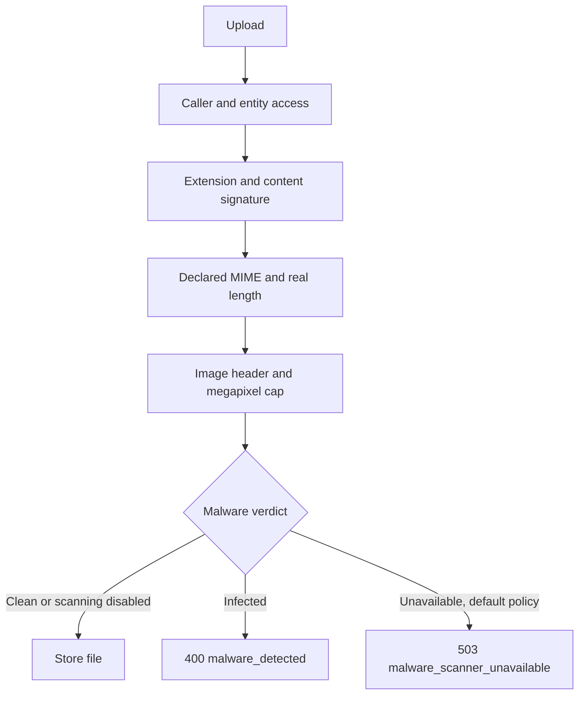

# Attachment security

Attachment validates untrusted content and checks file access independently of storage, with owner-bound upload sessions and fail-closed malware scanning.

## At a glance

| Boundary | Source under `src/Modules/Attachment/` |
|---|---|
| Entity policies | `Attachment.Contracts/Authorization/`, `Attachment/Infrastructure/Authorization/` |
| Sessions and signing | `Attachment/Infrastructure/Security/`, `Infrastructure/Storage/LocalReadUrlSigner.cs` |
| File inspection | `Attachment/Infrastructure/Validation/FileValidationService.cs`, `FileSignatureCatalog.cs` |
| Malware port / adapter | `IMalwareScanner`, `ClamAvMalwareScanner` |
| Download | `Attachment/Domains/Attachments/Features/DownloadAttachment/` |

## How it works


*Figure: Enabled scanning runs after content checks and rejects uploads without a clean verdict unless fail-open is explicitly configured.*

### Entity access policies

`IAttachmentEntityAccessPolicy.CanAttachAsync` and `CanReadAsync` let an owning module define entity rules without exposing its implementation. Policies are scoped and can call `ISender`; decisions are memoized per request. `UserAttachmentEntityAccessPolicy` allows the current user to attach/read their own user files. Admin access is handled by `AttachmentAccessService`. Missing policies deny entity attachment and do not grant private reads.

| Operation | Authorization behavior |
|---|---|
| HTTP upload with an entity | `EnforceEntityAccessPolicy=true`; attach policy must allow |
| HTTP association | Session ownership plus attach policy |
| HTTP deletion | Admin, attach policy for linked file, or uploader of unlinked file |
| Entity list | Read policy allows all; otherwise public files and caller's own uploads |
| Metadata / download | Public, admin, uploader or entity read policy |
| Trusted upload / association | Entity policy flag defaults false; calling module authorizes entity; association still checks session ownership |
| Trusted single-file deletion | Admin or uploader when entity policy enforcement is not requested |
| `GetAttachmentReadUrlQuery`, `OpenAttachmentContentQuery` | No access check; trusted caller must authorize first |

All reads retain tenant isolation. Endpoint declarations are in the [module route table](README.md#endpoints-and-authorization); the anonymous declaration on downloads permits public reads, not unrestricted private access.

### Pending sessions

`PendingSessionService` issues a GUID containing an eight-byte nonce and eight-byte MAC bound to the user or anonymous fingerprint (resolved IP + User-Agent). Ownership is recomputed rather than stored. Upload/list/delete/reorder require the current owner; association accepts the user's session or the current request's anonymous fingerprint. A forged/foreign session returns 403. Issuance and pending uploads use the `upload` rate policy; the session lock enforces per-session limits under concurrency. See [Uploads](Uploads.md).

### Content validation

1. Reduce the client name to a safe display name, without directory components or control characters.
2. Apply built-in blocked extensions (including HTML, SVG, scripts, executables and macro-enabled Office files), then configured allow/block lists. A block always wins.
3. Require a `FileSignatureCatalog` rule for the extension; merely adding an extension to configuration does not create support.
4. Check magic bytes for raster images, PDF, OLE/OOXML documents and supported media. OOXML checks ZIP structure and rejects macros. Text formats must be UTF-8 without HTML/script markup; XML with `DOCTYPE` or `ENTITY` is rejected.
5. Require declared MIME to agree with detection; `application/octet-stream` means unspecified. Check the real stream length against the detected type's size limit.
6. Use `IImageProcessingService.IdentifyAsync` for header-only image format/dimension checks. Reject over `MaxImageMegapixels` before pixel decoding.
7. Scan validated content when enabled. The stored extension, MIME and attachment type are server-determined; storage keys do not contain the client filename.

Content verification is always enabled regardless of the obsolete switch. [Image processing](Image-Processing.md) describes the SkiaSharp decoder and thumbnail metadata removal. Upload endpoints cap body and multipart size at the largest type limit plus 64 KiB; excessive bodies can return 413.

### Malware scanning

`ClamAvMalwareScanner` uses clamd TCP `INSTREAM`, one connection per file and no third-party client. `IMalwareScanner` implementations must not dispose the caller's stream and must throw if they cannot return a verdict. Returning clean on an outage violates the port contract. With a custom registered scanner, keep `Scanner:Provider=None` and ensure that registration wins over the no-op fallback.

| Outcome | HTTP / effect |
|---|---|
| Clean | Continue storing |
| Infected | 400 `malware_detected`; signature logged, never returned; nothing stored |
| Unreachable, timeout, ERROR, stream limit or scanner exception | 503 `malware_scanner_unavailable`; nothing stored |
| Unavailable with `Scanner:FailOpen=true` | Accept unscanned; error log and `skipped_fail_open` metric |

`FileScanUnavailableException` maps to the generic 5xx message; clients branch on `errorCode`. See [ADR-0015](../Decisions/0015-malware-scanning-clamd-fail-closed.md).

[`docker-compose.clamav.yml`](../../docker-compose.clamav.yml) adds clamd, persists signatures and enables scanning with `RequireVirusScanning=true`. Aspire also supports `Attachment:ClamAv=true`; use the [Aspire guide](../Infrastructure/Aspire.md). The overlay uses `clamav/clamav:1.4`, a 3 GB memory limit and `CLAMD_CONF_AlertExceedsMax=yes`. Plan roughly 1.5 GB resident memory and signature warm-up time.

`AlertExceedsMax yes` is essential: otherwise clamd can report OK for content skipped by scan limits. With it, exceeded archive/file limits produce a FOUND verdict and rejection. If raising upload limits, raise `CLAMD_CONF_StreamMaxLength` and `CLAMD_CONF_MaxFileSize` together; a stream above clamd's stream limit yields no verdict and 503.

The `clamav` health check uses `zPING`/`PONG` and reports **Degraded**, never Unhealthy, on outage. It is registered with readiness tags, allowing other API functionality to remain available while uploads fail closed. Monitor `attachment.malware.scans` in meter `StarterKit.Attachment`, tagged `clean`, `infected`, `unavailable`, `skipped_fail_open`.

`MalwareScannerStartupCheck` rejects enabled scanning with `NoOpMalwareScanner`, rejects `RequireVirusScanning=true` when scanning is disabled, and warns when scanning is off outside Development/Testing. Production should require scanning and retain `FailOpen=false`.

### Private reads and response headers

`StoragePath` is the source of truth. Stable DTO URLs are `/api/v1/attachments/{id}/download`, with `?thumbnail=true` for thumbnails and optional `Download:PublicBaseUrl` prefix. Checked downloads stream Local files or redirect (302) to an S3 presigned GET / Azure read-only SAS. Pending previews get fresh signed URLs.

API-served files include `X-Content-Type-Options: nosniff`, `Content-Security-Policy: sandbox`, and attachment disposition except configured raster MIME types. Local signed URLs carry `p`, `e`, `n`, `t`, `i`, `s`; the HMAC covers path, expiry and response-header inputs. There is no static `/uploads` serving. `Download:SigningKey` falls back to a key derived from `JwtSettings:SecretKey`, then to a random per-process key; the last fallback breaks sessions/URLs across restarts or replicas.

## Configuration

| Key | Default | Meaning |
|---|---|---|
| `Attachment:Validation:EnableVirusScanning` | false | Enable scanner calls |
| `Attachment:Validation:RequireVirusScanning` | false | Refuse disabled scanning at startup |
| `Attachment:Validation:Scanner:Provider` | `None` | `ClamAv` selects built-in adapter |
| `Attachment:Validation:Scanner:Port` | 3310 | clamd TCP port |
| `Attachment:Validation:Scanner:TimeoutSeconds` | 30 | Connect/scan deadline |
| `Attachment:Validation:Scanner:ChunkSizeBytes` | 65536 | INSTREAM chunks |
| `Attachment:Validation:Scanner:FailOpen` | false | Explicit unscanned acceptance on outage |
| `Attachment:Validation:MaxImageMegapixels` | 40 | Pre-decode cap |
| `Attachment:Download:ReadUrlTtlMinutes` | 5 | Signed read lifetime |

Set the scanner host for the deployment. The [complete configuration reference](Configuration.md) includes host defaults, signing, allowlists and startup constraints.

## Usage

Built-in registration from `src/Modules/Attachment/Attachment/AttachmentModule.cs`:

```csharp
services.AddSingleton<IMalwareScanner>(sp => sp.GetRequiredService<ClamAvMalwareScanner>());
```

This line is selected by `Scanner:Provider=ClamAv`; no endpoint code should depend directly on the adapter.

## Failure modes and guarantees

Access failures return 401/403, absent rows 404, invalid content/path 400, duplicate order/concurrency 409 and storage exceptions 500 with generic client text. Signed URLs expire but remain capabilities during their TTL. Database/blob compensation, pending cleanup and thumbnail races are defined in [Reliability](Reliability.md), not by a distributed transaction.

## Guardrails

`FileValidationServiceTests`, `ClamAvMalwareScannerTests`, `EntityAccessPolicyTests`, `PendingSessionServiceTests`, `LocalStorageContractTests`, `DownloadAuthorizationTests` and `AvatarReplacementTests` cover security boundaries. `ClamAvContainerTests` is opt-in with `STARTERKIT_CLAMAV_TESTS=1` and Docker; it checks real clamd and scan-limit behavior. `PendingAttachmentFlowTests` tests database races and ownership. `ThirdPartyIsolationTests` keeps image libraries inside Attachment.

## Related

[Uploads](Uploads.md), [Storage providers](Storage-Providers.md), [Reliability](Reliability.md), [Configuration](Configuration.md), [ADR-0015](../Decisions/0015-malware-scanning-clamd-fail-closed.md), and `/starterkit:add-permission`.
