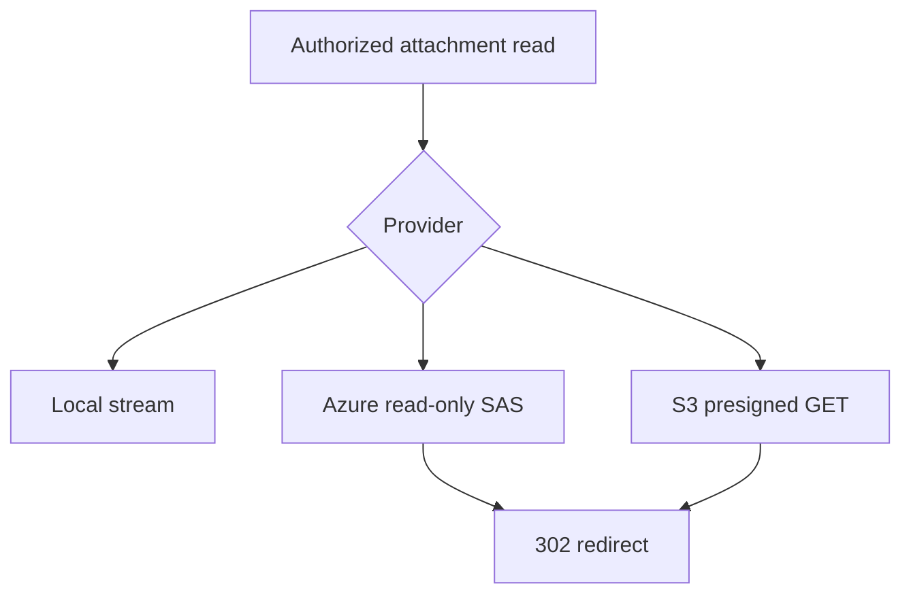

# Attachment storage providers

Attachment stores private blobs behind `IStorageService`, keeping tenant keys and read authorization consistent across Local, Azure Blob and S3.

## At a glance

Source: `src/Modules/Attachment/Attachment/Infrastructure/Storage/`; selection and client registration: `Infrastructure/Factories/StorageServiceFactory.cs`.

| Provider | Implementation | Operational boundary |
|---|---|---|
| `Local` | `LocalFileStorageService` | Filesystem beneath the configured root; replicas need access to the same durable volume |
| `AzureBlob` | `AzureBlobStorageService` | One private container; read-only SAS URLs |
| `S3` | `S3StorageService` | One bucket; private objects and presigned GET URLs |

Local suits development and deployments that provide durable shared storage and backups. Cloud adapters move storage capacity and replication choices to the provider. Encryption, replication, lifecycle policies, account permissions and costs remain deployment decisions; the template does not provision them. There is no built-in unsigned CDN serving path or configurable S3-compatible service endpoint.

## How it works


*Figure: The stable download endpoint checks access before streaming Local bytes or redirecting to a short-lived provider URL.*

`StoragePath` is authoritative. DTOs use stable `/api/v1/attachments/{id}/download` URLs; never persist SAS or presigned URLs. Trusted reads and pending previews can use signed URLs directly. Local signed URLs use `/api/v1/attachments/files`; ordinary Local downloads stream from the checked endpoint. [Security](Security.md) covers signing and response headers.

### Tenant isolation: one container, a prefix per tenant

Every provider uses `StoragePaths.TenantRoot(tenantId)` = `t/{tenantId:N}/`. The Default tenant is used in single-tenant mode. Server-built keys, tenant-filtered metadata and RLS establish access; knowing a prefix is not authorization.

| Builder in `StoragePaths` | Key shape |
|---|---|
| `ForUpload` | `t/{tenantId:N}/{yyyy}/{MM}/{dd}/{id:N}.ext` |
| `ForPending` | `t/{tenantId:N}/temp/{sessionId:N}/{id:N}.ext` |
| `ForPendingThumbnail` | Pending folder with `thumb_{id:N}.jpg` |
| `ForEntity` | `t/{tenantId:N}/{entityType lowercase}s/{entityId:N}/{id:N}.ext` |
| `ForEntityThumbnail` | Entity folder with `thumb_{id:N}.jpg` |
| `ThumbnailBeside` | Original's folder with `thumb_{id:N}.jpg` |

Association moves to an entity-specific folder under the same tenant root. `TenantDataPurgeRequestedEventHandler` and reconciliation list by tenant prefix. Legacy unprefixed objects belong to the Default tenant; migration of existing files must preserve that ownership.

**Decision: no per-tenant containers or buckets by default.** Separate containers add provisioning, deprovisioning, per-tenant permissions and provider quota management without replacing application access checks. A product requiring regional placement or customer-specific encryption keys can resolve containers inside its adapter, while retaining tenant prefixes so purge and reconciliation continue to work. See [tenant isolation](../MultiTenancy/Overview.md).

### Provider behavior

Local validates relative keys identically on Windows and Linux: no absolute paths, drive letters, backslashes, empty segments, traversal, control characters or invalid segments. It resolves paths beneath `UploadPath`, creates directories as needed, streams reads, and refreshes modification times on copies/moves to protect new destinations from orphan scanning. Files are not served as static content.

Azure creates its container privately through `AzureBlobContainerGate`; `AzureBlobContainerInitializer` attempts this at startup and a failed initialization can be retried on upload. Copies use `StartCopyFromUriAsync`, moves copy then delete. The configured client uses a connection string; account-key SAS signing is the standard path. The adapter also contains a user-delegation SAS branch for a client capable of obtaining that key.

S3 uses `TransferUtility` for uploads, `CopyObjectAsync` for server-side copies, and `DeleteObjectsAsync` in batches of at most 1000 keys. Moves copy then delete. Uploads/copies can request AES256 server-side encryption and a storage class. Recognized classes are `STANDARD`, `REDUCED_REDUNDANCY`, `STANDARD_IA`, `ONEZONE_IA`, `INTELLIGENT_TIERING`, `GLACIER`, `DEEP_ARCHIVE`, `GLACIER_IR`; unrecognized values fall back to Standard. Archive classes require an operational retrieval strategy before using them for downloadable files.

## Configuration

Defaults distinguish shipped `src/Api/appsettings.json` from `AttachmentOptions` fallbacks. See [Configuration](Configuration.md) for every option.

| Key | Default | Meaning |
|---|---|---|
| `Attachment:Storage:Provider` | `Local` | Select one provider; missing settings never fall back to Local |
| `Attachment:Storage:Local:UploadPath` | `uploads` | Relative to content root or absolute filesystem root |
| `Attachment:Storage:Local:BaseUrl` | `/uploads` shipped; null option | Ignored compatibility key |
| `Attachment:Storage:AzureBlob:ConnectionString` | null | Required for Azure; provide via secret configuration |
| `Attachment:Storage:AzureBlob:ContainerName` | `attachments` | Required container name |
| `Attachment:Storage:AzureBlob:UsePublicAccess` | false | Ignored; container creation is private |
| `Attachment:Storage:S3:AccessKeyId` | Empty shipped; null option | Set with secret key, or leave both empty for default AWS credential chain |
| `Attachment:Storage:S3:SecretAccessKey` | Empty shipped; null option | Paired credential |
| `Attachment:Storage:S3:Region` | `us-east-1` | AWS region |
| `Attachment:Storage:S3:BucketName` | Empty shipped; `attachments` option | Must be set when S3 is selected; bucket must exist |
| `Attachment:Storage:S3:UseServerSideEncryption` | true | Requests AES256 encryption |
| `Attachment:Storage:S3:StorageClass` | `STANDARD` | Upload/copy storage class |
| `Attachment:Storage:S3:UsePublicAccess` | true shipped; false option | Ignored; no public object ACL |
| `Attachment:Storage:S3:CloudFrontDomain` | null | Ignored; no unsigned CloudFront URL |
| `Attachment:Storage:S3:PresignedUrlExpirationMinutes` | 60 | Ignored; use Download TTL |
| `Attachment:Download:ReadUrlTtlMinutes` | 5 | Signed reads across providers |

Use environment variables or Docker secrets for credentials. IAM roles/default credential chain avoid static S3 keys. Ensure runtime permissions cover read, write, copy, delete and prefix listing as needed. `AccessDenied` points to credentials/policies; a missing bucket requires provisioning; timeouts require checking connectivity, region and object size.

## Usage

The tenant-root builder from `src/Modules/Attachment/Attachment/Infrastructure/Storage/StoragePaths.cs`:

```csharp
public static string TenantRoot(Guid tenantId) => $"{TenantRootSegment}/{tenantId:N}/";
```

To switch providers, copy existing objects preserving their exact keys, verify reads and hashes, then change `Attachment:Storage:Provider` and restart. Configuration alone does not migrate blobs. Plan cutover writes and rollback explicitly; use the reconciliation dry run before enabling orphan deletion. Monitor storage errors, object counts, capacity, request latency, transfer cost and failed deletion retries. Do not apply blanket temporary-prefix expiry rules without accounting for pending rows and association races.

## Failure modes and guarantees

Provider startup validation checks required names and paired S3 credentials, not full remote connectivity. Cloud copy/delete is not atomic with EF saves; [Reliability](Reliability.md) defines compensation. A missing blob is treated as deleted by cleanup. Private signed links remain bearer capabilities until expiry; protect them from logs and unintended sharing.

## Guardrails

`StorageProviderTests`, `LocalStorageContractTests`, `DownloadAuthorizationTests`, `ReconciliationTests` and `AttachmentTenantIsolationTests` cover provider behavior, path safety, signed reads and tenant isolation.

## Related

[Security](Security.md), [Reliability](Reliability.md), [Configuration](Configuration.md), [ADR-0015](../Decisions/0015-malware-scanning-clamd-fail-closed.md), and `/starterkit:add-feature`.
