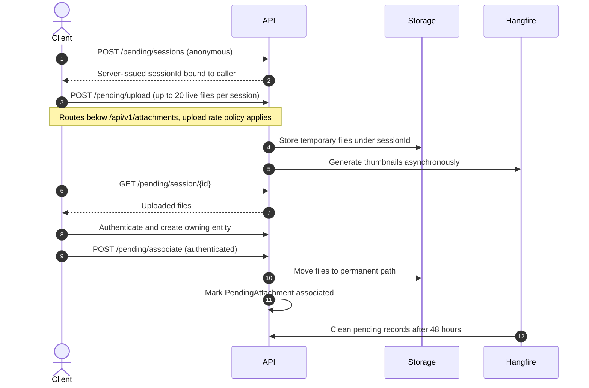

# Uploads

How files get into StarterKit: **direct uploads** to an existing entity, and **pending uploads**, where a client
(possibly anonymous) uploads files before the owning entity exists and later associates them. For configuration see
[Configuration.md](Configuration.md); for threat model and limits see [Security.md](Security.md) and
[Reliability.md](Reliability.md).

Entity types are `User`, `Product` and `Company` (`Attachment.Contracts/Attachments/Dtos/AttachmentEnums.cs`). The
category is computed from entity type + file type, never sent by the client. A module that wants its entities to
have files registers an `IAttachmentEntityAccessPolicy`, and access is denied by default.

# Part 1: Direct uploads

> **Historical.** Upload validation, authorization (entity access policies), the download endpoint and storage consistency changed - [Security.md](Security.md) is authoritative where this page differs.

Complete implementation guide for file upload functionality with best practices.

---

### Upload Endpoint

#### Request Model

```csharp
public sealed class UploadAttachmentRequest
{
    [FromForm(Name = "file")]
    public required IFormFile File { get; init; }
    
    [FromForm(Name = "type")]
    public AttachmentType Type { get; init; }
    
    [FromForm(Name = "entityType")]
    public EntityType EntityType { get; init; }
    
    [FromForm(Name = "entityId")]
    public Guid EntityId { get; init; }
    
    [FromForm(Name = "description")]
    public string? Description { get; init; }
    
    [FromForm(Name = "isPublic")]
    public bool IsPublic { get; init; }
    
    [FromForm(Name = "generateThumbnail")]
    public bool GenerateThumbnail { get; init; } = true;
}
```

**Features**:
- ✅ Automatic model binding with `[FromForm]`
- ✅ Type-safe enum and GUID parsing
- ✅ `required` keyword ensures file presence
- ✅ Immutable with `init` properties
- ✅ Default values supported

#### Endpoint Implementation

```csharp
app.MapPost(EndpointConfig.BaseApiPath + "/attachments/upload",
    async ([FromForm] UploadAttachmentRequest request, 
           ISender sender,
           IHttpContextService httpContextService,
           CancellationToken cancellationToken) =>
    {
        // 1. Basic validation (fast fail)
        if (request.File == null || request.File.Length == 0)
        {
            return Results.BadRequest(ApiResponseExtensions.BadRequest(
                "File is required and cannot be empty"));
        }

        if (request.File.Length > 500 * 1024 * 1024) // 500MB hard limit
        {
            return Results.BadRequest(ApiResponseExtensions.BadRequest(
                "File size exceeds maximum allowed size of 500MB"));
        }

        // 2. Smart type detection
        var attachmentType = request.Type != default 
            ? request.Type 
            : DetermineAttachmentType(request.File.ContentType);

        // 3. Smart category detection
        var category = DetermineCategory(request.EntityType, request.File.ContentType);

        // 4. Proper resource management
        using var fileStream = request.File.OpenReadStream();

        // 5. Build command
        var command = new UploadAttachmentCommand(
            FileName: request.File.FileName,
            ContentType: request.File.ContentType,
            FileSize: request.File.Length,
            FileStream: fileStream,
            Type: attachmentType,
            Category: category,
            UploadedBy: Guid.Empty, // Retrieved from HTTP context in handler
            EntityType: request.EntityType,
            EntityId: request.EntityId,
            Description: request.Description,
            IsPublic: request.IsPublic,
            GenerateThumbnail: request.GenerateThumbnail && attachmentType == AttachmentType.Image);

        // 6. Execute command
        var result = await sender.Send(command, cancellationToken);

        // 7. Map to response
        var response = new UploadAttachmentResponse(
            result.Id,
            result.FileName,
            result.FileUrl,
            result.ThumbnailUrl,
            result.FileSize,
            result.ContentType);

        return Results.Ok(ApiResponseExtensions.Success(response, "File uploaded successfully"));
    })
    .WithName("UploadAttachment")
    .WithTags("Attachments")
    .DisableAntiforgery()
    .Accepts<UploadAttachmentRequest>("multipart/form-data")
    .Produces<ApiResponse<UploadAttachmentResponse>>(StatusCodes.Status200OK)
    .Produces<ApiResponse<object>>(StatusCodes.Status400BadRequest)
    .RequireAuthorization()
    .HasApiVersion(1.0);
```

#### Smart Type Detection

Automatically determines attachment type from MIME type:

```csharp
private static AttachmentType DetermineAttachmentType(string contentType)
{
    return contentType.ToLowerInvariant() switch
    {
        var ct when ct.StartsWith("image/") => AttachmentType.Image,
        var ct when ct.StartsWith("video/") => AttachmentType.Video,
        var ct when ct.StartsWith("audio/") => AttachmentType.Audio,
        "application/pdf" or 
        "application/msword" or 
        "application/vnd.openxmlformats-officedocument.wordprocessingml.document" or
        "application/vnd.ms-excel" or
        "application/vnd.openxmlformats-officedocument.spreadsheetml.sheet" => AttachmentType.Document,
        _ => AttachmentType.Other
    };
}
```

#### Smart Category Detection

Context-aware category assignment:

```csharp
// Attachment/Domains/Attachments/Models/AttachmentCategoryHelper.cs (always computed, never sent by clients)
public static AttachmentCategory DetermineCategory(EntityType entityType, AttachmentType type) =>
    (entityType, type) switch
    {
        (EntityType.User, AttachmentType.Image) => AttachmentCategory.UserAvatar,
        (EntityType.User, _) => AttachmentCategory.General,
        (EntityType.Product, AttachmentType.Image) => AttachmentCategory.ProductImage,
        (EntityType.Product, _) => AttachmentCategory.ProductDocument,
        (EntityType.Company, AttachmentType.Image) => AttachmentCategory.CompanyLogo,
        (EntityType.Company, _) => AttachmentCategory.General,
        _ => AttachmentCategory.General
    };
```

---

### Multi-Layer Validation

#### Layer 1: Endpoint (Fast Fail)
```csharp
// Check file presence
if (request.File == null || request.File.Length == 0)
    return BadRequest("File is required");

// Check hard size limit
if (request.File.Length > 500 * 1024 * 1024)
    return BadRequest("File exceeds 500MB");
```

#### Layer 2: Command Validator (FluentValidation)
```csharp
public class UploadAttachmentCommandValidator : AbstractValidator<UploadAttachmentCommand>
{
    public UploadAttachmentCommandValidator()
    {
        RuleFor(x => x.FileName)
            .NotEmpty().WithMessage("File name is required")
            .MaximumLength(500).WithMessage("File name too long");
            
        RuleFor(x => x.ContentType)
            .NotEmpty().WithMessage("Content type is required");
            
        RuleFor(x => x.FileSize)
            .GreaterThan(0).WithMessage("File size must be greater than zero");
    }
}
```

#### Layer 3: Service Validation (Business Rules)
```csharp
// In UploadAttachmentHandler (content is sniffed from a seekable copy of the stream)
var validation = await fileValidationService.ValidateFileAsync(
    upload.Stream, command.FileName, command.ContentType, command.FileSize, command.Type, cancellationToken);

if (!validation.IsValid || validation.Detected is not { } detected)
    throw new InvalidFileException($"File validation failed: {string.Join(", ", validation.Errors)}");
```

**FileValidationService checks**:
- MIME type validation
- Content verification (magic bytes)
- Blocked extensions
- Type-specific size limits
- Security checks

---

### Authorization and user context

#### Entity access policies (who may attach to / read an entity's files)

The Attachment module does not know other modules' business rules. The module that owns an entity type registers an
`IAttachmentEntityAccessPolicy` (`Attachment.Contracts/Authorization`) for it:

```csharp
// CatalogModule.AddCatalogModule(...)
services.AddAttachmentEntityPolicy<ProductAttachmentAccessPolicy>(EntityType.Product);
```

- **Deny by default.** Without a policy, the HTTP endpoints refuse to attach files to that entity type and list
  only its `IsPublic` files.
- Admins are always allowed.
- Policies are scoped and may use `ISender`.
- Examples: `UserAttachmentEntityAccessPolicy` (Attachment) and `ProductAttachmentAccessPolicy` (Catalog).
  Read them for `CanAttachAsync` / `CanReadAsync`.

#### In the upload handler

`UploadAttachmentHandler` (`Attachment/Domains/Attachments/Features/UploadAttachment/`) is the reference. It
resolves the uploader from `IHttpContextService` and the tenant from `ITenantContext`, validates the content, then
stores the file in two phases: the row (`Uploading`) is written first, then the blob, then the row is marked ready.
Failures are compensated (see [Reliability.md](Reliability.md)). Errors are thrown as typed exceptions such as
`InvalidFileException`.

---

### API Usage Examples

#### cURL
```bash
curl -X POST "https://localhost:5001/api/attachments/upload" \
  -H "Authorization: Bearer {token}" \
  -H "Content-Type: multipart/form-data" \
  -F "file=@image.jpg" \
  -F "entityType=Product" \
  -F "entityId=3fa85f64-5717-4562-b3fc-2c963f66afa6" \
  -F "description=Product image" \
  -F "isPublic=true" \
  -F "generateThumbnail=true"
```

#### JavaScript/TypeScript
```typescript
const formData = new FormData();
formData.append('file', fileInput.files[0]);
formData.append('entityType', 'Product');
formData.append('entityId', productId);
formData.append('description', 'Product image');
formData.append('isPublic', 'true');
formData.append('generateThumbnail', 'true');

const response = await fetch('/api/attachments/upload', {
  method: 'POST',
  headers: { 'Authorization': `Bearer ${token}` },
  body: formData
});

const result = await response.json();
if (result.isSuccess) {
  console.log('File URL:', result.data.fileUrl);
  console.log('Thumbnail URL:', result.data.thumbnailUrl);
}
```

#### C# HttpClient
```csharp
using var form = new MultipartFormDataContent();
using var fileContent = new StreamContent(File.OpenRead("image.jpg"));

form.Add(fileContent, "file", "image.jpg");
form.Add(new StringContent("Product"), "entityType");
form.Add(new StringContent(productId.ToString()), "entityId");
form.Add(new StringContent("true"), "generateThumbnail");

var response = await client.PostAsync("/api/attachments/upload", form);
var result = await response.Content.ReadFromJsonAsync<ApiResponse<UploadAttachmentResponse>>();
```

---

### Common Issues & Solutions

#### Issue: "Missing required value for property 'File'"

**Cause**: Form field name doesn't match or file not sent correctly.

**Solution**: Ensure field name is exactly `file` (lowercase):
```bash
curl -F "file=@myfile.jpg"  # ✅ Correct
curl -F "File=@myfile.jpg"  # ❌ Wrong - capital F
```

#### Issue: DirectoryNotFoundException on Startup

**Cause**: Upload directory doesn't exist.

**Solution**: `UseAttachmentModule()` creates directory automatically. Ensure it's called:
```csharp
app.UseAttachmentModule();  // Must be called in Program.cs
```

#### Issue: 401 Unauthorized

**Cause**: Missing or invalid JWT token.

**Solution**: Include valid bearer token:
```bash
curl -H "Authorization: Bearer YOUR_JWT_TOKEN"
```

#### Issue: File uploaded but URL returns 404

**Cause**: Static file middleware not configured.

**Solution**: `UseAttachmentModule()` configures static files automatically. Check:
1. `UseAttachmentModule()` is called
2. Provider is set to `Local` in appsettings.json
3. Upload directory exists

---

### Testing

#### Unit Test: Type Detection
```csharp
[Theory]
[InlineData("image/jpeg", AttachmentType.Image)]
[InlineData("video/mp4", AttachmentType.Video)]
[InlineData("application/pdf", AttachmentType.Document)]
public void DetermineAttachmentType_ReturnsCorrectType(string mimeType, AttachmentType expected)
{
    var result = UploadAttachmentEndPoint.DetermineAttachmentType(mimeType);
    result.Should().Be(expected);
}
```

#### Integration Test: Upload
```csharp
[Fact]
public async Task UploadAttachment_ValidRequest_ReturnsSuccess()
{
    // Arrange
    var client = _factory.CreateClient();
    using var form = new MultipartFormDataContent();
    using var fileContent = new ByteArrayContent(TestData.SampleImage);
    
    form.Add(fileContent, "file", "test.jpg");
    form.Add(new StringContent("Product"), "entityType");
    form.Add(new StringContent(Guid.NewGuid().ToString()), "entityId");
    
    // Act
    var response = await client.PostAsync("/api/attachments/upload", form);
    
    // Assert
    response.StatusCode.Should().Be(HttpStatusCode.OK);
    var result = await response.Content.ReadFromJsonAsync<ApiResponse<UploadAttachmentResponse>>();
    result.IsSuccess.Should().BeTrue();
    result.Data.FileUrl.Should().NotBeNullOrEmpty();
}
```

---

### Security Best Practices

1. **Always require authorization**: `.RequireAuthorization()`
2. **Validate file content**: Enable content verification
3. **Block dangerous extensions**: Configure in appsettings.json
4. **Enforce size limits**: Multiple layers (endpoint + service)
5. **Use IHttpContextService**: Get authenticated user context
6. **Validate MIME types**: Type-specific allowed lists
7. **Sanitize file names**: Done automatically in handler

---

### Performance Tips

1. **Use streaming**: Don't buffer entire file in memory
2. **Fail-fast validation**: Check size before reading content
3. **Async I/O**: Use async methods throughout
4. **Dispose resources**: Use `using` statements
5. **CDN for public files**: Set `BaseUrl` in configuration

---


# Part 2: Pending (session-based) uploads

> **Changed (security hardening, see [Security.md](Security.md) section 2):**
> - Session ids are **issued by the server** and bound to the caller (user, or anonymous IP + User-Agent).
>   Get one with `POST /api/v1/attachments/pending/sessions`, or omit `sessionId` on the first upload and
>   reuse the `sessionId` from the response. A client-generated GUID (`crypto.randomUUID()`) is rejected (403).
> - Upload / list / delete must come from the same client (or the same logged-in user) that owns the session.
> - `fileUrl` / `thumbnailUrl` of pending files are short-lived signed preview URLs, not `/uploads/...` paths.
>   After association, use the stable `/api/v1/attachments/{id}/download` URLs.
> - Over the limit: 400; duplicate `displayOrder`: 409; foreign/forged session: 403.
> - Associating requires the entity type's access policy to allow you (deny by default).
>
> Examples below that show `/uploads/...` URLs or a client-generated session id are outdated in those details.

### API Endpoints

#### 0. Create an Upload Session (Anonymous)

```bash
curl -X POST http://localhost:5000/api/v1/attachments/pending/sessions
# { "isSuccess": true, "data": { "sessionId": "..." } }
```

#### 1. Upload File to Session (Anonymous)

**Endpoint:** `POST /api/v1/attachments/pending/upload`

**Authentication:** None (Anonymous)

**Rate Limit:** 5 uploads per minute per IP

**Request:**
```http
POST /api/v1/attachments/pending/upload
Content-Type: multipart/form-data

--boundary
Content-Disposition: form-data; name="file"; filename="house1.jpg"
Content-Type: image/jpeg

[binary data]
--boundary
Content-Disposition: form-data; name="sessionId"

00000000-0000-0000-0000-000000000001
--boundary
Content-Disposition: form-data; name="category"

ProductImage
--boundary
Content-Disposition: form-data; name="displayOrder"

0
--boundary--
```

**cURL Example:**
```bash
curl -X POST http://localhost:5000/api/v1/attachments/pending/upload \
  -F "file=@house1.jpg" \
  -F "sessionId=00000000-0000-0000-0000-000000000001" \
  -F "category=ProductImage" \
  -F "displayOrder=0"
```

**Response:**
```json
{
  "success": true,
  "message": "File uploaded successfully to session",
  "data": {
    "id": "550e8400-e29b-41d4-a716-446655440000",
    "sessionId": "00000000-0000-0000-0000-000000000001",
    "fileName": "550e8400-e29b-41d4-a716-446655440000_house1.jpg",
    "fileUrl": "/uploads/temp/00000000-0000-0000-0000-000000000001/550e8400-e29b-41d4-a716-446655440000.jpg",
    "expiresAt": "2026-02-03T12:00:00Z",
    "displayOrder": 0
  }
}
```

#### 2. Get Session Attachments

**Endpoint:** `GET /api/v1/attachments/pending/session/{sessionId}`

**Authentication:** None (Anonymous)

**Request:**
```http
GET /api/v1/attachments/pending/session/00000000-0000-0000-0000-000000000001
```

**cURL Example:**
```bash
curl http://localhost:5000/api/v1/attachments/pending/session/00000000-0000-0000-0000-000000000001
```

**Response:**
```json
{
  "success": true,
  "message": "Pending attachments retrieved successfully",
  "data": {
    "attachments": [
      {
        "id": "550e8400-e29b-41d4-a716-446655440000",
        "sessionId": "00000000-0000-0000-0000-000000000001",
        "fileName": "550e8400-e29b-41d4-a716-446655440000_house1.jpg",
        "originalFileName": "house1.jpg",
        "contentType": "image/jpeg",
        "fileSize": 1048576,
        "fileUrl": "/uploads/temp/00000000-0000-0000-0000-000000000001/550e8400-e29b-41d4-a716-446655440000.jpg",
        "thumbnailUrl": "/uploads/temp/00000000-0000-0000-0000-000000000001/thumb_550e8400-e29b-41d4-a716-446655440000.jpg",
        "type": "Image",
        "category": "ProductImage",
        "displayOrder": 0,
        "width": 200,
        "height": 200,
        "expiresAt": "2026-02-03T12:00:00Z",
        "createdAt": "2026-02-01T12:00:00Z",
        "isExpired": false
      }
    ],
    "totalCount": 1,
    "remainingSlots": 19
  }
}
```

#### 3. Associate Files with a Product (Authenticated)

**Endpoint:** `POST /api/v1/attachments/pending/associate`

**Authentication:** Required (Bearer token)

**Request:**
```http
POST /api/v1/attachments/pending/associate
Authorization: Bearer {your-jwt-token}
Content-Type: application/json

{
  "sessionId": "00000000-0000-0000-0000-000000000001",
  "entityType": "Product",
  "entityId": "123e4567-e89b-12d3-a456-426614174000"
}
```

**cURL Example:**
```bash
curl -X POST http://localhost:5000/api/v1/attachments/pending/associate \
  -H "Authorization: Bearer YOUR_JWT_TOKEN" \
  -H "Content-Type: application/json" \
  -d '{
    "sessionId": "00000000-0000-0000-0000-000000000001",
    "entityType": "Product",
    "entityId": "123e4567-e89b-12d3-a456-426614174000"
  }'
```

**Response:**
```json
{
  "success": true,
  "message": "Successfully associated 5 attachments",
  "data": {
    "totalAssociated": 5,
    "attachmentIds": [
      "550e8400-e29b-41d4-a716-446655440000",
      "550e8400-e29b-41d4-a716-446655440001",
      "550e8400-e29b-41d4-a716-446655440002",
      "550e8400-e29b-41d4-a716-446655440003",
      "550e8400-e29b-41d4-a716-446655440004"
    ]
  }
}
```

#### 4. Delete Pending Attachment

**Endpoint:** `DELETE /api/v1/attachments/pending/{id}?sessionId={sessionId}`

**Authentication:** None (Anonymous)

**Request:**
```http
DELETE /api/v1/attachments/pending/550e8400-e29b-41d4-a716-446655440000?sessionId=00000000-0000-0000-0000-000000000001
```

**cURL Example:**
```bash
curl -X DELETE "http://localhost:5000/api/v1/attachments/pending/550e8400-e29b-41d4-a716-446655440000?sessionId=00000000-0000-0000-0000-000000000001"
```

**Response:**
```json
{
  "success": true,
  "message": "Pending attachment deleted successfully",
  "data": true
}
```

### Frontend Integration Example (JavaScript)

#### Get a Session ID (server-issued)
```javascript
// Once at the start of the creation flow. Client-generated GUIDs are rejected.
const res = await fetch('/api/v1/attachments/pending/sessions', { method: 'POST' });
const { data: { sessionId } } = await res.json();
localStorage.setItem('productUploadSession', sessionId);
```

#### Upload Files
```javascript
async function uploadFile(file, displayOrder = 0) {
  const sessionId = localStorage.getItem('productUploadSession');

  const formData = new FormData();
  formData.append('file', file);
  formData.append('sessionId', sessionId);
  formData.append('category', 'ProductImage');
  formData.append('displayOrder', displayOrder);

  const response = await fetch('/api/v1/attachments/pending/upload', {
    method: 'POST',
    body: formData
  });

  if (!response.ok) {
    const error = await response.json();
    throw new Error(error.message);
  }

  return await response.json();
}

// Handle file input
document.getElementById('fileInput').addEventListener('change', async (e) => {
  const files = Array.from(e.target.files);

  for (let i = 0; i < files.length; i++) {
    try {
      const result = await uploadFile(files[i], i);
      console.log('Uploaded:', result.data);
    } catch (error) {
      console.error('Upload failed:', error);
    }
  }
});
```

#### Get Session Files
```javascript
async function getSessionFiles() {
  const sessionId = localStorage.getItem('productUploadSession');

  const response = await fetch(`/api/v1/attachments/pending/session/${sessionId}`);
  const result = await response.json();

  return result.data; // { attachments, totalCount, remainingSlots }
}
```

#### Associate Files After Product Creation
```javascript
async function createProductWithPhotos(productData) {
  const sessionId = localStorage.getItem('productUploadSession');

  // 1. Create product
  const productResponse = await fetch('/api/v1/products', {
    method: 'POST',
    headers: {
      'Content-Type': 'application/json',
      'Authorization': `Bearer ${authToken}`
    },
    body: JSON.stringify(productData)
  });

  const product = await productResponse.json();

  // 2. Associate uploaded files
  const associateResponse = await fetch('/api/v1/attachments/pending/associate', {
    method: 'POST',
    headers: {
      'Content-Type': 'application/json',
      'Authorization': `Bearer ${authToken}`
    },
    body: JSON.stringify({
      sessionId: sessionId,
      entityType: 'Product',
      entityId: product.data.id
    })
  });

  const associateResult = await associateResponse.json();
  console.log(`Associated ${associateResult.data.totalAssociated} photos`);

  // 3. Clear session
  localStorage.removeItem('productUploadSession');

  return product;
}
```

### Error Handling

#### Session Limit Exceeded (400)
```json
{
  "success": false,
  "message": "Session 00000000-0000-0000-0000-000000000001 has exceeded the maximum allowed uploads (20).",
  "errors": []
}
```

#### Rate Limit Exceeded (429)
```json
{
  "success": false,
  "message": "Too many requests. Please try again later.",
  "errors": []
}
```

#### File Not Found (404)
```json
{
  "success": false,
  "message": "PendingAttachment with id 550e8400-e29b-41d4-a716-446655440000 not found.",
  "errors": []
}
```

#### Unauthorized (401)
```json
{
  "success": false,
  "message": "User must be authenticated",
  "errors": []
}
```

### Limits and Constraints

- **Max files per session:** 20
- **Upload rate limit:** the `upload` policy (20 per minute in the shipped configuration)
- **File expiration:** 48 hours
- **Max file size:** 500MB (hard limit in endpoint)
- **Supported file types:** Images, Documents, Videos, Audio
- **Storage paths** (`Attachment/Infrastructure/Storage/StoragePaths.cs`, tenant-rooted):
  - Temp: `t/{tenantId}/temp/{sessionId}/{fileId}.ext`
  - Permanent: `t/{tenantId}/{yyyy}/{MM}/{dd}/{fileId}.ext`

### Workflow Diagram


*Figure: Pending uploads are associated with an authenticated entity before cleanup.*

### Hangfire Dashboard

Access background job monitoring at: `/hangfire`

**Jobs to monitor:**
- `cleanup-expired-attachments` - Runs every 6 hours
- Thumbnail generation jobs - On-demand per upload

### Testing with Postman

1. Import the collection using the endpoint definitions above
2. Set environment variables:
   - `baseUrl`: `http://localhost:5000`
   - `sessionId`: `00000000-0000-0000-0000-000000000001`
   - `authToken`: Your JWT token

3. Test flow:
   - Upload 3 files
   - Get session files
   - Delete one file
   - Create product (separate API)
   - Associate files
   - Verify files moved to product
