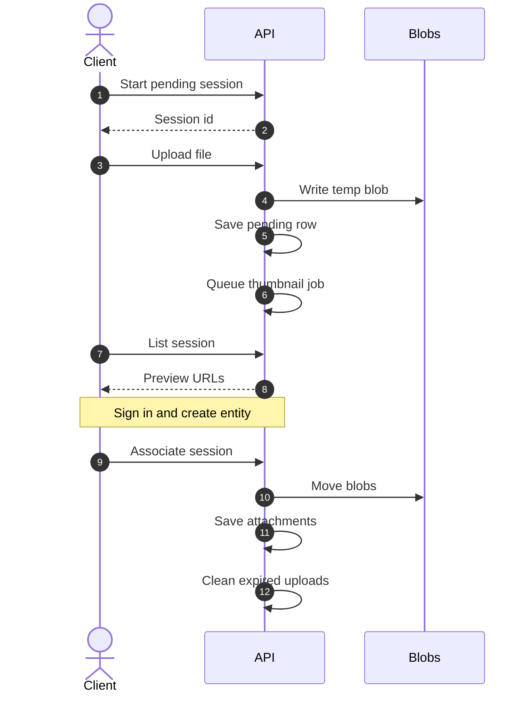

# Attachment uploads

Attachment supports direct uploads and owner-bound pending sessions so a client can validate files before linking them to a business entity.

## At a glance

| Flow | Source under `src/Modules/Attachment/Attachment/Domains/Attachments/Features/` |
|---|---|
| Direct upload | `UploadAttachment/` |
| Pre-entity upload | `UploadPendingAttachment/`, `GetPendingAttachmentsBySession/` |
| Finalize or discard | `AssociatePendingAttachments/`, `DeletePendingAttachment/`, `ReorderPendingAttachments/` |

The [module route table](README.md#endpoints-and-authorization) is the endpoint inventory. All successful JSON responses use `isSuccess` and `data`; see [Errors and responses](../Architecture/Errors-and-Responses.md).

## How it works

### Direct upload

`POST /api/v1/attachments/upload` requires authentication and `multipart/form-data`. `UploadAttachmentRequest` accepts:

| Field | Required / default | Meaning |
|---|---|---|
| `file` | Required, non-empty | File part; let the browser set the multipart boundary |
| `type` | Optional | Omit to let content detection choose; a supplied type must agree |
| `entityType`, `entityId` | Optional | Link to an entity authorized by its attach policy; entity id is discarded if entity type is absent |
| `description` | Optional | Display description |
| `isPublic` | false | Allows public reads through the download endpoint |
| `generateThumbnail` | true | Requests a thumbnail for images when globally enabled |

The handler gets the user through `IHttpContextService` and tenant through `ITenantContext`. It validates a seekable stream, detects content, computes SHA-256, commits an `Uploading` row, writes the blob and commits `Ready`. The response contains `id`, `fileName`, `fileUrl`, `thumbnailUrl`, `fileSize`, `contentType` and `thumbnailPending`. Read `GET /api/v1/attachments/{id}` later for the thumbnail and `contentHash`. The returned URL is an access-checked API URL, not a public storage path.

### Pending sessions and association


*Figure: Routes are relative to /api/v1/attachments; association moves blobs before saving metadata, while cleanup processes expired unassociated uploads.*

1. Call `POST /api/v1/attachments/pending/sessions`, or omit `sessionId` on the first pending upload. Retain the returned server-issued id. Random client GUIDs are rejected.
2. Upload to `POST /api/v1/attachments/pending/upload`. Fields are `file` (required), `sessionId` (optional on first upload), `type` (optional), `category` (default `General`), `displayOrder` (default 0) and `isPrimary` (default false). Assign distinct display orders within a session.
3. The upload response carries `id`, `sessionId`, `fileName`, `fileUrl`, `expiresAt`, `displayOrder`, `isPrimary`. List with `GET /api/v1/attachments/pending/session/{sessionId}` for `attachments`, `totalCount`, `remainingSlots` and fresh previews. Pending DTOs include original name, type/category, size/content type, thumbnail, dimensions, order, primary flag and expiry. Do not persist preview URLs.
4. To discard a file, call `DELETE /api/v1/attachments/pending/{id}?sessionId=...` from the session owner. `ReorderPendingAttachmentsCommand` is available to trusted module code; there is no reorder HTTP route.
5. Authenticate, create the owning entity through its module, then call `POST /api/v1/attachments/pending/associate` with JSON fields `sessionId`, `entityType`, `entityId`, optional `isPublic` (HTTP default false). The caller must own the session and pass the entity attach policy. The response has `totalAssociated`, `attachmentIds`, and `metadata` entries with `id`, stable `fileUrl`, `displayOrder`, `isPrimary`.

Sessions are bound to the signed-in user or an anonymous client fingerprint (resolved IP + User-Agent). Association accepts the user's session or the anonymous fingerprint of that request, supporting upload followed by login in the same browser. Changing network or User-Agent can invalidate anonymous ownership. The server serializes session uploads with a PostgreSQL advisory lock, so concurrent requests cannot bypass the live-file limit.

Direct keys are `t/{tenantId:N}/{yyyy}/{MM}/{dd}/{id:N}.ext`; pending keys are `t/{tenantId:N}/temp/{sessionId:N}/{id:N}.ext`. Association uses an entity folder, not the direct-upload date folder; see [Storage providers](Storage-Providers.md).

## Configuration

| Key | Default | Meaning |
|---|---|---|
| `Attachment:Pending:MaxUploadsPerSession` | 20 | Live uploads per session |
| `Attachment:Pending:ExpirationHours` | 48 | Pending row lifetime |
| `Attachment:Pending:CleanupIntervalHours` | 6 | Cleanup schedule; 24 or more means daily |
| `Attachment:Pending:CleanupBatchSize` | 100 | Rows per cleanup batch |
| `Attachment:Validation:MaxImageSizeBytes` | 10485760 | Image limit, 10 MiB |
| `Attachment:Validation:MaxDocumentSizeBytes` | 52428800 | Document limit, 50 MiB |
| `Attachment:Validation:MaxVideoSizeBytes` | 104857600 | Video limit, 100 MiB |
| `Attachment:Validation:MaxAudioSizeBytes` | 20971520 | Audio limit, 20 MiB |
| `Attachment:Validation:MaxFileSizeBytes` | 10485760 | Other-file limit |

The pending session/upload endpoints use the `upload` policy in `RateLimiting:Policies` (20 requests per 60 seconds, no queue in shipped settings). `Pending:MaxUploadsPerMinute` is unused. Direct upload does not declare this named policy. Endpoint request and multipart limits are the largest per-type limit plus 65536 bytes of framing; proxy and host limits may reject earlier. Both upload endpoints select the long-running request timeout. [Configuration](Configuration.md) lists all options.

## Usage

The public association request is copied from `src/Modules/Attachment/Attachment/Domains/Attachments/Features/AssociatePendingAttachments/AssociatePendingAttachmentsEndPoint.cs`:

```csharp
public sealed record AssociatePendingAttachmentsRequest(
    Guid SessionId,
    EntityType EntityType,
    Guid EntityId,
    bool IsPublic = false);
```

Use `EntityType.User` and the authenticated user's id to exercise the built-in self-access policy. Other entity types need an owning module's policy. Trusted `AssociatePendingAttachmentsCommand` has a different default (`IsPublic=true`); set visibility explicitly in module code.

## Failure modes and guarantees

| Failure | Result / recovery |
|---|---|
| Empty, invalid or over-type-limit file; session full | 400; fix input or remove pending files |
| Foreign or forged session; denied entity policy | 403 |
| Duplicate live `displayOrder` | 409; choose another order |
| Missing pending file | 404 |
| Body exceeds endpoint limit | 413 |
| Pending upload/session rate exceeded | 429 |
| Scanner unavailable / infected | 503 `malware_scanner_unavailable` / 400 `malware_detected` |

Association moves files then saves rows; it compensates failed saves by moving files back. Individual failed file moves are logged and skipped, and thumbnail moves are best effort. Check `totalAssociated` and returned ids rather than assuming every session file was attached; an empty live session returns zero. Direct uploads and pending writes have different crash windows; see [Reliability](Reliability.md). A thumbnail is asynchronous and may be absent even after upload success. Check jobs in `/hangfire`, especially `cleanup-expired-attachments` and thumbnail failures.

## Guardrails

`PendingAttachmentFlowTests` covers ownership, concurrent limits, duplicate order and association. `PendingAssociateRaceTests`, `PendingDeleteRaceTests`, `AttachmentLifecycleTests`, `FileValidationServiceTests` and `PendingSessionServiceTests` cover races, visibility, content and session forgery.

## Related

[Security](Security.md), [Reliability](Reliability.md), [Image processing](Image-Processing.md), [module overview](README.md), and `/starterkit:add-feature`.
