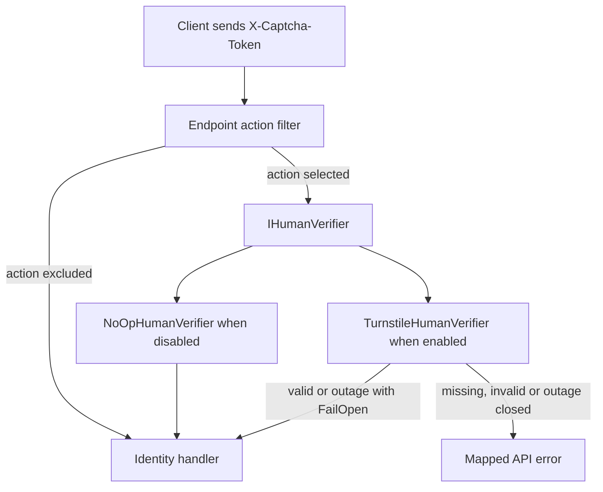

# Bot protection

Bot protection adds a replaceable human-verification check to selected anonymous Identity endpoints, reducing automated account creation, credential checks and message delivery abuse.

## At a glance

| Responsibility | Main types / source |
|---|---|
| Provider-neutral port | `IHumanVerifier`, `HumanVerificationResult`; `src/Shared/Shared.Core/BotProtection/` |
| Turnstile adapter | `TurnstileHumanVerifier`, a typed HTTP client |
| Endpoint opt-in and error mapping | `BotProtectionExtensions.RequireHumanVerification` |
| Configuration and disabled mode | `BotProtectionOptions`, `NoOpHumanVerifier` |
| Identity declarations | `src/Modules/Identity/Identity/Domains/Auth/Features/` and `Domains/Onboarding/Features/` |

The port lives in Shared.Core so other modules can use it without a provider dependency. The host registers
`AddBotProtection`; the default is disabled. Existing `auth` / `otp` rate limits still apply.
[Request lifecycle](../Architecture/Request-Lifecycle.md#endpoint-filters) owns the filter and middleware ordering.

## How it works

The frontend renders the Turnstile widget with the public site key. It sends the resulting token in
`X-Captcha-Token`; endpoint request bodies stay unchanged. A declared action selects whether the filter runs,
and `IHumanVerifier` decides whether the handler may execute.


*Figure: Disabled registration uses a no-op verifier; enabled actions reach the handler only after verification or an explicitly configured fail-open result.*

The adapter rejects missing or oversized tokens before making a provider call (maximum 2048 characters).
It posts the secret, response token, a per-call idempotency key and the client address when available.
A successful provider verdict is checked against `AllowedHostnames` and, when present, the echoed action.
The adapter does not implement a retry loop.

### Action binding

Set `data-action="login"` (or the matching action below) on the widget. A nonempty echoed action must match,
case-insensitively. If the provider response omits the action, the adapter accepts it; action binding depends on
the widget setting it. Reused or expired tokens need a new widget result.

## Configuration

Keys are under `BotProtection`. Defaults come from `src/Api/appsettings.json` and
`src/Shared/Shared.Core/BotProtection/BotProtectionOptions.cs`.

| Key | Default | Notes |
|---|---|---|
| `Enabled` | `false` | Off in dev/tests: `NoOpHumanVerifier` is registered and no header is needed |
| `Provider` | `Turnstile` | `None` \| `Turnstile` |
| `SecretKey` | empty | Never commit. Env `BotProtection__SecretKey` or Docker secret file `BotProtection__SecretKey` / `turnstile_secret` |
| `SiteKey` | empty | Public; for the frontend |
| `AllowedHostnames` | `[]` | When set, the token's hostname must match (e.g. `api.example.com`) |
| `TimeoutSeconds` | `5` | Provider call budget (1 to 30) |
| `FailOpen` | `true` | See below |
| `Actions` | `[]` | Empty = all declared endpoints. Set e.g. `["register","resend-otp"]` to protect only those |

Options are validated on start (Enabled needs a provider and a secret). Outside Development/Testing
`ProductionConfigurationGuard` also refuses to boot when `Enabled=true` and the secret is empty or `CHANGE_ME`.
`appsettings.json` ships an empty `SecretKey` (not `CHANGE_ME`) because the placeholder guard would otherwise block
production boots that leave the feature off.

The existing Turnstile test-secret examples are `1x0000000000000000000000000000000AA` (always passes) and
`2x0000000000000000000000000000000AA` (always fails), paired with the provider's test site keys. These are public
test values, not production credentials. Repository tests use fake verifiers or HTTP handlers; the provider's current test-key behavior is not verified by those tests.

## Usage

The real declaration tail in
`src/Modules/Identity/Identity/Domains/Auth/Features/Login/LoginEndPoint.cs`:

```csharp
.AllowAnonymous()
.RequireRateLimiting("auth")
.RequireHumanVerification("login")
```

Protected endpoints (action name in quotes):

| Endpoint | Action |
|---|---|
| `POST /api/auth/login` | `login` |
| `POST /api/auth/register` | `register` |
| `POST /api/auth/forgot-password` | `forgot-password` |
| `POST /api/identity/onboarding/register` | `onboarding-register` |
| `POST /api/identity/onboarding/resend-otp` | `resend-otp` |

Deliberately **not** protected: refresh, reset-password and verify-reset-otp (they need a secret token or an OTP the
caller already holds, and are rate limited), verify-phone/2FA verify, external login redirects, and every
authenticated endpoint. Tenancy invitations are sent by authenticated members, so they are out of scope.

### Adding a provider

1. Implement `IHumanVerifier` in `Shared.Core/BotProtection` (a typed `HttpClient`, using `BotProtectionOptions`).
2. Add a `BotProtectionProvider` value and one `case` in `AddBotProtection`.
3. Add adapter tests with a fake `HttpMessageHandler` (see `TurnstileHumanVerifierTests`).

Nothing else changes: endpoints, errors, config shape and metrics are provider-neutral.

## Failure modes and guarantees

| Situation | Status | `errorCode` |
|---|---|---|
| Header missing or blank | 400 | `captcha_required` |
| Token rejected (invalid, expired, reused, wrong hostname/action) | 400 | `captcha_invalid` |
| Provider unreachable and `FailOpen=false` | 503 | `captcha_unavailable` |

400 (not 403) is used because the request is incomplete or malformed from the caller's side, not an authorization
decision; clients that log users out on 401/403 must not do so here. Branch on `errorCode`: on `captcha_required` /
`captcha_invalid`, reset the widget and ask for a new token (tokens are single use). Messages are localized (en, ar).

### Fail-open trade-off

If the provider times out, errors or returns 5xx, the adapter either lets the request through (`FailOpen=true`,
default) or rejects it (`FailOpen=false`, 503). Fail-open keeps sign-in available during a Cloudflare outage at the
cost of a temporary gap an attacker could exploit by degrading the provider while rate limiting still
applies. Choose fail-closed if abuse costs you more than downtime. An **invalid** token is always rejected.
Each degraded call logs a warning and counts `provider_error`.

Timeouts, network errors, malformed/empty provider responses and 5xx use that availability policy. Caller
cancellation propagates rather than becoming a successful fail-open result. An invalid verdict, hostname mismatch
or action mismatch is always rejected. Disabled mode is implemented by registering `NoOpHumanVerifier`;
`BotProtectionOptions.Protects` itself filters actions, not the enabled flag.

### Observability

Counter `bot_protection.verifications` (meter `StarterKit.BotProtection`) tagged `outcome`
(`success` | `failure` | `provider_error`) and `action`. Alert on a rising `provider_error` share (outage, fail-open
active) or a spike of `failure` (an attack).

## Guardrails

`TurnstileHumanVerifierTests` and `RequireHumanVerificationTests` in
`src/Shared/Shared.Core.Tests/BotProtection/` cover provider requests, hostname/action checks, failures,
cancellation, metrics, action selection and disabled registration. `BotProtectionE2ETests` in
`src/Api.E2ETests/Identity/BotProtectionE2ETests.cs` exercises HTTP endpoints with a fake verifier.
`ProductionConfigurationGuardTests` checks startup rejection; `AdminEndpointAuthorizationTests` checks
explicit authorization declarations.

## Related

[Identity](README.md), [Frontend integration](Frontend-Integration.md),
[Request lifecycle](../Architecture/Request-Lifecycle.md),
[Errors and responses](../Architecture/Errors-and-Responses.md),
[ADR-0002](../Decisions/0002-carter-minimal-apis.md);
`/starterkit:add-feature`,
`/starterkit:write-tests`.
