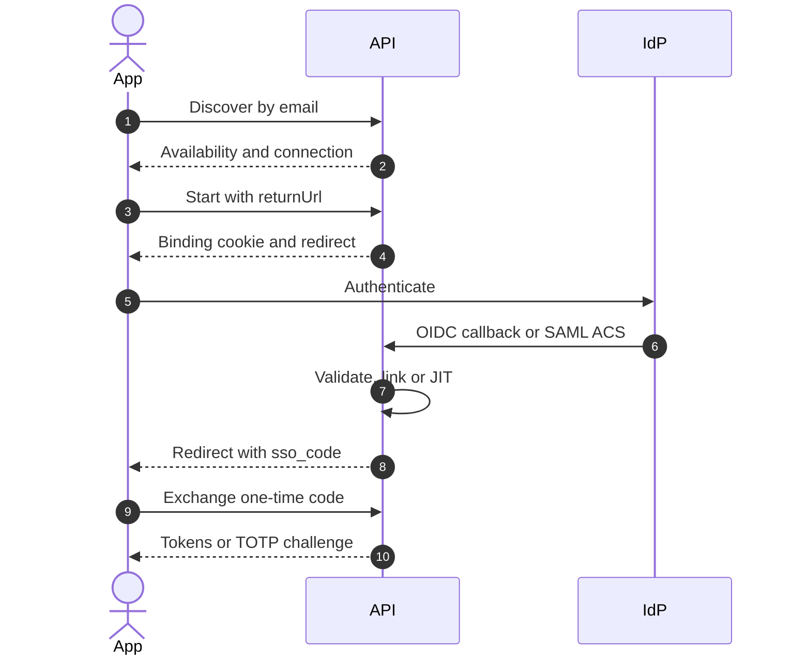

# Enterprise SSO

Enterprise SSO authenticates tenant members through per-tenant OIDC or SAML connections while keeping account linking, provisioning and application sessions under Identity's control.

## At a glance

| Responsibility | Main types / source |
|---|---|
| Tenant-owned control-plane connections and DNS proof | `SsoConnection`, `SsoDomain`; `src/Modules/Identity/Identity/Domains/Sso/` |
| Protocol adapters and account linking | `OidcSsoClient`, `SamlSsoClient`, `SsoAccountService`; `src/Modules/Identity/Identity/Services/Sso/` |
| Availability and local-login policy | `ISsoEntitlement`, `ISsoEnforcementPolicy` |
| Tenant role validation | Identity's `ITenantRoleGuard`, implemented through Tenancy contracts |
| Metadata maintenance | `RefreshSamlMetadataJob`, `CheckSamlCertificateExpiryJob` |

Connections are control-plane rows scoped explicitly by `TenantId`. [Identity](README.md) owns accounts;
Tenancy owns memberships. [SCIM](SCIM.md) covers directory-driven provisioning and
[request lifecycle](../Architecture/Request-Lifecycle.md) covers middleware and mediator behavior.

## How it works

### Connections and verified domains

| Term | Meaning |
|---|---|
| Connection | [`SsoConnection`](../../src/Modules/Identity/Identity/Domains/Sso/Models/SsoConnection.cs): one IdP for one tenant. `Draft → Active → Disabled`. Protocol (OIDC/SAML) is fixed. |
| Verified domain | An email domain the tenant proved with DNS: TXT `_starterkit-sso.<domain>` = `sso-verification=<token>`. A domain is verified by **one** connection platform-wide (filtered unique index). Public email providers are refused. |
| JIT provisioning | First sign-in creates the account (email confirmed, no password) and the membership with the connection's default tenant roles. |
| Enforced SSO | Users of the verified domains cannot use password, passkey or social login, (403 `sso_required`); email reset requests send no mail and retain their generic response. Break-glass: platform staff and the tenant owner (`AllowBreakGlassPasswordLogin`). |

The SAML adapter uses `ITfoxtec.Identity.Saml2` (BSD-3); the OIDC adapter validates ID tokens locally.

### Sign-in flow


*Figure: A successful callback redirects with a one-time code; only the POST exchange returns the application login result.*

The protocol adapters and login flow enforce these boundaries:

- **No tokens in URLs.** The callback hands over a single-use, 60-second code; the app exchanges it with a POST.
- **Login CSRF.** `start` sets an HttpOnly cookie (`sk_sso_binding`, path `/api/auth/sso`, 10 min; SameSite=None on
  HTTPS so the SAML POST carries it). An SP-initiated sign-in callback only completes in the browser holding it, so an attacker cannot
  make a victim finish the attacker's sign-in.
- **Platform staff are never signed in by a tenant IdP.** Accounts with a staff role (SuperAdmin, Admin, Finance,
  Support) are refused on every SSO sign-in (`staff_account`): a customer-controlled IdP must never grant global
  roles or assert their MFA.
- **Open-redirect guard.** `returnUrl` must be on `Identity:Sso:AllowedReturnOrigins`.
- **State** is server-side, single use through `IOneTimeUseGuard` (Redis `SET NX` across instances; the non-Redis gate is process-local).
- **OIDC:** authorization code + PKCE S256 + nonce; `client_secret_basic`; id_token validated locally (issuer,
  audience, lifetime, signing keys from JWKS with automatic rollover, RS/PS/ES algorithms only).
- **SAML:** signed response/assertion by a **pinned** IdP certificate, audience = the connection's SP entity id,
  issuer, time conditions, `InResponseTo` bound to our AuthnRequest, response id accepted once. IdP-initiated
  sign-in only when `SamlAllowIdpInitiated` is on.
- **Account linking.** Known `(sso:<connectionId>, subject)` → that user. Otherwise the email must be on a verified
  domain accepted by `SsoConnection.CoversVerified` (and not `email_verified=false`); an existing account is linked (security email to the
  user), else JIT creates one. DNS proof is the boundary for email-based linking; an existing subject link resolves directly to its account.
- **Availability.** Start, discovery/enforcement and SCIM user/group operations check `Identity:Sso:Enabled`.
  SSO start and callback both check the tenant plan feature `sso`: a lost entitlement gives 404 at start or
  callback `sso_error=sso_disabled`. Enforcement uses the same `ISsoEntitlement` check and lapses with availability.
  The callback and code exchange do not independently recheck the platform switch; disabling it is not a
  revocation mechanism for an already-started flow.
- **Default roles** must be roles of the tenant (Identity's `ITenantRoleGuard` queries Tenancy contracts; 400 `tenant_role_not_found`).
- **Open redirect via discovery.** The OIDC `authorization_endpoint` must be HTTPS and on the authority host.
- **SSRF.** Discovery, JWKS and token calls go through the shared guarded handler (`Shared.Core.Net.GuardedConnector`):
  HTTPS, public addresses only, no redirects (`AllowInsecureIdentityProviders` relaxes it for a local Keycloak only).
- **MFA.** The session is MFA only when the IdP asserts it (OIDC `amr`/`acr`, SAML authn-method) **and** the
  connection has `TrustIdpMfa`. Otherwise an account with its own TOTP still gets the 2FA challenge.
- **Suspended members stay out.** SSO never reactivates a membership suspended by the tenant or by SCIM.

`ISsoEnforcementPolicy` is the shared policy for every non-SSO sign-in path: password, passkey and social login.
The email branch of forgot-password calls `IsPasswordResetAllowedAsync` and silently suppresses delivery under
enforcement. This does not mean every reset endpoint calls the policy. Staff and the tenant owner retain their
other methods when `AllowBreakGlassPasswordLogin` is enabled.

`ISsoEntitlement` is the single tenant-plan availability check for SSO sign-in, discovery and enforcement.
It evaluates plan feature `sso` in the connection tenant's scope; the platform switch is a separate check as described above.
Plan enforcement follows the shared entitlement configuration in
[request lifecycle](../Architecture/Request-Lifecycle.md#configuration).

`returnUrl` must be an absolute HTTP(S) URL with an allow-listed origin, no user info and no fragment.
Unknown callback state falls back to the configured frontend login page.

### SAML metadata refresh and certificate expiry alerts

A SAML connection with a **metadata URL** keeps its IdP signing certificates and SSO URL current, to support IdP key rollover. Failed refreshes retain existing keys; availability still depends on those keys remaining usable.

- **Job.** `RefreshSamlMetadataJob` (Hangfire recurring `refresh-saml-metadata`, queue `default`, cron
  `Identity:Sso:MetadataRefreshCron`, default every 6 hours; `MetadataRefreshEnabled=false` turns it off). It
  iterates active SAML control-plane connections with a metadata URL across tenants, one `IUnitOfWorkRunner` call per connection, so one broken IdP never blocks the others.
- **Fetch.** Through the `identity-sso` HTTP client (`GuardedConnector`: no private/loopback/metadata addresses, no
  redirects, short timeout), HTTPS only (`AllowInsecureIdentityProviders` relaxes it in development), response capped
  at 1 MB, XML parsed with DTD processing prohibited.
- **Entity id and signature.** Metadata whose `entityID` differs from the configured one is rejected and
  recorded (`samlMetadataLastError = metadata_entity_id_mismatch`); keys and URL stay. If the metadata is
  **signed** (enveloped XML signature over the whole document, no XSLT/XPath transforms), the signature must verify
  against the certificates ALREADY pinned on the connection, otherwise `metadata_signature_invalid`; a rollover works
  because the old key signs the metadata that announces the new one.
- **Signature policy, per connection.** By default unsigned metadata is accepted (many IdPs publish none), and then the
  entity-id check does NOT protect against a hijacked or compromised metadata host: it can serve the right entity id
  with attacker keys.
  - `samlRequireSignedMetadata: true` refuses unsigned metadata with `metadata_signature_required`. The keys stay and
    sign-in keeps working, but a future rollover still needs metadata that satisfies the signature policy.
  - `samlMetadataSigningCertificates` pins the keys that sign the METADATA, for federations whose metadata key differs
    from the assertion keys. When set, they are the ONLY keys trusted for it, and a signature is required, so stripping
    the signature cannot bypass the pin. Rotate them by hand (up to 4 side by side); the expiry alerts cover the
    assertion certificates only, and a signature is verified by key, not by the certificate's validity dates.
  - On update, null keeps either setting and an empty list clears the pins.
  - The read model's `samlMetadataSignatureRequired` is the effective rule (either setting); show that one in a UI.
  - For an IdP that publishes no signature, leave the metadata URL empty and rotate certificates by hand.
- **Other error codes:** `metadata_fetch_failed`, `metadata_url_not_allowed`, `metadata_too_large`,
  `metadata_invalid`, `metadata_no_certificates`, `metadata_invalid_certificates`. They are codes, not text, so
  clients localize them. The same certificates in another order are not a change.
- **Outcomes.** *Updated*: certificates and/or SSO URL replaced (version bump, change event). *Unchanged*: only
  `samlMetadataRefreshedAt` moves, through a set-based update that does not bump the version, so it never conflicts
  with an admin edit. *Failed*: only the error code is recorded.
- **Expiry alerts.** `CheckSamlCertificateExpiryJob` (daily, `CertificateExpiryCheckCron`, switch
  `CertificateExpiryAlertsEnabled`) compares the LATEST certificate `NotAfter` of each active SAML connection
  (`samlCertificatesNotAfter`; a rollover certificate next to the old one is not an outage) with
  `CertificateExpiryAlertDays` (default 30, 14, 7, 1). The alert is **claimed** with one conditional set-based update
  (`alerted_not_after IS DISTINCT FROM notAfter OR alerted_days > band`, exactly one row wins), so replicas and re-runs
  never send it twice and no version bump can 409 an admin edit; then `SsoCertificateExpiringEvent` is published. The
  handler notifies the ACTIVE tenant members who hold `tenant.sso.manage` (the owner plus the members of each role
  carrying it, one paged members query per role, through the Tenancy contracts in the tenant's scope) by email
  (`SsoCertificateExpiring`, in the tenant's culture) and in the in-app inbox (category
  `security.sso-certificate-expiring`). Delivery failures propagate: the job **releases** its claim and the next run
  retries (recipients notified before the failure may get it twice: at-least-once). A new certificate resets the
  schedule.

## Configuration

Keys below are under `Identity:Sso`; defaults come from `Options/SsoOptions.cs` and
`src/Api/appsettings.json`. Base settings select the local frontend origin; Docker settings select a deployment placeholder.

| Key | Default | Notes |
|---|---|---|
| `Enabled` | `true` | Platform SSO/SCIM switch; admin endpoints remain readable |
| `PublicBaseUrl` | Base settings empty; options null | the API URL the IdP sees (`https://api.example.com`); Request-host fallback is development-only; **required outside development** (the Host header is never trusted there); never change it after customers configured IdPs |
| `AllowedReturnOrigins` | Options `[]`; base `["http://localhost:3000"]` | Allowed origins; empty falls back to `Application:FrontendBaseUrl` |
| `LoginTimeoutMinutes` | 10 | state lifetime |
| `ExchangeCodeLifetimeSeconds` | 60 | One-time grant lifetime, clamped to 10-300 seconds |
| `AllowInsecureIdentityProviders` | `false` | http / private IdPs - development only |
| `ClockSkewSeconds` | 120 | Accepted IdP token/assertion clock skew |
| `AllowBreakGlassPasswordLogin` | `true` | staff + tenant owner bypass enforcement |
| `MetadataRefreshEnabled` / `MetadataRefreshCron` | `true` / `0 */6 * * *` | recurring SAML metadata refresh |
| `CertificateExpiryCheckCron` | `0 7 * * *` | daily certificate expiry check |
| `CertificateExpiryAlertsEnabled` | `true` | switch for the daily expiry check |
| `CertificateExpiryAlertDays` | unset = `[30,14,7,1]` | alert thresholds. The code default is empty and replaced after binding, because the configuration binder appends to a non-empty default array |

## Usage

From `src/Modules/Identity/Identity/Services/Sso/SsoAccountService.cs`, inside the connection tenant's scope:

```csharp
await sender.Send(new ProvisionMemberCommand(userId, MemberProvisioningSource.Sso, connection.DefaultRoleIds), ct);
```

This provisions membership through Tenancy's contract without reading its implementation data.

### Tenant admin API (`/api/v1/tenant/sso`)

Gate on every route: `.RequireTenantPermission(TenantPermissions.SsoManage)` (`tenant.sso.manage`) +
`.RequireFeature(EntitlementKeys.Sso)` (plan feature `sso`) + `.DisallowApiKey()`; changes also `.DisallowImpersonation()`.

| Method | Route | Purpose |
|---|---|---|
| GET/POST | `/connections` | list / create (draft) |
| GET/PUT/DELETE | `/connections/{id}` | read (incl. the SP values for the IdP admin) / update (`version`) / delete |
| POST | `/connections/{id}/activate`, `/connections/{id}/disable` | status |
| POST | `/connections/{id}/refresh-metadata` | SAML only: "refresh now" from the metadata URL; result `{outcome: Updated|Unchanged|Failed, error?, refreshedAt?}` |
| POST | `/connections/{id}/domains` | add a domain → TXT record to publish |
| POST | `/connections/{id}/domains/{domain}/verify` | DNS check (409 `sso_domain_unverified` / `sso_domain_taken`) |
| DELETE | `/connections/{id}/domains/{domain}` | remove |
| POST | `/connections/{id}/test` | IdP round trip in **test mode** (draft too); returns to `returnUrl?sso_test=<code>` |
| GET | `/test-results/{code}` | what the IdP asserted (subject, email, claims), read once |

Platform staff: `GET /api/v1/admin/sso/connections` (`tenants.read`).
The OIDC client secret is write-only (Data Protection encrypted, `[AuditIgnore]`); connection changes are audited
in `identity.audit_entries` (`IAuditable`).

### Public routes (`/api/auth/sso`)

`POST discover`, `GET {id}/start`, `GET oidc/callback`, `POST saml/{id}/acs`, `GET saml/{id}/metadata`
(SP metadata XML), `POST exchange`. Callback business failures redirect with `sso_error`; the allow-listed codes are:
`state_invalid`, `idp_error`, `connection_unavailable`, `domain_not_allowed`, `not_provisioned`, `account_disabled`,
`tenant_unavailable`, `membership_inactive`, `staff_account`, `access_denied` (e.g. the plan seat limit), `provisioning_failed`,
`sso_disabled`, `sso_failed`. These are query-string values, not `errorCode` fields. Start validation and missing/unavailable connections return API errors; unexpected infrastructure exceptions can also escape callback handling.

OIDC email: the configured claim, else `email`, else `upn` (Entra). `preferred_username` is never used (editable in
some IdPs). Last sign-in time is recorded with a single-row update (no aggregate version bump, so sign-ins never
conflict with admin edits).

`email_verified`: an explicit `false` is refused; a missing claim is accepted because the domain itself is
DNS-verified by the tenant; this accommodates providers such as Entra ID that omit the claim.

Discovery cache: one `ConfigurationManager` per authority in `IMemoryCache`. A connection change carries its current
and previous authority (`SsoConnectionChangedEvent`); both are evicted locally and broadcast over Redis
(`ILocalCacheInvalidationBus`), so every replica re-reads an edited IdP on the next sign-in.

### Configuring an IdP

The connection DTO's `serviceProvider` block gives the values to paste:

| IdP | Protocol | Steps |
|---|---|---|
| **Entra ID** | OIDC | App registration → Web redirect URI = `oidcRedirectUri`; client secret; use the provider-issued authority for a specific tenant, not `common`. |
| **Entra ID** | SAML | Enterprise app → Identifier = `samlEntityId`, Reply URL = `samlAcsUrl`; upload the signing certificate (Base64) to the connection. |
| **Okta** | OIDC | Web app, sign-in redirect = `oidcRedirectUri`, authority = the provider-issued organization authority. |
| **Okta / Google Workspace** | SAML | ACS URL = `samlAcsUrl`, Audience/Entity ID = `samlEntityId`, NameID = email or persistent; copy SSO URL, issuer and certificate. |

Then add the email domain, publish the TXT record, verify, run **Test**, check the claims, activate.

## Failure modes and guarantees

| Condition | Response / guarantee |
|---|---|
| Invalid `returnUrl` at start | 400; no redirect to an untrusted origin |
| Disabled SSO, inactive/missing connection or missing plan entitlement at start | 404 |
| Invalid, expired or consumed exchange code | 401; start another sign-in |
| Invalid connection settings | 400 `sso_connection_invalid` |
| DNS proof absent / domain verified elsewhere | 409 `sso_domain_unverified` / `sso_domain_taken` |
| Non-SSO login under enforcement | 403 `sso_required` |
| Foreign default role | 400 `tenant_role_not_found` |
| Metadata failure | Existing keys and URL retained; stable error recorded |

The exchange rechecks account activity and lockout. Session completion enforces membership status; SSO never
reactivates suspended members. Consuming state, exchange codes and test reports is not retry-idempotent.
Metadata concurrency conflicts are logged and skipped until a later run. Expiry delivery is at-least-once.

### Known limits

- No SAML Single Logout and no signed AuthnRequests (IdPs do not require them by default).
- Without a metadata URL the certificates are managed by hand (update the connection); the expiry alert still applies.
- One active connection per verified domain (by design: home-realm discovery must be unambiguous).

## Guardrails

`SsoConnectionTests`, `SsoPolicyTests`, `SamlSsoClientTests`, `SamlMetadataRefreshTests`, `SsoJobsTests` and
`SsoCertificateExpiringEventHandlerTests` cover domain proof, return URLs, plan enforcement, role validation,
cache broadcasts, real signed SAML responses, metadata policy and job isolation.

`EnterpriseSsoE2ETests` uses an in-process OIDC provider with PKCE and RS256, and checks stale versions,
foreign roles, cross-tenant ids and authorization. `SamlSsoE2ETests` uses `SamlTestIdp` for signed HTTP round
trips, forged signatures, replay and browser binding. `SsoTenantTests` checks two-tenant sign-in, discovery,
JIT, administration, SCIM isolation and metadata refresh. These live under `src/Api.E2ETests/`.
`ModuleBoundaryTests` and `AdminEndpointAuthorizationTests` enforce module access and explicit authorization.

## Related

[Identity](README.md), [SCIM](SCIM.md), [Passkeys](Passkeys.md),
[Permissions, 2FA and audit](Permissions-2FA-and-Admin-Audit.md),
[Frontend integration](Frontend-Integration.md), [ADR-0013](../Decisions/0013-enterprise-sso-and-scim.md);
Backlog reference: G15.
[/starterkit:add-feature](../../tools/claude/starterkit-plugin/skills/add-feature/SKILL.md),
[/starterkit:add-background-job](../../tools/claude/starterkit-plugin/skills/add-background-job/SKILL.md).
