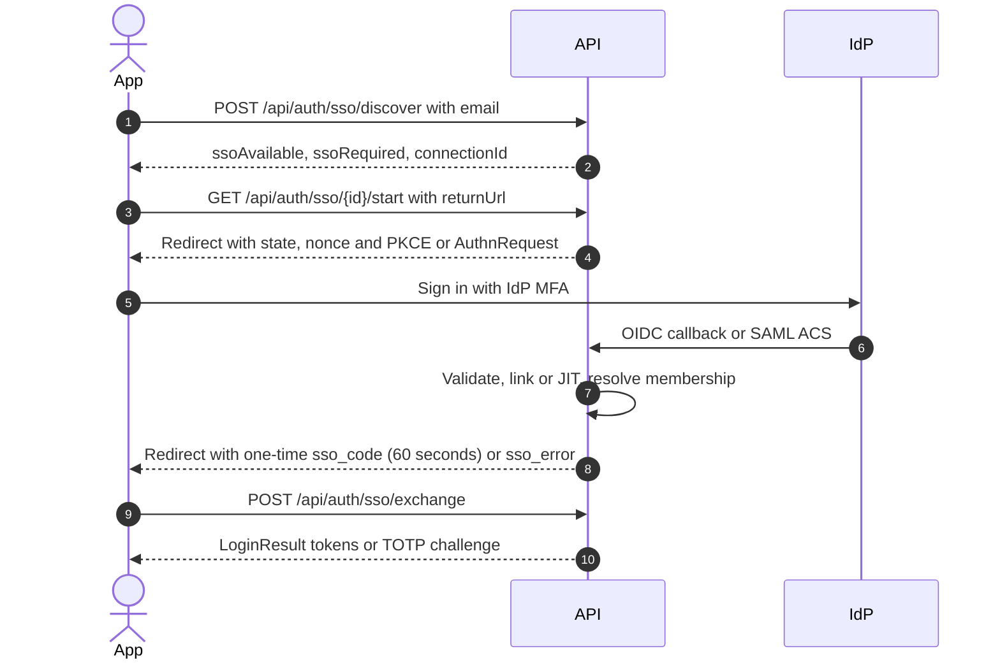

# Enterprise SSO (OIDC and SAML 2.0 per tenant)

Tenant admins connect their company identity provider (Entra ID, Okta, Google Workspace, ADFS, Keycloak, ...) and
their users sign in there. Backlog item G15; provisioning is covered by [SCIM](SCIM.md).
Decision record: [ADR 0013](../Decisions/0013-enterprise-sso-and-scim.md).

## Concepts

| Term | Meaning |
|---|---|
| Connection | [`SsoConnection`](../../src/Modules/Identity/Identity/Domains/Sso/Models/SsoConnection.cs): one IdP for one tenant. `Draft → Active → Disabled`. Protocol (OIDC/SAML) is fixed. |
| Verified domain | An email domain the tenant proved with DNS: TXT `_starterkit-sso.<domain>` = `sso-verification=<token>`. A domain is verified by **one** connection platform-wide (filtered unique index). Public providers (gmail.com, ...) are refused. |
| JIT provisioning | First sign-in creates the account (email confirmed, no password) and the membership with the connection's default tenant roles. |
| Enforced SSO | Users of the verified domains cannot use password, passkey or social login, and get no password-reset mail (403 `sso_required`). Break-glass: platform staff and the tenant owner (`AllowBreakGlassPasswordLogin`). |

## Sign-in flow

*Figure: SSO callbacks exchange a short-lived code for the application login result.*

Security properties (all covered by tests):
- **No tokens in URLs.** The callback hands over a single-use, 60-second code; the app exchanges it with a POST.
- **Login CSRF.** `start` sets an HttpOnly cookie (`sk_sso_binding`, path `/api/auth/sso`, 10 min; SameSite=None on
  HTTPS so the SAML POST carries it). A callback only completes in the browser holding it, so an attacker cannot
  make a victim finish the attacker's sign-in.
- **Platform staff are never signed in by a tenant IdP.** Accounts with a staff role (SuperAdmin, Admin, Finance,
  Support) are refused on every SSO sign-in (`staff_account`): a customer-controlled IdP must never grant global
  roles or assert their MFA.
- **Open-redirect guard.** `returnUrl` must be on `Identity:Sso:AllowedReturnOrigins`.
- **State** is server-side, single use across instances (`IOneTimeUseGuard`: Redis `SET NX` or a local fallback).
- **OIDC:** authorization code + PKCE S256 + nonce; `client_secret_basic`; id_token validated locally (issuer,
  audience, lifetime, signing keys from JWKS with automatic rollover, RS/PS/ES algorithms only).
- **SAML:** signed response/assertion by a **pinned** IdP certificate, audience = the connection's SP entity id,
  issuer, time conditions, `InResponseTo` bound to our AuthnRequest, response id accepted once. IdP-initiated
  sign-in only when `SamlAllowIdpInitiated` is on.
- **Account linking.** Known `(sso:<connectionId>, subject)` → that user. Otherwise the email must be on a verified
  domain of the connection (and not `email_verified=false`); an existing account is linked (security email to the
  user), else JIT creates one. One tenant can never claim another tenant's users.
- **Plan and kill switch.** Sign-in (start and callback), discovery and SCIM require `Identity:Sso:Enabled` and the
  tenant plan feature `sso`; a plan that loses it stops SSO immediately (`sso_disabled`). Enforcement lapses with it
  (one check, `ISsoEntitlement`): users fall back to their other sign-in methods instead of being locked out.
- **Default roles** must be roles of the tenant (validated through Tenancy, 400 `tenant_role_not_found`).
- **Open redirect via discovery.** The OIDC `authorization_endpoint` must be HTTPS and on the authority host.
- **SSRF.** Discovery, JWKS and token calls go through the shared guarded handler (`Shared.Core.Net.GuardedConnector`):
  HTTPS, public addresses only, no redirects (`AllowInsecureIdentityProviders` relaxes it for a local Keycloak only).
- **MFA.** The session is MFA only when the IdP asserts it (OIDC `amr`/`acr`, SAML authn-method) **and** the
  connection has `TrustIdpMfa`. Otherwise an account with its own TOTP still gets the 2FA challenge.
- **Suspended members stay out.** SSO never reactivates a membership suspended by the tenant or by SCIM.

## Tenant admin API (`/api/v1/tenant/sso`)

Gate on every route: `.RequireTenantPermission(TenantPermissions.SsoManage)` (`tenant.sso.manage`) +
`.RequireFeature(EntitlementKeys.Sso)` (plan feature `sso`) + `.DisallowApiKey()`; changes also `.DisallowImpersonation()`.

| Method | Route | Purpose |
|---|---|---|
| GET/POST | `/connections` | list / create (draft) |
| GET/PUT/DELETE | `/connections/{id}` | read (incl. the SP values for the IdP admin) / update (`version`) / delete |
| POST | `/connections/{id}/activate`, `/disable` | status |
| POST | `/connections/{id}/refresh-metadata` | SAML only: "refresh now" from the metadata URL; result `{outcome: Updated|Unchanged|Failed, error?, refreshedAt?}` |
| POST | `/connections/{id}/domains` | add a domain → TXT record to publish |
| POST | `/connections/{id}/domains/{domain}/verify` | DNS check (409 `sso_domain_unverified` / `sso_domain_taken`) |
| DELETE | `/connections/{id}/domains/{domain}` | remove |
| POST | `/connections/{id}/test` | IdP round trip in **test mode** (draft too); returns to `returnUrl?sso_test=<code>` |
| GET | `/test-results/{code}` | what the IdP asserted (subject, email, claims), read once |

Platform staff: `GET /api/v1/admin/sso/connections` (`tenants.read`).
The OIDC client secret is write-only (Data Protection encrypted, `[AuditIgnore]`); connection changes are audited
in `identity.audit_entries` (`IAuditable`).

## Public routes (`/api/auth/sso`)

`POST discover`, `GET {id}/start`, `GET oidc/callback`, `POST saml/{id}/acs`, `GET saml/{id}/metadata`
(SP metadata XML), `POST exchange`. Browser routes always redirect; error codes a browser can receive:
`state_invalid`, `idp_error`, `connection_unavailable`, `domain_not_allowed`, `not_provisioned`, `account_disabled`,
`tenant_unavailable`, `staff_account`, `access_denied` (e.g. the plan seat limit), `provisioning_failed`,
`sso_disabled`, `sso_failed`. Every failure is a redirect, never a JSON page.

OIDC email: the configured claim, else `email`, else `upn` (Entra). `preferred_username` is never used (editable in
some IdPs). Last sign-in time is recorded with a single-row update (no aggregate version bump, so sign-ins never
conflict with admin edits).

`email_verified`: an explicit `false` is refused; a missing claim is accepted because the domain itself is
DNS-verified by the tenant and Entra ID never sends the claim.

Discovery cache: one `ConfigurationManager` per authority in `IMemoryCache`. A connection change carries its current
and previous authority (`SsoConnectionChangedEvent`); both are evicted locally and broadcast over Redis
(`ILocalCacheInvalidationBus`), so every replica re-reads an edited IdP on the next sign-in.

## Configuring an IdP

The connection DTO's `serviceProvider` block gives the values to paste:

| IdP | Protocol | Steps |
|---|---|---|
| **Entra ID** | OIDC | App registration → Web redirect URI = `oidcRedirectUri`; client secret; authority `https://login.microsoftonline.com/<tenant-id>/v2.0` (a specific tenant, not `common`). |
| **Entra ID** | SAML | Enterprise app → Identifier = `samlEntityId`, Reply URL = `samlAcsUrl`; upload the signing certificate (Base64) to the connection. |
| **Okta** | OIDC | Web app, sign-in redirect = `oidcRedirectUri`, authority = `https://<org>.okta.com`. |
| **Okta / Google Workspace** | SAML | ACS URL = `samlAcsUrl`, Audience/Entity ID = `samlEntityId`, NameID = email or persistent; copy SSO URL, issuer and certificate. |

Then add the email domain, publish the TXT record, verify, run **Test**, check the claims, activate.

## Configuration (`Identity:Sso`)

| Key | Default | Notes |
|---|---|---|
| `Enabled` | `true` | |
| `PublicBaseUrl` | request host (development only) | the API URL the IdP sees (`https://api.example.com`); **required outside development** (the Host header is never trusted there); never change it after customers configured IdPs |
| `AllowedReturnOrigins` | `Application:FrontendBaseUrl` | frontends a sign-in may return to |
| `LoginTimeoutMinutes` | 10 | state lifetime |
| `ExchangeCodeLifetimeSeconds` | 60 | |
| `AllowInsecureIdentityProviders` | `false` | http / private IdPs - development only |
| `ClockSkewSeconds` | 120 | |
| `AllowBreakGlassPasswordLogin` | `true` | staff + tenant owner bypass enforcement |
| `MetadataRefreshEnabled` / `MetadataRefreshCron` | `true` / `0 */6 * * *` | recurring SAML metadata refresh |
| `CertificateExpiryCheckCron` | `0 7 * * *` | daily certificate expiry check |
| `CertificateExpiryAlertsEnabled` | `true` | switch for the daily expiry check |
| `CertificateExpiryAlertDays` | unset = `[30,14,7,1]` | alert thresholds. The code default is empty and replaced after binding, because the configuration binder appends to a non-empty default array |

## SAML metadata refresh and certificate expiry alerts

A SAML connection with a **metadata URL** keeps its IdP signing certificates and SSO URL current, so an IdP key
rollover never locks a company out.

- **Job.** `RefreshSamlMetadataJob` (Hangfire recurring `refresh-saml-metadata`, queue `default`, cron
  `Identity:Sso:MetadataRefreshCron`, default every 6 hours; `MetadataRefreshEnabled=false` turns it off). It
  iterates the active SAML connections that have a metadata URL (control-plane rows, queried by explicit
  `TenantId`), one `IUnitOfWorkRunner` call per connection, so one broken IdP never blocks the others.
- **Fetch.** Through the `identity-sso` HTTP client (`GuardedConnector`: no private/loopback/metadata addresses, no
  redirects, short timeout), HTTPS only (`AllowInsecureIdentityProviders` relaxes it in development), response capped
  at 1 MB, XML parsed with DTD processing prohibited.
- **Entity id and signature.** Metadata whose `entityID` differs from the configured one is rejected and
  recorded (`samlMetadataLastError = metadata_entity_id_mismatch`); keys and URL stay. If the metadata is
  **signed** (enveloped XML signature over the whole document, no XSLT/XPath transforms), the signature must verify
  against the certificates ALREADY pinned on the connection, otherwise `metadata_signature_invalid`; a rollover works
  because the old key signs the metadata that announces the new one.
- **Signature policy, per connection.** By default unsigned metadata is accepted (many IdPs publish none), and then the
  entity-id check does NOT protect against a hijacked or compromised metadata host: it can serve the right entity id
  with attacker keys.
  - `samlRequireSignedMetadata: true` refuses unsigned metadata with `metadata_signature_required`. The keys stay and
    sign-in keeps working, so turning it on can never lock anyone out.
  - `samlMetadataSigningCertificates` pins the keys that sign the METADATA, for federations whose metadata key differs
    from the assertion keys. When set, they are the ONLY keys trusted for it, and a signature is required, so stripping
    the signature cannot bypass the pin. Rotate them by hand (up to 4 side by side); the expiry alerts cover the
    assertion certificates only, and a signature is verified by key, not by the certificate's validity dates.
  - On update, null keeps either setting and an empty list clears the pins.
  - The read model's `samlMetadataSignatureRequired` is the effective rule (either setting); show that one in a UI.
  - For an IdP that publishes no signature, leave the metadata URL empty and rotate certificates by hand.
- **Other error codes:** `metadata_fetch_failed`, `metadata_url_not_allowed`, `metadata_too_large`,
  `metadata_invalid`, `metadata_no_certificates`, `metadata_invalid_certificates`. They are codes, not text, so
  clients localize them. The same certificates in another order are not a change.
- **Outcomes.** *Updated*: certificates and/or SSO URL replaced (version bump, change event). *Unchanged*: only
  `samlMetadataRefreshedAt` moves, through a set-based update that does not bump the version, so it never conflicts
  with an admin edit. *Failed*: only the error code is recorded.
- **Expiry alerts.** `CheckSamlCertificateExpiryJob` (daily, `CertificateExpiryCheckCron`, switch
  `CertificateExpiryAlertsEnabled`) compares the LATEST certificate `NotAfter` of each active SAML connection
  (`samlCertificatesNotAfter`; a rollover certificate next to the old one is not an outage) with
  `CertificateExpiryAlertDays` (default 30, 14, 7, 1). The alert is **claimed** with one conditional set-based update
  (`alerted_not_after IS DISTINCT FROM notAfter OR alerted_days > band`, exactly one row wins), so replicas and re-runs
  never send it twice and no version bump can 409 an admin edit; then `SsoCertificateExpiringEvent` is published. The
  handler notifies the ACTIVE tenant members who hold `tenant.sso.manage` (the owner plus the members of each role
  carrying it, one paged members query per role, through the Tenancy contracts in the tenant's scope) by email
  (`SsoCertificateExpiring`, in the tenant's culture) and in the in-app inbox (category
  `security.sso-certificate-expiring`). Delivery failures propagate: the job **releases** its claim and the next run
  retries (recipients notified before the failure may get it twice: at-least-once). A new certificate resets the
  schedule.

## Code map

- Model/handlers: `src/Modules/Identity/Identity/Domains/Sso/` (Features `SsoConnections`, `SsoLogin`).
- Protocols: [`OidcSsoClient`](../../src/Modules/Identity/Identity/Services/Sso/OidcSsoClient.cs), [`SamlSsoClient`](../../src/Modules/Identity/Identity/Services/Sso/SamlSsoClient.cs) (ITfoxtec.Identity.Saml2, BSD-3).
- Linking/JIT: [`SsoAccountService`](../../src/Modules/Identity/Identity/Services/Sso/SsoAccountService.cs) → Tenancy `ProvisionMemberCommand`.
- Enforcement: [`SsoEnforcementPolicy`](../../src/Modules/Identity/Identity/Services/Sso/SsoEnforcementPolicy.cs).
- Tests: `Identity.Tests/Sso/*` (aggregate, return URLs, SAML with real signed responses, enforcement vs plan,
  cache broadcast, role guard), `Api.E2ETests/Identity/EnterpriseSsoE2ETests.cs` (in-process OIDC provider with PKCE
  and RS256; stale versions, foreign roles, cross-tenant ids, 401/403), `Api.E2ETests/Identity/SamlSsoE2ETests.cs`
  (full SAML round trip over HTTP: forged signature, replay, another browser), `Api.E2ETests/Identity/SamlTestIdp.cs`
  (shared fake IdP), `Api.E2ETests/MultiTenancy/SsoTenantTests.cs` (two tenants: sign-in isolation, discovery, JIT,
  admin and SCIM isolation, metadata refresh against a local metadata server), `Identity.Tests/Sso/SamlMetadataRefreshTests.cs`.

## Known limits

- No SAML Single Logout and no signed AuthnRequests (IdPs do not require them by default).
- Without a metadata URL the certificates are managed by hand (update the connection); the expiry alert still applies.
- One active connection per verified domain (by design: home-realm discovery must be unambiguous).
