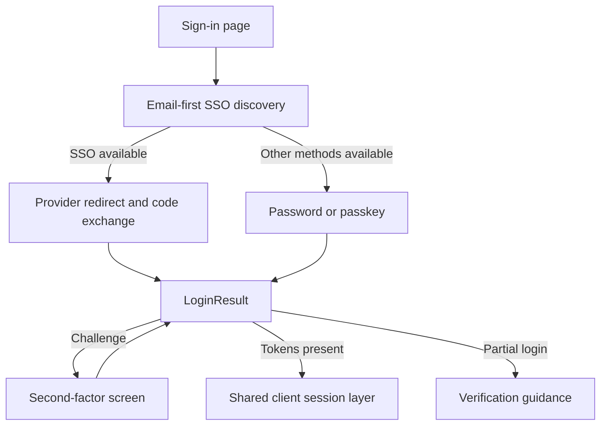

# Frontend Identity integration

A frontend coordinates password, SSO and passkey sign-in, then hands successful sessions to one shared token-management layer.

## At a glance

| Client concern | Canonical reference |
|---|---|
| Session storage, response envelope, refresh and logout | [JWT frontend guide](jwt/JWT-AUTH-FRONTEND-GUIDE.md) |
| Refresh timing and concurrency | [Token refresh strategies](jwt/TokenRefreshStrategies.md) |
| Enterprise connection setup and enforcement | [Enterprise SSO](Enterprise-SSO.md) |
| WebAuthn server configuration and lifecycle | [Passkeys](Passkeys.md) |
| MFA enrollment and challenges | [Permissions and 2FA](Permissions-2FA-and-Admin-Audit.md) |
| Routes and endpoint authorization | [Users and admins API](Users-and-Admins-API.md) |

The server contracts live in `src/Modules/Identity/Identity.Contracts/Auth`, `Sso` and `Passkeys`.
HTTP-specific request records live beside their Carter modules.

## How it works


*Figure: Different sign-in methods converge on the same session result rather than separate token stores.*

### Email-first sign-in

1. POST `/api/auth/sso/discover` with `email`.
2. Inspect the response envelope's `data.ssoAvailable`, `data.ssoRequired` and `data.connectionId`.
   Offer SSO when available; when required, do not offer password as a bypass.
3. Navigate to `/api/auth/sso/{connectionId}/start` with URL-encoded `returnUrl` and optional `loginHint`.
   The frontend return origin must be in `Identity:Sso:AllowedReturnOrigins`.
4. Without available SSO, offer the enabled password/passkey methods. The server still enforces policy at sign-in;
   discovery is not an authorization decision.

### The return page

The frontend owns its chosen return route (for example `/auth/sso`); it is not an API callback endpoint.
Read `sso_error` or `sso_code` from the query, remove them from browser history, and immediately POST
`/api/auth/sso/exchange` with `code`. Never persist or log the exchange code.

The code is single-use and expires after `Identity:Sso:ExchangeCodeLifetimeSeconds` (base default 60).
An exchange returns the normal login result: handle `requiresTwoFactor` before storing tokens.
Do not treat redirects or SAML metadata responses as JSON envelopes. A password/passkey response with
403 and `errorCode: sso_required` redirects the UI to the SSO flow rather than repeatedly retrying credentials.

### Passkeys

Feature-detect the WebAuthn JSON helpers and conditional mediation in the supported browser set; older browsers
need a compatible conversion layer. Do not alter the challenge or relying-party data returned by the server.

**Sign in:**

1. POST `/api/auth/passkeys/assertion/options`.
2. Parse `data.optionsJson` as JSON, then use `PublicKeyCredential.parseRequestOptionsFromJSON`.
3. Pass the result to `navigator.credentials.get`. Conditional mediation supports autofill beside an input with
   `autocomplete="username webauthn"`; a button can use the ordinary interactive call.
4. POST `/api/auth/passkeys/assertion` with `ceremonyId` and `credential` from `credential.toJSON()`.
5. Process the returned login result. User verification counts as MFA; do not assume every custom passkey
   configuration guarantees it. The default server configuration requires user verification.

**Add a passkey while signed in:**

1. POST `/api/auth/passkeys/registration/options`. On `reauthentication_required`, sign in again.
2. Parse `data.optionsJson` with `PublicKeyCredential.parseCreationOptionsFromJSON`.
3. Call `navigator.credentials.create`.
4. POST `/api/auth/passkeys/registration` with `ceremonyId`, the credential JSON object and an optional name.
   The server takes the owner from the authenticated caller, not a body-supplied user id.

List with GET `/api/auth/passkeys`; rename with PATCH and delete with DELETE `/api/auth/passkeys/{id}`.
The id is a base64url credential id. Display `isBackedUp` as synced; `isBackupEligible` describes eligibility,
not proof of a completed backup.

Use a secure browser context (HTTPS in deployment; loopback development exceptions are browser-defined).
The origin must be allowed by Identity and its host must match the relying-party domain or a valid subdomain.
Native apps need platform association files at `/.well-known/apple-app-site-association` and
`/.well-known/assetlinks.json`, served by the frontend on that domain. They are not Identity endpoints.

### Confirmation, reset and account security

Confirmation links target the frontend's `/confirm-email` with `userId` and `token`; POST both to
`/api/auth/email/confirm`. The signed-in resend endpoint takes no target user. The
[Identity overview](README.md#email-confirmation) owns confirmation lifetimes and stamp invalidation.

Forgot-password takes `identifier`. For confirmed email, the frontend `/reset-password` link carries `userId`
and `token`. For verified phone, submit `phoneNumber` and `otpCode` to `/api/auth/verify-reset-otp`, then use
the returned `userId` and `resetToken`. Complete `/api/auth/reset-password` with `token`, `newPassword`
and `confirmPassword`, identifying the account by `userId` or `email`. Do not reveal account existence from
the generic forgot-password result.

Profile export, account erasure, API-key and device-management screens use the
[endpoint reference](Users-and-Admins-API.md). Make one-time key secrets and recovery codes visible only at issuance.
Provide an explicit impersonation indicator and suppress restricted actions; the server remains authoritative.

## Configuration

Client-facing keys come from `src/Api/appsettings.json` and Identity's `Options/SsoOptions.cs`,
`PasskeyOptions.cs` and `LoginPolicyOptions.cs`. Configure deployment origins explicitly; the base configuration
uses development origins. Provider settings and full defaults remain in [SSO](Enterprise-SSO.md) and
[Passkeys](Passkeys.md).

| Key | Default | Meaning |
|---|---|---|
| `Identity:Sso:ExchangeCodeLifetimeSeconds` | `60` | Time to exchange the frontend return code |
| `Identity:Passkeys:CeremonyTimeoutMinutes` | `5` | Time to complete a registration/assertion ceremony |
| `Identity:Passkeys:FreshAuthMinutes` | `15` | Maximum authentication age for registration |
| `LoginPolicy:RequirePhoneVerification` | `false` | Login completion requirement |
| `LoginPolicy:RequireEmailVerification` | `false` | Login completion requirement |
| `LoginPolicy:RequireProfileCompletion` | `false` | Login completion requirement |
| `LoginPolicy:AllowPartialLogin` | Base `true`; options fallback `false` | Allow a result with user information but no tokens |

Set `Identity:Sso:AllowedReturnOrigins`, `Identity:Passkeys:AllowedOrigins`,
`Identity:Passkeys:ServerDomain`, `EmailConfirmation:FrontendBaseUrl` and `PasswordReset:FrontendBaseUrl`
to match the deployed frontend. When a verification requirement is unmet, `AllowPartialLogin=true` returns no tokens;
with it false, `LoginCompletionService` still issues tokens and includes the completion message. These flags are not
a substitute for endpoint authorization. Configure API CORS separately; see [request lifecycle](../Architecture/Request-Lifecycle.md).

## Usage

The options response is defined in `src/Modules/Identity/Identity.Contracts/Passkeys/PasskeyContracts.cs`:

```csharp
public sealed record PasskeyOptionsResult(string CeremonyId, string OptionsJson, DateTime ExpiresAt);
```

The HTTP assertion request, from
`src/Modules/Identity/Identity/Domains/Passkeys/Features/PasskeyLogin/PasskeyLoginModule.cs`:

```csharp
public record CompletePasskeyLoginRequest(string CeremonyId, System.Text.Json.JsonElement Credential);
```

`optionsJson` is a JSON string; `credential` is a JSON object. Do not send a double-encoded credential string.
Unwrap `ApiResponse.data` once in the client transport and make that convention consistent across all sign-in methods.

## Failure modes and guarantees

- SSO codes and passkey ceremonies are single-use. A lost response is ambiguous; restart the flow instead of
  repeatedly submitting the same proof.
- Browser cancellation is not a server authentication failure. Offer another configured sign-in method.
- `sso_required` and `reauthentication_required` are 403 error codes with different recovery actions.
- Deleting the last sign-in method returns 409 with `errorCode: last_sign_in_method`.
- MFA-only authorization failure uses `X-Auth-Error: mfa_required` and `errors[]`, not an `errorCode` property.
- Permission claims returned for the UI are hints for display, not client-side authorization.

Use [Errors and responses](../Architecture/Errors-and-Responses.md) for the envelope and
[JWT frontend guide](jwt/JWT-AUTH-FRONTEND-GUIDE.md) for session failure handling.

## Guardrails

`PasskeyServiceTests`, `PasskeyCeremonyStoreTests`, `ExternalLoginTwoFactorTests` and `LoginHandlerTests` cover server-side sign-in behavior.
Client verification must also exercise browser cancellation, expired/reused ceremonies, invalid return origins,
MFA challenges, partial login and shared-session coordination. Server tests do not validate a product's browser UI.

## Related

[Enterprise SSO](Enterprise-SSO.md), [Passkeys](Passkeys.md), [Bot protection](Bot-Protection.md),
[JWT frontend guide](jwt/JWT-AUTH-FRONTEND-GUIDE.md),
[ADR-0013](../Decisions/0013-enterprise-sso-and-scim.md),
[ADR-0014](../Decisions/0014-passkeys-on-built-in-identity.md); `/starterkit:add-feature`, `/starterkit:write-tests`.
