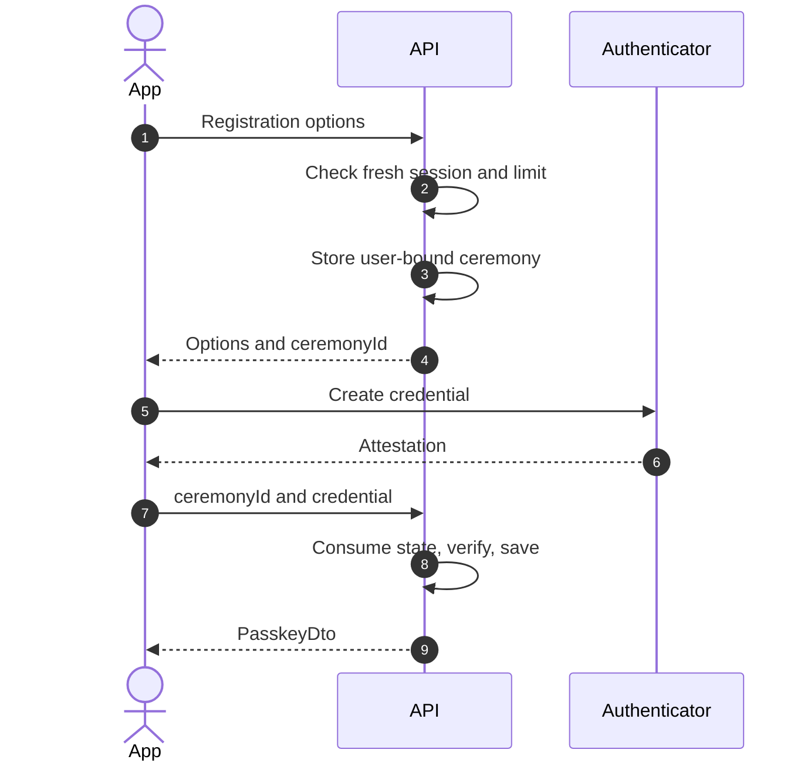
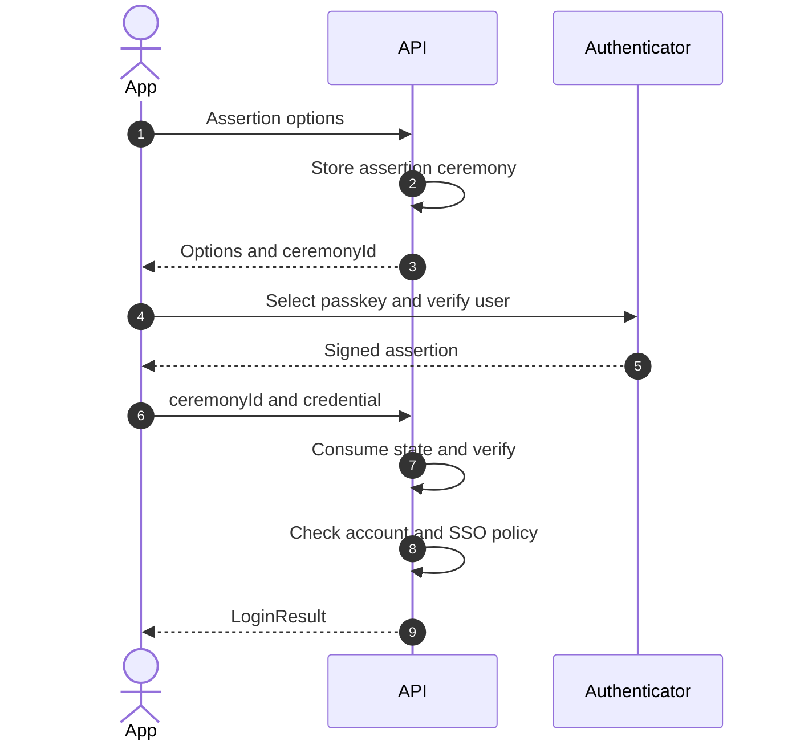

# Passkeys (WebAuthn)

Passkeys provide passwordless WebAuthn authentication through ASP.NET Core Identity's verifier, with server-side ceremonies and application token sessions for SPA and mobile clients.

## At a glance

| Responsibility | Main types / source |
|---|---|
| Cryptographic verification adapter | `IPasskeyService` / `PasskeyService` over built-in `IPasskeyHandler<ApplicationUser>` |
| Single-use state | `IPasskeyCeremonyStore` / `DistributedCachePasskeyCeremonyStore` in `Services/Passkeys/PasskeyCeremonyStore.cs` |
| WebAuthn settings | `PasskeyConfiguration`, `Options/PasskeyOptions.cs` |
| Registration and credential management | `Domains/Passkeys/Features/MyPasskeys/` |
| Sign-in | `Domains/Passkeys/Features/PasskeyLogin/` |

All implementation paths above are under `src/Modules/Identity/Identity/`.
Platform authenticators (Touch ID, Face ID, Windows Hello, Android) and synced passkeys (iCloud Keychain,
Google Password Manager, 1Password) use the same WebAuthn protocol. The server does not restrict authenticator models.

## How it works

`IPasskeyService` is the only application boundary to the built-in .NET 10 `IPasskeyHandler<ApplicationUser>`.
The handler verifies challenge, origin, RP ID, signature, signature counter and backup flags. StarterKit adds
ceremony storage, ownership checks, registration step-up and credential management. There is no cookie-based
passkey flow: the client submits a `ceremonyId` alongside the serialized browser credential.

### Registration ceremony


*Figure: Registration options require recent authentication; completion consumes the user-bound state before verifying and storing the credential.*

The options handler checks the current refresh-token family and its original sign-in time against
`FreshAuthMinutes`; refreshing a token does not reset that time. It also checks `MaxPasskeysPerUser`.
These checks occur when options are issued, not again at completion. A ceremony is a random 128-bit id in the
distributed cache, bound to its kind and, for registration, the user. State is consumed before verification,
so even a failed verification needs new options. `IOneTimeUseGuard` provides Redis atomic replay protection
across instances; its non-Redis implementation is process-local.

### Sign-in ceremony


*Figure: Usernameless sign-in verifies the assertion before account, SSO and session-completion checks.*

`PasskeyConfiguration` sets user verification and discoverable credentials to `required`, enabling
usernameless sign-in and conditional UI/autofill. Attestation is `none`, avoiding device attestation identifiers.
A user-verified assertion counts as MFA (`amr=mfa`). If user verification is relaxed in application code,
a presence-only assertion does not count as MFA and an account with TOTP receives a challenge.
[Permissions, 2FA and audit](Permissions-2FA-and-Admin-Audit.md) owns the privileged-role policy;
[Identity](README.md) owns the common session model.

The service attempts to persist updated signature counters and backup state after assertion verification.
A failed Identity update result is logged; it does not itself reject sign-in. Locked or inactive accounts are
refused, and `ISsoEnforcementPolicy` blocks passkeys for enforced SSO domains.

### Credential storage and management

A credential already owned by another account cannot be rebound. Rename/delete of an unknown or foreign id
returns 404. Deletion refuses the account's last sign-in method: there must be a password, another passkey or a
linked external/SSO login. Adding/removing sends a `SecurityAlert` email; add, rename and remove record
`passkey.added`, `passkey.renamed` and `passkey.removed` in Identity audit. Adding preserves existing sessions.

Storage: `identity.user_passkeys` (Identity schema v3, `IdentitySchemaVersions.Version3`), mapped explicitly in
`ApplicationIdentityDbContext`. Rows cascade with the user (account erasure).

> **Deploy note.** Schema v3 also limits `user_logins.login_provider` and the `user_tokens` keys to 128 characters
> and `users.phone_number` to 256 (migration `AddEnterpriseIdentity`; `user_logins.provider_key` is kept at 256 for
> long IdP subjects). Check custom data before migrating a long-lived database.

## Configuration

Keys are under `Identity:Passkeys`. Sources: `Options/PasskeyOptions.cs`, `PasskeyConfiguration.cs`
and `src/Api/appsettings.json`. The table distinguishes options fallbacks from configured development values.

| Key | Default | Meaning |
|---|---|---|
| `Enabled` | `true` | Disabled handlers return 404 `passkeys_disabled`; endpoint auth/validation can reject first |
| `ServerDomain` | Options null; base `localhost` | RP ID, a domain without scheme or port; unset uses the request host |
| `AllowedOrigins` | Options `[]`; base `["http://localhost:3000"]` | Empty uses the built-in API-origin rule; configured origins are exact scheme/host/port values |
| `CeremonyTimeoutMinutes` | `5` | Clamped to 1?15; ceremony and authenticator timeout |
| `FreshAuthMinutes` | `15` | Recent sign-in window when registration options are issued; minimum 1 |
| `MaxPasskeysPerUser` | `10` | Checked before creation options are issued |

Changing the RP ID orphans credentials bound to the previous one. Docker settings provide an example-domain
RP ID and frontend origin; replace them for deployment. Cross-origin iframes are refused by the configured-origin
validator. Origins describe frontend pages, not callback URLs.

## Usage

From `src/Modules/Identity/Identity/Services/Passkeys/PasskeyConfiguration.cs`:

```csharp
options.UserVerificationRequirement = "required";
```

### API

| Method | Route | Auth | Purpose |
|---|---|---|---|
| POST | `/api/auth/passkeys/registration/options` | user, fresh session, no API key, no impersonation | creation options + `ceremonyId` |
| POST | `/api/auth/passkeys/registration` | user, no API key, no impersonation | `{ ceremonyId, credential, name? }` → `PasskeyDto` |
| GET | `/api/auth/passkeys` | user, no API key | my passkeys |
| PATCH | `/api/auth/passkeys/{id}` | user, no API key, no impersonation | rename |
| DELETE | `/api/auth/passkeys/{id}` | same | remove (409 `last_sign_in_method`) |
| POST | `/api/auth/passkeys/assertion/options` | anonymous, `auth` rate limit | request options + `ceremonyId` |
| POST | `/api/auth/passkeys/assertion` | anonymous, `auth` rate limit | `{ ceremonyId, credential }` → `LoginResult` (MFA session) |

`credential` is the browser's `PublicKeyCredential` serialized with `credential.toJSON()`. `id` in the DTO is the
base64url credential id. Browser code: [Frontend integration](Frontend-Integration.md#passkeys).

Both registration POSTs and assertion POSTs use the `auth` rate-limit policy. Freshness is checked on
`registration/options` only. Passkey management returns the caller's own credentials.

## Failure modes and guarantees

| Condition | Response / guarantee |
|---|---|
| Invalid, expired, wrong-user or replayed registration state; failed attestation | 400 `passkey_invalid` |
| Invalid/expired assertion state or failed assertion | 401; no dedicated passkey `errorCode` |
| Options requested without a recent known session | 403 `reauthentication_required` |
| Options requested at the credential limit | 409 `passkey_limit_reached` |
| Removing the last sign-in method | 409 `last_sign_in_method` |
| Unknown/foreign credential | 404 |
| Disabled feature | 404 `passkeys_disabled` when the handler checks availability |
| SSO required | 403 `sso_required` |

Single-use ceremonies are not retry-idempotent: after a consumed or expired id, obtain fresh options.
The count check at options issuance is not a concurrency-safe quota on completion. A stored credential cannot
be moved to another account, but deletion does not retain a permanent credential-id tombstone.
See [request lifecycle](../Architecture/Request-Lifecycle.md) for authorization/filter ordering and shared errors.

## Guardrails

`PasskeyCeremonyStoreTests`, `PasskeyServiceTests`, `PasskeyConfigurationTests` and `DeletePasskeyHandlerTests`
are the actual classes in `src/Modules/Identity/Identity.Tests/Passkeys/PasskeyTests.cs`. They cover single use,
step-up, limits, account binding, option mapping and last-method protection.
`PasskeyE2ETests` in `src/Api.E2ETests/Identity/PasskeyE2ETests.cs` uses a software authenticator with real
ES256 signatures and the real verifier: registration, MFA sign-in, replay, forged signatures, foreign origins,
cross-account ceremonies, ownership, last method, deactivated accounts and API-key restrictions.
`AdminEndpointAuthorizationTests` enforces explicit endpoint authorization.

## Related

[Identity](README.md), [Enterprise SSO](Enterprise-SSO.md),
[Permissions, 2FA and audit](Permissions-2FA-and-Admin-Audit.md),
[Frontend integration](Frontend-Integration.md#passkeys),
[ADR-0014](../Decisions/0014-passkeys-on-built-in-identity.md);
Backlog reference: G16.
`/starterkit:add-feature`,
`/starterkit:write-tests`.
