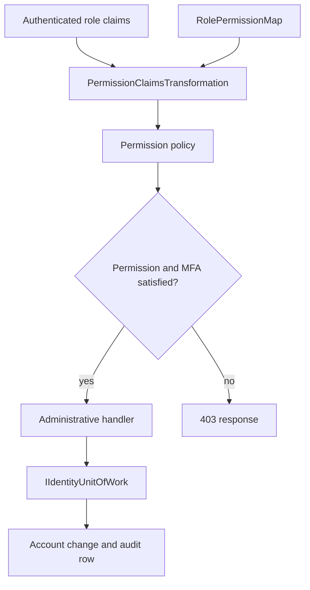

# Permissions, two-factor authentication and admin audit

Identity combines role-derived permissions, privileged-session MFA and transactional audit records to control and trace administrative actions.

## At a glance

| Concern | Source |
|---|---|
| Platform grants | `src/Shared/Shared.Core/Authorization/RolePermissionMap.cs` |
| Permission policies and MFA | `src/Modules/Identity/Identity/Authorization/` |
| TOTP, recovery codes, replay protection | `src/Modules/Identity/Identity/Services/TwoFactor/` |
| Admin hierarchy | `IRoleHierarchyGuard` |
| Audit persistence | `AdminActionAuditLog`, `IIdentityAuditWriter`, `AuditedCommandTransactionBehavior` |
| Key-ring encryption | `IdentityDataProtectionExtensions`, `DataProtectionKeyOptions` |

Seeded role ids and the authentication schemes are canonical in [Identity](README.md).
Routes and endpoint restrictions are canonical in [Users and admins API](Users-and-Admins-API.md).

## How it works

### Roles and permissions


*Figure: Authorization gates the handler before account changes and their audit record commit together.*

`PermissionClaimsTransformation` derives permissions per request; `JwtTokenGenerator` does not expand role
permissions into tokens. Changes to the code map apply to live principals on the next request. Role assignment
changes instead revoke the user's sessions through `ISessionRevoker`, requiring a fresh login.

| Role | Grants from `RolePermissionMap` |
|---|---|
| SuperAdmin | All platform permissions and all tenant permission claims |
| Admin | All platform permissions except `admins.manage`, `outbox.manage`, `feature-flags.manage`; all tenant permission claims |
| Finance | `billing.read`, `billing.approve`, `billing.refund`, `billing.export`, `billing.coupons.manage`, `plans.manage`, `payment-settings.manage`, `audit.read` |
| Support | `billing.read`, `users.read`, `tenants.read`, `tenants.impersonate`, `sessions.manage` |
| User / unknown role | No platform grants |

Tenant permission claims from platform roles are honored only in single-tenant mode. In multi-tenant mode,
membership permissions govern tenant access. Cache invalidation and its limits belong to
[Multi-tenancy](../MultiTenancy/Overview.md).

Identity registers `perm:<permission>` policies through `AddIdentityAuthorizationPolicies`. Each requires an
authenticated principal, the permission and MFA where required. `AdminOnly` and `SuperAdminOnly` also apply MFA.
Use `.RequirePermission(Permissions.X)` for platform endpoints.

Granting or revoking Admin, SuperAdmin, Finance or Support is SuperAdmin-only. An Admin manages ordinary users,
never staff; the hierarchy guard also prevents self-targeting. Assign, revoke, promote and demote end target
sessions; creating an admin has no existing sessions to revoke. Keep Identity's role names and
`Shared.Core.Authorization.RoleConstants` synchronized.

### Two-factor authentication

### Building blocks

- **TOTP:** ASP.NET Identity's built-in `AuthenticatorTokenProvider`; this module adds no custom TOTP code.
- **Authenticator key:** stored encrypted with ASP.NET Data Protection by `ProtectedUserStore` (purpose
  `Identity.TwoFactor.AuthenticatorKey.v1`).
- **Authenticator codes are single-use** (`ITotpReplayGuard`). The provider accepts a code for the current 30 s step
  and two steps either side (up to 150 s). After a code is ACCEPTED, the guard records `(user, SHA-256(user:code))`
  for `TotpReplayGuard.Window` (180 s). The same code is then refused for login verify, enable, disable and
  regenerate. On verify, disable and regenerate the refusal is a normal lockout strike.
  - Redis enabled: `SET key 1 PX 180000 NX`, atomic across instances. Redis disabled: the `IDistributedCache`
    fallback with a process-wide lock (exact for one instance, like the rest of the Redis-less mode).
  - Only a valid code is recorded, so a wrong guess never burns the next real code.
  - Fail closed: if Redis is unreachable the request fails (500, no strike) instead of silently skipping the check.
  - For clients and tests: two operations in the same 30 s step need two different codes (wait for the next code).
    Tests use `Totp.Code(key, stepsAhead)` with increasing offsets.
- **Recovery codes:** stored only as salted SHA-256 hashes. Each code works once, also under concurrency: redeeming
  rewrites the user row, and its concurrency stamp makes a parallel second redemption fail
  (`ReplayAndRoleChangeTests.Parallel_redemption_of_one_recovery_code_succeeds_exactly_once`).
- **Data Protection key ring:** persisted in `identity.data_protection_keys` (`DataProtectionKeyRepository`), so all
  instances share it and it survives redeploys. Losing the key ring makes every authenticator key unreadable.
  For at-rest encryption see the next section.

### Endpoints for the signed-in user

| Endpoint | Body | Notes |
|----------|------|-------|
| `POST api/auth/2fa/setup` | – | Returns `sharedKey` and an `otpauth://` URI. The key is pending: 2FA stays off. |
| `POST api/auth/2fa/enable` | `{ code }` | Enables 2FA and returns the recovery codes (shown once). Revokes every session and returns a new MFA session. |
| `POST api/auth/2fa/disable` | `{ password, code }` | `code` can be an authenticator code or a recovery code. Removes the key and the codes, revokes every session, and returns a new non-MFA session. |
| `POST api/auth/2fa/recovery-codes/regenerate` | `{ code }` | Old codes stop working. |
| `POST api/auth/2fa/verify` | `{ challengeToken, code }` or `{ challengeToken, recoveryCode }` | Second login step. The anonymous `auth` rate limit applies. A code already accepted by any 2FA endpoint is refused. |
| `POST api/identity/users/{id}/2fa/reset` | `{ reason }` | SuperAdmin only (`admins.manage`). Removes the target's 2FA, ends all of their sessions, and is audited. |

### Login flow (client contract)

1. `POST api/auth/login` checks the password. If 2FA is off, the response is unchanged.
2. If 2FA is on, the response is `200` with `requiresTwoFactor: true`, `twoFactorChallengeToken` and
   `twoFactorChallengeExpiresAt`. `accessToken` and `refreshToken` are `null`.
   - The challenge token is an HS256 JWT signed with a key derived from the JWT secret, with audience
     `<audience>:2fa-challenge` and `token_use=2fa_challenge`. It is not an access token.
   - It expires after 5 minutes and is bound to the security stamp.
3. `POST api/auth/2fa/verify` returns the normal `LoginResult`.
   - The access token carries `amr: ["otp","mfa"]`.
   - The refresh-token row stores `multi_factor = true`, so refreshed tokens keep `amr=mfa`.
   - A self-service password change from an MFA session also keeps it.
4. Every wrong code adds a strike through Identity `AccessFailed`, and the account locks after
   `IdentitySettings:Lockout:MaxFailedAccessAttempts`.
   - Strikes are recorded outside the unit of work, so a rejected request cannot roll them back.
5. External login (Google/Facebook) is only the first factor. A user with 2FA enabled gets the same
   `requiresTwoFactor` + challenge response from the callback; `bypassTwoFactor` is gone.

### Impersonation

`StartImpersonationHandler` requires `tenants.impersonate` at the endpoint, subject to the configured MFA rule.
The feature switch must be enabled. The reason is 10?500 characters; requested duration is 1?60 minutes and is
capped by `MultiTenancy:Impersonation:MaxMinutes`. The actor cannot target themselves, another staff account,
an inactive/locked user or start from an existing impersonation. In multi-tenant mode, the target must have an
active membership in a serviceable tenant.

The result is an access-only token carrying `act`; permissions belong to the target. The handler records
`impersonation.started` and synchronously publishes `ImpersonationStartedEvent` so tenant audit failure aborts
issuance. This event is deliberately in-process, unlike the session/deletion integration events.

`ImpersonationGuardMiddleware` rejects unsafe methods on Identity's registered read-only assembly and host-only
endpoints, and every endpoint marked `.DisallowImpersonation()`. Safe means GET, HEAD or OPTIONS.
Logs carry `ImpersonatorId`; tenant audit also records the actor. A read-mostly support token is not a blanket
read-only guarantee for other modules: mark destructive and ownership endpoints explicitly.

### Identity admin audit (`identity.admin_action_audit_logs`)

- **Shape:** admin id, action, target type and id, reason, `before_json` / `after_json` (jsonb), IP, user agent,
  correlation id, `occurred_at`.
  - The table is append-only: `ApplicationIdentityDbContext` refuses to update or delete a row.
- **Never stored:** passwords, hashes, security stamps, keys, codes or tokens.
  - User changes use `UserAuditSnapshot`; other actions use bounded metadata snapshots. A test rejects credential-like fields in the user snapshot.
- **Actions:**
  - `user.edited`, `user.locked`, `user.unlocked`, `user.status_changed`, `user.deleted`
  - `role.assigned`, `role.revoked`
  - `admin.promoted`, `admin.demoted`, `admin.created`, `admin.updated`, `admin.password_changed`
  - `2fa.enabled`, `2fa.disabled`, `2fa.reset`, `2fa.recovery_codes_regenerated`, `2fa.recovery_code_used`
- **Same unit of work:**
  - Commands that implement `Identity.Contracts.Audit.IAuditedCommand` run inside `IIdentityUnitOfWork` through the
    `AuditedCommandTransactionBehavior`. The transaction covers every UserManager save and the audit row.
  - Handlers record with `IIdentityAuditWriter.Record(...)`.
  - The 2FA disable, regenerate and verify handlers check credentials first, then run `IIdentityUnitOfWork` explicitly.
    This keeps lockout strikes from being rolled back.
- **Read:** `GET api/v1/admin/identity/audit` requires `audit.read`. It is paged and newest first, with filters
  `adminId`, `action`, `targetType`, `targetId`, `from`, `to`.


Additional actions include `account.erased`, `impersonation.started`, `session.revoked`, `api_key.revoked`, and `passkey.added` / `passkey.renamed` / `passkey.removed` (`IdentityAuditActions`).

## Configuration

Defaults come from `src/Api/appsettings.json`, `Options/TwoFactorOptions.cs` and `Options/DataProtectionKeyOptions.cs` under Identity. Data Protection table keys are relative to `Identity:DataProtection`; MFA keys are fully qualified.

### MFA enforcement

| Config key | Default | Meaning |
|------------|---------|---------|
| `Identity:TwoFactor:RequiredForRoles` | `["SuperAdmin","Admin","Finance"]` | Callers with any of these roles need an MFA session on `perm:*` / `AdminOnly` / `SuperAdminOnly` policies. `[]` turns the rule off. |
| `Identity:TwoFactor:EnforcementMode` | `Enforce`, except `Warn` in Development/Testing | `Enforce`: the request gets `403`. `Warn`: the request is allowed and logged, and the response gets an `X-Auth-Error: mfa_required` header. |
| `Identity:TwoFactor:ChallengeTokenLifetimeMinutes` | `5` | Clamped to the range 1–15. |
| `Identity:TwoFactor:RecoveryCodeCount` | `10` | Clamped to the range 5–20. |
| `Identity:TwoFactor:Issuer` | `StarterKit` | Label shown in authenticator apps. |

When the only reason for a 403 is the MFA rule, the response is:

```json
HTTP/1.1 403
X-Auth-Error: mfa_required
{ "isSuccess": false, "statusCode": 403, "errors": ["mfa_required", "Two-factor authentication is required ..."] }
```

A missing permission is always a plain 403, never `mfa_required`.

**Rollout:** deploy with `EnforcementMode=Warn`. Have each admin enroll, watch the warnings, then switch to
`Enforce`.

### Data Protection key ring (`Identity:DataProtection`)

Registered by `IdentityDataProtectionExtensions.AddIdentityDataProtection`.

| Key | Default | Meaning |
|-----|---------|---------|
| `ApplicationName` | `StarterKit` | `SetApplicationName`: the discriminator every instance shares. See the warning below. |
| `KeyEncryption` | inferred | `None`, `Certificate`, `AzureKeyVault` or `AwsKms`. When unset: certificate, then Azure Key Vault, then AWS KMS if configured, otherwise None. |
| `RequireKeyEncryption` | `false` | Outside Development/Testing: `false` starts and logs a startup **warning** when keys are unencrypted; `true` refuses to start. |
| `Certificate:Thumbprint` | – | Certificate (with private key) in `Certificate:StoreLocation`/`StoreName` (default `CurrentUser`/`My`). Wins over `Path`. |
| `Certificate:Path` | – | PFX file, e.g. `/run/secrets/dataprotection_cert.pfx`. |
| `Certificate:Password` | – | PFX password. Docker secret `dataprotection_cert_password`. |
| `Certificate:PreviousPaths` | Base `[]`; options null | Old PFX files retained for decryption (same password). |
| `AzureKeyVault:KeyIdentifier` | null | HTTPS wrapping-key identifier; required for Azure mode |
| `AzureKeyVault:TenantId`, `AzureKeyVault:ClientId`, `AzureKeyVault:ClientSecret` | null | All three select client-secret credentials; otherwise use `DefaultAzureCredential` |
| `AwsKms:KeyId` | null | Key id, ARN or alias; required for AWS mode |
| `AwsKms:Region` | null | Default AWS region unless explicitly set |

- **`ApplicationName` is permanent.** Payloads protected under another name (authenticator keys, open reset links)
  become unreadable. Before this setting existed, the discriminator was derived from the content root (`/app` in the
  container). An existing deployment with enrolled 2FA users must set `ApplicationName` to that old value, or have
  its users re-enroll.
- **Certificate mode** calls `ProtectKeysWithCertificate(current)` and
  `UnprotectKeysWithAnyCertificate(current, previous...)`. A PFX-loaded certificate is not in the machine store, so it
  must be registered for decryption explicitly. The certificate is loaded at registration: a missing file, a wrong
  password or a certificate without a private key stops startup.
- **Existing unencrypted keys** stay readable after encryption is turned on; only new keys are encrypted. The old
  keys remain needed to decrypt payloads protected with them; expiry of a key for new protection does not make old payloads unreadable.
- **Why the default is warn, not fail.** The key ring lives in the same database as the data it protects, so the
  certificate protects against a database-only leak (dump, backup, read replica), not against a full host compromise.
  Failing by default would break every existing deployment and every fresh deploy that has no certificate yet. The
  production overlay `docker-compose.dataprotection.yml` mounts the PFX and sets `RequireKeyEncryption=true`, so a
  stack that opts in cannot silently fall back to unencrypted keys.
- **KMS:** built-in Azure Key Vault and AWS KMS adapters are selected with `KeyEncryption`. Azure uses `AzureKeyVault:KeyIdentifier` and managed/default credentials or explicit client credentials; AWS uses `AwsKms:KeyId`, optional `AwsKms:Region` and the default credential chain. AWS encryption context is bound to the application name.
- **Rotation:** issue a new PFX, set it as `Certificate:Path`, add the old one to `Certificate:PreviousPaths`, and
  retain it while any protected payload still needs its keys. `deployment/secrets-setup.sh` never overwrites an existing PFX.
- **Back up the PFX** with the database: a restored database cannot read any encrypted key without it.


| Key | Default | Meaning |
|---|---|---|
| `MultiTenancy:Impersonation:Enabled` | `true` | Enable support impersonation |
| `MultiTenancy:Impersonation:MaxMinutes` | `30` | Upper lifetime bound for issued support tokens |

## Usage

From `src/Modules/Identity/Identity/Domains/Audit/Features/GetIdentityAuditLog/GetIdentityAuditLogEndPoint.cs`:

```csharp
.RequirePermission(Permissions.AuditRead)
.RequireRateLimiting("search")
```

To add a permission, add a stable constant to `Permissions` and `Permissions.All`, grant it in
`RolePermissionMap`, and use `.RequirePermission(...)` on the endpoint. Policy registration enumerates
`Permissions.All`; it needs no separate manual policy entry. Follow `/starterkit:add-permission`.

To audit a new command, implement `IAuditedCommand`, add a stable action to `IdentityAuditActions` and call
`IIdentityAuditWriter.Record` with sanitized snapshots. Credential verification that records lockout strikes
must happen outside the transaction that may roll back. Follow `/starterkit:add-feature`.

## Failure modes and guarantees

| Condition | Response / guarantee |
|---|---|
| Missing permission | Plain 403; do not prompt for MFA as if it would grant a missing permission |
| Only MFA requirement fails in Enforce mode | 403, `X-Auth-Error: mfa_required`, first `errors[]` entry `mfa_required`; not an `errorCode` field |
| MFA missing in Warn mode | Request allowed, warning logged and the same header set |
| API key on `.DisallowApiKey()` | 403 with `errorCode: api_key_restricted` |
| Impersonation restriction | 403 with message identifier `impersonation_restricted`; not a dedicated `errorCode` |
| TOTP replay store unavailable | Fails closed (500), no lockout strike for infrastructure failure |
| Audit transaction fails | Account change rolls back; impersonation does not return a token |
| Data Protection key ring or decryption key lost | Existing protected authenticator secrets and links cannot be recovered from configuration alone |

See [Errors and responses](../Architecture/Errors-and-Responses.md) for the shared envelope.
These operations are not generally idempotent: recovery codes and TOTP codes are consumed; a second submission
must not be treated as a retry with an equivalent result.

## Guardrails

`RolePermissionMapTests`, `RoleHierarchyTests`, `PermissionPolicyTests`, `PermissionClaimsTransformationTests`
and `AdminEndpointAuthorizationTests` check grants, boundaries and explicit policies.
`TotpReplayTests`, `ReplayAndRoleChangeTests`, `AdminAuditTests`, `DataProtectionKeyEncryptionTests` and
`DataProtectionKmsTests` cover replay, session invalidation, audit and key protection.

E2E `TestAuthHandler` derives permissions from `X-Test-Roles`; `X-Test-Permissions` overrides them and
`X-Test-Mfa: true` adds MFA. Without `X-Test-UserId`, real Bearer tokens use real JWT validation.
These are test-host facilities, not production headers.

## Related

[Identity](README.md), [Users and admins API](Users-and-Admins-API.md),
[JWT client contract](jwt/JWT-AUTH-FRONTEND-GUIDE.md), [Passkeys](Passkeys.md),
[ADR-0014](../Decisions/0014-passkeys-on-built-in-identity.md),
[Messaging](../Architecture/Messaging.md); `/starterkit:add-permission`, `/starterkit:write-tests`.
