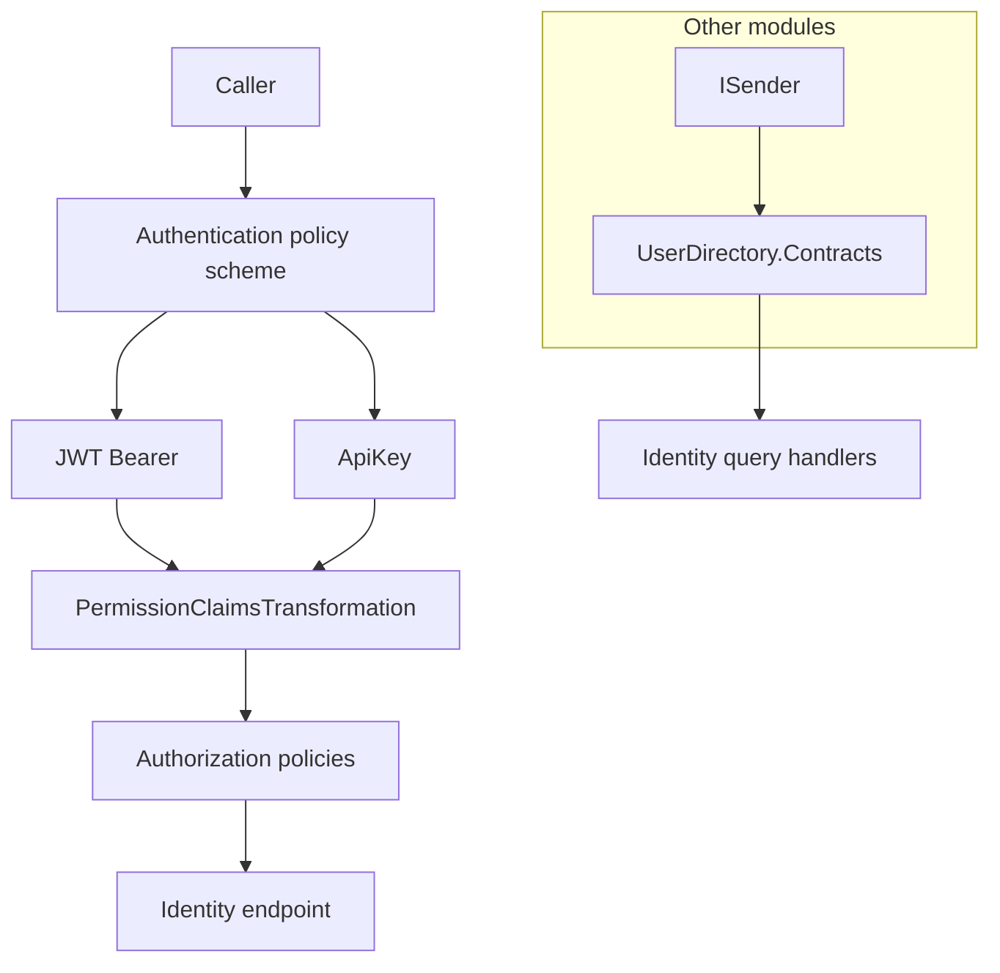

# Identity

Identity owns global user accounts and authentication, exposing a provider-neutral user directory so other modules do not depend on its implementation.

## At a glance

| Responsibility | Main types / location |
|---|---|
| Accounts, credentials, roles, onboarding and verification | `src/Modules/Identity/Identity/Domains/`; ASP.NET Core Identity `ApplicationUser` and `ApplicationRole` |
| Global persistence | `ApplicationIdentityDbContext`, schema `identity`; PostgreSQL stores accounts, refresh tokens, OTPs, API keys, audit and Data Protection keys |
| Authentication | `IdentityModule`, `JwtTokenGenerator`, `AuthSessionService`, `ApiKeyAuthenticationHandler` |
| Cross-module user access | `src/Modules/Identity/UserDirectory.Contracts`; queries through `ISender`, integration events through the outbox |
| Private workflows | `src/Modules/Identity/Identity.Contracts`; only Identity and the host may reference it |
| Authorization | `src/Shared/Shared.Core/Authorization`; Identity registers permission and MFA policies |

`ApplicationIdentityDbContext` maps `identity.users`, `roles`, `user_roles`, `user_claims`, `role_claims`,
`user_logins`, `user_tokens` and `user_passkeys`; dedicated configurations map refresh tokens and other Identity records.

Identity stays global. Tenancy owns memberships, tenant roles and branches; see [Multi-tenancy](../MultiTenancy/Overview.md).
The [request lifecycle](../Architecture/Request-Lifecycle.md) owns middleware and mediator ordering.

## How it works


*Figure: Authentication feeds application authorization while other modules access users through the directory port.*

### Authentication and sessions

The `BearerOrApiKey` policy scheme selects `ApiKey` for `Authorization: ApiKey <key>` or `X-Api-Key: <key>`; an explicit
`Authorization: Bearer <token>` takes precedence. The JWT path validates signature, issuer, audience and lifetime,
then checks access-token, session and user-stamp revocation. `sid` identifies the refresh-token family, allowing
one device to be signed out. [JWT technical guide](jwt/JWT-AUTH-TECHNICAL-GUIDE.md) owns rotation, revocation,
claims, signing-key rotation, storage and lifetimes.

ASP.NET Core Identity manages password hashing and credentials. Redis accelerates revocation checks; it is not
the authoritative store for refresh sessions. Social login, passkeys and enterprise SSO complete authentication
through Identity; they do not give other modules access to Identity internals.

### Roles and permissions

Tokens carry platform roles; `PermissionClaimsTransformation` derives permissions through `RolePermissionMap`
on each request. Token issuance does not expand the map into permission claims. There is no platform role CRUD
API: roles are seeded, assigned and revoked; grants are code. Tenant permissions come from memberships in
multi-tenant mode, not JWT claims.

Seed identifiers from `src/Modules/Identity/Identity/Domains/Roles/Constants/RoleConstants.cs`:

| Role | Seeded id |
|---|---|
| User | `11111111-1111-1111-1111-111111111111` |
| Admin | `33333333-3333-3333-3333-333333333333` |
| SuperAdmin | `44444444-4444-4444-4444-444444444444` |
| Finance | `66666666-6666-6666-6666-666666666666` |
| Support | `77777777-7777-7777-7777-777777777777` |

The default MFA requirement covers SuperAdmin, Admin and Finance on permission/admin policies. Support is a staff
role but is not in that default list. A user-verified passkey counts as MFA. See
[Permissions, 2FA and audit](Permissions-2FA-and-Admin-Audit.md) for grants, enrollment, enforcement and role hierarchy.

### Impersonation and restricted endpoints

Support impersonation issues an access-only token with `act` identifying the actor, a mandatory reason and a bounded
lifetime; it cannot impersonate staff or create another impersonation. Identity and tenant audit writes must both
succeed before the token is returned. Identity writes are blocked while impersonating, and
`.DisallowImpersonation()` also blocks explicitly marked endpoints, including safe methods.
`.DisallowApiKey()` separately rejects API-key callers on interactive credential, session and key-management routes.
The [endpoint reference](Users-and-Admins-API.md) lists the declarations; [governance](Permissions-2FA-and-Admin-Audit.md)
owns the impersonation constraints.

### API keys (personal access tokens)

Keys have format `sk_<8-character prefix>_<secret>`. Creation returns the secret once; persistence stores its SHA-256
hash. Effective permissions are the owner's current permissions intersected with key scopes, including tenant
membership permissions where applicable. Creation cannot grant scopes the owner lacks. Locked, inactive or deleted
owners cannot authenticate with a key.

Key principals carry neither `ClaimTypes.Role` nor `is_admin`; owner roles use `ApiKeyClaimTypes.OwnerRole` solely
for permission derivation and the MFA gate. Role policies and Hangfire admin checks therefore do not accept a key
as an administrator. Keys have no `amr=mfa`, so owners subject to MFA enforcement cannot use them to satisfy that
requirement. Each key has its own rate-limit partition. Last-use writes are throttled.

### One-time codes (OTP)

Identity owns the application's ONE one-time-code system: `IOtpCodeService` (`Services/Otp`), stored in
`identity.otp_codes` (one row per user and `OtpPurpose`). Notification only delivers codes.

| Purpose | Used by | Delivery |
|---|---|---|
| `PhoneVerification` | `POST /api/identity/phone/send-verification` + verify; `/api/v1/notifications/verification/*` (PhoneVerification) | SMS (`ISmsService`) / WhatsApp |
| `PasswordReset` | `forgot-password` (phone) + `verify-reset-otp` | SMS (`ISmsService`) |
| `OnboardingPhoneVerification` | onboarding register / resend-otp / verify-phone, `OnboardingOtpRetryJob` | WhatsApp or email (`IOtpSender` → Notification `IOtpDeliveryService`) |
| `EmailVerification`, `TwoFactorLogin` | `/api/v1/notifications/verification/*` | Notification (WhatsApp or email) |

Guarantees:
- Codes from a CSPRNG; stored only as HMAC-SHA256(`Identity:OtpHmacKey` / secret `identity_otp_hmac_key`,
  `purpose:user:code`), so a code never verifies another user or purpose. Constant-time compare.
- **Issue** is one conditional `UPDATE` (or the first `INSERT`): the resend cooldown
  (`PhoneVerification:ResendCooldownSeconds`) and the send cap (`PhoneVerification:MaxSendsPerDay`, rolling 24h) are
  checked atomically, so parallel requests cannot both pass. A new code replaces (invalidates) the previous one and
  resets its attempts. Refusals throw `OtpRateLimitedException` (429, `Reason` = `Cooldown` / `SendCapReached`).
- **Verify** reserves an attempt atomically BEFORE comparing (`attempts < max_attempts`), so parallel guesses never
  exceed `MaxVerificationAttempts` (`PasswordReset:MaxOtpAttempts` for resets); a correct code is consumed by a
  compare-and-set, so parallel correct submissions succeed exactly once. The row is kept (cooldown + cap survive a
  successful verify).
- `ReleaseAsync` (delivery failed: invalidate that code, lift the cooldown, keep the cap) and `InvalidateAsync`
  (onboarding timeout). `IOtpSender` = issue + Notification delivery + release on failure, as a result (no throw).

### Email Confirmation

Email accounts start with `EmailConfirmed = false`. Forgot-password by email needs a confirmed email, so confirmation is
part of onboarding.

| Step | Endpoint | Auth |
|------|----------|------|
| Link sent automatically | on `POST /api/auth/register` (email) and when `complete-profile` adds an email to a phone account | – |
| Resend | `POST /api/auth/email/send-confirmation` (no body; always the caller) | signed in, `otp` rate limit |
| Confirm | `POST /api/auth/email/confirm` `{ "userId": "...", "token": "..." }` | anonymous, `auth` rate limit |

**Link and frontend:**
- The email links to `{EmailConfirmation:FrontendBaseUrl}/confirm-email?userId=..&token=..`.
- The frontend page posts both values to `/api/auth/email/confirm`.

**Tokens:**
- Tokens come from their own provider (`EmailConfirmationTokenProvider`), with their own Data Protection purpose and lifetime: `EmailConfirmation:TokenExpiryHours` (default 24h). Password-reset tokens stay short.
- Tokens are bound to the security stamp, so changing the email or password invalidates older links.
- Unknown user, wrong token and expired token all return the same 400.

**Other behaviour:**
- The automatic send is best effort; registration never fails because mail is down. Turn it off with `EmailConfirmation:SendOnRegister=false`.
- The `email_verified` claim in existing access tokens updates at the next refresh.
- Phone accounts carry a non-routable placeholder email. They get no confirmation mail until they add a real email.

## Configuration

Defaults below come from `src/Api/appsettings.json` and Identity's `Options/IdentityOptions.cs`,
`PhoneVerificationOptions.cs`, `EmailConfirmationOptions.cs`, `PasswordResetOptions.cs` and `ApiKeyOptions.cs`.
JWT and Data Protection settings belong to the [technical guide](jwt/JWT-AUTH-TECHNICAL-GUIDE.md#configuration)
and [governance guide](Permissions-2FA-and-Admin-Audit.md#configuration).

| Key | Default | Meaning |
|---|---|---|
| `IdentitySettings:Password:RequiredLength` | `8` | Minimum password length |
| `IdentitySettings:Password:RequireDigit`, `RequireLowercase`, `RequireUppercase`, `RequireNonAlphanumeric` | `true` each | Required character classes; all keys under the same Password section |
| `IdentitySettings:Password:RequiredUniqueChars` | `1` | Distinct characters required |
| `IdentitySettings:Lockout:MaxFailedAccessAttempts` | `5` | Failed-attempt threshold |
| `IdentitySettings:Lockout:DefaultLockoutTimeSpanMinutes` | `15` | Lockout duration |
| `IdentitySettings:Lockout:AllowedForNewUsers` | `true` | Enable lockout for new accounts |
| `IdentitySettings:User:RequireUniqueEmail` | `true` | Unique email requirement |
| `IdentitySettings:SignIn:RequireConfirmedEmail`, `RequireConfirmedPhoneNumber` | `false` each | Framework sign-in requirements |
| `PhoneVerification:CodeLength` | `6` | Numeric OTP length |
| `PhoneVerification:CodeExpirationMinutes` | `10` | OTP lifetime |
| `PhoneVerification:MaxVerificationAttempts` | `5` | Attempt cap |
| `PhoneVerification:ResendCooldownSeconds` | `60` | Minimum resend interval |
| `PhoneVerification:MaxSendsPerDay` | `10` | Rolling 24-hour send cap |
| `Identity:OtpHmacKey` | No production default | Stable shared secret; Development/Testing generate a per-process fallback |
| `EmailConfirmation:TokenExpiryHours` | `24` | Confirmation-token lifetime |
| `EmailConfirmation:SendOnRegister` | `true` | Best-effort automatic confirmation email |
| `PasswordReset:TokenExpiryHours` | `1` | Reset-link lifetime |
| `PasswordReset:OtpExpiryMinutes` | `15` | Reset OTP lifetime |
| `PasswordReset:MaxOtpAttempts` | `3` | Reset OTP attempt cap |
| `Identity:ApiKeys:Enabled` | `true` | Key authentication and creation switch |
| `Identity:ApiKeys:DefaultExpiryDays` | `90` | Default key lifetime |
| `Identity:ApiKeys:MaxExpiryDays` | `365` | Maximum requested lifetime |
| `Identity:ApiKeys:MaxActiveKeysPerUser` | `10` | Active-key cap |
| `Identity:ApiKeys:LastUsedWriteIntervalMinutes` | `5` | Last-use write throttle |

Set `EmailConfirmation:FrontendBaseUrl` and `PasswordReset:FrontendBaseUrl` to the deployed frontend origin.
See [Frontend integration](Frontend-Integration.md) for client flows and provider configuration.

## Usage

A provider-neutral query contract, from
`src/Modules/Identity/UserDirectory.Contracts/Queries/GetUserProfileQuery.cs`:

```csharp
public sealed record GetUserProfileQuery(Guid UserId) : IQuery<UserProfileDto?>;
```

Send this through `ISender`; unknown users return null. Do not reference `ApplicationUser`, the Identity DbContext
or `Identity.Contracts` from another module. [Replacing the provider](Replacing-the-Identity-Provider.md) lists
the complete port, including deletion and session-revocation events.

Use [database conventions](../Architecture/DatabaseConventions.md) for migrations; the context is
`ApplicationIdentityDbContext`, not `IdentityDbContext`.

## Failure modes and guarantees

- Login returns the same 401 for unknown accounts, bad passwords and lockout. A successful HTTP response can still
  require a second factor or represent partial login; clients must inspect the result.
- OTP issuance and attempt reservation are atomic. Consuming a correct code succeeds once; delivery failure lifts
  cooldown but preserves the send cap. `OtpRateLimitedException` maps to 429.
- Revocation cache failures can leave issued access tokens valid until expiry; refresh validity remains database-backed.
- API-key restrictions and impersonation restrictions return 403. These do not replace permission or ownership checks.
- Confirmation links are stamp-bound; invalid, unknown-user and expired confirmations share a 400 response.

For the envelope and the distinction between error strings and `errorCode`, use
[Errors and responses](../Architecture/Errors-and-Responses.md).

## Guardrails

`ModuleBoundaryTests` enforces the user-directory boundary. `AdminEndpointAuthorizationTests` requires explicit
endpoint authorization. `RolePermissionMapTests`, `PermissionClaimsTransformationTests`, `ApiKeyAuthenticatorTests`, `ApiKeyHandlerTests`,
`ApiKeyAuthorizationTests`, `AuthSessionServiceTests`, `SessionManagementTests` and `OtpCodeServiceTests` cover
runtime grants, key scope limits, rotation, sessions and OTP behavior.

## Related

- [Users and admins API](Users-and-Admins-API.md): every Identity Carter route and its authorization.
- [Permissions, 2FA and admin audit](Permissions-2FA-and-Admin-Audit.md): platform governance.
- [Replacing the Identity provider](Replacing-the-Identity-Provider.md): provider-neutral contracts.
- [Frontend integration](Frontend-Integration.md): sign-in orchestration, SSO and passkeys.
- [JWT technical guide](jwt/JWT-AUTH-TECHNICAL-GUIDE.md): server token lifecycle.
- [JWT frontend guide](jwt/JWT-AUTH-FRONTEND-GUIDE.md): client session contract.
- [Token refresh strategies](jwt/TokenRefreshStrategies.md): client scheduling and coordination.
- [Enterprise SSO](Enterprise-SSO.md), [SCIM](SCIM.md), [Passkeys](Passkeys.md), [Bot protection](Bot-Protection.md).
<!--#if (sample)-->
- [Catalog module](../Modules/Catalog.md): the reference module for new work.
<!--#endif-->
- [ADR-0007](../Decisions/0007-owned-mediator-port.md); `/starterkit:add-feature`, `/starterkit:add-permission`, `/starterkit:update-docs`.
