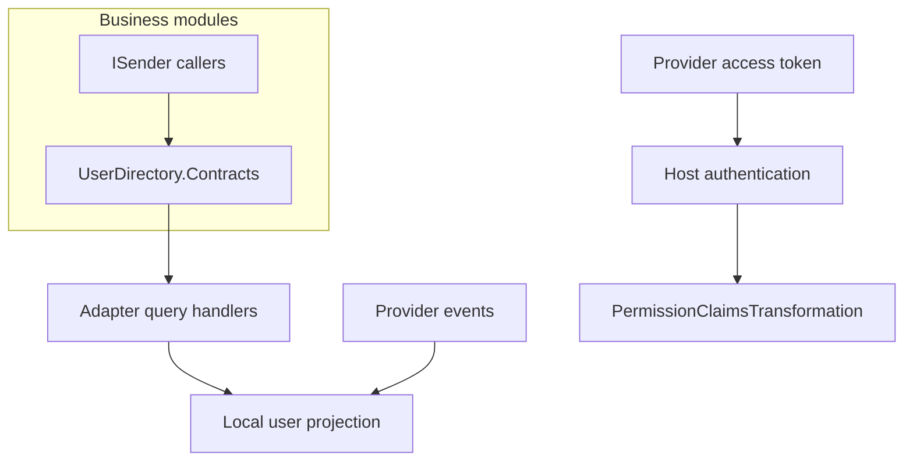

# Replacing the Identity provider

Replace the built-in Identity implementation behind stable user-directory and authentication contracts while keeping other modules independent of the chosen provider.

## Goal

Provide an adapter for an external identity provider without changing business-module user lookups, permission
checks or tenant membership ownership. This is an implementation checklist, not a bundled Keycloak, Entra ID
or Auth0 adapter.

## Prerequisites

- Read [module boundaries](../Architecture/Overview.md), [request lifecycle](../Architecture/Request-Lifecycle.md)
  and [Identity](README.md).
- Inventory callers of `UserDirectory.Contracts`, the host's Identity references and the frontend's Identity API usage.
- Define how existing Guid user ids, tenant memberships, audit references and financial references survive migration.
  Do not assume an external provider's subject is a Guid or equals an existing user id.
- Decide which built-in workflows remain: passwords, OTP, onboarding, API keys, sessions, impersonation, passkeys,
  SSO/SCIM and account erasure each need an explicit owner.

## Steps

### 1. Preserve the user-directory port

Keep `src/Modules/Identity/UserDirectory.Contracts` available even if replacing the sibling `Identity`
implementation. Deleting the entire Identity parent folder would delete the port that other modules need.

Implement every query in `UserDirectory.Contracts/Queries`:

| Contract | Required behavior |
|---|---|
| `GetUserSummariesQuery` | Batch display data; max 500 ids; omit unknown users |
| `GetUserIdsByEmailsQuery` | Max 500 emails; case-insensitive lookup and result map; omit unknown addresses |
| `GetUserProfileQuery` | One profile or null |
| `GetUserContactInfoQuery` | Contact DTO; both fields null when unknown |
| `GetUserRolesQuery` | Platform roles; empty for unknown users; used by background work |
| `GetUsersInRoleQuery` | Active users, oldest first; default 100, maximum 500 |
| `GetUserStatsQuery` | Total user count |
| `GetActiveSessionIdsQuery` | Active `sid` values; empty when unknown or signed out everywhere |

`UserSummaryDto.DisplayName` and `UserProfileDto.DisplayName` use first/last name, else email, else id; never empty.
A local user projection synchronized from provider events avoids a remote directory call in every request.
Its freshness, reconciliation and deletion semantics become part of the adapter's operational contract.


*Figure: The replacement supplies user projections and an authenticated principal while business modules keep their contracts.*

### 2. Preserve lifecycle events and revocation

Implement `UserDirectory.Contracts.Sessions.ISessionRevocationChecker` for long-lived connections. With no
implementation, consumers may skip the check; that is not equivalent to revocation support.

Preserve `UserDeletedIntegrationEvent` and `UserSessionsRevokedIntegrationEvent`, including their existing
message URNs, through the transactional outbox. Notification uses session events to close sockets; deletion fans
out to Attachment, Tenancy and Notification. A provider webhook is an input to this process, not a substitute
for durable internal delivery.

If retaining support impersonation, publish `ImpersonationStartedEvent` synchronously before returning a token:
tenant audit failure must fail issuance. See [Messaging](../Architecture/Messaging.md).

### 3. Map the authenticated principal

| Concern | Required adapter behavior |
|---|---|
| Token validation | Configure the provider's trusted issuer, audience, signing keys and lifetime checks |
| User id | Map provider subject to a stable application Guid in `sub` / `NameIdentifier` |
| Platform roles | Expose the seeded role names using the identity's configured `RoleClaimType` |
| Permissions | Register `AddRolePermissionClaims()`; application policy stays in `RolePermissionMap` |
| MFA | Map only verified provider MFA evidence to `amr=mfa`; do not infer MFA from the role |
| Tenant | Preserve `tid` / `tms` semantics if issued, or resolve through validated host/header hints |
| Session | Provide stable `sid` and a real revocation strategy for HTTP and live connections |
| Impersonation | Preserve `act` and the endpoint restrictions if this feature remains |

Source for the permission registration call: `src/Shared/Shared.Core/Authorization/PermissionClaimsTransformation.cs`.
Tenant authorization remains in Tenancy; see [Multi-tenancy](../MultiTenancy/Overview.md).
Do not copy tenant permissions into access tokens.

The existing provider validates HS256 tokens and uses security-stamp and session revocation in Redis. An external
provider's session logout alone does not prove that already-issued access tokens are rejected by this API.
Implement equivalent checks or explicitly document the remaining access-token lifetime window.

### 4. Replace registration and host integration

Create an adapter module following `/starterkit:new-module`. Ship a module manifest at
`ModuleOrder.Identity` and replace the built-in implementation's registration, rather than running two providers'
query handlers for the same contracts.

The host discovers referenced modules through manifests. Replace Identity's implementation reference/discovery
input and the `UseIdentityPipeline` call in `src/Api/Program.cs` with the adapter's equivalent.
Preserve authentication, tenant resolution and authorization order. Carry over or replace the policy registration
currently provided by `AddIdentityAuthorizationPolicies`, including MFA behavior and API-key restrictions if keys remain.

`Identity.Contracts` is private to Identity and the host. Replace its host callers and workflows as a unit; do not
make business modules reference it to bridge a migration. Preserve the separate `UserDirectory.Contracts` project
and its consumers. [ADR-0019](../Decisions/0019-module-manifests-and-discovery.md) explains discovery.

### 5. Migrate accounts and client flows

Map existing ids, roles and contacts before switching traffic. Reconcile provider deletion and deactivation with
local projections. Choose a controlled session cutover; do not reinterpret old local refresh tokens as external
provider tokens. Replace client login/logout/reset/enrollment calls with supported provider flows, retaining the
[client session contract](jwt/JWT-AUTH-FRONTEND-GUIDE.md) only where the adapter actually implements it.

## Verify

Run from the repository root after implementing the adapter:

```bash
dotnet build StarterKit.slnx
dotnet test src/Api.Tests
dotnet test StarterKit.slnx
```

The full suite needs the infrastructure described in [Testing](../Testing/Testing-Strategy.md).
`ModuleBoundaryTests` and `ModuleDiscoveryTests` verify structural boundaries; they cannot prove provider behavior.

Test real-provider sign-in, role mapping, MFA, unknown users, batched lookup limits, session revocation, tenant
switching and membership changes. Verify deletion fan-out and live-connection closure. E2E `TestAuthHandler`
can synthesize roles, permissions and MFA; those tests do not exercise a replacement provider's signature or
claims mapping. Add integration coverage for the adapter.

## Pitfalls

- Removing the shared port with the old implementation breaks every directory consumer.
- Remapping user ids breaks stored cross-module references.
- A provider role with an unfamiliar name yields no grants from the application map.
- Missing `sid` or revocation-checker support weakens live session revocation.
- Dropping Identity does not automatically migrate its endpoints, secrets, key ring, API keys or audit history.
- Polling or event-synchronized projections have a stale-data window; define and test it.
- External network failures should not silently turn a rejected identity into an authenticated principal.

## Related

[Identity](README.md), [Permissions and audit](Permissions-2FA-and-Admin-Audit.md),
[JWT technical guide](jwt/JWT-AUTH-TECHNICAL-GUIDE.md),
[ADR-0007](../Decisions/0007-owned-mediator-port.md),
[ADR-0019](../Decisions/0019-module-manifests-and-discovery.md);
`/starterkit:new-module`, `/starterkit:add-integration-event`, `/starterkit:write-tests`.
