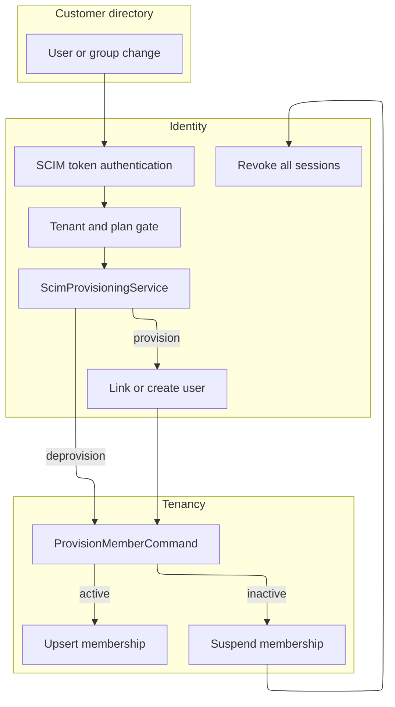

# SCIM 2.0 provisioning

SCIM 2.0 synchronizes a tenant's directory users and groups with Identity accounts and Tenancy memberships, allowing directory offboarding without account erasure.

## At a glance

| Responsibility | Main types / source |
|---|---|
| Tenant directories and directory resources | `ScimDirectory`, `ScimUser`, `ScimGroup`; `src/Modules/Identity/Identity/Domains/Scim/Models/ScimModels.cs` |
| Protocol and administration | `ScimModule`, `ScimDirectoriesModule`; `Domains/Scim/Features/` in Identity |
| Provisioning and protocol helpers | `ScimProvisioningService`, `ScimSupport.cs`; `src/Modules/Identity/Identity/Services/Scim/` |
| Credentials | `ScimAuthentication`; dedicated bearer-token scheme and policy |
| Membership and roles | Tenancy `ProvisionMemberCommand`; Identity `ITenantRoleGuard` validates role mappings |

The implementation covers RFC 7643/7644 users, groups and discovery for directory clients such as Entra ID,
Okta, Google Workspace and JumpCloud. Directory rows are control-plane records explicitly scoped by `TenantId`;
users and groups are scoped by directory; tables use the `identity.scim_*` names. [Identity](README.md) owns global accounts, not tenant memberships.

## How it works


*Figure: Directory operations cross into Tenancy through its provisioning contract; deprovisioning retains the account and revokes its sessions.*

### Protocol surface (`/scim/v2`)

| Resource | Operations |
|---|---|
| `ServiceProviderConfig`, `ResourceTypes`, `Schemas` | GET (advertise exactly what is implemented: PATCH and filter; ETag support, bulk, sort and password change are false) |
| `Users` | GET (filter, `startIndex`, `count` ≤ 200), GET by id, POST, PUT, PATCH, DELETE |
| `Groups` | GET (filter, `excludedAttributes=members`), GET by id, POST, PUT, PATCH, DELETE |

User/group operations require `Identity:Sso:Enabled` and the tenant plan feature `sso` (403 otherwise). The three static discovery routes authenticate the directory token but do not run those operation gates.

Authentication: `Authorization: Bearer scim_…` through its **own** scheme and policy (`ScimAuthentication`): a SCIM
token authenticates nothing else, and a JWT or API key never reaches SCIM. User/group operations run in the directory's tenant scope. Responses are `application/scim+json`; authentication challenges and operation failures handled by `ScimModule.Run` use SCIM's error schema (`status`, `scimType`, `detail`). Malformed bodies are parsed before that wrapper and can escape to the host error handler.

Filters use `attr eq "value"` joined by `and`. Users accept `userName`, `externalId`, `id`,
`emails.value` and the normalized `emails[type eq "work"].value` form. Groups accept `displayName`,
`externalId` and `id`. Unsupported filters return 400 `invalidFilter`, never an unfiltered result.
List pagination starts at 1, defaults to 100 results and caps `count` at 200; `startIndex` is not capped at 200.

### Semantics

| Situation | Behaviour |
|---|---|
| POST user | `userName` and `externalId` unique per directory (409 `uniqueness`, also unique indexes for concurrent retries). Email must be on a verified domain of the tenant (400 `invalidValue`). Existing account with that email → linked; else created (email confirmed, no password). Membership created via Tenancy `ProvisionMemberCommand` (seat limit `MaxUsers` applies). |
| `active: false` (PATCH/PUT) and DELETE | Membership **suspended** in this tenant and **every session revoked** immediately. The account and membership are retained. DELETE removes the SCIM resource and group references (204; later GET returns 404). Account erasure is a separate explicit flow. |
| PATCH | Op names any case; path-less `replace` with an object (Okta); `"active": "False"` strings and `name.givenName` paths (Entra). Enterprise paths (`urn:ietf:params:scim:schemas:extension:enterprise:2.0:User:department`, `...:manager`, `manager.value`, or a path-less object keyed by the extension URN). A bare attribute name that is not an attribute of the User schema, or an unknown attribute of the enterprise extension, is a 400 `invalidPath` (RFC 7644 section 3.5.2), never silently ignored. Attributes of RFC 7643 that this server does not store (phone numbers, addresses, `title`, ...) are known, and a path inside any OTHER schema URN (a custom extension an IdP maps) is accepted and ignored: Entra and Okta send them whenever an admin maps them, and rejecting them would fail the whole sync. `remove` without a path is 400 `noTarget`. |
| Enterprise extension | `employeeNumber`, `costCenter`, `organization`, `division`, `department`, `manager` are stored per directory user and returned under the extension URN (which is then listed in `schemas`). `manager.value` is the SCIM id of another user of the SAME directory; an unknown manager is dropped (IdPs often send it before the manager exists). POST/PUT read the extension from the body (unknown attributes in a body are ignored; PUT replaces the whole resource, so a body without the enterprise object clears it, RFC 7644 section 3.5.1); an empty value or `remove` clears an attribute. The manager is returned with `displayName` and omitted once the referenced user no longer exists. Discovery lists it in `Schemas` and `ResourceTypes.schemaExtensions`. |
| Groups | Only users of the same directory are retained as members; unknown ids are dropped. `add`/`remove` are incremental, including `members[value eq "<id>"]`. |
| Roles | Unmapped directory: roles are managed in the app and never touched. While any group is mapped, the directory **owns** roles: a user's roles = mapped roles of their groups (re-applied on every membership or mapping change). A mapping must name a role of the tenant (`ITenantRoleGuard` queries Tenancy contracts; admin API returns 400 `tenant_role_not_found`). |
| Owner | A directory never suspends the tenant owner (break-glass). |
| Isolation | A directory sees only its own resources (another directory's ids answer 404). |
| Concurrency | Users and groups carry a revision (concurrency token). Parallel PATCHes from the IdP are retried on fresh data (3 attempts), before surfacing an unresolved conflict. `meta.version` is a weak ETag; `If-Match` is not evaluated (advertised `etag.supported=false`). |
| Sessions | Deactivation revokes **all** sessions of the account (security first), not only those of this tenant. |

Membership upserts are idempotent in Tenancy, but the overall SCIM request is not an atomic cross-module transaction.
Identity saves the directory resource before calling Tenancy and revoking sessions. A failure after that save can
leave partial progress; a duplicate POST receives a uniqueness conflict rather than replaying the original result.

## Configuration

SCIM has no separate options class. It shares SSO availability and public URL configuration;
see [SSO configuration](Enterprise-SSO.md#configuration) for the remaining settings.

| Key | Default | Meaning |
|---|---|---|
| `Identity:Sso:Enabled` | `true` | Platform gate on user/group operations |
| `Identity:Sso:PublicBaseUrl` | Base settings empty; options null | Public base for directory URLs; request-host fallback is development-only |

The directory's enabled flag and token are persisted settings, not appsettings keys. At most five directories
may be created per tenant. Tokens have format `scim_<prefix>_<secret>`; only a SHA-256 hash is stored.
Creation and rotation return the token once. Rotation invalidates the old token immediately; a disabled directory
cannot authenticate. SCIM tokens authenticate no other routes, and JWTs/API keys do not authenticate SCIM.

## Usage

### Setup

1. Verify the company's email domain on an [SSO connection](Enterprise-SSO.md) (SCIM only provisions verified domains).
2. `POST /api/v1/tenant/scim/directories {name}` → **base URL** (`https://api.example.com/scim/v2`) and **token**
   (`scim_<prefix>_<secret>`, shown once; only a SHA-256 hash is stored).
3. Paste both into the IdP's provisioning app (Entra: *Provisioning → Tenant URL + Secret token*; Okta: *SCIM 2.0
   Bearer token*). Optionally map pushed groups to tenant roles.


### Directory administration

Prefix: `/api/v1/tenant/scim/directories`. Every route requires `tenant.sso.manage`, plan feature `sso`
and no API key; writes also prohibit impersonation.

| Method | Suffix | Purpose |
|---|---|---|
| GET / POST | Base route | List / create |
| POST | `/{id}/rotate-token` | Replace the bearer token |
| PUT | `/{id}/enabled` | Set enabled state; optional `version` |
| DELETE | `/{id}` | Delete the directory; accounts and memberships remain unchanged |
| GET | `/{id}/groups` | List pushed groups |
| PUT | `/{id}/groups/{groupId}/role` | Map or clear a tenant role |

Admin commands use `IScimDirectoryRepository`; the directory list counts users/groups in the same SQL query.
From `src/Modules/Identity/Identity/Services/Scim/ScimProvisioningService.cs`:

```csharp
await sender.Send(new ProvisionMemberCommand(userId, MemberProvisioningSource.Scim, Active: false), ct);
```

After that command succeeds, the service revokes all sessions. It never deletes the global account or membership.

## Failure modes and guarantees

| Condition | Response / guarantee |
|---|---|
| Missing, invalid, rotated or disabled-directory token | 401 SCIM authentication challenge |
| Tenant unavailable, platform disabled or plan lacks `sso` | 403 for user/group operations |
| Duplicate userName/externalId | 409 `scimType: uniqueness`; unique indexes also cover concurrent creates |
| Email domain unverified | 400 `scimType: invalidValue` |
| Unsupported filter / unknown User PATCH path / remove without path | 400 `invalidFilter` / `invalidPath` / `noTarget` |
| Another directory's resource id | 404 |
| Concurrent user/group PUT or PATCH | Up to three attempts with fresh tracked data; unresolved conflicts still fail |

Protocol `scimType` values differ from the shared API's `errorCode`. The directory administration API uses the
shared envelope; foreign role mappings return 400 `errorCode: tenant_role_not_found`.
Weak ETags are returned in `meta.version` and resource responses, but `If-Match` is not evaluated.
Deactivation is tenant membership suspension plus account-wide session revocation; the tenant owner cannot be suspended.

### Known limits

No `/Bulk`, no sorting, no `/Me`, no custom schema extensions beyond the enterprise one. Email changes from the
directory are not applied to existing accounts (the account email is a credential; change it in the app).

## Guardrails

`ScimE2ETests` (`src/Api.E2ETests/Identity/ScimE2ETests.cs`) covers Okta/Entra request forms, role mapping,
authorization and disabled directories. `ScimEnterpriseTests` covers enterprise extension and PATCH semantics;
`SsoPolicyTests` covers the role guard. `ProvisionMemberTests` in `Tenancy.IntegrationTests` checks idempotency,
seat limits and owner protection. `SsoTenantTests` covers cross-tenant SCIM isolation.
`ModuleBoundaryTests` and `AdminEndpointAuthorizationTests` enforce the module and authorization boundaries.

## Related

[Enterprise SSO](Enterprise-SSO.md), [Identity](README.md),
[Permissions, 2FA and audit](Permissions-2FA-and-Admin-Audit.md),
[Request lifecycle](../Architecture/Request-Lifecycle.md),
[ADR-0013](../Decisions/0013-enterprise-sso-and-scim.md);
Backlog reference: G15.
`/starterkit:add-feature`,
`/starterkit:add-permission`.
