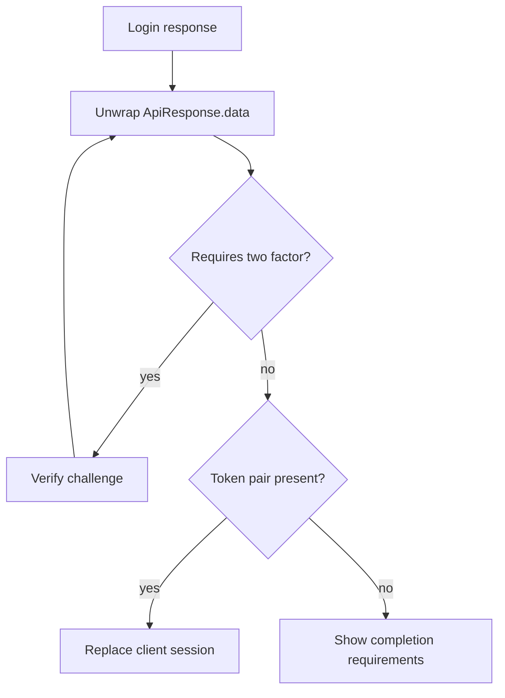

# JWT authentication: frontend session guide

Implement one client session layer that understands Identity's login results, rotates refresh tokens safely and clears authentication state consistently.

## Goal

Connect a browser or native client to the existing Bearer-token API. The backend returns tokens in JSON and accepts
refresh tokens in a JSON body; it does not provide an HttpOnly refresh-cookie or silent iframe endpoint.
[Frontend integration](../Frontend-Integration.md) owns SSO, passkeys, confirmation and reset screens.

## Prerequisites

- A running API reached over HTTPS, with the frontend origin permitted by CORS.
- A transport convention for [ApiResponse](../../Architecture/Errors-and-Responses.md).
- A client storage decision and one shared session manager for every sign-in method.
- Access to the [endpoint reference](../Users-and-Admins-API.md) and current Swagger/Scalar request schemas.

No client framework or Axios dependency is required. Fetch, Axios and framework services can implement the same
contract. The snippets below quote server contracts rather than presenting an unshipped client SDK.

## Steps

### 1. Choose storage and ownership

| Storage | Persistence | Constraint |
|---|---|---|
| Memory | Ends on reload/process exit | Lost refresh token requires a new login; active-page XSS can still access runtime credentials |
| sessionStorage | Survives reload in the tab | Script-readable; not a general shared-tab session store |
| localStorage | Survives browser restart; shared by origin | Script-readable and shared across tabs; requires cross-tab refresh coordination |
| Native secure storage | Platform-defined | Use the platform's credential store and lifecycle controls |

Neither browser storage API protects tokens from XSS. Use a restrictive content security policy, safe rendering,
dependency controls and HTTPS; do not log credentials or include them in telemetry. JWT payloads are readable,
not encrypted; decoding `exp` is scheduling advice, not signature validation.

A product can add a backend-for-frontend with protected cookies, but that is additional server work including its
own CSRF and cookie policy. Setting `credentials: include` on this API does not create a refresh-cookie contract.

Keep access token, refresh token, expiry and user state under one owner. Replace the pair together. Clear only
application-owned authentication data; do not call a whole-origin storage clear as a logout implementation.

### 2. Process login results

POST `/api/auth/login` with `identifier` (email or international phone number) and `password`.
The request is `LoginCommand` in `src/Modules/Identity/Identity.Contracts/Auth/Commands/LoginCommand.cs`:

```csharp
public record LoginCommand(
    string Identifier,  // Email OR Phone
    string Password
) : ICommand<LoginResult>;
```

Fetch's parsed body is the envelope; Axios's `response.data` is that envelope, so its payload is
`response.data.data` unless the application's transport already unwraps it.

The server's `LoginResult` can represent three states:

| Result | Client action |
|---|---|
| Non-null `accessToken`, `refreshToken`, `expiresAt` | Store the pair and user; enter signed-in state |
| `requiresTwoFactor: true` | Keep the challenge temporarily; send `challengeToken` and `code` or `recoveryCode` to `/api/auth/2fa/verify` |
| No tokens, no challenge | Partial login; display the completion requirements using user flags and message |

A 200 status alone does not prove authentication. Challenge tokens are not access tokens: never install them in the
Authorization header. The [MFA guide](../Permissions-2FA-and-Admin-Audit.md) owns challenge lifetimes,
enrollment and recovery-code behavior. Social callbacks, SSO exchange and passkey assertion feed the same result handling.


*Figure: Only a result containing a token pair establishes the client session.*

### 3. Authorize requests and protect screens

Send `Authorization: Bearer <accessToken>` on authenticated REST calls. Use the current pair after any pending
refresh completes. Never send refresh tokens as Bearer credentials. Query-string access tokens are accepted only
for the hub transport described in the [technical guide](JWT-AUTH-TECHNICAL-GUIDE.md#bearer-events-and-hub-query-tokens).

React route wrappers, Vue navigation guards and Angular guards should consult shared session state and wait for
session restoration before rendering protected screens. Cached user data or the presence of a string token alone
does not prove that the server will authorize the call. Use the login/profile permissions for UI affordances;
the API remains authoritative.

For tenant-aware screens, use [Multi-tenancy](../../MultiTenancy/Overview.md). Replace session tokens when switching
tenant and clear cached data tied to the old tenant. Do not infer membership permissions from platform JWT roles.

### 4. Rotate through one coordinator

POST `/api/auth/refresh` with the current `refreshToken`. The successful payload is defined in
`src/Modules/Identity/Identity.Contracts/Auth/Commands/RefreshTokenCommand.cs`:

```csharp
public record RefreshTokenResult(
    string AccessToken,
    string RefreshToken,
    DateTime ExpiresAt,
    string Message = "Token refreshed successfully"
);
```

Replace both tokens and expiry before releasing waiting requests. Never keep using the old refresh token.
Choose timing with [Token refresh strategies](TokenRefreshStrategies.md); that page owns proactive/reactive
scheduling and cross-tab coordination.

Exclude login, refresh, MFA verification and other anonymous credential flows from the authenticated request
retry interceptor. Permit at most one refresh-related retry of an eligible protected request. A 403 permission
failure is not a token-expiry signal.

Refresh has no retry grace period or idempotency key. On a network timeout, the server may already have rotated;
do not blindly replay the same refresh body. Stop dependent requests and recover by a new login if the new pair
cannot be recovered from the shared client coordinator.

### 5. End and replace sessions

POST `/api/auth/logout` with the current Bearer token and optional `refreshToken`; set
`logoutAllDevices: true` to end all sessions. The contract from
`src/Modules/Identity/Identity.Contracts/Auth/Commands/LogoutCommand.cs` is:

```csharp
public record LogoutCommand(
    string? RefreshToken = null,
    bool LogoutAllDevices = false
) : ICommand<LogoutResult>;
```

Stop timers, reject pending refresh waiters, clear owned authentication state, close live connections and navigate
to sign-in even if the logout request fails. Local cleanup does not prove server revocation succeeded.
Use a session generation/cancellation mechanism so an in-flight refresh cannot restore credentials after logout.

Password changes and 2FA enable/disable can return replacement sessions while revoking old ones. Install the
replacement through the same session manager, not a second store. Device revocation screens use
[session endpoints](../Users-and-Admins-API.md#sessions-devices); signing out the current device must clear local state.

### 6. Handle failures by meaning

| Response | Action |
|---|---|
| Login 401 | Show generic invalid-credential feedback; do not refresh |
| Protected request 401 | Consult the refresh coordinator once; persistent 401 requires sign-in |
| Refresh 401 | Discard the pair and sign in again |
| 403 plus `X-Auth-Error: mfa_required` | Complete MFA/enrollment; this is not an expired token |
| Other 403 | Surface authorization or provider-policy guidance; do not loop refresh |
| 400 | Show validation feedback from the envelope |
| 409 | Resolve conflicting state or reload the current version; do not blindly overwrite |
| 429 | Respect retry guidance; avoid retry storms |
| Network error or 5xx | Show a recoverable transport/server failure; an unknown refresh outcome needs special handling |

Error boundaries can render unexpected UI failures, but they do not replace transport error handling. Avoid a
second global interceptor that retries operations the session manager already handled.

## Verify

Exercise the client against the real API:

1. Login by email and phone; test invalid credentials and account lockout without account-enumeration feedback.
2. Test MFA challenge, recovery code, partial login, SSO and passkey success through the same session layer.
3. Expire an access token; issue several requests and confirm only one refresh is sent per session.
4. Repeat with multiple tabs and after sleep/resume; no tab may replay a pair another tab has replaced.
5. Replay an old refresh token in an isolated test account and verify subsequent family refresh fails.
6. Logout one device and all devices; test a late refresh response cannot sign the client back in.
7. Test offline/timeout behavior, 403, 429, CORS denial and storage unavailability.
8. Inspect headers and telemetry for accidental tokens; verify application logout preserves unrelated origin data.

Backend coverage includes `AuthSessionServiceTests`, `LoginHandlerTests`, `SessionManagementTests` and
`HubTokenTests`. Product-specific React/Vue/Angular guards and storage coordination need their own client checks.

## Pitfalls

- Posting `email` instead of `identifier` does not match the login contract.
- Reading tokens from the top-level HTTP body misses the `data` envelope.
- Storing a null pair from a partial login or MFA challenge destroys valid client state.
- Refreshing independently in each interceptor, tab or live-connection callback can revoke the family through reuse.
- Timers do not run reliably while suspended; always re-evaluate expiry when work resumes.
- A failed logout request leaves server state uncertain even after local credentials are cleared.
- CORS configuration, secure origin requirements and missing Authorization headers are separate from token validity.

## Related

[Frontend integration](../Frontend-Integration.md), [Token refresh strategies](TokenRefreshStrategies.md),
[JWT server lifecycle](JWT-AUTH-TECHNICAL-GUIDE.md),
[Errors and responses](../../Architecture/Errors-and-Responses.md),
[ADR-0014](../../Decisions/0014-passkeys-on-built-in-identity.md);
`/starterkit:add-feature`, `/starterkit:write-tests`.
