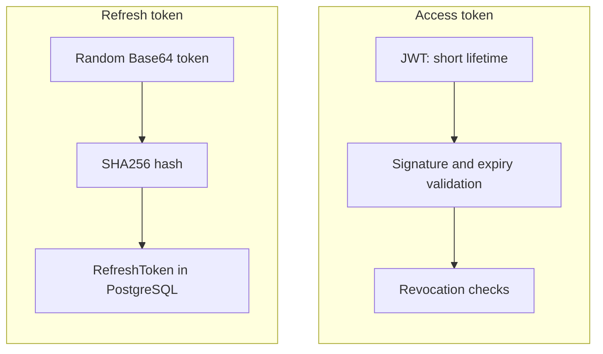
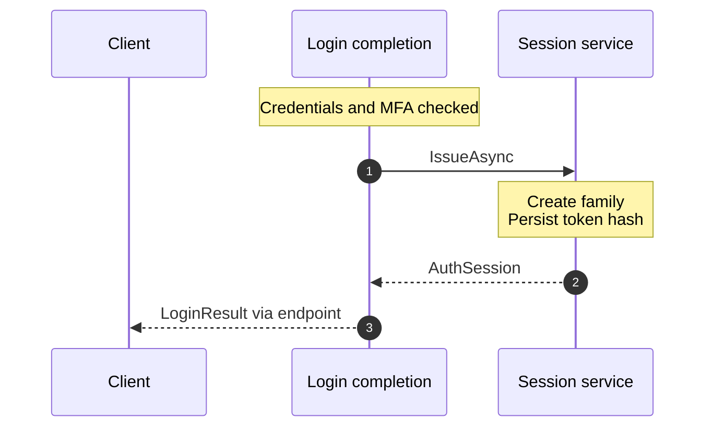
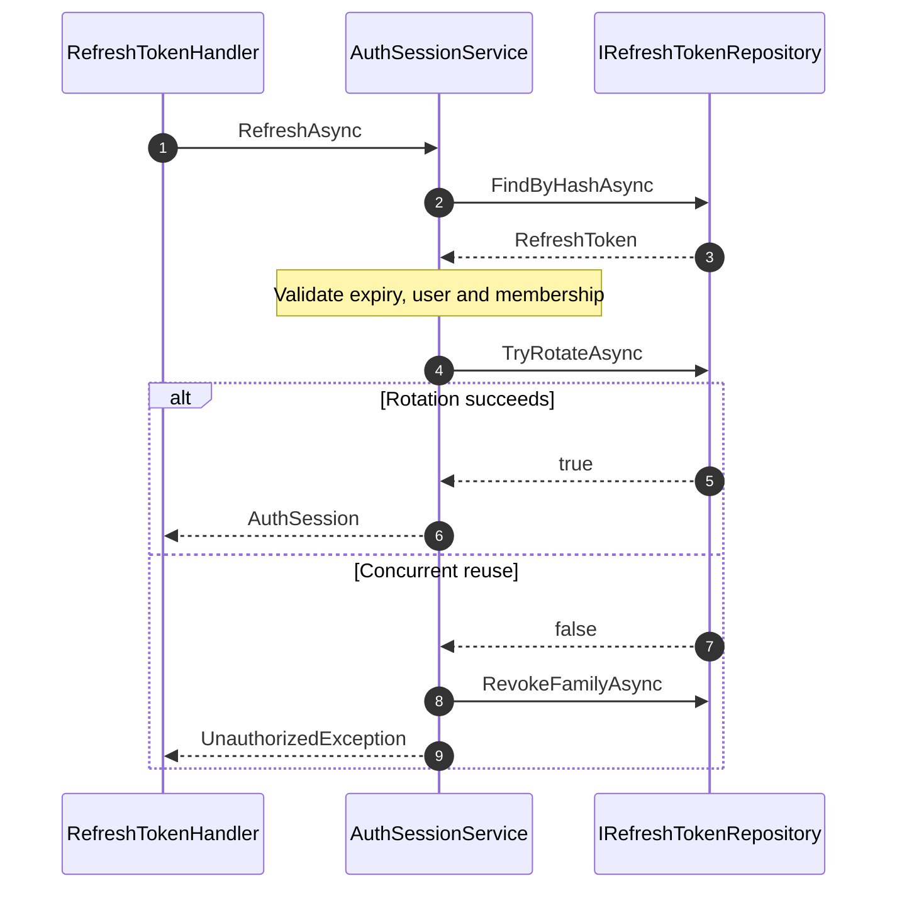
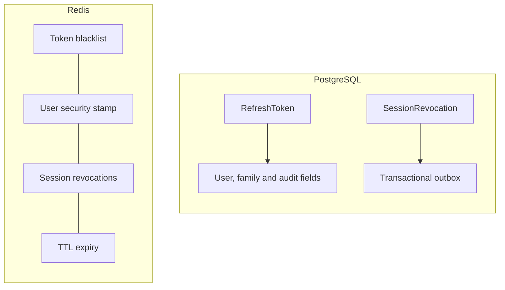
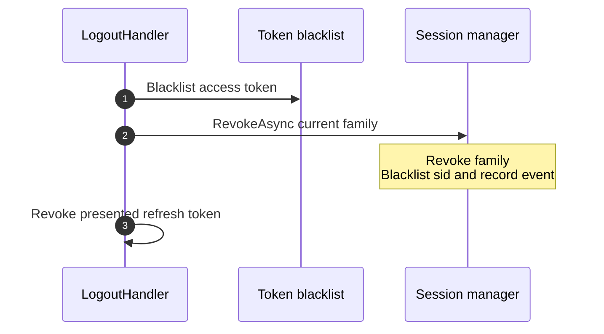
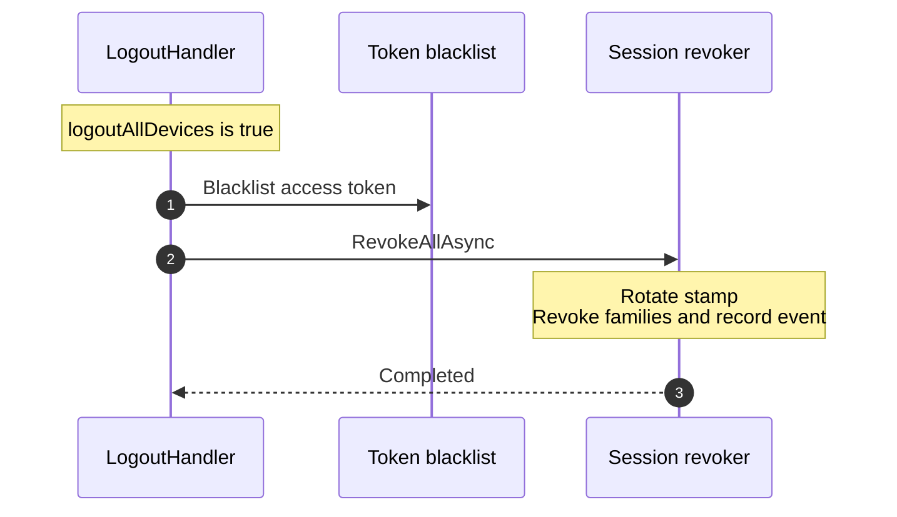

# JWT authentication: server lifecycle

Identity issues short-lived access tokens and rotating refresh tokens so sessions can continue without re-entering credentials while remaining revocable.

## At a glance

| Concern | Implementation under `src/Modules/Identity/Identity/` |
|---|---|
| Issue and rotate sessions | `Services/Sessions/AuthSessionService.cs`, through `IAuthSessionService` |
| Sign access tokens | `Services/Token/JwtTokenGenerator.cs`, `JwtSigningKeys.cs` |
| Persist refresh tokens | `Models/RefreshToken.cs`, `Data/Repository/RefreshTokens/RefreshTokenRepository.cs` |
| Validate access-token revocation | `Services/Token/TokenBlacklistJwtBearerEvents.cs`, `TokenBlacklistService.cs` |
| End one or all sessions | `Services/Sessions/SessionManager.cs`, `SessionRevoker.cs` |
| Remove expired records | `Infrastructure/BackgroundJobs/RefreshTokenCleanupJob.cs` |

[Identity](../README.md) owns authentication schemes and API keys.
[Permissions and 2FA](../Permissions-2FA-and-Admin-Audit.md) owns role grants and MFA.
[Request lifecycle](../../Architecture/Request-Lifecycle.md) owns pipeline ordering.

## How it works

### Access and refresh tokens


*Figure: Access tokens authorize requests while persisted refresh-token hashes support session rotation.*

Access tokens use HS256. Validation always checks issuer, audience, signature, expiry and algorithm; clock skew
is zero. The legacy `Validate*` entries in appsettings are not switches: `IdentityModule` sets validation to true.

`JwtTokenGenerator` generates refresh tokens from 64 random bytes, encodes them as Base64, returns the raw value
once and persists only its SHA-256 hash. Refresh tokens are opaque credentials, not JWTs.

Access claims include `sub`, `jti`, `iat`, contact/profile flags, `full_name`, `must_change_password`, roles and
`sstamp` (security-stamp hash). Normal sessions carry `sid` (family id); MFA sessions carry `amr=otp` and
`amr=mfa`. Tenant sessions add `tid` and `tms`. Impersonation adds `act` and overrides expiry, with no refresh
token. Role-derived permissions are not added at issuance. Stored user claims are merged, de-duplicating
(type, value) pairs; this is not an instruction to store permission claims.

### Initial sign-in


*Figure: Successful sign-in creates a refresh-token family after credential and MFA checks.*

### Rotation and reuse detection

1. `RefreshAsync` hashes the submitted token and loads its row.
2. Unknown or expired tokens fail with 401. A previously revoked token triggers family revocation before the same 401.
3. The service rejects missing, inactive or locked users and mismatched security stamps, revoking that family.
4. It revalidates the tenant membership. If no longer usable, the replacement session is tenant-less; see
   [tenant sessions](../../MultiTenancy/Overview.md#sessions).
5. It creates a replacement with the same `FamilyId`, MFA state and user-agent information, current roles, and
   fresh configured access/refresh expiries.
6. `TryRotateAsync` atomically revokes the old row and inserts the replacement. A concurrent loser is treated as
   reuse and revokes the family.


*Figure: Rotation has one winner; a competing refresh is reuse rather than an idempotent retry.*

Each rotation gets a new refresh expiry; this is a sliding lifetime, not a fixed absolute family lifetime.
A replay revokes the refresh family and records a session-revocation event for live connections. This path does
not itself call `BlacklistSessionAsync`: do not promise immediate rejection of every already-issued HTTP access
token on refresh reuse. Explicit session revocation uses the blacklist as described below.

### Storage and revocation


*Figure: PostgreSQL records refresh sessions and revocation events while Redis accelerates access-token revocation checks.*

`RefreshTokenConfiguration` maps `identity.refresh_tokens`: user, token hash, family, security-stamp hash,
MFA state, tenant, creation/expiry/revocation timestamps, IP, device name, user agent and last use.
The token hash is unique; user, expiry, family and user/revocation indexes support lookup, cleanup and session lists.
Revoked but unexpired rows remain available for reuse detection. `ReplacedByTokenId` records the replacement id on rotation; the family groups descendants for revocation.
The mapping does not configure a self-referencing foreign key for that id.

`TokenBlacklistService` uses `IDistributedCache`, normally Redis:

| Key suffix (before the cache instance prefix) | Value / expiry |
|---|---|
| `token:blacklist:<token hash>` | Revoked marker until the token's expiry |
| `user:stamp:<user id>` | Current stamp hash; tokens with another or missing stamp fail |
| `session:revoked:<family id in N format>` | Revoked marker for the session |

`SessionManager` revokes one family, or all except the current family, then blacklists each ended `sid` for
`AccessTokenExpirationMinutes + 1` minutes. Unknown, foreign and already-ended session ids are indistinguishable.
`SessionRevoker` rotates the security stamp, revokes all refresh tokens and caches the new stamp for the same duration.
Role changes, credential changes and administrative account restrictions use this all-session path.

Logout ends the caller's family, blacklists the presented access token and revokes the presented refresh token.
`logoutAllDevices: true` invokes all-session revocation. No refresh-token blacklist exists in Redis: PostgreSQL
is authoritative for refresh validity.

`SessionRevocationRecorder` publishes `UserSessionsRevokedIntegrationEvent` via a tombstone and outbox row.
Inside a transaction these commit with the caller; outside one, a separate unit of work records the event and logs
recording failures. Notification closes sockets across replicas; see
[real-time notifications](../../Modules/Notification-Realtime-and-Push.md). Do not equate eventual outbox delivery
with synchronous acknowledgement from every connected client.

### Logout flows


*Figure: Logout revokes the current session as well as the presented tokens.*


*Figure: Logout-all ends every session belonging to the authenticated user.*

The initial per-token blacklist write in `LogoutHandler` is not caught there. If it fails, logout can fail before
family revocation; clients must distinguish local cleanup from confirmed server logout.

### Bearer events and hub query tokens

`TokenBlacklistJwtBearerEvents.MessageReceived` accepts `access_token` only under `RealtimePaths.HubPrefix`
(`/hubs`), and only when no Authorization header is present. REST endpoints do not authenticate from query tokens.
`TokenValidated` checks the compact token actually validated, whether it came from a header or the hub query:

1. Per-token blacklist.
2. Session revocation (`sid`, with `ClaimTypes.Sid` fallback).
3. User-stamp revocation (`sstamp`).

This prevents hub query authentication from bypassing revocation. Never put access or refresh tokens in ordinary
navigation URLs; SSO uses a separate one-time exchange code.

### Cleanup and capacity

`IdentityJobSchedulerBootstrap` registers `cleanup-expired-refresh-tokens` with `Cron.Daily(2)`.
`RefreshTokenCleanupJob` deletes expired tokens using set-based batches of 1,000 and purges session-revocation
rows older than seven days. It does not load every expired entity into memory or delete unexpired revoked tokens.

Storage grows with logins and rotations, not merely daily active users: every rotation inserts a row. Measure
database size, cleanup time and cache latency in the target deployment; the repository does not establish the
old guide's throughput or sub-millisecond latency guarantees.

## Configuration

Defaults from `src/Api/appsettings.json`, `appsettings.Docker.json` and
`src/Modules/Identity/Identity/Options/JwtOptions.cs`:

| Key | Default | Meaning |
|---|---|---|
| `JwtSettings:SecretKey` | `CHANGE_ME_TO_A_RANDOM_SECRET_OF_AT_LEAST_32_CHARS` in base config | Replace with a random secret; minimum 32 UTF-8 bytes |
| `JwtSettings:PreviousSecretKeys` | `[]` | Validation-only former signing keys, each at least 32 bytes |
| `JwtSettings:Issuer` | `StarterKitAPI` | Required issuer |
| `JwtSettings:Audience` | `StarterKitClient` | Required audience |
| `JwtSettings:AccessTokenExpirationMinutes` | Base `30`; Docker `15`; options fallback `60` | Access lifetime; must be positive |
| `JwtSettings:RefreshTokenExpirationDays` | `7` | Lifetime of each newly issued refresh token; must be positive |
| `JwtSettings:RequireHttpsMetadata` | Base `false`; options fallback `true` | Bearer metadata setting; not a replacement for transport TLS |
| `Redis:Enabled` | `true` | Distributed revocation cache |
| `Redis:InstanceName` | `StarterKit:` | Cache key prefix |

Production rejects placeholder signing keys through `ProductionConfigurationGuard`. Configure Redis using
[Redis infrastructure](../../Infrastructure/Redis.md).

### Signing key rotation

New tokens use `SecretKey` and a `kid` fingerprint: the first eight SHA-256 bytes of the key, hex encoded.
Validation accepts the current key and `PreviousSecretKeys`.

1. Move the old secret to `PreviousSecretKeys` (environment variable `JwtSettings__PreviousSecretKeys__0`) and set
   the new `SecretKey`.
2. Deploy consistently across instances, ensuring validators accept keys used by every still-running issuer.
3. Remove the old key after every token it signed has expired. Consider the lifetime used before the rotation.

Removing a key immediately rejects its remaining access tokens. Opaque refresh tokens are unaffected.
Derived 2FA challenge keys change, so in-flight challenges must restart. The attachment signing fallback also changes;
set `Attachment:Download:SigningKey` explicitly to decouple download links. Keep Data Protection key-ring encryption
separate; see [governance](../Permissions-2FA-and-Admin-Audit.md#configuration).

## Usage

From `src/Modules/Identity/Identity/Services/Token/JwtTokenGenerator.cs`:

```csharp
public string GenerateRefreshToken() => Convert.ToBase64String(RandomNumberGenerator.GetBytes(64));
```

Call the session service from Identity workflows rather than creating refresh rows in endpoints.
Client request/response contracts belong to the [JWT frontend guide](JWT-AUTH-FRONTEND-GUIDE.md);
the complete route inventory is in [Users and admins API](../Users-and-Admins-API.md).

## Failure modes and guarantees

| Condition | Result / limit |
|---|---|
| Unknown, expired, revoked or raced refresh token | 401, `Invalid or expired refresh token.`; no dedicated `errorCode` is assigned by this service |
| Inactive, locked, deleted user or changed stamp on refresh | Family revoked, same 401 |
| Invalid signature, issuer, audience, algorithm or expired access token | 401, independent of cache health |
| Blacklisted token, session or mismatched cached stamp | Authentication fails with 401 |
| Cache read failure | Logged; revocation checks fail open, signature and lifetime still apply |
| Session/user blacklist write failure | Logged by session services; database revocation remains authoritative |
| Refresh response lost after commit | Old token may already be consumed; no retry grace window or idempotent replay response |

Serialize refresh per session, including across tabs. A refresh timeout is an ambiguous outcome, not permission
to resubmit the old token. Plain 403 is not a refresh signal. See
[Errors and responses](../../Architecture/Errors-and-Responses.md) and [client strategies](TokenRefreshStrategies.md).

## Guardrails

`AuthSessionServiceTests`, `SessionRevocationTests`, `SessionManagementTests`, `TokenClaimsTests`,
`JwtKeyRotationTests`, `HubTokenTests` and `SessionRevocationCheckerTests` cover rotation, claims,
revocation and hub transport. Integration coverage lives beside Identity in `Identity.IntegrationTests`.

## Related

[Identity](../README.md), [JWT frontend guide](JWT-AUTH-FRONTEND-GUIDE.md),
[Token refresh strategies](TokenRefreshStrategies.md), [Messaging](../../Architecture/Messaging.md),
[ADR-0007](../../Decisions/0007-owned-mediator-port.md); `/starterkit:add-feature`, `/starterkit:write-tests`.
