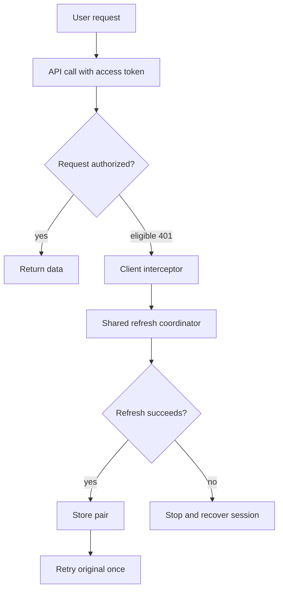
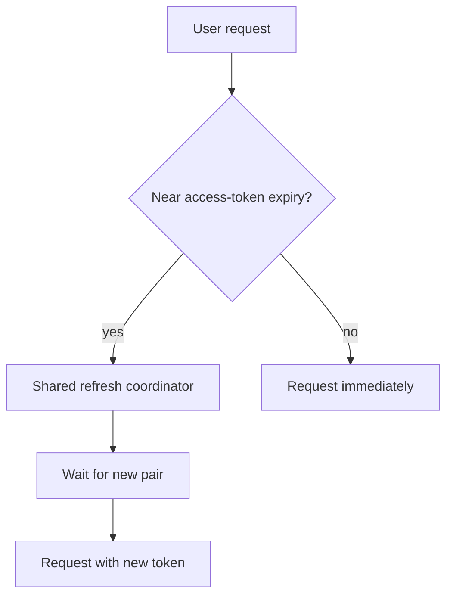
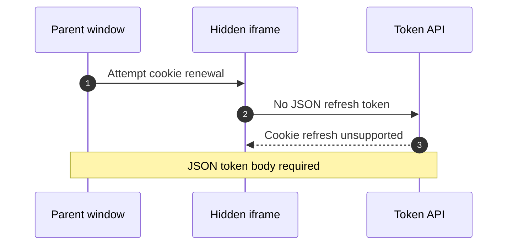
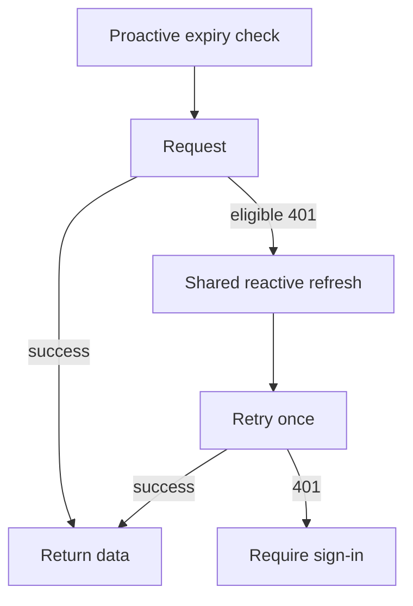
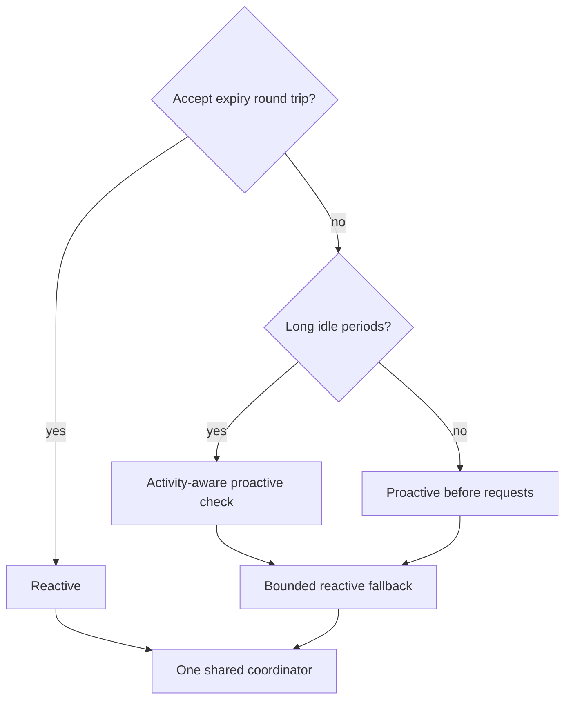

# Client token refresh strategies

Choose when the client rotates a session's refresh token while ensuring all requests share one refresh operation.

## At a glance

| Strategy | Trigger | Tradeoff |
|---|---|---|
| Reactive | Eligible protected request receives 401 | Less idle work; first expired request pays a failed round trip |
| Proactive | Access expiry approaches before useful work | Fewer expiry failures; clock and suspension handling still needed |
| Activity-aware | Useful user activity plus near expiry | Avoids idle renewal; needs a resume path |
| Hybrid | Proactive check plus bounded reactive fallback | More coordination, but handles missed expiry checks |
| Hidden iframe / cookie refresh | Requires a different server contract | Not supported by this backend |

This is client policy, not server configuration. The server exposes JSON
`POST /api/auth/refresh`; [JWT frontend guide](JWT-AUTH-FRONTEND-GUIDE.md) owns storage, envelopes and request contracts.
[JWT server lifecycle](JWT-AUTH-TECHNICAL-GUIDE.md) owns rotation and family revocation.

## How it works

### Strategy 1: Reactive refresh (401 response)

Make an authenticated request, then refresh once if the failure is an eligible 401 and the client still has a
refresh token. Exclude login, refresh and second-factor endpoints. Retry the original request at most once after
installing the new pair; a second 401 requires sign-in.


*Figure: Reactive refresh retries an eligible request once after successful token rotation.*

Reactive refresh suits low-activity clients that can accept the extra round trip. It cannot assume every 401 means
expiry: revoked sessions and account restrictions also fail authentication. Do not replay an application operation
after an ambiguous network failure merely because it can be retried after a definite authentication rejection.

### Strategy 2: Proactive refresh (before expiration)

Before a protected request, compare the returned `expiresAt` or decoded JWT `exp` with the client clock.
Use a chosen safety margin; two minutes is a client example, not a backend requirement. Derive it from the actual
token lifetime and latency budget rather than hard-coding a fifteen-minute schedule.


*Figure: Proactive refresh checks token expiry before issuing useful work.*

This reduces expired-token calls but cannot prevent revocation failures or all clock races. Timers can be
throttled while a tab is hidden or a device sleeps. Re-evaluate on foreground/resume and before requests.
Decoding a token does not authenticate it.

### Strategy 3: Silent refresh with hidden iframe

The previous cookie/iframe recommendation does not apply to this API. The refresh endpoint binds a
`RefreshTokenCommand` JSON body; it does not read a refresh cookie, return `Set-Cookie` or serve a refresh page.


*Figure: An iframe cannot supply a cookie-refresh contract that the token API does not implement.*

A backend-for-frontend or external provider may offer another contract, but adding it requires a separate design
for cookies, CSRF, origins and browser restrictions. Do not point an iframe at an invented refresh endpoint or
expect `postMessage` to replace the API's required credential.

### Strategy 4: Refresh on user activity

Track meaningful activity or app foregrounding, then invoke the same near-expiry check used by proactive refresh.
Debounce activity events and avoid permanent mouse/scroll loops if ordinary API requests already indicate activity.
An idle client can stop scheduling renewals; resume must still handle access expiry and refresh expiry.

This can reduce background network and battery use. It does not impose a server-side idle-session timeout:
refresh lifetime is renewed on successful rotation, and the server has no activity signal from local UI events.
Do not advertise client inactivity as a server security guarantee.

### Strategy 5: Hybrid approach

Use proactive refresh before useful work and a single reactive fallback for an eligible 401. Both paths must share
the same coordinator; two independent implementations recreate the concurrent-reuse problem.


*Figure: Hybrid refresh combines an expiry check with a bounded retry on unauthorized responses.*

Hybrid is a reasonable default for interactive clients with frequent requests. Reactive-only can be sufficient
for less active applications. Neither approach guarantees zero failed requests.

### Choosing a strategy


*Figure: Choose timing for the client workload; every supported strategy still needs one refresh coordinator.*

## Usage

The real request contract, from
`src/Modules/Identity/Identity.Contracts/Auth/Commands/RefreshTokenCommand.cs`:

```csharp
public record RefreshTokenCommand(
    string RefreshToken
) : ICommand<RefreshTokenResult>;
```

Implement this coordination algorithm in the product's transport layer:

1. If a newer session generation already exists, use that pair instead of refreshing an obsolete token.
2. If a refresh is in flight, await its result; do not send another refresh request.
3. Otherwise acquire exclusive ownership of the session's refresh operation, re-read the current pair and submit it once.
4. On success, store both replacement tokens and expiry together before releasing waiters.
5. On failure, reject every waiter and clear the in-flight state. Do not leave a queue waiting indefinitely.
6. Reject late results after logout, account switch or tenant/session replacement.

An in-memory promise coordinates one JavaScript runtime only. If tabs share persistent credentials, coordinate
ownership across tabs and propagate new pairs and logout. Re-read storage after obtaining ownership; a tab's cached
refresh token can already be obsolete. Multiple clients sharing one refresh token are not independent sessions.

Fetch wrappers and Axios interceptors should both follow these rules. Keep raw refresh transport outside the
authenticated interceptor to avoid recursion. Do not add a second retry queue with different ownership rules.

## Failure modes and guarantees

| Situation | Required client behavior |
|---|---|
| Concurrent refresh with the same token | Prevent it; the backend treats the loser as reuse and revokes the family |
| Timeout / connection loss during refresh | Treat the commit outcome as unknown; no automatic replay of the old token |
| Successful response, storage write fails | Stop using the old pair; recover explicitly rather than refreshing it again |
| 403 | Handle permission/MFA/SSO policy; never refresh as a universal remedy |
| 429 | Honor available retry guidance; do not fan out queued refresh requests |
| Tab resumes after sleep | Re-read current session and expiry before work |
| Logout races with refresh | Session generation invalidates the late result and wakes/rejects waiters |
| Refresh expires | New sign-in; there is no cookie fallback |

A normal request retry after a definite 401 is different from retrying a refresh whose response was lost.
The server provides no refresh grace window or idempotent replay result.

## Guardrails

`AuthSessionServiceTests` exercises server rotation and reuse handling; it does not test the client's coordinator.
Verify burst requests, concurrent tabs, sleeping tabs, storage failures, logout races, lost refresh responses and
second-401 termination in the product client. Confirm that no token is logged.

There is no backend configuration section for these strategies. Token lifetimes come from
[JWT configuration](JWT-AUTH-TECHNICAL-GUIDE.md#configuration); scheduling margins belong to the client.

## Related

[JWT frontend guide](JWT-AUTH-FRONTEND-GUIDE.md), [Frontend integration](../Frontend-Integration.md),
[JWT server lifecycle](JWT-AUTH-TECHNICAL-GUIDE.md),
[Errors and responses](../../Architecture/Errors-and-Responses.md); `/starterkit:write-tests`.
