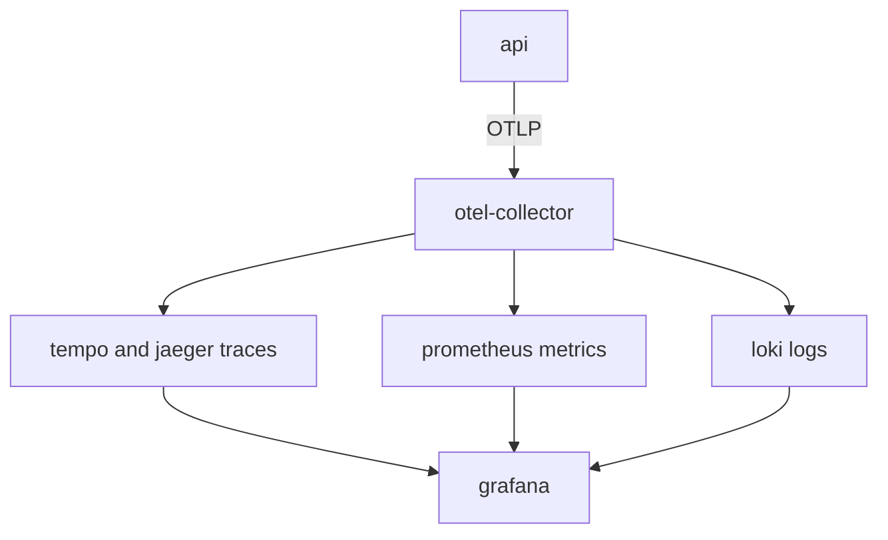

# .NET Aspire (local development)

`src/Aspire/AppHost` orchestrates local infrastructure and the API with a dashboard for resources, logs, traces and metrics.

```bash
cd src/Aspire/AppHost && dotnet run            # https profile; the login URL is printed in the console
```

Requires Docker. The first run pulls the images.
Production uses Docker Compose and `deployment/`, rather than running the AppHost.

## At a glance

| Resource | Purpose | Lifetime |
|---|---|---|
| `postgres` → database `starterkit` | All module DbContexts (`ConnectionStrings:starterkit`) | Persistent + data volume |
| `pgadmin` | PostgreSQL UI | Per session |
| `redis` | Distributed cache, OTP / TOTP stores (`ConnectionStrings:redis`, TLS) | Persistent + data volume |
| `redisinsight` | Redis UI ("Manage (Insights)" link) | Per session |
| `seq` | Log search (`ConnectionStrings:seq`) | Persistent + data volume |
| `api` | `src/Api` | Per session |
| `rabbitmq` | Only with `Messaging:Transport=RabbitMq` | Persistent + data volume |
| `clamav` | Only with `Attachment:ClamAv=true`: clamd for upload malware scanning | Persistent + signature volume |
| `postgres` → database `tenant-demo` | Only with `MultiTenancy:DedicatedSample=true`: database `starterkit_tenant_demo` for a dedicated tenant (`ConnectionStrings:tenant-demo`) | Persistent (same server) |

Persistent containers survive AppHost restarts. Their generated passwords are stored in the AppHost user secrets
(`dotnet user-secrets list --project src/Aspire/AppHost`). To start from scratch, remove the containers and volumes
in Docker.

The API **waits** for Postgres and Redis (readiness), not for Seq. Its dashboard health comes from `/health`, which
covers the process, Postgres and Redis. Seq is a log sink and has no health check: a Seq outage never marks the API
unhealthy.

## Configuration

Keys come from `src/Aspire/AppHost/AppHostSettings.cs` and `appsettings.json`.

| Setting | Default | Effect |
|---|---|---|
| `Observability:FullStack` | `false` | Adds the Grafana stack (below) |
| `Messaging:Transport` | `InMemory` | `InMemory` \| `PostgreSql` \| `RabbitMq` - passed to the API; `RabbitMq` adds the broker |
| `Postgres:HostPort` | *(random)* | Fixed host port for a desktop SQL client, e.g. `55432` |
| `MultiTenancy:DedicatedSample` | `false` | Turns multi-tenancy on in the API and adds a second database for a dedicated tenant. Create the tenant with `isolation: "Dedicated"` and `connectionSecretRef: "tenant-demo"` (`POST /api/v1/tenants` as a platform admin); provisioning migrates it ([Dedicated databases](../MultiTenancy/Isolation-and-Dedicated-Databases.md#connection-resolution-tenantconnectionstringresolver)) |
| `Attachment:ClamAv` | `false` | Adds clamd and turns upload scanning on in the API (`Scanner:Provider=ClamAv`). The API does not wait for it: uploads get 503 `malware_scanner_unavailable` until signatures are loaded (1-2 min) |

```bash
dotnet run -- Observability:FullStack=true Messaging:Transport=RabbitMq
# or: Observability__FullStack=true dotnet run
```

Invalid values (an unknown transport, a port out of range) stop the AppHost at startup with a clear message.

## How it works

### Telemetry

The API always exports logs, traces and metrics to the **Aspire dashboard**. Aspire injects the standard
`OTEL_EXPORTER_OTLP_*`, `OTEL_SERVICE_NAME` and `OTEL_RESOURCE_ATTRIBUTES` variables, and the API honours them
(`OtlpExporterPlan`), so telemetry is linked to the `api` resource.

`Observability:FullStack=true` adds the same topology as `docker-compose.observability.yml`, using the config files
in `infra/observability/configs`:


*Figure: The optional Aspire observability stack routes telemetry through the collector.*

The API then exports to the dashboard **and** the collector (`ObservabilityOptions:UseOTLPExporter`, endpoint wired
from the collector resource). Grafana's admin password is generated on first use and stored in the AppHost user
secrets (`Parameters:grafana-admin-password`). Every stack container has a health check, and the UIs (Grafana,
Jaeger, Prometheus) are linked from the dashboard.

## Guardrails

- **Random host ports by default.** Containers reach each other by resource name on the Aspire network.
  Aspire allocates host ports; `Postgres:HostPort` is the explicit opt-in exception for desktop SQL tools.
- **Every image is pinned.** Bump a tag deliberately in `ObservabilityStack.cs`, together with its config file.
  Aspire pins its own integrations. Redis Commander was replaced by Redis Insight because Aspire's Commander uses
  `:latest`.
- **Configs are mounted read-only**, and their files must exist (the AppHost fails fast otherwise).
- **The API gets its dependencies by reference** (`WithReference`), never by hard-coded host or port.

`AppHostModelTests` check the resource graph without Docker. `AppHostLiveTests` boot everything and require
`/health` = 200 (process + Postgres + Redis + MassTransit bus) on **each** message transport (`InMemory`,
`PostgreSql`, `RabbitMq`). On RabbitMQ they also check that the API's queues exist on the broker. They use random ports,
so they can run next to your own AppHost, but not while a debugger holds the API's DLLs. They run only with
`ASPIRE_LIVE_TESTS=1`:

```bash
dotnet test src/Aspire/AppHost.Tests/                        # model tests (no Docker)
ASPIRE_LIVE_TESTS=1 dotnet test src/Aspire/AppHost.Tests/    # + live boot (Docker)
```

## Usage

The resource-reference pattern from `src/Aspire/AppHost/AppHost.cs` is:

```csharp
var api = builder.AddProject<Projects.Api>("api")
    .WithReference(database).WaitFor(database)
    .WithReference(redis).WaitFor(redis)
```

The following Seq reference does not gate API startup. Use the dashboard's resource endpoints, not assumed
Compose ports. Persistent infrastructure survives AppHost restarts; removing a volume destroys its data.
The dedicated sample is a second database on the same server, not a separate production database service.

## Failure modes and guarantees

| Symptom | Cause / fix |
|---|---|
| A container exits immediately with `exec format error` | Corrupt local image layer. `docker image rm -f <image>`, `docker image prune -f`, then run again |
| All containers stop with exit code 255 at the same time | The Docker Desktop VM restarted. Restart Docker Desktop (or `wsl --shutdown`) and run again |
| API unhealthy, the `redis` check fails | Redis container not running. Check the `redis` resource logs |
| No API telemetry in the dashboard | Do not set `OTEL_EXPORTER_OTLP_ENDPOINT` yourself, and keep `UseGrafanaExporter=false` (the Grafana distro would export a second time) |

Unknown transports or invalid configured ports fail settings parsing. Missing mounted configuration fails the
optional-stack setup. The API does not wait for ClamAV signatures: uploads fail closed until scanning is available.
AppHost readiness covers registered checks and cannot certify every external provider or dedicated tenant database.
The optional collector uses the shared configuration, so its actual exporters/retention still need review in
[operations observability](../deployment/Observability.md).

## Related

[Developer observability](../Architecture/Observability.md), [operations observability](../deployment/Observability.md),
[Redis](Redis.md), [dedicated databases](../MultiTenancy/Isolation-and-Dedicated-Databases.md),
[production deployment](../deployment/README.md), and `/starterkit:write-tests`.
