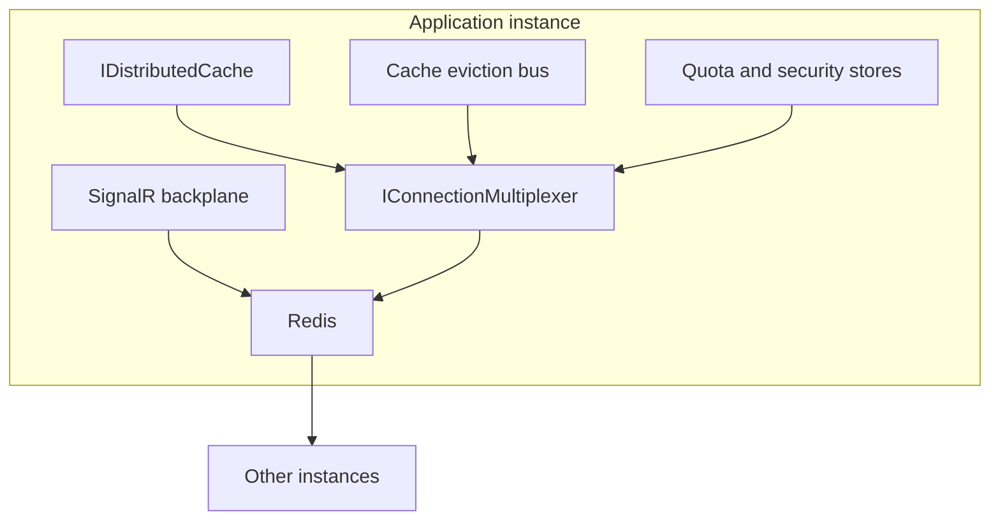

# Redis infrastructure

Redis provides shared cache state, revocation hints, coordination and real-time distribution across application instances.

## At a glance

| Use | Implementation / ownership | Failure behavior |
|---|---|---|
| Distributed JSON cache | `RedisExtensions`, `IDistributedCache`, Shared.Core | Helper reads become misses; writes/removals log and continue |
| Tenant cache keys | `ITenantCacheKeys`, `TenantCacheKeys` | Missing tenant throws; isolation never fails open |
| Token/user/session revocation | Identity `TokenBlacklistService` | Read checks fail open; writes can throw |
| OTP and TOTP coordination | Identity stores using `IConnectionMultiplexer` | Security-store semantics are separate from best-effort caching |
| SignalR backplane | Notification Redis backplane registration | Cross-instance sends can fail; durable inbox remains in PostgreSQL |
| Tenant/membership L1 eviction | `RedisLocalCacheInvalidationBus` | Pub/sub failures log; remote snapshots can remain until expiry |
| HTTP idempotency | Shared.Core idempotency store/filter | Redis outage fails open; not a durable exactly-once guarantee |
| Metered quotas | Subscriptions `RedisUsageCounterStore` | Counter-store errors fail open; durable snapshots are not every increment |

Redis is not the integration-event transport or the durable job store. Messaging/outbox and Hangfire use their
configured durable stores; see [Messaging](../Architecture/Messaging.md) and [DataTransfer](../Modules/DataTransfer.md).
The API's request rate limiter is not a Redis cluster-wide quota counter.

## How it works


*Figure: Shared cache and coordination consumers use Redis; the SignalR integration also distributes sends between instances.*

`AddRedisCache` registers one process-wide multiplexer shared by `IDistributedCache`, readiness and direct Redis
consumers. Inject it rather than opening a connection per operation. The SignalR library owns its backplane
integration; do not assume every integration shares that same connection internally.

### Connection resolution

`src/Shared/Shared.Core/Extensions/RedisConnectionConfiguration.cs` defines this order:

1. `ConnectionStrings:redis` supplies endpoint/password/TLS when present. Aspire injects it by reference; the
   Docker secrets provider builds it from `redis_password` and `REDIS_HOST`/`REDIS_PORT`.
2. Otherwise use `Redis:Host`/`Port`, with `REDIS_HOST`/`REDIS_PORT` overrides outside Development.
3. Without a connection string, Production (also the default when no environment is named) requires a nonempty
   secret at `Redis:PasswordSecretPath`. Other environments use `REDIS_PASSWORD`, then `Redis:Password`.
4. Client timeout and abort settings always come from the Redis options, including when a connection string wins.

`Redis:Enabled=false` registers in-process distributed-memory cache and no Redis multiplexer from this method.
That fallback is single-process, loses state on restart and does not provide a cross-instance backplane or pub/sub.
`AbortOnConnectFail=false` allows reconnecting in the background; readiness may still report Redis unhealthy.

### Key ownership and eviction

Tenant-derived entries use `ITenantCacheKeys.For(key)`, producing `t:{tenantId:N}:<key>` before the cache instance
prefix. A missing tenant raises `TenantNotResolvedException`. User-keyed revocation/OTP and platform-wide entries
retain their own keys. A prefix is a naming convention, not Redis ACL isolation; keep Redis private.

`TokenBlacklistService` hashes raw access tokens and stores `token:blacklist:` entries until token expiry,
`user:stamp:` snapshots for user revocation and `session:revoked:` entries for revoked sessions. JWT signature
and lifetime validation still apply if a cache read fails. Refresh-token/session state remains database-backed;
an outage can delay immediate rejection of already issued access tokens until their short expiry.

Tenant/membership snapshots have local and distributed lifetimes. Changes evict locally and broadcast remote
L1 evictions over `starterkit:tenancy:invalidate`. Pub/sub is not durable replay: missed invalidations leave stale
snapshots until expiration. Domain-event handlers explicitly invalidate business caches; Redis does not infer
database changes. Use bounded TTLs rather than unbounded entries.

### Persistence and operations

Base Compose runs `redis:7-alpine`, mounts `/data`, requires `secrets/redis_password.txt`, uses AOF with
`appendfsync everysec` and defaults to `allkeys-lru`. Memory pressure can evict revocation/idempotency/quota keys
as well as ordinary cache data; persistence is not a substitute for business constraints in PostgreSQL.
The service publishes `${REDIS_PORT:-6379}` without a loopback bind; `.env.example` uses host port 6380 to avoid
local conflicts. Containers still connect to `redis:6379`.

## Configuration

Defaults below are from `RedisOptions`; application base/Docker settings explicitly set `Host=redis`.

| Key | Default | Meaning |
|---|---|---|
| `Redis:Enabled` | `true` | Redis registration rather than process memory |
| `Redis:Host` / `Port` | `localhost` / `6379` | Fallback endpoint |
| `Redis:Password` | `null` | Non-production fallback password |
| `Redis:PasswordSecretPath` | `/run/secrets/redis_password` | Required Production fallback credential file |
| `Redis:InstanceName` | `StarterKit:` | Distributed-cache namespace |
| `Redis:AbortOnConnectFail` | `false` | Reconnect instead of aborting first connect |
| `Redis:ConnectTimeout` / `SyncTimeout` | `5000` / `5000` ms | Connection and sync/async operation timeouts |
| `Redis:UseSsl` / `Database` | `false` / `0` | Fallback TLS and logical database |
| `MultiTenancy:Cache:LocalSeconds` / `DistributedSeconds` | `30` / `600` | Snapshot L1/L2 lifetimes |
| `MultiTenancy:Cache:BroadcastInvalidation` | `true` | Broadcast local evictions when Redis exists |
| `MultiTenancy:Cache:InvalidationChannel` | `starterkit:tenancy:invalidate` | Pub/sub channel |
| `Realtime:UseRedisBackplane` | `true` in base settings | Notification cross-instance distribution when configured |

Compose additionally reads `REDIS_MAXMEMORY` (fallback `512mb`), `REDIS_MAXMEMORY_POLICY` (`allkeys-lru`),
`REDIS_MEMORY_LIMIT`, `REDIS_MEMORY_RESERVATION` and `REDIS_CPUS`. Configure authenticated TLS for network paths
that require it; the Docker-generated connection string explicitly sets `ssl=false` while Aspire supplies its
own connection-string TLS settings.

## Usage

The real read/miss behavior in `src/Shared/Shared.Core/Extensions/RedisExtensions.cs` is:

```csharp
var data = await cache.GetStringAsync(key, cancellationToken);
if (string.IsNullOrEmpty(data))
{
    return null;
}
```

`GetFromCacheAsync<T>`, `SetInCacheAsync<T>` and `RemoveFromCacheAsync` add logging/fallbacks; caller-requested
cancellation is rethrown. Direct `IDistributedCache` calls do not inherit those helper guarantees. Keep DTOs small,
choose explicit expiry, build tenant keys through the port and invalidate after committed domain changes.

Inspect `docker compose -f docker-compose.yml --env-file .env.prod logs redis`, readiness, memory, eviction counts,
latency and connected clients. Use authenticated Redis CLI inspection with secrets supplied privately; avoid
putting passwords in command history. Use incremental key scanning for investigations. `FLUSHALL` destroys
revocation, idempotency and quota state along with caches; do not use it as routine cache invalidation.

## Failure modes and guarantees

Availability behavior is consumer-specific. Cache helpers, blacklist reads, idempotency and quota consumption
fail open; tenant-key construction and security-store operations do not have a blanket fail-open guarantee.
Blacklist writes do not catch store errors. Redis-down requests can still be affected by readiness routing,
OTP/TOTP state or direct callers even when ordinary cache reads fall back to the database.

There is no guaranteed sub-millisecond latency or 100k-operations throughput for an arbitrary deployment.
Measure timeouts, memory, eviction and reconnect behavior under expected traffic. Redis Cluster/HA, Streams and
distributed rate limiting are not supplied by this single-service configuration. SignalR and pub/sub eviction
are current features, not future work.

## Guardrails

`RedisConnectionConfigurationTests` and `RedisCacheRegistrationTests` in `Shared.Core.Tests/Caching` cover
resolution, shared registration and fallback. `LocalCacheInvalidationTests`, `IdempotencyFilterTests`,
`IdempotencyStoreOwnershipTests` and `RequireQuotaTests` cover coordination behavior. Tenant isolation tests
also matter: Redis availability is never permission to use an unscoped tenant-data key.

## Related

[Aspire](Aspire.md), [secrets](../deployment/Secrets.md), [observability](../deployment/Observability.md),
[multi-tenancy](../MultiTenancy/Overview.md), [real-time and push](../Modules/Notification-Realtime-and-Push.md),
[DataTransfer](../Modules/DataTransfer.md), and `/starterkit:add-feature`.
